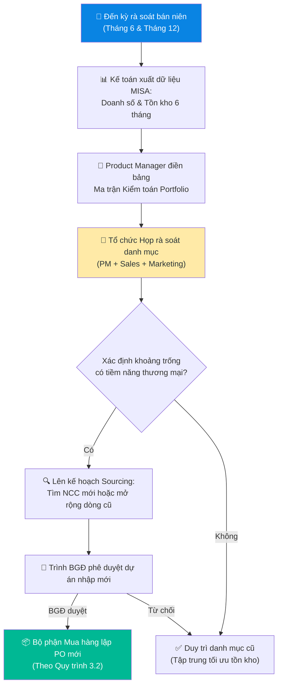

# 1.6 Quy trình Đánh giá & Kiểm toán Danh mục (Portfolio Audit)

## 1. Mục đích & Phạm vi
- **Mục đích:** Thiết lập cơ chế rà soát và đánh giá định kỳ danh mục sản phẩm (Portfolio) hiện có của Lyscellar. Đối chiếu với các xu hướng tiêu dùng và kiến thức chuẩn mực thế giới nhằm phát hiện các khoảng trống danh mục (Gaps), từ đó đưa ra định hướng nhập khẩu (Sourcing), đặt đơn hàng PO mới và phát triển sản phẩm hiệu quả.
- **Phạm vi:** Áp dụng đối với toàn bộ danh mục sản phẩm đang kinh doanh và các dự án sản phẩm mới tiềm năng tại Lyscellar.
- **Tần suất:** Thực hiện định kỳ bán niên (Vào tuần cuối cùng của Tháng 6 và Tháng 12 hàng năm).

## 2. Trách nhiệm (RACI)

| Nghiệp vụ | Responsible | Approve | Consulted | Informed |
|-----------|------------|---------|-----------|----------|
| Trích xuất số liệu bán hàng & tồn kho | Kế toán trưởng | Kế toán trưởng | Kế toán kho | Product Manager |
| Cập nhật Ma trận Kiểm toán (Audit Matrix) | Product Manager | — | Sales Director | — |
| Đánh giá Khoảng trống (Gap Analysis) | Product Manager | — | Sales, Marketing | BGĐ |
| Phê duyệt Kế hoạch Sourcing & PO mới | BGĐ | BGĐ | Kế toán, Logistics | Toàn bộ các phòng ban |

## 3. Quy trình Chi tiết

### Bước 1: Trích xuất số liệu kinh doanh thực tế
- Trước ngày họp rà soát 05 ngày, Kế toán trưởng trích xuất báo cáo doanh số từ phần mềm kế toán MISA và gửi cho Product Manager:
  1. Số lượng chai và trị giá doanh thu bán ra theo từng mã SKU trong 6 tháng gần nhất.
  2. Số lượng tồn kho thực tế và tốc độ quay vòng của từng mã sản phẩm.

### Bước 2: Điền Ma trận Kiểm toán Portfolio (Portfolio Audit Matrix)
- Product Manager phân nhóm 138 SKU hiện có của Lyscellar lên bản đồ danh mục thế giới để phân tích độ phủ:
  - 🟢 **Đã phủ (Covered):** Có sản phẩm chất lượng tốt, sản lượng bán ổn định, giá cạnh tranh.
  - 🟡 **Còn mỏng (Thin):** Đang kinh doanh nhưng số lượng SKU quá ít (chỉ 1-2 SKU), thiếu đa dạng phân khúc giá (Entry vs Premium) hoặc phong cách.
  - 🔴 **Trống hoàn toàn (Missing/Gap):** Vùng sản xuất hoặc dòng rượu vang kinh điển thế giới bán chạy nhưng Lyscellar chưa có mã hàng nào.

### Bước 3: Họp đánh giá khoảng trống thương mại (Gap Analysis Meeting)
- Product Manager chủ trì cuộc họp với Sales Director và Marketing Manager để phân tích các khoảng trống đã phát hiện:
  - Khoảng trống đó có thuộc thị hiếu đang lên của thị trường Việt Nam không? *(Ví dụ: Vang ngọt Moscato sủi tăm hay vang đỏ đậm Primitivo Nam Ý đang là xu hướng bán lẻ cực mạnh tại Việt Nam).*
  - Kênh HORECA của chúng ta có thường xuyên hỏi dòng sản phẩm đó không? *(Ví dụ: Các khách sạn lớn luôn yêu cầu Champagne Pháp trong Wine List).*
  - Đánh giá năng lực của các nhà cung cấp (NCC) hiện tại: Họ có thể cung cấp thêm các SKU thuộc vùng còn thiếu đó không? *(Ví dụ: Maison Bouey là nhà buôn lớn tại Bordeaux, hoàn toàn có thể chào thêm vang vùng hữu ngạn hoặc tả ngạn mà ta chưa nhập).*

### Bước 4: Lập Kế hoạch Sourcing & Trình duyệt PO mới
- Dựa trên kết luận buổi họp, Product Manager lập **Kế hoạch Sourcing bán niên**:
  - Đối với các vùng/giống nho 🔴 **Trống** hoặc 🟡 **Mỏng** có nhu cầu cao: Đề xuất tìm kiếm NCC mới hoặc đàm phán mở rộng SKU từ NCC cũ.
  - Đóng gói hồ sơ đề xuất (bao gồm giá vốn dự kiến, sản lượng cam kết tối thiểu - MOQ, giá bán dự kiến) trình BGĐ phê duyệt để chuyển sang bộ phận Mua hàng lập PO (theo quy trình [3.2 Lập PO](../03_mua_hang/3.2_lap_po.md)).

---

## 4. Ma trận Kiểm toán Danh mục Lyscellar (Cập nhật 2026)

Dưới đây là ma trận đối chiếu 138 SKUs thực tế của Lyscellar với các vùng trồng và giống nho kinh điển thế giới (chuẩn WSET 2) để chỉ ra các khoảng trống cần bổ sung:

| Quốc gia | Vùng sản xuất / Phong cách rượu | Trạng thái độ phủ | Dòng sản phẩm đại diện đang bán | Đánh giá & Đề xuất hành động |
|----------|----------------------------------|-------------------|---------------------------------|-----------------------------|
| **Pháp** (73 SKUs) | **Bordeaux đỏ** (Tả ngạn & Hữu ngạn) | 🟢 Đã phủ tốt | Chateau Clos Seric, L'Orangerie de Pez, Chateau Franc Maillet | Đa dạng từ vang uống hàng ngày đến phân khúc trung-cao cấp (nhà *Maison Bouey*). |
| | **Burgundy đỏ** (Pinot Noir) | 🟢 Đã phủ tốt | Domaine de Rochebin Bourgogne Pinot Noir | Có đại diện chất lượng ổn định từ nhà *Rochebin*. |
| | **Chablis trắng** (Chardonnay) | 🟢 Đã phủ tốt | Baudouin Millet Chablis, Chablis 1er Cru | Phủ tốt vang trắng vùng mát từ nhà *Baudouin Millet* (nhập qua *DVP*). |
| | **Loire trắng** (Sauvignon Blanc) | 🟢 Đã phủ tốt | La Petite Perriere, Sancerre Blanc | Có các dòng Sauvignon Blanc chất lượng cao từ nhà *Saget La Perriere*. |
| | **Rhône Valley đỏ** (Syrah / Grenache) | 🟢 Đã phủ tốt | Famille Lancon La Solitude Cotes du Rhone, Chateauneuf du Pape | Phủ tốt phân khúc từ Cotes du Rhone đến cao cấp Chateauneuf-du-Pape (nhà *Famille Lancon*). |
| | **Languedoc-Roussillon** | 🟢 Đã phủ tốt | L’Orangeraie (Cabernet, Viognier, Rose), Chateau de Pennautier | Phủ tốt phân khúc giá rẻ uống hàng ngày (nhà *Vignobles Lorgeril*). |
| | **Champagne** (Sủi tăm cao cấp) | 🔴 Trống hoàn toàn | *Không có* | **KHOẢNG TRỐNG LỚN:** Cần khẩn cấp sourcing 1 dòng Champagne của nhà làm vang độc lập (Grower Champagne) hoặc nhà buôn lớn để cung cấp cho kênh HORECA khách sạn 5 sao. |
| **Ý** (45 SKUs) | **Veneto đỏ** (Amarone, Valpolicella) | 🟢 Đã phủ tốt | I Saltari Amarone, Arco dei Giovi Valpolicella Ripasso, Centoventi | Vùng thế mạnh chủ lực của Lyscellar, doanh số cực tốt từ nhà *Collis Heritage*. |
| | **Prosecco** (Vang sủi Charmat) | 🟢 Đã phủ tốt | La Jara Prosecco, Sartori Prosecco Brut | Phủ tốt cả phân khúc Organic (nhà *La Jara*) và dòng phổ thông (*Sartori*). |
| | **Friuli trắng** (Pinot Grigio) | 🟢 Đã phủ tốt | Collavini Pinot Grigio Villa Canlungo | Chất lượng xuất sắc, đã khẳng định vị thế với nhà *Collavini*. |
| | **Tuscany đỏ** (Chianti Classico, BdM) | 🔴 Trống hoàn toàn | *Không có* (Chỉ có vang IGT của Petra) | **KHOẢNG TRỐNG LỚN:** Thiếu hụt Chianti Classico DOCG và Brunello di Montalcino (Bdm) - các dòng vang đỏ Sangiovese nổi tiếng nhất nước Ý. Cần tìm kiếm đối tác vùng Toscana. |
| | **Piedmont đỏ** (Barolo, Barbaresco) | 🟡 Còn mỏng | Mirafiore Barolo DOCG | Mới chỉ có duy nhất 1 SKU Barolo của nhà *Mirafiore*. Cần thêm 1-2 lựa chọn phân khúc giá tốt hơn hoặc bổ sung Barbaresco. |
| | **Moscato d'Asti** (Vang ngọt sủi nhẹ) | 🔴 Trống hoàn toàn | *Không có* | **KHOẢNG TRỐNG LỚN:** Moscato ngọt là dòng vang thu hút khách hàng nữ cực mạnh tại Việt Nam. Bắt buộc phải bổ sung vào danh mục. |
| **Tây Ban Nha** (2 SKUs) | **Cava** (Sủi tăm Classic Method) | 🟡 Còn mỏng | Cava Bella Mistala Brut | Mới có 1 SKU từ nhà *Cavas Marevia*. Cần đa dạng thêm 1 dòng Rose Cava. |
| | **Rioja đỏ** (Tempranillo) | 🔴 Trống hoàn toàn | *Không có* (Chỉ có 1 chai Garnacha Paniza) | **KHOẢNG TRỐNG LỚN:** Vùng vang đỏ nổi tiếng nhất Tây Ban Nha hoàn toàn vắng bóng. Cần tìm một nhà làm vang Rioja DOCa tiêu biểu (nhân tố Tempranillo). |
| **Tân Thế Giới** (18 SKUs) | **Marlborough Sauvignon Blanc** (New Zealand) | 🟢 Đã phủ tốt | Sandy Cove Sauvignon Blanc | Bán tốt với thương hiệu *Sandy Cove*. |
| | **Barossa Valley Shiraz** (Úc) | 🟢 Đã phủ tốt | Berton Reserve Barossa Shiraz | Phủ tốt giống nho Shiraz thế mạnh của Úc từ nhà *Beron Vineyards*. |
| | **Chile Cabernet / Merlot** | 🟢 Đã phủ tốt | Vina San Esteban Classic Cabernet / Merlot | Phủ tốt phân khúc vang Entry hàng ngày của Chile. |
| | **USA / Napa Valley Cabernet** | 🔴 Trống hoàn toàn | *Không có* | **KHOẢNG TRỐNG CHIẾN LƯỢC:** Đang có tài liệu học tập của nhà *Duckhorn* nhưng chưa nhập hàng. Cần sớm đưa vào danh mục để phục vụ khách hàng VIP Corporate ưa chuộng vang Mỹ đậm đà. |
| | **Argentina Malbec** | 🔴 Trống hoàn toàn | *Không có* | **KHOẢNG TRỐNG LỚN:** Dòng vang đỏ ăn khách nhất khi đi kèm thịt nướng (Steak). Cần tìm kiếm nhà cung cấp vùng Mendoza. |
| | **South Africa Chenin Blanc** | 🔴 Trống hoàn toàn | *Không có* | Đang có tài liệu nghiên cứu nhà *Radford Dale* (Organic). Cần xem xét nhập khẩu dòng vang Organic từ Elgin này để đón đầu xu hướng tiêu dùng xanh. |

---

## 5. Sơ đồ Quy trình Vận hành

## 6. KPI & Đo lường
- **Tỷ lệ hoàn thành rà soát định kỳ:** 100% đúng hạn (Tháng 6 & Tháng 12).
- **Tỷ lệ lấp đầy khoảng trống (Gap Fill Rate):** Tối thiểu lấp đầy 1-2 khoảng trống lớn (Được đánh dấu 🔴) mỗi năm thông qua nhập khẩu mới thành công.

## 7. Tài liệu Liên quan
- ← Trước: [1.2 Quản lý Danh mục Sản phẩm](1.2_quan_ly_danh_muc.md)
- ↔ Liên quan: [3.1 Dự báo Nhu cầu & Đặt hàng](../03_mua_hang/3.1_du_bao_nhu_cau.md) | [3.2 Lập & Phê duyệt PO](../03_mua_hang/3.2_lap_po.md)
