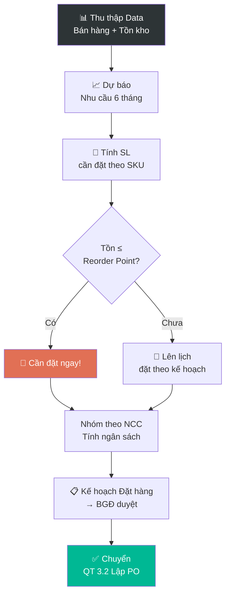

# 3.1 Dự báo Nhu cầu & Kế hoạch Đặt hàng

## 1. Mục đích & Phạm vi
- **Mục đích:** Dự báo nhu cầu bán hàng theo SKU, lập kế hoạch đặt hàng từ NCC quốc tế — đảm bảo không đứt hàng mà cũng không tồn quá nhiều.
- **Áp dụng:** Toàn bộ SKU đang kinh doanh + SKU mới dự kiến nhập.
- **Tần suất:** Review hàng tháng. Lập kế hoạch nhập hàng hàng quý.

## 2. Thuật ngữ
| Thuật ngữ | Giải thích |
|-----------|-----------|
| **Lead Time** | Thời gian từ đặt hàng → nhận hàng (thường 3-6 tháng cho rượu vang NK) |
| **MOQ** | Minimum Order Quantity — SL tối thiểu NCC yêu cầu (thường 1 pallet) |
| **Safety Stock** | Mức tồn tối thiểu để không đứt hàng |
| **Reorder Point** | Mức tồn mà khi chạm → phải đặt hàng |
| **Sell-through Rate** | Tốc độ bán (chai/tháng) |

## 3. Trách nhiệm (RACI)

| Bước | Responsible | Approve | Consulted | Informed |
|------|------------|---------|-----------|----------|
| Thu thập data bán hàng | Sales + Kế toán | — | — | — |
| Phân tích & Dự báo | BGĐ | — | Sales, Kho | — |
| Lập kế hoạch đặt hàng | BGĐ | — | Kế toán (ngân sách) | Sales |
| Phê duyệt ngân sách NK | BGĐ | Cổ đông (nếu lớn) | Kế toán | — |

## 4. Quy trình Chi tiết

### Bước 1: Thu thập Dữ liệu (Đầu mỗi tháng)
- **Input:** Dữ liệu bán hàng, tồn kho, pipeline KH
- **Thao tác:**
  1. Xuất **Báo cáo bán hàng 6 tháng gần nhất** theo SKU → [QT 6.7](../06_ban_hang/6.7_bao_cao_doanh_so.md)
  2. Xuất **Bảng tồn kho hiện tại** → [QT 5.4](../05_kho_van/5.4_quan_ly_ton_kho.md)
  3. Thu thập thông tin từ Sales:
     - KH nào đang muốn mua SP gì?
     - Có đơn hàng lớn sắp tới không? (Wedding, Event, Tết)
     - Có KH mới nào sắp onboard?
  4. Kiểm tra **lịch sự kiện:** Tết, Giáng sinh, Valentine → nhu cầu cao
- **Output:** Bảng dữ liệu tổng hợp

### Bước 2: Dự báo Nhu cầu (Forecast)
- **Thao tác:**
  1. Tính **Sell-through Rate trung bình** cho từng SKU:
     ```
     Sell-through = Tổng SL bán 6 tháng / 6
     ```
  2. Điều chỉnh theo **Seasonality:**
     - Q4 (Tháng 10-12): ×1.5 - 2.0 (mùa lễ)
     - Q1 (Tháng 1-3): ×0.7 - 0.8 (sau Tết, chậm)
     - Q2-Q3: ×1.0 (bình thường)
  3. Điều chỉnh theo **Trend:**
     - SP đang tăng → ×1.1 - 1.3
     - SP đang giảm → ×0.7 - 0.9
     - SP mới (chưa có data) → Ước lượng từ SP tương tự
  4. Tính **Nhu cầu dự kiến 6 tháng tới:**
     ```
     Nhu cầu 6 tháng = Sell-through × Hệ số Seasonality × Hệ số Trend × 6
     ```
  5. Điền vào **Form 3.1-A**

### Bước 3: Tính Toán Đặt hàng
- **Thao tác:**
  1. Tính **SL cần đặt** cho mỗi SKU:
     ```
     SL cần đặt = Nhu cầu 6 tháng - Tồn hiện tại + Safety Stock
     ```
  2. Kiểm tra **MOQ** của NCC:
     - Nếu SL cần < MOQ → quyết định: đặt MOQ hoặc bỏ qua
     - Nếu SL cần > MOQ → OK, làm tròn theo pallet/container
  3. Tính **Lead Time:** Đặt hàng bây giờ → khi nào nhận?
     - NCC Châu Âu: 3-4 tháng (sản xuất + vận chuyển biển)
     - NCC Úc/NZ: 2-3 tháng
     - NCC Chile: 3-4 tháng
  4. Kiểm tra **Reorder Point:**
     ```
     Reorder Point = Sell-through × Lead Time (tháng) + Safety Stock
     ```
     Nếu Tồn hiện tại ≤ Reorder Point → **CẦN ĐẶT NGAY**

### Bước 4: Lập Kế hoạch & Phê duyệt
- **Thao tác:**
  1. Nhóm đơn hàng theo NCC (để tối ưu shipping)
  2. Tính **ngân sách cần thiết** (FOB + cước + thuế)
  3. Lập **Kế hoạch Đặt hàng Quý** (Form 3.1-B):
     - NCC nào, SKU nào, SL bao nhiêu, Dự kiến khi nào đặt
     - Tổng ngân sách
  4. Trình BGĐ phê duyệt
  5. Nếu OK → chuyển [QT 3.2 Lập PO](3.2_lap_po.md)

## 5. Bảng Tham khảo Lead Time & MOQ

| NCC | Quốc gia | Lead Time | MOQ | Cước ước tính |
|-----|---------|----------|-----|-------------|
| Collis Heritage (Sartori) | 🇮🇹 Ý | 3-4 tháng | 1 pallet | FCL ~$3,000 |
| Maison Bouey | 🇫🇷 Pháp | 3-4 tháng | 600 chai | FCL ~$3,500 |
| Tour Blanche | 🇫🇷 Pháp | 3-4 tháng | 300 chai | LCL ~$1,500 |
| Vina San Esteban | 🇨🇱 Chile | 3-4 tháng | 1 pallet | FCL ~$4,000 |
| Berton Vineyards | 🇦🇺 Úc | 2-3 tháng | 600 chai | FCL ~$3,000 |
| Allan Scott | 🇳🇿 NZ | 2-3 tháng | 300 chai | LCL ~$2,000 |
| Cavas Marevia | 🇪🇸 TBN | 3-4 tháng | 1 pallet | FCL ~$3,000 |

## 6. Sơ đồ Quy trình



## 7. Biểu mẫu
📥 **Form 3.1-A:** [Du_bao_Nhu_cau.xlsx](../../../sources/Forms/Form_3.1-A_Du_bao_Nhu_cau.xlsx)

**Nội dung:** SKU, Sell-through 6 tháng, Hệ số mùa vụ, Tồn hiện tại, SL cần đặt, Reorder Point

📥 **Form 3.1-B:** [Ke_hoach_Dat_hang_Quy.xlsx](../../../sources/Forms/Form_3.1-B_Ke_hoach_Dat_hang.xlsx)

**Nội dung:** NCC, SKU, SL, Ngân sách, Timeline, Trạng thái phê duyệt

## 8. KPI & Đo lường

| KPI | Công thức | Mục tiêu | Tần suất |
|-----|----------|---------|----------|
| Độ chính xác dự báo | \|Thực tế - Dự báo\| / Dự báo | ≤ 20% sai lệch | Hàng quý |
| Tỷ lệ đứt hàng (OOS) | Số ngày hết hàng best-seller / Tổng ngày | ≤ 5% | Hàng tháng |
| Vòng quay tồn kho | COGS / Tồn kho TB | ≥ 4 lần/năm | Hàng quý |
| Dead stock ratio | GT dead stock / GT tồn tổng | ≤ 5% | Hàng quý |

## 9. Tài liệu Liên quan
- → Sau: [3.2 Lập PO](3.2_lap_po.md)
- ↔ Liên quan: [5.4 Quản lý Tồn kho](../05_kho_van/5.4_quan_ly_ton_kho.md) | [6.7 Báo cáo Doanh số](../06_ban_hang/6.7_bao_cao_doanh_so.md)
- 📊 Dữ liệu: [Sổ Mua hàng Ý](purchase_l1.md) | [Pháp](purchase_l2.md) | [Chile](purchase_l3.md) | [Úc](purchase_l4.md) | [NZ](purchase_l5.md) | [TBN](purchase_l6.md)
