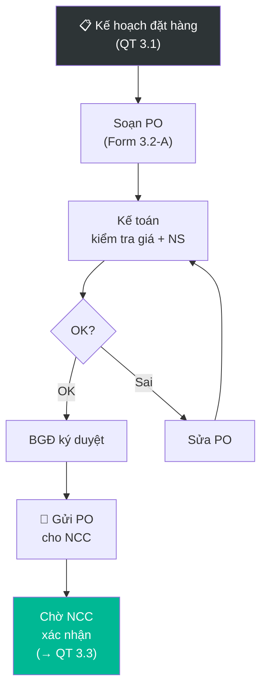

# 3.2 Lập & Phê duyệt Đơn Đặt hàng (PO)

## 1. Mục đích & Phạm vi
- **Mục đích:** Lập Purchase Order chính xác, phê duyệt nội bộ, và gửi cho NCC quốc tế để đặt hàng.
- **Áp dụng:** Mọi đơn mua hàng từ NCC nước ngoài (qua Thắng Ân).
- **Tần suất:** Theo kế hoạch đặt hàng (QT 3.1) hoặc khi cần bổ sung gấp.

## 2. Trách nhiệm (RACI)

| Bước | Responsible | Approve | Consulted | Informed |
|------|------------|---------|-----------|----------|
| Soạn PO | BGĐ / Mua hàng | — | Sales (SL), Kế toán (ngân sách) | — |
| Kiểm tra giá & điều khoản | Kế toán | — | BGĐ | — |
| Phê duyệt PO | BGĐ | — | — | Kế toán, Logistics |
| Gửi PO cho NCC | BGĐ / Mua hàng | — | — | NCC |
| Theo dõi xác nhận NCC | Mua hàng | — | — | BGĐ |

## 3. Quy trình Chi tiết

### Bước 1: Soạn Purchase Order
- **Input:** Kế hoạch đặt hàng đã duyệt (QT 3.1), Price List NCC, HĐ phân phối
- **Thao tác:**
  1. Mở **Template PO** (Form 3.2-A)
  2. Điền thông tin:
     - **Buyer:** Thắng Ân Commerce JSC (công ty nhập khẩu)
     - **Supplier:** Tên NCC, Địa chỉ, Contact
     - **PO Number:** PO-[NCC code]-[Năm]-[Số] (VD: PO-SARTORI-2026-03)
     - **Danh sách SP:**

| Mã SP NCC | Tên rượu | Vintage | SL (chai) | SL (thùng) | Đơn giá (EUR/FOB) | Thành tiền |
|-----------|---------|---------|----------|-----------|-------------------|-----------|
| (Theo catalog NCC) | | | | | | |

  3. Tính tổng giá trị PO (EUR/USD)
  4. Ghi điều khoản:
     - **Incoterm:** FOB / CIF / EXW → [QT 3.5](3.5_incoterms.md)
     - **Payment terms:** TT Trả trước (TT in Advance) / TT Trả sau (TT Deferred) (hoặc theo quy định trong HĐ)
     - **Delivery:** Estimated shipment date
     - **Packing:** Standard export carton
     - **Documents required:** Invoice, Packing List, B/L, C/O, Health Certificate

### Bước 2: Kiểm tra & Phê duyệt Nội bộ
- **Thao tác:**
  1. Kế toán kiểm tra:
     - Giá trên PO = Giá trong HĐ/Price List? (không bị markup sai)
     - Ngân sách đủ cho đợt nhập này?
     - Điều khoản thanh toán có phù hợp?
  2. BGĐ review + phê duyệt:
     - SL có hợp lý vs dự báo?
     - Timing có phù hợp? (tránh nhập quá gần Tết khi cần hàng)
  3. Ký duyệt PO
- **Timeline:** 1-2 ngày

### Bước 3: Gửi PO cho NCC
- **Thao tác:**
  1. Gửi PO qua **email** (PDF có chữ ký scan)
  2. CC: Kế toán, Logistics
  3. Email mẫu:
     ```
     Subject: Purchase Order PO-SARTORI-2026-03 — Thang An Commerce
     
     Dear [NCC name],
     
     Please find attached our Purchase Order PO-SARTORI-2026-03.
     We kindly request your order confirmation within 5 working days.
     
     Best regards,
     [Tên]
     Thang An Commerce JSC
     ```
  4. Lưu PO vào thư mục: `sources/PO/[NCC]/PO-xxx-yyyy-mm.pdf`
- **Timeline:** Ngay sau khi duyệt

### Bước 4: Nhận Xác nhận từ NCC → [QT 3.3](3.3_xac_nhan_don_hang.md)

## 4. Sơ đồ Quy trình



## 5. Biểu mẫu
📥 **Form 3.2-A:** [Purchase_Order_Template.xlsx](../../../sources/Forms/Form_3.2-A_Purchase_Order.xlsx)

**Nội dung form:**
- Header: Buyer (Thắng Ân), Supplier, PO Number, Date
- Bảng chi tiết: Mã SP, Tên, Vintage, SL chai, SL thùng, Đơn giá FOB, Thành tiền
- Terms: Incoterm, Payment, Delivery, Packing, Documents
- Tổng giá trị + Chữ ký

## 6. KPI & Đo lường

| KPI | Công thức | Mục tiêu | Tần suất |
|-----|----------|---------|----------|
| Thời gian lập PO | Từ quyết định → gửi NCC | ≤ 3 ngày | Mỗi PO |
| Tỷ lệ PO sửa | Số PO phải sửa / Tổng PO | ≤ 5% | Hàng quý |
| Giá trị PO TB | Tổng giá trị PO / Số PO | Theo kế hoạch | Hàng quý |

## 7. Xử lý Ngoại lệ

| Tình huống | Hành động | Escalation |
|-----------|----------|-----------|
| NCC tăng giá so với HĐ | Đàm phán, tham chiếu HĐ, xem xét NCC thay thế | BGĐ |
| NCC không đủ SL yêu cầu | Giảm SL hoặc chia thành 2 đợt giao | BGĐ |
| Tỷ giá biến động lớn | Kế toán tính lại ngân sách, BGĐ quyết định | BGĐ + Kế toán |
| Cần đặt hàng gấp (ngoài kế hoạch) | BGĐ duyệt nhanh, gửi PO + gọi điện NCC | BGĐ |

## 8. Tài liệu Liên quan
- ← Trước: [3.1 Dự báo Nhu cầu](3.1_du_bao_nhu_cau.md)
- → Sau: [3.3 Xác nhận Đơn hàng](3.3_xac_nhan_don_hang.md)
- ↔ Liên quan: [3.5 Incoterms](3.5_incoterms.md) | [8.1 Thanh toán Quốc tế](../08_tai_chinh/8.1_thanh_toan_quoc_te.md)
