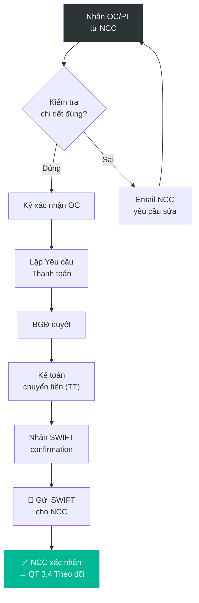

# 3.3 Xác nhận Đơn hàng & Thanh toán Đặt cọc

## 1. Mục đích & Phạm vi
- **Mục đích:** Nhận xác nhận PO từ NCC, kiểm tra chi tiết, và thanh toán đặt cọc (deposit) để NCC bắt đầu chuẩn bị hàng.
- **Áp dụng:** Tất cả PO đã gửi cho NCC quốc tế.

## 2. Trách nhiệm (RACI)

| Bước | Responsible | Approve | Consulted | Informed |
|------|------------|---------|-----------|----------|
| Nhận & kiểm tra Order Confirmation | Mua hàng | — | BGĐ | — |
| Yêu cầu thanh toán deposit | Mua hàng | BGĐ | — | Kế toán |
| Thực hiện chuyển tiền | Kế toán | BGĐ | Ngân hàng | Mua hàng |
| Gửi bằng chứng TT cho NCC | Mua hàng | — | — | NCC |

## 3. Quy trình Chi tiết

### Bước 1: Nhận Order Confirmation từ NCC
- **Timeline:** 3-10 ngày sau khi gửi PO
- **Thao tác:**
  1. NCC gửi **Order Confirmation (OC)** hoặc **Proforma Invoice (PI)** qua email
  2. Kiểm tra kỹ OC/PI:
     - ✅ Tên SP + Vintage đúng?
     - ✅ SL đúng?
     - ✅ Giá đúng (theo Price List/HĐ)?
     - ✅ Incoterm đúng?
     - ✅ Delivery date hợp lý?
     - ✅ Payment terms đúng?
  3. Nếu **tất cả đúng** → Ký xác nhận OC, gửi lại NCC
  4. Nếu **có sai** → Email NCC yêu cầu sửa → chờ OC mới
- **Lưu ý:** Một số NCC không gửi OC riêng mà dùng PI làm xác nhận. Cả hai đều chấp nhận.

### Bước 2: Yêu cầu Thanh toán Đặt cọc
- **Thao tác:**
  1. Căn cứ OC/PI, lập **Yêu cầu Thanh toán** (Form 3.3-A):
     - Tên NCC, Số PO, Số PI/OC
     - Tổng giá trị đơn hàng
     - Số tiền cần chuyển (thanh toán trả trước/đặt cọc theo Hợp đồng)
     - Thông tin TK ngân hàng NCC (từ PI)
     - Mục đích chuyển: "Advance Payment/Deposit for PO-xxx"
  2. BGĐ ký duyệt Yêu cầu Thanh toán
  3. Chuyển Kế toán thực hiện

### Bước 3: Thực hiện Chuyển tiền (TT - Telegraphic Transfer)
- **Thao tác:**
  1. Kế toán chuẩn bị hồ sơ cho ngân hàng:
     - Lệnh chuyển tiền (mẫu ngân hàng)
     - Hợp đồng ngoại thương (Sales Contract)
     - Proforma Invoice / Order Confirmation
     - Giấy phép kinh doanh (lần đầu)
  2. Nộp hồ sơ tại ngân hàng (hoặc online banking nếu đã đăng ký)
  3. Ngân hàng xử lý (1-3 ngày làm việc)
  4. Nhận **SWIFT confirmation** từ ngân hàng
  5. Lưu SWIFT vào hồ sơ đơn hàng
- **Timeline:** 2-5 ngày làm việc
- **Lưu ý:** 
  - Kiểm tra tỷ giá trước khi chuyển — cân nhắc mua ngoại tệ sớm nếu tỷ giá tốt
  - Phí chuyển tiền quốc tế: ~$25-40/lần (tùy ngân hàng)

### Bước 4: Gửi Bằng chứng Thanh toán cho NCC
- **Thao tác:**
  1. Gửi email cho NCC kèm **SWIFT confirmation** (PDF)
  2. Email mẫu:
     ```
     Subject: Payment Confirmation — PO-SARTORI-2026-03 (Advance Payment)
     
     Dear [NCC],
     
     Please find attached the SWIFT confirmation for advance payment/deposit 
     of EUR xx,xxx for PO-SARTORI-2026-03.
     
     Please confirm receipt and advise estimated production/shipment date.
     
     Best regards,
     ```
  3. Yêu cầu NCC xác nhận đã nhận tiền
  4. Cập nhật trạng thái PO: "Deposit Paid"
- **Timeline:** Ngay sau khi có SWIFT

## 4. Sơ đồ Quy trình



## 5. Biểu mẫu
📥 **Form 3.3-A:** [Yeu_cau_Thanh_toan.xlsx](../../../sources/Forms/Form_3.3-A_Yeu_cau_Thanh_toan.xlsx)

**Nội dung form:**
- Tên NCC, Số PO, Số PI, Tổng giá trị
- SL tiền cần chuyển (% deposit), Tỷ giá, Số tiền VND
- Thông tin TK ngân hàng NCC
- Chữ ký: Người lập + BGĐ duyệt

## 6. KPI & Đo lường

| KPI | Công thức | Mục tiêu | Tần suất |
|-----|----------|---------|----------|
| Thời gian nhận OC | PO gửi → OC nhận | ≤ 7 ngày | Mỗi PO |
| Thời gian TT deposit | OC nhận → SWIFT gửi | ≤ 5 ngày | Mỗi PO |
| Tỷ lệ OC sai | OC phải sửa / Tổng OC | ≤ 10% | Hàng quý |

## 7. Tài liệu Liên quan
- ← Trước: [3.2 Lập PO](3.2_lap_po.md)
- → Sau: [3.4 Theo dõi Tiến độ](3.4_theo_doi_tien_do.md) | [8.1 Thanh toán QT](../08_tai_chinh/8.1_thanh_toan_quoc_te.md)
