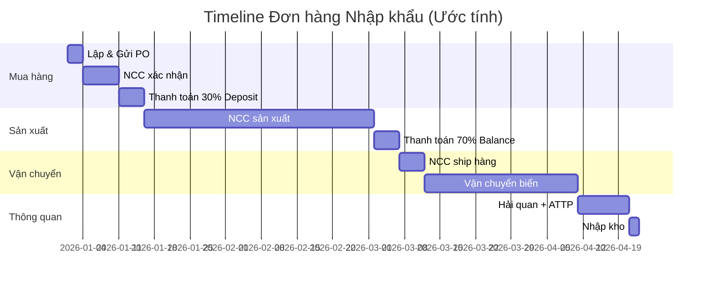

# 3.4 Theo dõi Tiến độ Sản xuất & Vận chuyển

## 1. Mục đích & Phạm vi
- **Mục đích:** Theo dõi tiến độ từ khi NCC xác nhận đơn → sản xuất → đóng gói → vận chuyển → hàng đến cảng VN, đảm bảo nhận hàng đúng hẹn.
- **Áp dụng:** Tất cả PO đang hoạt động.

## 2. Trách nhiệm (RACI)

| Bước | Responsible | Approve | Consulted | Informed |
|------|------------|---------|-----------|----------|
| Liên hệ NCC check tiến độ | Mua hàng | — | — | BGĐ |
| Nhận shipping docs | Mua hàng / Logistics | — | — | Kế toán |
| Thanh toán TT Trả sau / Số dư | Kế toán | BGĐ | — | NCC |
| Phối hợp Forwarder | Logistics | — | — | Kho |

## 3. Quy trình Chi tiết

### Bước 1: Theo dõi Sản xuất (Production Follow-up)
- **Timeline:** 2-8 tuần sau deposit
- **Thao tác:**
  1. Email NCC **mỗi 2 tuần** hỏi tiến độ:
     ```
     Subject: Production Status — PO-SARTORI-2026-03
     
     Dear [NCC],
     Could you please update us on the production status?
     Estimated ready date?
     ```
  2. Ghi nhận vào **Bảng theo dõi PO** (Form 3.4-A):
     - Ngày hỏi, Phản hồi NCC, ETA cập nhật
  3. Nếu NCC thông báo delay → đánh giá ảnh hưởng:
     - Tồn kho đủ chờ không?
     - Cần điều chỉnh kế hoạch bán?
     - Thông báo Sales

### Bước 2: Thanh toán TT Trả sau / Số dư còn lại
- **Khi nào:** Theo thỏa thuận thanh toán trong Hợp đồng (Khi NCC thông báo hàng sẵn sàng xuất hoặc sau khi nhận hàng/thông quan).
- **Thao tác:**
  1. NCC gửi **Commercial Invoice** / **Balance Invoice** hoặc thông báo sẵn sàng giao hàng.
  2. Lập Yêu cầu Thanh toán → BGĐ duyệt → Kế toán thực hiện chuyển tiền (TT Trả sau).
     - *Lưu ý:* Đối với bộ hồ sơ thanh toán có nhiều hóa đơn (invoices), bắt buộc phải đi kèm **bảng kê hóa đơn** (bản nộp cùng tờ khai thông quan) trong hồ sơ gửi ngân hàng.
     - *Báo cáo khoản vay NHNN:* Đối với các lô hàng trả sau mà quá 45 ngày kể từ ngày thông quan hải quan vẫn chưa thanh toán, Kế toán phải làm báo cáo đăng ký khoản vay ngắn hạn trên hệ thống của Ngân hàng Nhà nước (NHNN). Khi nộp hồ sơ thanh toán qua ngân hàng, bắt buộc phải đính kèm ảnh chụp màn hình báo cáo đăng ký khoản vay này.
  3. Quy trình thực hiện chuyển tiền giống [QT 3.3 Bước 3](3.3_xac_nhan_don_hang.md)
  4. Gửi SWIFT cho NCC.
  5. NCC xác nhận đã nhận tiền và giải phóng hàng / giao hàng.
- **Lưu ý:** Một số NCC yêu cầu 100% TT trước khi ship. Kiểm tra HĐ!

### Bước 3: Nhận Shipping Documents
- **Khi nào:** Sau khi NCC ship hàng (7-15 ngày)
- **Documents cần nhận:**

| Document | Mô tả | Cần cho |
|----------|-------|--------|
| **Bill of Lading (B/L)** | Vận đơn đường biển — quan trọng nhất | Nhận container tại cảng |
| **Commercial Invoice** | Hóa đơn thương mại | Hải quan + Kế toán |
| **Packing List** | Danh sách đóng gói chi tiết | Kiểm tra hàng |
| **Certificate of Origin (C/O)** | Giấy chứng nhận xuất xứ | Hải quan (ưu đãi thuế) |
| **Health Certificate** | Giấy chứng nhận ATTP | Kiểm tra ATTP VN |
| **Phytosanitary Certificate** | Kiểm dịch thực vật (nếu có) | Kiểm dịch |
| **Analysis Report** | Kết quả phân tích rượu | Tự công bố SP |

- **Thao tác:**
  1. Nhận docs qua email (scan) + courier (bản gốc)
  2. Kiểm tra: Tất cả docs đầy đủ? Thông tin khớp PO?
  3. Chuyển cho Logistics để chuẩn bị thông quan → [QT 4.2](../04_nhap_khau_logistics/4.2_chung_tu_hai_quan.md)

### Bước 4: Theo dõi Vận chuyển (Shipment Tracking)
- **Thao tác:**
  1. Tra cứu B/L number trên website hãng tàu:
     - Maersk: maersk.com/tracking
     - MSC: msc.com/track-a-shipment
     - CMA CGM: cmacgm.com/ebusiness/tracking
  2. Cập nhật vào Bảng theo dõi PO:
     - ETD (ngày rời cảng xuất)
     - ETA (ngày đến cảng VN)
     - Cảng đến: Cát Lái / Hải Phòng
  3. Thông báo Logistics + Kho: ETA hàng đến
  4. **7 ngày trước ETA:** Nhắc Logistics chuẩn bị bộ hồ sơ hải quan
  5. **Khi hàng đến cảng:** Chuyển → [QT 4.3 Thông quan](../04_nhap_khau_logistics/4.3_thong_quan.md)

## 4. Timeline Tổng quát



## 5. Biểu mẫu
📥 **Form 3.4-A:** [Bang_theo_doi_PO.xlsx](../../../sources/Forms/Form_3.4-A_Bang_theo_doi_PO.xlsx)

**Nội dung form:**
- Danh sách PO đang hoạt động: Số PO, NCC, Giá trị, Trạng thái
- Timeline từng PO: Ngày gửi, OC, Deposit, Ready, Ship, ETA, Nhập kho
- Ghi chú follow-up

## 6. KPI & Đo lường

| KPI | Công thức | Mục tiêu | Tần suất |
|-----|----------|---------|----------|
| Tổng lead time | PO gửi → Hàng nhập kho | ≤ 4 tháng (Châu Âu) | Mỗi PO |
| Tỷ lệ giao đúng hẹn (NCC) | PO đúng ETA / Tổng PO | ≥ 80% | Hàng quý |
| Tỷ lệ docs đầy đủ | Lần đầu nhận đủ docs / Tổng | ≥ 90% | Hàng quý |

## 7. Tài liệu Liên quan
- ← Trước: [3.3 Xác nhận & Deposit](3.3_xac_nhan_don_hang.md)
- → Sau: [4.1 Book Container](../04_nhap_khau_logistics/4.1_book_container_van_chuyen.md) | [4.2 Chứng từ HQ](../04_nhap_khau_logistics/4.2_chung_tu_hai_quan.md)
- ↔ Liên quan: [4.6 Theo dõi Shipment](../04_nhap_khau_logistics/4.6_theo_doi_shipment.md)
