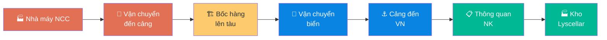

# 3.5 Quản lý Incoterms & Điều kiện Giao hàng

## 1. Mục đích & Phạm vi
- **Mục đích:** Hiểu rõ và áp dụng đúng Incoterms (điều kiện giao hàng quốc tế) trong mỗi PO, xác định rõ trách nhiệm chi phí và rủi ro giữa Buyer (Thắng Ân) và Seller (NCC).
- **Áp dụng:** Tất cả giao dịch mua hàng quốc tế.

## 2. Incoterms 2020 — Áp dụng cho Lyscellar

### 2.1 Các Incoterms Thường dùng

| Incoterm | Tên đầy đủ | Ai chịu cước? | Ai chịu rủi ro? | Khi nào dùng? |
|----------|-----------|--------------|----------------|-------------|
| **EXW** | Ex Works | Buyer 100% | Buyer từ cổng nhà máy | Khi có forwarder riêng tại nước NCC |
| **FOB** | Free On Board | Buyer (cước biển) | Buyer từ khi lên tàu | **Phổ biến nhất** — kiểm soát cước |
| **CIF** | Cost, Insurance, Freight | Seller | Buyer từ khi đến cảng | Khi NCC có giá cước tốt hơn |
| **CFR** | Cost and Freight | Seller (cước) | Buyer từ khi đến cảng | Như CIF nhưng BH tự mua |
| **DAP** | Delivered At Place | Seller đến kho | Buyer khi nhận hàng | Khi NCC giao tận kho VN |

### 2.2 So sánh Chi phí & Trách nhiệm

```
                EXW    FOB    CFR    CIF    DAP
Đóng gói        S      S      S      S      S
Vận chuyển NĐ   B      S      S      S      S
Thủ tục XK      B      S      S      S      S
Bốc hàng lên tàu B     S      S      S      S
Cước biển        B      B      S      S      S
Bảo hiểm hàng   B      B      B      S      S
Dỡ hàng tại cảng B     B      B      B      S
Thông quan NK    B      B      B      B      B*
Vận chuyển NĐ VN B     B      B      B      S/B

S = Seller (NCC)  |  B = Buyer (Thắng Ân)
* Thông quan NK luôn là trách nhiệm Buyer
```

### 2.3 Chiến lược Chọn Incoterm

| Tình huống | Incoterm khuyến nghị | Lý do |
|-----------|---------------------|-------|
| Đơn hàng lớn (FCL - full container) | **FOB** | Thắng Ân book cước riêng, kiểm soát chi phí |
| Đơn hàng nhỏ (LCL - ghép container) | **CIF** hoặc **CFR** | NCC có cước LCL tốt hơn |
| NCC lần đầu, chưa quen | **CIF** | NCC lo hết vận chuyển, ít rủi ro |
| NCC quen, có forwarder tốt | **FOB** | Tiết kiệm cước |
| NCC nhỏ, không xuất khẩu nhiều | **EXW** | Thắng Ân tự arrange |

## 3. Quy trình Áp dụng Incoterms

### Bước 1: Xác định Incoterm khi Đàm phán
- **Thao tác:**
  1. Review HĐ phân phối: Incoterm đã thỏa thuận?
  2. Nếu chưa có → đề xuất FOB (mặc định cho FCL)
  3. Yêu cầu NCC báo giá theo Incoterm đã chọn
  4. So sánh: Giá FOB + cước tự book vs Giá CIF → chọn cái nào rẻ hơn

### Bước 2: Ghi Incoterm trong PO
- **Thao tác:**
  1. Ghi rõ trong PO: **"Incoterm: FOB [Tên cảng xuất]"**
     - VD: "FOB Genoa, Italy" hoặc "CIF Ho Chi Minh City, Vietnam"
  2. Phải ghi kèm **tên cảng** — đây là nơi chuyển giao trách nhiệm

### Bước 3: Mua Bảo hiểm (nếu FOB/CFR)
- **Khi nào:** Khi Incoterm là FOB hoặc CFR (không bao gồm BH)
- **Thao tác:**
  1. Liên hệ công ty bảo hiểm (Bảo Việt, PVI, AIG...)
  2. Mua bảo hiểm hàng hải cho lô hàng:
     - Giá trị bảo hiểm: 110% CIF value
     - Loại: All Risks (mọi rủi ro)
  3. Nhận Policy → lưu vào hồ sơ lô hàng
- **Chi phí:** ~0.1-0.3% giá trị hàng
- **Lưu ý:** Bắt buộc mua nếu vay ngân hàng (LC) hoặc hàng giá trị cao

## 4. Bảng Tham khảo NCC — Incoterm Đang áp dụng

| NCC | Quốc gia | Incoterm | Cảng xuất | Ghi chú |
|-----|---------|---------|----------|--------|
| Collis Heritage | 🇮🇹 Ý | FOB | Genoa | FCL, 20ft |
| Maison Bouey | 🇫🇷 Pháp | FOB | Bordeaux | FCL |
| Tour Blanche | 🇫🇷 Pháp | CIF | HCMC | LCL, NCC lo cước |
| Vina San Esteban | 🇨🇱 Chile | FOB | Valparaiso | FCL |
| Berton Vineyards | 🇦🇺 Úc | FOB | Sydney | FCL |
| Allan Scott | 🇳🇿 NZ | CIF | HCMC | LCL |
| Lorgeril | 🇫🇷 Pháp | EXW | Nhà máy | Thắng Ân book cước |

> ⚠️ Bảng này cần cập nhật khi thay đổi điều khoản với NCC.

## 5. Sơ đồ Trách nhiệm



**Legend:** 🔴 NCC (FOB) | 🔵 Buyer (FOB) | 🟢 Luôn là Buyer

## 6. KPI & Đo lường

| KPI | Công thức | Mục tiêu | Tần suất |
|-----|----------|---------|----------|
| Chi phí logistics / Giá trị hàng | Tổng CP logistics / Tổng FOB | ≤ 15% | Mỗi lô |
| Claim bảo hiểm | Số claim / Tổng shipment | ≤ 5% | Hàng năm |
| Tỷ lệ FOB vs CIF | Số PO FOB / Tổng PO | ≥ 70% (FCL) | Hàng năm |

## 7. Tài liệu Liên quan
- ← Liên quan: [3.2 Lập PO](3.2_lap_po.md) | [2.2 Đàm phán HĐ](../02_nha_cung_cap/2.2_dam_phan_hop_dong.md)
- → Sau: [4.1 Book Container](../04_nhap_khau_logistics/4.1_book_container_van_chuyen.md) | [4.5 Thuế & Landed Cost](../04_nhap_khau_logistics/4.5_thue_chi_phi.md)
