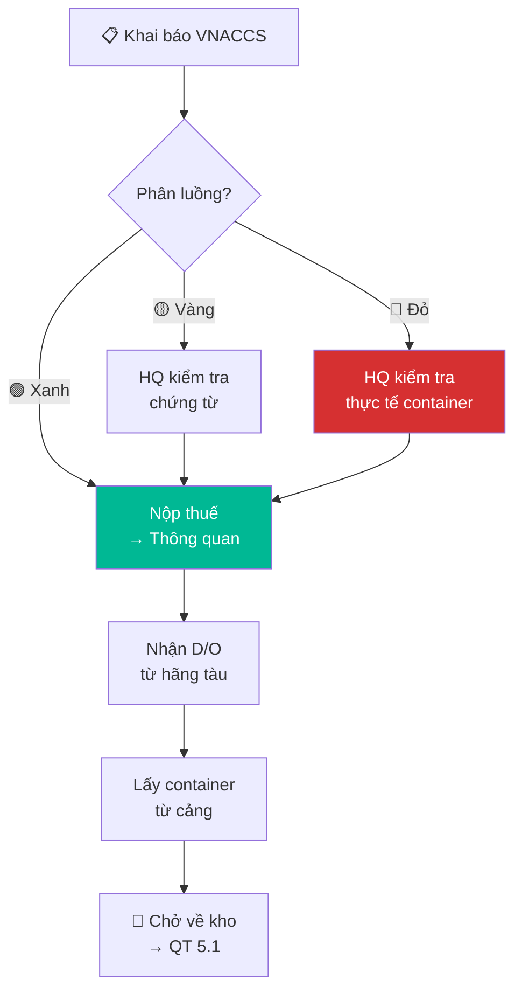

# 4.3 Thông quan Nhập khẩu

## 1. Mục đích & Phạm vi
- **Mục đích:** Hoàn tất thủ tục hải quan để nhận hàng từ cảng về kho, đảm bảo tuân thủ pháp luật và nhanh chóng.
- **Áp dụng:** Mọi lô hàng nhập khẩu rượu vang.

## 2. Trách nhiệm (RACI)

| Bước | Responsible | Approve | Informed |
|------|------------|---------|----------|
| Khai báo HQ (VNACCS) | Đại lý HQ | — | Kế toán |
| Nộp thuế | Kế toán | BGĐ | Đại lý HQ |
| Kiểm tra thực tế (nếu có) | Đại lý HQ + HQ | — | Logistics |
| Nhận hàng từ cảng | Logistics / Tài xế | — | Kho |

### 2.1 Phối hợp giữa Hãng vận chuyển (Forwarder) và Đơn vị Thông quan nội địa
Trong thực tế vận hành tại Lyscellar, việc lựa chọn đơn vị vận chuyển quốc tế (Forwarder) và đơn vị làm thủ tục thông quan nội địa có thể theo hai mô hình:

#### Mô hình A: Thuê hai bên Độc lập (Forwarder và Đại lý Hải quan khác nhau)
Đây là mô hình thường gặp khi Lyscellar chỉ định hãng vận chuyển quốc tế có giá cước tàu tốt, nhưng sử dụng đại lý thông quan nội địa chuyên nghiệp và quen thuộc tại cảng Việt Nam. Quy trình phối hợp bắt buộc:
1. **Thông báo hàng đến (Arrival Notice - A/N):** Ngay khi nhận được A/N từ Forwarder quốc tế (thường là 3-5 ngày trước khi tàu cập cảng), bộ phận Logistics của Lyscellar phải chuyển tiếp (forward) tài liệu này cùng bản scan **Bill of Lading (B/L)** cho Đại lý Hải quan nội địa để họ chuẩn bị truyền tờ khai trước.
2. **Thanh toán phí Local Charges & Thu hồi lệnh giao hàng (D/O):**
   * Kế toán / Logistics của Lyscellar tiến hành thanh toán các khoản phí local charges tại cảng đích (THC, D/O, Cleaning, CIC...) cho hãng tàu/Forwarder quốc tế để họ giải phóng lệnh giao hàng.
   * Lyscellar chuẩn bị **Giấy ủy quyền (Letter of Authorization)** hoặc ký/đóng dấu khống mặt sau B/L để Đại lý Hải quan đại diện đến văn phòng Forwarder quốc tế xuất trình và nhận lệnh giao hàng (D/O) gốc hoặc mã E-D/O.
3. **Phối hợp Hải quan & Kéo hàng (Trucking):** Đại lý Hải quan bàn giao D/O + Tờ khai đã thông quan cho đơn vị vận tải (Trucker) mà Lyscellar thuê hoặc do chính họ chỉ định để rút container và trả vỏ rỗng về bãi/cảng theo đúng chỉ dẫn của Forwarder.

#### Mô hình B: Sử dụng Dịch vụ Trọn gói (Cùng một đơn vị làm Forwarder & Thông quan)
Đơn vị Forwarder đảm nhận toàn bộ từ việc book tàu quốc tế đến làm thủ tục thông quan hải quan nội địa và vận chuyển container về tận kho Lyscellar (dịch vụ door-to-door).
* **Quy trình:** Đơn giản hóa tối đa. Bên cung cấp dịch vụ tự động luân chuyển chứng từ nội bộ (A/N, D/O).
* **Trách nhiệm:** Logistics của Lyscellar chỉ cần cung cấp đầy đủ bộ chứng từ hàng hóa (Invoice, Packing list, C/O, TCB) và giám sát thời gian giao hàng về kho.

## 3. Luồng Hải quan

| Luồng | Mô tả | Thời gian | Xác suất |
|-------|-------|----------|---------|
| 🟢 **Luồng Xanh** | Miễn kiểm tra, thông quan ngay | 1-2 ngày | ~40% |
| 🟡 **Luồng Vàng** | Kiểm tra hồ sơ chứng từ | 2-3 ngày | ~40% |
| 🔴 **Luồng Đỏ** | Kiểm tra thực tế hàng hóa | 3-7 ngày | ~20% |

> Luồng do hệ thống HQ tự phân loại dựa trên: lịch sử nhập khẩu, loại hàng, NCC, giá trị.

## 4. Quy trình Chi tiết

### Bước 1: Khai báo Hải quan
- **Thời điểm khai báo:** Ngay khi nhận được **Thông báo hàng đến (Arrival Notice - A/N)** từ hãng vận chuyển/Forwarder (thường 3-5 ngày trước ETA), Đại lý HQ có thể tiến hành nhập thông tin và chuẩn bị truyền tờ khai.
- **Thao tác:**
  1. Đại lý HQ nhập dữ liệu và truyền tờ khai nháp (**IDA**), sau đó truyền chính thức (**IDC**) trên hệ thống **VNACCS/VCIS**.
     * *Lưu ý quan trọng:* Trước khi truyền chính thức (IDC), bắt buộc kiểm tra xem hãng tàu đã truyền và hoàn tất duyệt **Manifest** trên hệ thống Một cửa Quốc gia chưa để tránh lỗi không tìm thấy thông tin vận đơn.
  2. Hệ thống trả kết quả phân luồng (Xanh/Vàng/Đỏ)
  3. Thực hiện nộp thuế khâu nhập khẩu (Thuế NK, Thuế TTĐB, Thuế GTGT):
     - Chi tiết cách tính thuế → [QT 4.5](4.5_thue_chi_phi.md).
     - **Hai phương án thanh toán thuế:**
       * **Phương án A: Nộp trực tiếp** qua tài khoản công ty bằng hệ thống điện tử (e-Tax Payment / Internet Banking).
       * **Phương án B: Giải ngân nhận nợ ngân hàng (Vay thanh toán thuế):** Áp dụng khi sử dụng hạn mức tín dụng (ví dụ hạn mức 2 tỷ đồng tại Sacombank Chi nhánh Thăng Long - PGD Đội Cấn).
         * *Thủ tục:* Kế toán lập **Giấy nhận nợ** (theo mẫu Sacombank) + **Giấy nộp tiền vào NSNN (Mẫu C1-02/NS)** + **Tờ khai hải quan (phân luồng)** + Thông báo thuế của hải quan.
         * *Hành động:* Sacombank sẽ duyệt hồ sơ giải ngân và trích tiền từ hạn mức tín dụng để chuyển khoản trực tiếp vào tài khoản Kho bạc Nhà nước quản lý thu (ví dụ KBNN Hải Phòng cho thuế nhập khẩu tại cảng, hoặc KBNN Hà Nội cho thuế nội địa).
  4. Nhận xác nhận nộp thuế (Giấy nộp tiền vào NSNN có xác nhận của Ngân hàng/Kho bạc) để đại lý hải quan xuất trình thông quan giải phóng hàng.

### Bước 2: Xử lý Theo Luồng
- **Luồng Xanh:** Nộp thuế → Thông quan → Nhận D/O → Lấy hàng
- **Luồng Vàng:**
  1. HQ kiểm tra bộ chứng từ
  2. Nếu OK → Thông quan
  3. Nếu thiếu/sai → bổ sung → kiểm tra lại
- **Luồng Đỏ:**
  1. HQ kiểm tra thực tế container:
     - Mở container, đếm số lượng thùng
     - Đối chiếu với Packing List
     - Có thể lấy mẫu kiểm tra
  2. Nếu khớp → Thông quan
  3. Nếu không khớp → Giải trình / Phạt

### Bước 3: Nhận Hàng từ Cảng (LCL vs. FCL)
Quy trình nhận hàng sẽ khác nhau hoàn toàn dựa trên phương thức nhập khẩu. Hiện tại, Lyscellar chủ yếu nhập hàng lẻ (LCL), do đó cần chú trọng phương án LCL:

#### 🟢 Phương án A: Nhận hàng lẻ (LCL - Áp dụng hiện tại)
1. **Rút hàng tại kho CFS:** Hàng hóa sau khi cập cảng sẽ được dỡ từ container và đưa vào lưu trữ tại **Kho CFS (Container Freight Station)** của cảng.
2. **Làm thủ tục tại kho CFS:** Đại lý Hải quan nộp D/O + Tờ khai đã thông quan cho thủ kho CFS của cảng.
3. **Thanh toán phí kho CFS:** Trả các chi phí xếp dỡ hàng lẻ, phí CFS, và phí lưu kho CFS (nếu lấy hàng trễ quá thời hạn miễn phí thường là 3-5 ngày).
4. **Nhận hàng rời:** Thuê **xe tải thùng kín (ưu tiên xe tải lạnh hoặc xe có bạt cách nhiệt)** đến cửa kho CFS để nhận các pallet hàng. Nhân viên giao nhận phải kiểm tra ngoại quan (số lượng thùng, tình trạng ướt/nứt vỡ) trước khi ký nhận biên bản giao hàng tại kho CFS.
5. **Chở về kho:** Xe tải chở các kiện hàng về kho Lyscellar để tiến hành mở kiện và nhập kho -> [QT 5.1 Nhập kho](../05_kho_van/5.1_nhap_kho.md).

#### 🟡 Phương án B: Nhận hàng nguyên container (FCL - Dự phòng tương lai)
1. **Lấy nguyên cont:** Đại lý Hải quan nộp tờ khai đã thông quan và đóng phí tại thương vụ cảng để nhận lệnh cấp container.
2. **Thanh toán phí cont:** Trả phí nâng hạ container tại cảng, phí lưu bãi container (Demurrage) nếu có.
3. **Kéo cont về kho:** Xe đầu kéo (tập kết bởi hãng vận chuyển) kéo nguyên container từ bãi cảng về kho Lyscellar.
4. **Rút hàng tại kho:** Cắt seal container tại kho Lyscellar dưới sự chứng kiến của thủ kho, dỡ hàng từ container nhập vào kho.
5. **Trả vỏ rỗng:** Xe đầu kéo trả vỏ container rỗng về bãi/cảng chỉ định của hãng tàu và trả phí lưu container (Detention) nếu quá hạn.

## 5. Sơ đồ Quy trình

## 6. Chi phí Thông quan (Ước tính)

| Hạng mục | Chi phí | Ghi chú |
|----------|--------|--------|
| Phí đại lý HQ | 1.5-3 triệu/lô | Theo HĐ |
| Phí D/O | 1-2 triệu/lô | Phí hãng tàu |
| Phí nâng hạ container | 2-4 triệu/lô | Phí cảng |
| Phí lưu bãi (nếu quá hạn) | 500K-2 triệu/ngày | Tránh để quá 5 ngày |
| Vận chuyển container → kho | 3-8 triệu/lô | Tùy khoảng cách |
| **Thuế NK + TTĐB + GTGT** | Xem QT 4.5 | 80-120% giá CIF |

## 7. KPI & Đo lường

| KPI | Mục tiêu | Tần suất |
|-----|---------|----------|
| Thời gian thông quan | ≤ 5 ngày (từ ETA) | Mỗi lô |
| Tỷ lệ luồng Xanh | ≥ 40% | Hàng quý |
| Phí lưu bãi | = 0 (không để phát sinh) | Mỗi lô |

## 8. Tài liệu Liên quan
- ← Trước: [4.2 Chứng từ HQ](4.2_chung_tu_hai_quan.md)
- → Sau: [4.4 Kiểm tra ATTP](4.4_kiem_tra_attp.md) | [5.1 Nhập kho](../05_kho_van/5.1_nhap_kho.md)
- ↔ Liên quan: [4.5 Thuế & Chi phí](4.5_thue_chi_phi.md)
