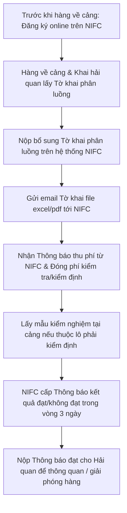

# 4.4 Kiểm tra An toàn Thực phẩm (ATTP) đối với Hàng Nhập khẩu

---

## 1. Mục đích & Phạm vi
- **Mục đích:** Hướng dẫn chi tiết thủ tục kiểm tra nhà nước về an toàn thực phẩm đối với hàng thực phẩm (rượu vang, nước giải khát) nhập khẩu trước khi thông quan và lưu thông tại thị trường Việt Nam.
- **Phạm vi áp dụng:** Bộ phận Kho - Logistics và nhân viên Kế toán Pháp lý của Thắng Ân & Lyscellar.

---

## 2. Căn cứ Pháp lý & Tài khoản Hệ thống
* **Căn cứ pháp lý:** Chương VI Nghị định 15/2018/NĐ-CP hướng dẫn Luật An toàn thực phẩm.
* **Cổng thông tin đăng ký trực tuyến:** Viện Kiểm nghiệm an toàn vệ sinh thực phẩm quốc gia (NIFC) tại địa chỉ: [kiemnghiemthucpham.nifc.gov.vn](https://kiemnghiemthucpham.nifc.gov.vn/DangKyMauOnline/DangNhap)
* **Thông tin tài khoản đăng nhập của Thắng Ân:**
  * **Tên đăng nhập:** `TK2024033721`
  * **Mật khẩu:** `Thangan@12345`

---

## 3. Danh mục Hồ sơ Đăng ký Kiểm tra ATTP
*(Theo quy định tại Khoản 2 Điều 18 Nghị định 15/2018/NĐ-CP)*

| STT | Tài liệu bắt buộc | Quy cách / Yêu cầu chi tiết |
|---|-------------------|-----------------------------|
| 1 | **Giấy giới thiệu** | Giấy giới thiệu của doanh nghiệp cho nhân viên đi làm thủ tục. |
| 2 | **Giấy đăng ký kiểm tra ATTP** | **Mẫu số 04** (Phụ lục Nghị định 15/2018). Số lượng: **03 bản**.   *Lưu ý: Bản nhập online trên hệ thống phải khớp chính xác tuyệt đối với Bản Tự công bố sản phẩm (TCB).* |
| 3 | **Bản tự công bố sản phẩm (TCB)** | Bản sao y có đóng dấu xác nhận của doanh nghiệp. |
| 4 | **Bản dịch thuật nhãn chính sản phẩm** | Bản dịch thuật công chứng nhãn gốc/nhãn chính (sao y, có dấu xác nhận của doanh nghiệp). |
| 5 | **Packing List (Phiếu đóng gói)** | Bản xác nhận có đóng dấu của doanh nghiệp. |
| 6 | **Bill of Lading (B/L - Vận đơn)** | Bản xác nhận có đóng dấu của doanh nghiệp. |
| 7 | **Tờ khai phân luồng hải quan** | Nộp sau khi hàng về Cảng và khai báo hải quan.   *Lưu ý: Điền 12 số của Tờ khai phân luồng vào ô "Số tờ khai hải quan" trên hệ thống. Chỉ sau khi nộp tờ khai này thì hệ thống mới trả kết quả.* |

---

## 4. Trình tự Thực hiện Chi tiết
*(Theo quy định tại Khoản 2 Điều 19 Nghị định 15/2018/NĐ-CP)*

### Hướng dẫn các bước chi tiết:
* **Bước 1: Đăng ký online trước khi hàng về cảng**
  * Truy cập cổng dịch vụ công trực tuyến của NIFC, sử dụng tài khoản doanh nghiệp được cấp để nộp hồ sơ.
  * Điền đầy đủ thông tin hàng hóa, đính kèm các tài liệu trong danh mục hồ sơ ở Mục 3 (trừ Tờ khai phân luồng).
* **Bước 2: Cập nhật Tờ khai phân luồng**
  * Ngay sau khi mở tờ khai hải quan tại cảng, lấy mã Tờ khai phân luồng chính thức.
  * Điền **12 chữ số** của Tờ khai phân luồng vào phần "Số tờ khai hải quan" trên hệ thống NIFC để kích hoạt quá trình xử lý hồ sơ trả kết quả.
  * Gửi file tờ khai (dạng Excel hoặc PDF) qua email cho cán bộ tiếp nhận tại:
    * **Email chính:** `Dothanhthuong226@gmail.com`
    * **Email hệ thống:** `vphp@nifc.gov.vn`
* **Bước 3: Lấy mẫu và thanh toán phí**
  * **Nhận Thông báo thu phí:** NIFC sẽ phát hành một tờ Thông báo thu phí (qua hệ thống trực tuyến hoặc gửi thông tin thanh toán).
  * **Thực hiện đóng phí:** Kế toán thực hiện chuyển khoản hoặc nộp tiền trực tiếp theo Thông báo thu phí của NIFC. Đây là điều kiện bắt buộc để NIFC tiến hành xử lý hồ sơ/kiểm nghiệm mẫu.
  * **Lấy mẫu:** Tiến hành lấy mẫu kiểm định thực tế tại cảng (nếu lô hàng thuộc diện phải lấy mẫu kiểm định chỉ tiêu).
  * **Phí kiểm tra thông thường:** **150.000 VNĐ/lô** (theo Quyết định số 2495/QĐ-BYT). Chi phí kiểm định chỉ tiêu phát sinh theo quy định lấy mẫu dưới đây.
* **Bước 4: Nhận kết quả và thông quan**
  * Thời gian cấp Thông báo kết quả kiểm tra ATTP: **Tối đa 03 ngày làm việc** kể từ khi nộp đủ hồ sơ hợp lệ, mẫu kiểm nghiệm và hoàn tất thanh toán phí.
  * Nhận **02 bản Thông báo kết quả đạt**: 01 bản nộp cho Hải quan để làm thủ tục thông quan giải phóng hàng, 01 bản doanh nghiệp lưu trữ tại hồ sơ pháp lý.

---

## 5. Quy định Lấy mẫu & Biểu phí Kiểm định Chi tiết

Tần suất lấy mẫu kiểm nghiệm và biểu phí cho từng loại hàng hóa nhập khẩu được áp dụng theo lộ trình sau:

### 5.1. Lô hàng Rượu vang nhập khẩu

| Số thứ tự lô hàng | Quy định lấy mẫu & Kiểm định chỉ tiêu | Chỉ tiêu & Biểu phí cụ thể |
| :--- | :--- | :--- |
| **Lô 1 và Lô 2** | Kiểm định ATTP bắt buộc, lấy mẫu ngẫu nhiên **30% chỉ tiêu** (tương đương **2/5 chỉ tiêu** của QCVN 6-3:2010). | - **Hàm lượng SO2:** 200.000 VNĐ/lần/mẫu - **Hàm lượng Chì:** 250.000 VNĐ/lần/mẫu **Tổng phí kiểm định:** **450.000 VNĐ** (chưa gồm phí thông thường) |
| **Lô thứ 3** | Kiểm định ATTP bắt buộc, chỉ kiểm tra **01 chỉ tiêu**. | - **Hàm lượng SO2:** 200.000 VNĐ/lần/mẫu **Tổng phí kiểm định:** **200.000 VNĐ** (chưa gồm phí thông thường) |
| **Lô thứ 4 trở đi** | **Miễn kiểm định lấy mẫu**, chỉ thực hiện kiểm tra hồ sơ chứng từ. | Áp dụng trong vòng **12 tháng** kể từ ngày lần kiểm định thứ 4 đạt yêu cầu. |

### 5.2. Lô hàng Nước giải khát nhập khẩu

| Số thứ tự lô hàng | Quy định lấy mẫu & Kiểm định chỉ tiêu | Chỉ tiêu & Biểu phí cụ thể |
| :--- | :--- | :--- |
| **Lô 1 và Lô 2** | Kiểm định ATTP bắt buộc, lấy mẫu ngẫu nhiên **30% chỉ tiêu** (tương đương **4/11 chỉ tiêu**). | - **Hàm lượng Chì:** 250.000 VNĐ/lần/mẫu - **Hàm lượng Propargit:** 700.000 VNĐ/lần/mẫu - **Tổng số SV hiếu khí:** 120.000 VNĐ/lần/mẫu - **Coliform:** 200.000 VNĐ/lần/mẫu **Tổng phí kiểm định:** **1.270.000 VNĐ** |
| **Lô thứ 3** | Kiểm định ATTP bắt buộc, kiểm tra **03 chỉ tiêu**. | - **Hàm lượng Chì:** 250.000 VNĐ/lần/mẫu - **Hàm lượng Propargit:** 700.000 VNĐ/lần/mẫu - **Tổng số SV hiếu khí:** 120.000 VNĐ/lần/mẫu **Tổng phí kiểm định:** **1.070.000 VNĐ** |
| **Lô thứ 4 trở đi** | **Miễn kiểm định lấy mẫu**, chỉ thực hiện kiểm tra hồ sơ chứng từ. | Áp dụng trong vòng **12 tháng** kể từ ngày lần kiểm định thứ 4 đạt yêu cầu. |

---

## 6. Xử lý Ngoại lệ
* **Sai lệch thông tin Giấy đăng ký và TCB:** Nếu thông tin nhập online lệch với TCB, hồ sơ sẽ bị từ chối. Nhân viên phụ trách phải đối chiếu kỹ số TCB hiện hành của SKU đó trong bảng theo dõi trước khi submit hồ sơ.
* **Thời gian cấp kết quả quá 3 ngày:** Liên hệ trực tiếp cán bộ tiếp nhận qua email hoặc điện thoại phòng nhận hồ sơ của NIFC để kiểm tra trạng thái mẫu/phân tích chỉ tiêu.

---

## 7. Tài liệu Liên quan
* ← Trước: [4.3 Thông quan](4.3_thong_quan.md)
* → Sau: [7.2 Tự công bố](../07_phap_ly/7.2_tu_cong_bo_san_pham.md) | [7.3 Kiểm nghiệm](../07_phap_ly/7.3_kiem_nghiem_chat_luong.md)
