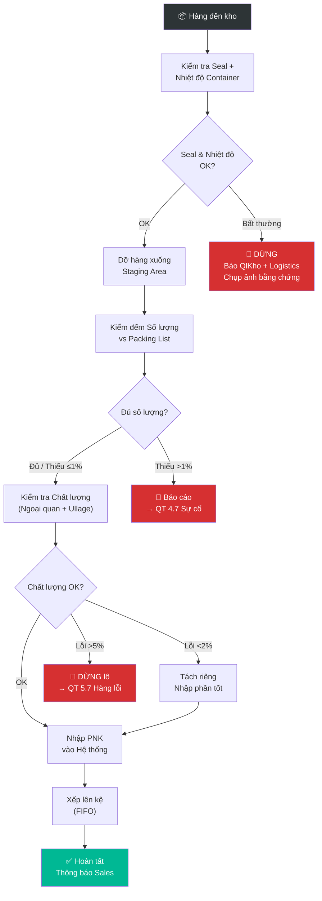

# 5.1 Nhập kho & Kiểm tra Hàng đến

## 1. Mục đích & Phạm vi
- **Mục đích:** Đảm bảo hàng hóa nhập kho được kiểm tra đầy đủ về số lượng, chất lượng, và tình trạng trước khi nhập vào hệ thống quản lý kho.
- **Áp dụng:** Tất cả lô hàng nhập kho tại hệ thống kho Lyscellar bao gồm:
  - **Kho Thường Tín (KTT):** Tiếp nhận các lô hàng nhập khẩu nguyên container (FCL).
  - **Kho Giang Văn Minh (KGVM):** Tiếp nhận các lô hàng trung chuyển nội bộ, hàng mua gom nhỏ lẻ trong nước, hoặc hàng khách trả lại.
  - **Showroom Lyscellar (KSR):** Tiếp nhận hàng mẫu tasting, hàng chuyển kho phục vụ bán tại showroom, hoặc hàng trả trực tiếp của khách mua lẻ.
- **Tần suất:** Mỗi khi có lô hàng đến kho.

## 2. Thuật ngữ
| Thuật ngữ | Giải thích |
|-----------|-----------|
| **PNK** | Phiếu Nhập Kho |
| **GDN** | Goods Delivery Note (Phiếu giao hàng từ NCC/Forwarder) |
| **Ullage** | Mức rượu trong chai — dùng để đánh giá tình trạng |
| **Packing List** | Danh sách đóng gói chi tiết từ NCC |
| **FIFO** | First In First Out — hàng nhập trước xuất trước |

## 3. Trách nhiệm (RACI)

| Bước | Responsible | Approve | Consulted | Informed |
|------|------------|---------|-----------|----------|
| Tiếp nhận hàng tại kho | Nhân viên Kho | — | Logistics | Sales |
| Kiểm đếm số lượng | Nhân viên Kho | — | — | — |
| Kiểm tra chất lượng | Nhân viên Kho + QC | — | BGĐ (nếu lỗi lớn) | NCC |
| Nhập dữ liệu hệ thống | Nhân viên Kho | Quản lý Kho | Kế toán | — |
| Phê duyệt PNK | Quản lý Kho | — | — | Kế toán |
| Xử lý chênh lệch | Quản lý Kho | BGĐ | Logistics/NCC | Kế toán |

## 4. Quy trình Chi tiết

### Bước 1: Tiếp nhận lô hàng
- **Input:** Thông báo hàng đến (từ Logistics hoặc Forwarder), Packing List, Invoice
- **Thao tác:**
  1. Xác nhận lịch giao hàng với tài xế/forwarder
  2. Chuẩn bị khu vực nhập hàng (dọn sạch, đủ không gian)
  3. Kiểm tra seal container (nếu nhập khẩu) — **chụp ảnh seal trước khi cắt**
  4. Kiểm tra tính nguyên vẹn của container thường (Dry container): xem vỏ cont có bị thủng, móp méo hay rò rỉ nước không.
  5. **Đo nhiệt độ bề mặt bằng súng hồng ngoại:** Ngay sau khi mở cửa container, nhân viên kho dùng súng đo nhiệt hồng ngoại đo nhiệt độ bề mặt của các thùng hàng ở mép ngoài, giữa cont và vách trong cùng. Ghi chép nhiệt độ thực tế vào Biên bản kiểm nhận để đánh giá tình trạng hàng hóa đi đường.
  6. Kiểm tra trực quan tấm cách nhiệt (Thermal Liner): Xem tấm cách nhiệt bọc trong cont có bị rách, hở hoặc rơi xuống không.
  7. Dỡ hàng xuống khu vực kiểm tra tạm (staging area)
- **Output:** Hàng đã dỡ tại staging area, ảnh chụp seal + vỏ container, kết quả đo nhiệt độ nhanh bằng súng hồng ngoại.
- **Timeline:** 30-60 phút (tùy số lượng)
- **Lưu ý:**
  - Kiểm soát thời gian dỡ hàng: Ưu tiên kéo container và bốc dỡ hàng vào **khung giờ mát mẻ (sáng sớm trước 8h00 hoặc ban đêm sau 19h00)** để hạn chế hấp hơi nóng khi dỡ cont khô ngoài trời.
  - Kiểm tra nhiệt độ hàng đến: Vì không sử dụng datalogger hành trình, việc dùng súng đo nhiệt hồng ngoại đo nhiệt độ bề mặt thùng hàng là cách đối soát nhanh. Nếu phát hiện nhiệt độ vỏ thùng hàng vượt quá 25°C, cần lập tức báo cáo Quản lý Kho để theo dõi sát chất lượng cảm quan và tách riêng lô hàng để kiểm tra sâu hơn.
  - Nếu seal container bị đứt/không đúng số → **DỪNG**, chụp ảnh, báo Quản lý + Logistics ngay.

### Bước 2: Kiểm đếm Số lượng
- **Input:** Packing List, hàng tại staging area
- **Thao tác:**
  1. Đếm số thùng (carton) theo SKU, đối chiếu Packing List
  2. Mở ngẫu nhiên **10-20% số thùng** để đếm chai bên trong
  3. Ghi số lượng thực tế vào **Biên bản Kiểm nhận** (Form 5.1-A)
  4. So sánh: Thực tế vs Packing List vs Invoice
- **Output:** Biên bản Kiểm nhận (Form 5.1-A) đã điền
- **Timeline:** 1-2 giờ (tùy khối lượng)
- **Ngoại lệ:**
  - Thiếu hàng ≤ 1%: Ghi nhận, vẫn nhập kho, claim NCC sau
  - Thiếu hàng > 1%: Dừng nhập, báo Quản lý + Logistics → [QT 4.7 Xử lý Sự cố](../04_nhap_khau_logistics/4.7_xu_ly_su_co.md)

### Bước 3: Kiểm tra Chất lượng
- **Input:** Hàng tại staging area
- **Thao tác:**
  1. **Kiểm tra ngoại quan** — từng thùng:
     - Thùng carton: Có ướt, bẹp, rách không?
     - Chai: Có nứt, mẻ, rò rỉ không?
     - Nhãn: Có bong tróc, mờ, sai không?
     - Nút bần (cork): Có đẩy lên, mốc không?
  2. **Quy định kiểm tra đối với rượu cao cấp (Grand Cru/Icon Wine):**
     - Thực hiện kiểm tra ngoại quan **100% các chai** thuộc dòng rượu cao cấp (không kiểm tra chọn mẫu ngẫu nhiên).
     - Kiểm tra kỹ phần màng co bọc nút bần (capsule): Không được có vết ố đỏ/ố vàng do rượu rò rỉ. Nút bần (cork) phải phẳng tuyệt đối với miệng chai. Nếu nút bần nhô lên dù chỉ 1-2mm là dấu hiệu rượu bị giãn nở do quá nhiệt trong vận chuyển (cooked wine), nếu nút bần bị tụt xuống là lỗi nút.
     - Đối chiếu niên vụ (vintage) và số sê-ri chai (nếu có) bảo đảm khớp 100% với Chứng nhận xuất xứ (C/O) và Packing List.
  3. **Kiểm tra mức rượu (ullage)** — chọn ngẫu nhiên 5 chai/SKU (đối với rượu phổ thông):
     - Mức rượu ngang vai chai hoặc cao hơn = OK.
     - Mức rượu dưới vai chai = Nghi ngờ bị oxy hóa hoặc rò rỉ → tách riêng để theo dõi hoặc nếm thử kiểm tra.
  4. **Nếm thử (nếu cần)** — khi nghi ngờ chất lượng hoặc khi đo nhiệt độ bề mặt thùng hàng bằng súng hồng ngoại vượt quá 25°C:
     - Mở 1 chai/SKU nghi ngờ để nếm cảm quan.
     - Kiểm tra các lỗi: TCA (rượu mùi ẩm mốc, mùi carton ướt), Oxidized (rượu chuyển sắc nâu, mất hương quả, có mùi táo thối/giấm), Cooked (vị rượu nhạt nhẽo, nồng mùi mứt khô hoặc caramel cháy do quá nhiệt).
  5. Ghi kết quả vào **Biên bản Kiểm nhận** (Form 5.1-A)
- **Output:** Biên bản Kiểm nhận hoàn chỉnh (SL + Chất lượng)
- **Timeline:** 1-2 giờ
- **Ngoại lệ:**
  - Hàng lỗi < 2%: Tách riêng, nhập kho phần tốt, claim NCC.
  - Hàng lỗi > 5%: **DỪNG nhập toàn bộ lô** → báo BGĐ + NCC → [QT 5.7](5.7_xu_ly_hang_loi.md)

### Bước 4: Nhập Dữ liệu & Lên kệ
- **Input:** Biên bản Kiểm nhận OK, Phiếu Nhập Kho (PNK)
- **Thao tác:**
  1. Tạo **Phiếu Nhập Kho (PNK)** trên hệ thống kế toán (MISA):
     - Chọn đúng mã kho đích tương ứng: `KTT` (Kho Thường Tín), `KGVM` (Kho Giang Văn Minh), hoặc `KSR` (Kho Showroom).
     - Nhập đầy đủ thông tin: Mã hàng, Tên hàng, SL, Đơn giá, Số Invoice.
  2. Dán **nhãn vị trí kệ** lên mỗi thùng (nếu chưa có)
  3. Xếp hàng lên kệ theo nguyên tắc:
     - **FIFO:** Hàng mới xếp phía sau, hàng cũ phía trước
     - **Phân khu:** Theo NCC hoặc theo loại rượu (Đỏ/Trắng/Sparkling)
     - **Nằm ngang:** Rượu nút bần phải xếp nằm ngang
  4. Cập nhật **Bảng tồn kho** (Excel/Hệ thống)
- **Output:** PNK hoàn chỉnh, hàng đã lên kệ đúng vị trí
- **Timeline:** 1-2 giờ
- **Lưu ý:** Rượu sparkling/nút vặn có thể đứng thẳng

### Bước 5: Hoàn tất & Lưu hồ sơ
- **Input:** PNK, Biên bản Kiểm nhận, ảnh chụp
- **Thao tác:**
  1. Quản lý Kho ký duyệt PNK
  2. Scan/chụp PNK + Biên bản → lưu vào `sources/Accounting/`
  3. Gửi PNK cho Kế toán (bản gốc hoặc email)
  4. Thông báo Sales: "Hàng mới đã sẵn sàng bán" (WhatsApp/Email)
- **Output:** Hồ sơ nhập kho hoàn chỉnh
- **Timeline:** 30 phút

## 5. Sơ đồ Quy trình

## 6. Biểu mẫu

### Form 5.1-A: Biên bản Kiểm nhận Hàng hóa
📥 **Tải form:** [Form_5.1-A_Bien_ban_Kiem_nhan.xlsx](../../../sources/Forms/Form_5.1-A_Bien_ban_Kiem_nhan.xlsx)

**Nội dung form:**
- Thông tin lô hàng (NCC, Invoice, Container, Seal, Nhiệt độ)
- Bảng đối chiếu SL: Packing List vs Thực tế vs Chênh lệch
- Checklist kiểm tra chất lượng (6 hạng mục)
- Chữ ký Người kiểm nhận + Quản lý Kho

## 7. KPI & Đo lường

| KPI | Công thức | Mục tiêu | Tần suất |
|-----|----------|---------|----------|
| Tỷ lệ nhập kho đúng hạn | Số lô nhập đúng ngày / Tổng lô | ≥ 95% | Hàng tháng |
| Tỷ lệ chênh lệch SL | Số chai chênh lệch / Tổng chai | ≤ 0.5% | Mỗi lô |
| Tỷ lệ hàng lỗi nhập | Số chai lỗi / Tổng chai nhập | ≤ 1% | Mỗi lô |
| Thời gian nhập kho | Từ lúc dỡ → hoàn tất PNK | ≤ 4 giờ | Mỗi lô |

## 8. Xử lý Ngoại lệ

| Tình huống | Hành động | Escalation |
|-----------|----------|-----------|
| Nhiệt độ container > 20°C | Chụp ảnh, ghi log, nhập kho nhưng đánh dấu "cần theo dõi" | Quản lý Kho → BGĐ |
| Seal container sai/đứt | DỪNG dỡ hàng, chụp ảnh, liên hệ Forwarder + Insurance | Logistics → BGĐ |
| Thiếu hàng > 1% | Ghi Biên bản, nhập phần có, gửi claim NCC | Logistics → NCC |
| Chai vỡ trong container | Đếm, chụp ảnh, tách riêng, ghi biên bản → claim Insurance | Quản lý Kho → BGĐ |
| Rượu bị cooked (mùi mứt) | Nếm thử xác nhận, tách toàn bộ SKU nghi vấn → claim NCC | QC → BGĐ → NCC |
| Nhãn sai vintage | Tách riêng, xác nhận với NCC trước khi bán | Quản lý Kho → BGĐ |

## 9. Tài liệu Liên quan
- ← Trước: [4.3 Thông quan](../04_nhap_khau_logistics/4.3_thong_quan.md) | [4.4 Kiểm tra ATTP](../04_nhap_khau_logistics/4.4_kiem_tra_attp.md)
- → Sau: [5.2 Dán Tem](5.2_dan_tem.md)
- ↔ Liên quan: [5.4 Quản lý Tồn kho](5.4_quan_ly_ton_kho.md) | [5.7 Xử lý Hàng lỗi](5.7_xu_ly_hang_loi.md)
- 📊 Dữ liệu: [Sổ Mua hàng — NCC Ý](../03_mua_hang/purchase_l1.md) | [NCC Pháp](../03_mua_hang/purchase_l2.md)
