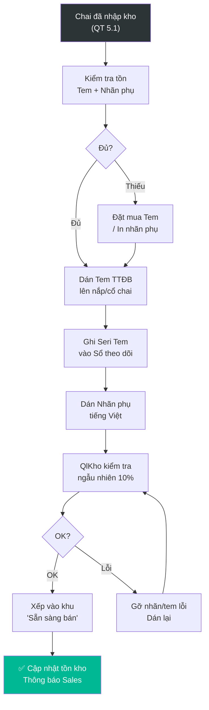

# 5.2 Dán Tem Rượu Nhập khẩu & Nhãn phụ

## 1. Mục đích & Phạm vi
- **Mục đích:** Dán tem rượu nhập khẩu (tem cục thuế) và nhãn phụ tiếng Việt lên từng chai trước khi bán ra thị trường, đúng quy định NĐ 105/2017 và NĐ 43/2017.
- **Áp dụng:** Tất cả chai rượu nhập khẩu. **Không được bán chai nào chưa dán tem + nhãn phụ.**
- **Tần suất:** Sau mỗi lần nhập kho (QT 5.1), hoặc theo nhu cầu bán hàng.

## 2. Thuật ngữ
| Thuật ngữ | Giải thích |
|-----------|-----------|
| **Tem rượu NK** | Tem do Cục Thuế TTĐB cấp, dán trên nắp/cổ chai, chứng minh đã nộp thuế |
| **Nhãn phụ** | Nhãn tiếng Việt dán lên thân chai, chứa thông tin bắt buộc theo NĐ 43/2017 |
| **Seri tem** | Số seri trên tem, phải đăng ký và báo cáo sử dụng với Cục Thuế |

## 3. Trách nhiệm (RACI)

| Bước | Responsible | Approve | Consulted | Informed |
|------|------------|---------|-----------|----------|
| Đặt mua tem tại Cục Thuế | Kế toán | BGĐ | — | Quản lý Kho |
| Biên soạn nội dung nhãn phụ | XNK / Pháp lý | BGĐ | — | Marketing, Kho |
| Thiết kế & In nhãn phụ | Marketing | — | XNK / Pháp lý | Kho |
| Dán tem + nhãn phụ | Nhân viên Kho | Quản lý Kho | — | — |
| Kiểm tra sau dán | Quản lý Kho | — | — | Kế toán |
| Báo cáo sử dụng tem | Kế toán | BGĐ | — | Cục Thuế |

## 4. Quy trình Chi tiết

### Bước 1: Chuẩn bị Tem & Nhãn phụ
- **Input:** Số lượng chai cần dán (từ PNK), tem rượu đã mua, file nhãn phụ
- **Thao tác:**
  1. Kiểm tra **tồn tem** — đủ không? Nếu thiếu → đặt mua bổ sung (cần 3-5 ngày)
  2. Kiểm tra **tồn nhãn phụ** cho từng SKU — nếu thiếu → in bổ sung
  3. Đối với **SKU mới lần đầu**: Cần thiết kế + phê duyệt nhãn phụ mới $\rightarrow$ XNK/Pháp lý biên soạn nội dung kỹ thuật chuẩn gửi phòng Marketing thiết kế maket và thực hiện in ấn $\rightarrow$ [QT 7.4](../07_phap_ly/7.4_tem_nhan.md)
  4. Chuẩn bị bàn dán, kéo, khăn lau, đèn kiểm tra
- **Output:** Tem + nhãn phụ đủ số lượng, sẵn sàng dán
- **Timeline:** 30 phút (nếu đủ stock) | 3-5 ngày (nếu cần mua tem mới)

### Bước 2: Dán Tem rượu Nhập khẩu
- **Input:** Chai rượu, tem TTĐB
- **Thao tác:**
  1. Lau sạch cổ chai / nắp chai (nếu bụi)
  2. Dán tem **ngang qua nắp chai** sao cho:
     - Tem dính 1 phần lên nắp, 1 phần lên cổ chai
     - Khi mở nắp → tem bị rách → chứng minh chai chưa mở
  3. Ấn chặt tem, đảm bảo không bong góc
  4. **Ghi seri tem** theo từng SKU vào Sổ theo dõi Tem (Form 5.2-A)
- **Output:** Chai đã dán tem, sổ theo dõi seri
- **Timeline:** ~30 giây/chai | ~100 chai/giờ (1 người)
- **Lưu ý:**
  - Tem bị rách khi dán → hủy, ghi vào sổ "tem hủy", dùng tem mới
  - **KHÔNG ĐƯỢC** dán tem lên chai ướt (sẽ bong)

### Bước 3: Dán Nhãn phụ Tiếng Việt
- **Input:** Chai đã dán tem, nhãn phụ đúng SKU
- **Thao tác:**
  1. **Xác nhận đúng nhãn** — kiểm tra tên SP, ABV, vintage trên nhãn phụ khớp với nhãn gốc
  2. Dán nhãn phụ lên **mặt sau chai** (không che nhãn gốc)
  3. Vị trí: Thẳng, cân đối, không nghiêng, không chồng lên nhãn gốc
  4. Ấn phẳng, đảm bảo không bong góc
- **Output:** Chai hoàn chỉnh (tem + nhãn phụ)
- **Timeline:** ~20 giây/chai
- **Lưu ý:**
  - Nhãn phụ phải có đủ **10 nội dung bắt buộc** theo NĐ 43/2017 (xem QT 7.4)
  - Nếu vintage trên nhãn phụ ≠ vintage thực tế → **DỪNG**, báo Marketing sửa file nhãn

### Bước 4: Kiểm tra & Hoàn tất
- **Input:** Lô chai đã dán xong
- **Thao tác:**
  1. Quản lý Kho kiểm tra ngẫu nhiên **10% số chai**:
     - Tem dán đúng vị trí, không bong?
     - Nhãn phụ đúng SKU, thông tin chính xác?
     - Nhãn phụ không che nhãn gốc?
  2. Đếm: Số tem đã dán + Số tem hủy = Tổng tem xuất dùng → khớp sổ
  3. Xếp chai đã hoàn thiện vào khu vực **"Sẵn sàng bán"**
  4. Cập nhật trạng thái tồn kho: "Đã dán tem"
- **Output:** Lô hàng sẵn sàng bán, sổ tem cập nhật
- **Timeline:** 30 phút

## 5. Sơ đồ Quy trình

## 6. Biểu mẫu

### Form 5.2-A: Sổ Theo dõi Tem Rượu Nhập khẩu
📥 **Tải form:** [Form_5.2-A_So_theo_doi_Tem.xlsx](../../../sources/Forms/Form_5.2-A_So_theo_doi_Tem.xlsx)

**Nội dung form:**
- Theo dõi hàng ngày: Ngày, Mã SKU, Seri Tem (Từ→Đến), SL Dán, SL Hủy, Người dán
- Tổng kết tháng: Tồn đầu kỳ + Mua – Dán – Hủy = Tồn cuối kỳ

### Nội dung Bắt buộc trên Nhãn phụ (NĐ 43/2017)
1. ✅ Tên sản phẩm (tiếng Việt)
2. ✅ Thành phần / Giống nho
3. ✅ Nồng độ cồn (% vol)
4. ✅ Thể tích (ml)
5. ✅ Vintage / Ngày sản xuất
6. ✅ Hạn sử dụng (hoặc "Không giới hạn")
7. ✅ Xuất xứ (Made in...)
8. ✅ Tên & Địa chỉ Nhà nhập khẩu
9. ✅ Hướng dẫn bảo quản
10. ✅ Cảnh báo sức khỏe

## 7. KPI & Đo lường

| KPI | Công thức | Mục tiêu | Tần suất |
|-----|----------|---------|----------|
| Năng suất dán tem | Số chai dán / giờ / người | ≥ 80 chai/giờ | Mỗi đợt |
| Tỷ lệ tem hủy | Tem hủy / Tổng tem dùng | ≤ 1% | Hàng tháng |
| Tỷ lệ nhãn sai | Nhãn dán sai / Tổng chai | = 0% | Mỗi đợt |
| Thời gian hoàn tất | Từ nhập kho → sẵn sàng bán | ≤ 2 ngày | Mỗi lô |

## 8. Xử lý Ngoại lệ

| Tình huống | Hành động | Escalation |
|-----------|----------|-----------|
| Hết tem, chưa mua kịp | Không được bán! Đặt mua gấp, ưu tiên SKU bán chạy | Kế toán → Cục Thuế |
| Nhãn phụ sai vintage | DỪNG dán SKU đó, báo Marketing sửa file, in lại | Marketing |
| Tem bị rách khi dán | Hủy, ghi sổ, dùng tem mới | — |
| KH yêu cầu không dán nhãn phụ (xuất khẩu) | Chỉ áp dụng nếu hàng KHÔNG bán tại VN. Cần phê duyệt BGĐ | BGĐ |

## 9. Tài liệu Liên quan
- ← Trước: [5.1 Nhập kho](5.1_nhap_kho.md)
- → Sau: [5.3 Bảo quản](5.3_bao_quan.md) | [5.6 Xuất kho](5.6_xuat_kho.md)
- ↔ Liên quan: [7.4 Quản lý Tem nhãn](../07_phap_ly/7.4_tem_nhan.md) | [7.2 Tự Công bố](../07_phap_ly/7.2_tu_cong_bo_san_pham.md)
