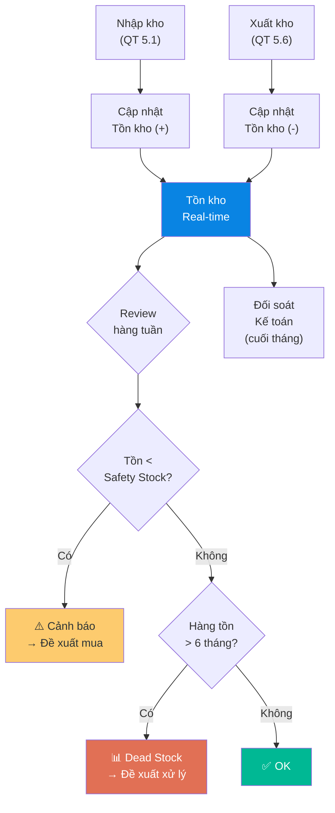

# 5.4 Quản lý Tồn kho

## 1. Mục đích & Phạm vi
- **Mục đích:** Duy trì dữ liệu tồn kho chính xác, real-time, phục vụ bán hàng, mua hàng, và kế toán.
- **Áp dụng:** Toàn bộ hàng hóa rượu vang và vật phẩm quảng cáo, hộp quà (xem chi tiết [5.8 Quản lý POSM & Hộp quà](5.8_quan_ly_posm_hop_qua.md)) tại tất cả các địa điểm kho của Lyscellar bao gồm:
  - **Kho Thường Tín (KTT):** Kho tổng lưu trữ số lượng lớn và bảo quản trung - dài hạn.
  - **Kho Giang Văn Minh (KGVM):** Kho trung chuyển phục vụ giao hàng nhanh khu vực nội thành.
  - **Kho Showroom (KSR):** Kho chứa hàng trưng bày và bán trực tiếp tại showroom.
  - **Kho Ký gửi (Consignment):** Kho tại các đối tác/nhà hàng (nếu có).
- **Tần suất:** Cập nhật liên tục khi có nhập/xuất. Review hàng tuần.

## 2. Thuật ngữ
| Thuật ngữ | Giải thích |
|-----------|-----------|
| **Tồn khả dụng** | Tồn kho thực tế - Hàng đã reserve (đặt trước chưa xuất) |
| **Safety Stock** | Mức tồn tối thiểu để không bị đứt hàng |
| **Dead Stock** | Hàng tồn > 12 tháng không bán được |
| **Aging** | Thời gian hàng nằm trong kho (tính từ ngày nhập) |
| **FIFO** | First In First Out — nguyên tắc xuất hàng cũ trước |
| **FEFO** | First Expired First Out — nguyên tắc xuất hàng có hạn dùng/niên vụ cũ hơn ra trước (xem chi tiết [5.9 Quản lý Niên vụ & FEFO](5.9_quan_ly_nien_vu_fefo.md)) |

## 3. Trách nhiệm (RACI)

| Hạng mục | Responsible | Approve | Consulted | Informed |
|----------|------------|---------|-----------|----------|
| Cập nhật tồn kho sau nhập/xuất | Nhân viên Kho | — | — | Sales, Kế toán |
| Đối soát tồn kho vs Kế toán | Quản lý Kho | Kế toán trưởng | — | BGĐ |
| Phân tích hàng chậm/dead stock | Quản lý Kho | BGĐ | Sales, Marketing | — |
| Đề xuất mua bổ sung | Quản lý Kho | BGĐ | Sales | Kế toán |

## 4. Quy trình Chi tiết

### Bước 1: Cập nhật Nhập kho
- **Khi nào:** Ngay sau khi hoàn tất QT 5.1 (Nhập kho)
- **Thao tác:**
  1. Nhập vào hệ thống/Excel: Mã SKU, SL nhập, Ngày nhập, Số PNK, Vị trí kệ
  2. Cập nhật trạng thái: "Chưa dán tem" → "Đã dán tem" → "Sẵn sàng bán"
  3. Kiểm tra: Tồn mới = Tồn cũ + SL nhập
- **Lưu ý:** Hàng chưa dán tem **KHÔNG** tính vào tồn khả dụng để bán

### Bước 2: Cập nhật Xuất kho
- **Khi nào:** Ngay sau khi xuất hàng (QT 5.6)
- **Thao tác:**
  1. Trừ tồn: Mã SKU, SL xuất, Ngày xuất, Số PXK, KH nhận. Bắt buộc trừ đúng mã kho thực tế đã xuất hàng (`KTT`, `KGVM` hoặc `KSR`).
  2. Kiểm tra: Tồn mới = Tồn cũ - SL xuất
  3. **Cảnh báo tự động:** Nếu tồn mới < Safety Stock → thông báo BGĐ + Mua hàng

### Bước 3: Điều chuyển Kho Nội bộ (Internal Transfer)
- **Khi nào:** Khi cần bổ sung hàng hóa từ Kho tổng Thường Tín (KTT) sang Kho Giang Văn Minh (KGVM) hoặc Kho Showroom (KSR) phục vụ bán lẻ/giao nhanh.
- **Thao tác:**
  1. **Lập yêu cầu chuyển kho:** Nhân viên showroom hoặc Sales gửi yêu cầu chuyển hàng, ghi rõ SKU, Số lượng, và Kho nhận đích (`KGVM` hoặc `KSR`).
  2. **Tạo Lệnh điều chuyển trên MISA:** Kế toán kho hoặc Sale Admin tạo phiếu **Chuyển kho nội bộ** trên phần mềm MISA:
     - Chọn Kho xuất: `KTT` (hoặc kho nguồn tương ứng)
     - Chọn Kho nhập: `KGVM` hoặc `KSR`
     - Nhập mã SKU và số lượng cần điều chuyển.
  3. **Xuất hàng vật lý:** Thủ kho Thường Tín thực hiện lấy hàng theo nguyên tắc FIFO/FEFO, đóng gói chống va đập cẩn thận, dán nhãn chuyển kho. Bàn giao hàng cho tài xế xe tải thùng kín cách nhiệt.
  4. **Vận chuyển:** Vận chuyển nhanh chóng bằng xe chuyên dụng. Tránh để hàng tiếp xúc trực tiếp ngoài nắng gắt trong quá trình bốc dỡ.
  5. **Nhập kho nhận:** Thủ kho Giang Văn Minh hoặc nhân viên Showroom nhận hàng, kiểm đếm số lượng thực tế, kiểm tra chất lượng nhãn chai và nút bần (đảm bảo không nứt/mẻ/rò rỉ), ký xác nhận vào phiếu điều chuyển giấy.
  6. **Xác nhận hoàn thành trên hệ thống:** Thủ kho nhận hoặc kế toán xác nhận "Nhập kho" trên hệ thống MISA để chính thức ghi tăng tồn kho tại kho nhận và ghi giảm tồn kho tại kho xuất.
- **Timeline:** Hoàn tất trong vòng 24 giờ kể từ khi yêu cầu được duyệt.

### Bước 4: Review Tồn kho Hàng tuần
- **Tần suất:** Mỗi thứ Sáu
- **Thao tác:**
  1. In/xuất **Bảng tồn kho tổng hợp theo từng kho** (Form 5.4-A)
  2. Review từng SKU tại từng địa điểm kho (`KTT`, `KGVM`, `KSR`):
     - Tồn = 0 → Hết hàng, cần đặt?
     - Tồn < Safety Stock tại kho trung chuyển/showroom → Lập lệnh điều chuyển bổ sung từ kho tổng.
     - Tồn > 6 tháng không bán tại showroom → Đề xuất điều động trả về kho tổng hoặc triển khai chương trình khuyến mãi/tasting giải phóng hàng.
  3. Gửi bảng tồn cho Sales team (để biết hàng nào còn bán được ở kho nào)
  4. Gửi cho BGĐ nếu có SKU cần quyết định (hàng chậm, hết hàng)

### Bước 5: Đối soát với Kế toán (Hàng tháng)
- **Tần suất:** Ngày cuối mỗi tháng
- **Thao tác:**
  1. Xuất **Tồn kho theo từng Kho** (`KTT`, `KGVM`, `KSR`) từ hệ thống thủ kho
  2. Xuất **Tồn kho theo Kế toán chi tiết từng Kho** từ MISA/sổ sách
  3. So khớp từng SKU tại từng kho — ghi nhận chênh lệch
  4. Nếu chênh lệch > 0 → điều tra nguyên nhân:
     - Chưa nhập liệu / Chuyển kho chưa xác nhận trên hệ thống?
     - Xuất bán mà chưa ghi giảm trên MISA?
     - Hàng lỗi/vỡ chưa xử lý khấu trừ?
  5. Điều chỉnh sau khi xác nhận nguyên nhân

## 5. Bảng Mức Tồn kho Khuyến nghị (Safety Stock)

| Loại sản phẩm | Safety Stock | Dựa trên |
|---------------|-------------|---------|
| **Best sellers** (Centoventi, Pinot Grigio, HOH Shiraz) | ≥ 2 tháng bán | Lịch sử bán 6 tháng |
| **Mid-range** (Collavini, La Solitude) | ≥ 1 tháng bán | Lịch sử bán 6 tháng |
| **Premium** (Amarone, Barolo, Broy) | ≥ 6 chai | Bán chậm, khó bổ sung |
| **Seasonal** (Prosecco, Sparkling) | ≥ 3 tháng bán trước Tết/Noel | Nhu cầu cao mùa lễ |
| **SKU mới** | Theo số lượng nhập đầu tiên | Chưa có data |

## 6. Sơ đồ Quy trình

## 7. Biểu mẫu

### Form 5.4-A: Bảng Tồn kho Tổng hợp
📥 **Tải form:** [Form_5.4-A_Bang_Ton_kho.xlsx](../../../sources/Forms/Form_5.4-A_Bang_Ton_kho.xlsx)

**Nội dung form:**
- Danh sách SKU: Tồn thực tế, Đã reserve, Khả dụng, Safety Stock
- Cột trạng thái: ✅ OK / ⚠️ Dưới SS / 🔴 Hết hàng / 💤 Dead Stock
- Tổng kết: Tổng SKU, Tổng chai, Giá trị ước tính

## 8. KPI & Đo lường

| KPI | Công thức | Mục tiêu | Tần suất |
|-----|----------|---------|----------|
| Độ chính xác tồn kho | SKU khớp / Tổng SKU (khi kiểm kê) | ≥ 98% | Hàng quý |
| Tỷ lệ đứt hàng | Số lần hết hàng best-seller / Tổng tuần | ≤ 5% | Hàng tháng |
| Vòng quay tồn kho | COGS / Tồn kho trung bình | ≥ 4 lần/năm | Hàng quý |
| Tỷ lệ dead stock | Giá trị dead stock / Tổng giá trị tồn | ≤ 5% | Hàng quý |

## 9. Xử lý Ngoại lệ

| Tình huống | Hành động | Escalation |
|-----------|----------|-----------|
| Tồn kho âm (xuất > nhập) | DỪNG xuất, kiểm tra lại nhập liệu | Quản lý Kho |
| Chênh lệch kiểm kê > 2% | Kiểm kê lại, truy vết từng PNK/PXK | BGĐ |
| Dead stock > 12 tháng | Đề xuất: giảm giá, quà tặng KH, trả NCC | BGĐ |
| Hết hàng best-seller | Thông báo Sales ngay, đặt hàng khẩn nếu có thể | BGĐ + Mua hàng |

## 10. Tài liệu Liên quan
- ← Liên quan: [5.1 Nhập kho](5.1_nhap_kho.md) | [5.6 Xuất kho](5.6_xuat_kho.md)
- → Sau: [5.5 Kiểm kê](5.5_kiem_ke.md)
- ↔ Liên quan: [3.1 Dự báo Nhu cầu](../03_mua_hang/3.1_du_bao_nhu_cau.md) | [8.4 Giá vốn COGS](../08_tai_chinh/8.4_gia_von_cogs.md) | [5.8 Quản lý POSM & Hộp quà](5.8_quan_ly_posm_hop_qua.md) | [5.9 Quản lý Niên vụ & FEFO](5.9_quan_ly_nien_vu_fefo.md)
