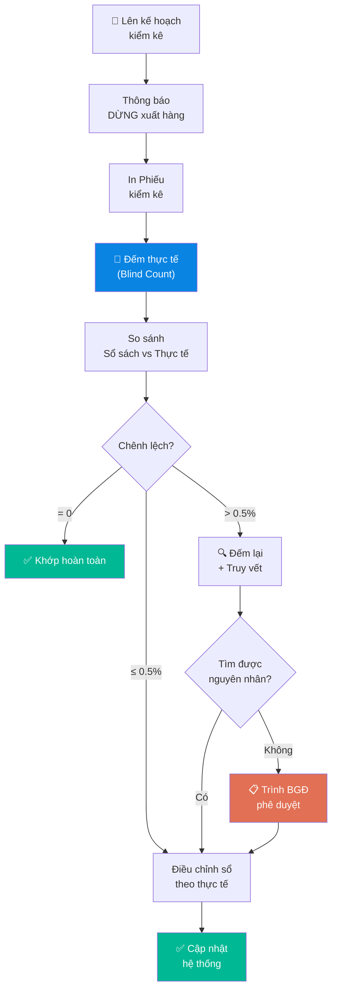

# 5.5 Kiểm kê Hàng hóa

## 1. Mục đích & Phạm vi
- **Mục đích:** Đối chiếu tồn kho thực tế (đếm tay) với sổ sách, phát hiện chênh lệch, đảm bảo tính chính xác cho kế toán và bán hàng.
- **Áp dụng:** Toàn bộ hàng hóa tại tất cả kho.
- **Tần suất:** 
  - Kiểm kê toàn bộ — **hàng quý** (31/3, 30/6, 30/9, 31/12).
  - Kiểm kê định kỳ & đối chiếu số liệu trên phần mềm — **hàng tuần** (vào các ngày 6, 13, 20, 27 hàng tháng).
  - Kiểm kê ngẫu nhiên — **hàng tháng**.

## 2. Trách nhiệm (RACI)

| Bước | Responsible | Approve | Consulted | Informed |
|------|------------|---------|-----------|----------|
| Lên kế hoạch kiểm kê | Quản lý Kho | BGĐ | Kế toán | Sales |
| Đếm thực tế | Nhân viên Kho + 1 người độc lập | — | — | — |
| Đối soát chênh lệch | Quản lý Kho + Kế toán | — | — | — |
| Phê duyệt điều chỉnh | BGĐ | — | Kế toán | — |

## 3. Quy trình Chi tiết

### Bước 1: Chuẩn bị Kiểm kê
- **Timeline:** 1-2 ngày trước kiểm kê
- **Thao tác:**
  1. Thông báo Sales: **DỪNG xuất hàng** trong ngày kiểm kê (hoặc hoàn tất trước 5PM hôm trước)
  2. In **Phiếu kiểm kê** (Form 5.5-A) — danh sách SKU, vị trí kệ, cột để ghi SL đếm
  3. Chuẩn bị nhân sự: Ít nhất **2 người đếm** (1 kho + 1 người ngoài kho để đảm bảo khách quan)
  4. Đảm bảo hàng sắp xếp gọn gàng, không lẫn lộn

### Bước 2: Đếm Thực tế (Blind Count)
- **Nguyên tắc:** Người đếm **KHÔNG được xem** số liệu sổ sách (blind count)
- **Thao tác:**
  1. Đi theo thứ tự kệ (A → B → C...), từng vị trí
  2. Đếm từng SKU:
     - Đếm số thùng nguyên (carton) × số chai/thùng
     - Đếm chai lẻ riêng
     - SL = (Thùng nguyên × chai/thùng) + Chai lẻ
  3. Ghi vào Phiếu kiểm kê (Form 5.5-A)
  4. Nếu phát hiện chai lạ (không có trong danh sách) → ghi riêng
  5. Nếu thấy chai bị hỏng → đánh dấu riêng, không tính vào tồn tốt

### Bước 3: Đối soát
- **Timeline:** Ngay sau khi đếm xong (trong ngày)
- **Thao tác:**
  1. Quản lý Kho nhập SL đếm thực tế vào bảng đối soát
  2. So sánh: **SL Sổ sách vs SL Đếm thực tế**
  3. Tính chênh lệch:
     - Chênh lệch (+) = Thực tế > Sổ sách → Thừa
     - Chênh lệch (-) = Thực tế < Sổ sách → Thiếu
  4. **Nếu chênh lệch:**
     - Đếm lại SKU đó (lần 2)
     - Kiểm tra PNK/PXK gần nhất — có quên nhập liệu không?
     - Kiểm tra hàng trả lại, hàng lỗi chưa ghi sổ
  5. Ghi kết luận vào **Biên bản Kiểm kê** (Form 5.5-B)

### Bước 4: Phê duyệt & Điều chỉnh
- **Thao tác:**
  1. Quản lý Kho + Kế toán ký Biên bản Kiểm kê
  2. Nếu chênh lệch ≤ 0.5% (tính theo giá trị) → Điều chỉnh sổ theo thực tế
  3. Nếu chênh lệch > 0.5% → Trình BGĐ phê duyệt trước khi điều chỉnh
  5. Lưu hồ sơ kiểm kê

### Bước 5: Kiểm kê & Đối chiếu hàng tuần
- **Tần suất:** Ngày 6, 13, 20, 27 hàng tháng (R)
- **Thao tác:**
  1. Kế toán kho lập danh sách các mã hàng (SKU) có phát sinh giao dịch nhiều hoặc hàng fast-moving trong tuần.
  2. Nhân viên kho tiến hành đếm nhanh thực tế các SKU này.
  3. Kế toán đối chiếu số lượng thực tế đếm được với số dư tồn kho trên phần mềm kế toán MISA.
  4. Nếu có chênh lệch, thực hiện rà soát ngay các chứng từ nhập - xuất kho trong tuần để tìm nguyên nhân (ví dụ: chưa nhập phiếu, xuất nhầm mã, lỗi hệ thống) và điều chỉnh số liệu trên phần mềm kế toán kịp thời.

## 4. Sơ đồ Quy trình

## 5. Biểu mẫu

### Form 5.5-A: Phiếu Kiểm kê
📥 **Tải form:** [Form_5.5-A_Phieu_Kiem_ke.xlsx](../../../sources/Forms/Form_5.5-A_Phieu_Kiem_ke.xlsx)

**Nội dung form:**
- Danh sách SKU, Vị trí kệ, Thùng nguyên × chai/thùng, Chai lẻ, Tổng
- Chữ ký 2 Người đếm (blind count)

### Form 5.5-B: Biên bản Kiểm kê (Đối soát)
📥 **Tải form:** [Form_5.5-B_Bien_ban_Kiem_ke.xlsx](../../../sources/Forms/Form_5.5-B_Bien_ban_Kiem_ke.xlsx)

**Nội dung form:**
- Tổng kết: SKU khớp, SKU chênh lệch, Giá trị thừa/thiếu
- Chi tiết chênh lệch: Mã SKU, Sổ sách vs Thực tế, Nguyên nhân
- Chữ ký: Quản lý Kho + Kế toán + BGĐ (nếu > 0.5%)

## 6. KPI & Đo lường

| KPI | Công thức | Mục tiêu | Tần suất |
|-----|----------|---------|----------|
| Độ chính xác tồn kho | SKU khớp / Tổng SKU | ≥ 98% | Hàng quý |
| Giá trị chênh lệch | Tổng giá trị chênh lệch / Tổng giá trị tồn | ≤ 0.5% | Hàng quý |
| Thời gian kiểm kê | Từ bắt đầu đếm → hoàn tất biên bản | ≤ 1 ngày | Mỗi lần |

## 7. Tài liệu Liên quan
- ← Trước: [5.4 Quản lý Tồn kho](5.4_quan_ly_ton_kho.md)
- → Sau: [5.6 Xuất kho](5.6_xuat_kho.md)
- ↔ Liên quan: [8.4 Giá vốn COGS](../08_tai_chinh/8.4_gia_von_cogs.md) | [8.7 Báo cáo Tài chính](../08_tai_chinh/8.7_bao_cao_tai_chinh.md)
