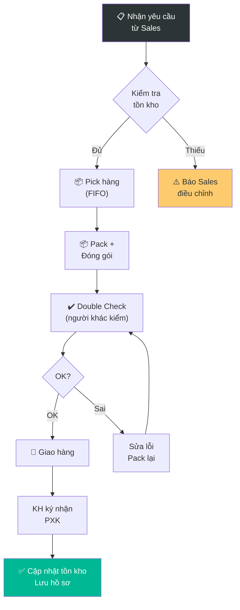

# 5.6 Xuất kho & Giao hàng

## 1. Mục đích & Phạm vi
- **Mục đích:** Đảm bảo hàng được xuất kho chính xác (đúng SKU, đúng SL, đúng KH), đóng gói an toàn, giao đúng hẹn.
- **Áp dụng:** Mọi trường hợp hàng rời khỏi các kho của Lyscellar:
  - **Kho Thường Tín (KTT):** Xuất các đơn hàng B2B lớn, đại lý, đơn hàng liên tỉnh, hoặc chuyển kho nội bộ sang các chi nhánh.
  - **Kho Giang Văn Minh (KGVM):** Xuất các đơn hàng lẻ B2C giao nhanh nội thành Hà Nội, đơn HoReCa nội thành.
  - **Kho Showroom (KSR):** Xuất hàng trực tiếp cho khách mua tại showroom hoặc khách tự đến lấy tại Showroom.
- **Tần suất:** Hàng ngày.

## 2. Trách nhiệm (RACI)

| Bước | Responsible | Approve | Consulted | Informed |
|------|------------|---------|-----------|----------|
| Nhận yêu cầu xuất kho | Thủ kho | — | Sales | — |
| Pick & Pack | Thủ kho | — | — | — |
| Kiểm tra trước xuất | Quản lý Kho (hoặc NV khác) | — | — | — |
| Phê duyệt PXK | Quản lý Kho | BGĐ (nếu > 50 chai) | — | Kế toán |
| Bàn giao & Giao hàng | Thủ kho & Người giao hàng (Shipper) | — | — | Sales, KH |
| Xác nhận KH đã nhận | Sales | — | — | Kế toán |

## 3. Quy trình Chi tiết

### Bước 1: Nhận Yêu cầu Xuất kho & Xác định Kho nguồn
- **Input:** Đơn hàng đã duyệt (từ QT 6.3) hoặc Yêu cầu chuyển kho nội bộ.
- **Thao tác:**
  1. Nhận yêu cầu từ Sales/Hệ thống bao gồm:
     - Tên KH, địa chỉ giao, SĐT.
     - Danh sách SKU + SL.
     - Thời gian giao yêu cầu.
  2. **Xác định Kho nguồn xuất hàng (Sourcing Rules):**
     - Đơn đại lý/B2B lớn/Giao tỉnh $\rightarrow$ Xuất từ **`KTT`** (Kho Thường Tín).
     - Đơn B2C lẻ/Giao nhanh nội thành Hà Nội $\rightarrow$ Xuất từ **`KGVM`** (Kho Giang Văn Minh).
     - Đơn mua trực tiếp tại Showroom hoặc khách tự lấy tại Showroom $\rightarrow$ Xuất từ **`KSR`** (Kho Showroom).
  3. Kiểm tra tồn kho khả dụng cho từng SKU tại Kho nguồn tương ứng.
  4. Nếu đủ hàng $\rightarrow$ Tiến hành duyệt xuất và chuyển sang Bước 2.
  5. Nếu thiếu hàng tại kho phân bổ nhưng còn ở kho tổng $\rightarrow$ Lập lệnh điều chuyển nội bộ khẩn cấp về kho phân bổ trước khi giao, hoặc báo Sales đổi kho nguồn xuất hàng.
- **Timeline:** 15 phút
- **Lưu ý:** 
  - Kiểm tra hàng đã dán tem + nhãn phụ chưa. **KHÔNG xuất hàng chưa dán tem.**
  - **Đơn hàng từ tối hôm trước:** Sale Admin và Thủ kho phải phối hợp để chuẩn bị xong đơn và hàng (in PXK, soạn hàng, đóng gói, kiểm tra chéo) trước **09h00 sáng** để sẵn sàng bàn giao cho Shipper.

### Bước 2: Pick (Lấy hàng)
- **Thao tác:**
  1. In/ghi **Phiếu xuất kho (PXK)** tạm — danh sách SKU + SL + vị trí kệ
  2. Đi đến vị trí kệ, lấy hàng theo nguyên tắc **FIFO** (hàng cũ trước)
  3. Đặt hàng lên xe đẩy / khu vực đóng gói
  4. Đánh dấu "đã lấy" trên PXK
- **Timeline:** 15-30 phút (tùy số SKU)
- **Lưu ý:** Kiểm tra visual khi lấy — chai có bị bẩn, nhãn bong, nút lỏng không?

### Bước 3: Pack (Đóng gói)
- **Thao tác:**
  1. Kiểm tra lại: **đúng SKU, đúng SL, đúng vintage**
  2. Đóng gói theo quy cách:
     - **1-6 chai:** Túi giấy Lyscellar + giấy chống sốc
     - **6-12 chai:** Thùng carton chia ngăn + giấy chống sốc
     - **> 12 chai:** Thùng carton + foam / bubble wrap giữa các chai
     - **Rượu premium (> 500K/chai):** Hộp gỗ (nếu có) + giấy lụa
  3. Dán nhãn thùng: Tên KH, SĐT, địa chỉ, SL chai, "FRAGILE / DỄ VỠ"
  4. **Chụp ảnh hàng trước khi đóng thùng** (làm bằng chứng nếu KH khiếu nại)
- **Timeline:** 15-30 phút
- **Lưu ý:** Mùa hè (> 30°C ngoài trời) → cân nhắc thêm túi gel đá hoặc giao sáng sớm/chiều tối

### Bước 4: Kiểm tra Chéo (Double Check)
- **Thao tác:**
  1. Người **KHÁC** (không phải người pick) kiểm tra lại:
     - SL thùng vs PXK
     - Mở ngẫu nhiên 1 thùng → đúng SKU + SL?
     - Nhãn giao hàng đúng KH?
  2. Ký xác nhận trên PXK: "Đã kiểm tra"
- **Timeline:** 10 phút
- **SLA chuẩn bị hàng gấp:** Đối với các đơn hàng gấp/giao nhanh trong nội thành, tổng thời gian từ khi nhận phiếu xuất kho từ kế toán đến khi soạn hàng, đóng gói, kiểm tra chéo và bàn giao cho shipper **không vượt quá 10 phút**.
- **Lưu ý:** Bước này **BẮT BUỘC** — giảm 95% sai sót giao hàng

### Bước 5: Bàn giao & Giao hàng
- **Thao tác:**
  1. **Giao bằng Người giao hàng nội bộ (Shipper):**
     - Thủ kho thực hiện bàn giao hàng hóa và PXK giấy cho Shipper.
     - Shipper xếp hàng lên xe cẩn thận (không xếp nặng lên nhẹ).
     - Shipper đi giao hàng, yêu cầu KH ký nhận trên PXK bản gốc.
  2. **Giao qua đối tác vận chuyển (GHTK/Lalamove...):**
     - Thủ kho bàn giao hàng cho tài xế của đối tác, chụp ảnh biên nhận làm bằng chứng.
     - Ghi mã vận đơn lên PXK giấy.
  3. **KH tự đến lấy:**
     - KH ký nhận PXK trực tiếp tại kho.
  4. Bàn giao PXK bản gốc có đầy đủ chữ ký nhận của KH cho Kế toán bán hàng (hoặc scan/gửi ảnh trước).
  5. Thông báo Sales: "Đã giao xong đơn hàng [mã đơn]".
- **Timeline:** Tùy khoảng cách
- **Lưu ý:** 
  - Nếu giao ngoài TP ➔ kiểm tra shipper có bảo hiểm hàng dễ vỡ không.
  - **Lịch giao hàng đặc biệt:** Nhân viên giao nhận phải đối chiếu khung giờ giao hàng tối ưu và ngày nghỉ của khách hàng HORECA/Key Accounts tại [Mục 8](#8-lich-giao-hang--luu-y-dac-biet-cho-khach-hang-horeca--key-accounts) trước khi xuất phát để tránh bị trả lại hàng.

### Bước 6: Xác nhận & Hoàn tất
- **Thao tác:**
  1. Sales xác nhận KH đã nhận hàng (Zalo/Điện thoại)
  2. Nếu KH báo lỗi (thiếu, vỡ) → [QT 6.6 Khiếu nại](../06_ban_hang/6.6_xu_ly_khieu_nai.md)
  3. Cập nhật tồn kho (QT 5.4): Trừ SL đã xuất
  4. Lưu PXK (bản có chữ ký KH) vào hồ sơ

### Bước 7: Đối chiếu kho cuối ngày (Trước 18:00 hàng ngày)
- **Thao tác:**
  1. Thủ kho tổng hợp toàn bộ Phiếu xuất kho (PXK bản gốc và liên giao khách đã có chữ ký nhận) phát sinh trong ngày.
  2. Đối chiếu số liệu xuất kho thực tế với PXK và cập nhật giảm số lượng trên Thẻ kho vật lý.
  3. Tiến hành kiểm đếm vật lý, đối chiếu tồn kho thực tế cuối ngày với số liệu trên Thẻ kho và phần mềm (phải khớp 100%).
  4. Lập Biên bản kiểm kê kho và báo cáo ngay cho Quản lý kho/Kế toán trưởng nếu phát sinh chênh lệch, mất mát, hư hỏng trong ngày.
  5. Bàn giao toàn bộ chứng từ (PXK, Thẻ kho đã cập nhật, Biên lai thu tiền mặt nếu có) cho bộ phận Kế toán **trước 18:00 hàng ngày** để đối soát tài chính và xuất hóa đơn GTGT.

## 4. Sơ đồ Quy trình

## 5. Quy cách Đóng gói

| Số chai | Quy cách | Vật liệu |
|---------|---------|---------|
| 1-2 chai | Túi giấy Lyscellar | Giấy chống sốc bọc từng chai |
| 3-6 chai | Thùng carton nhỏ | Chia ngăn + giấy chống sốc |
| 7-12 chai | Thùng carton chuẩn (12-bottle) | Chia ngăn sẵn |
| > 12 chai | Nhiều thùng, mỗi thùng ≤ 12 chai | Bubble wrap + foam |
| Premium | Hộp gỗ + giấy lụa | Theo bộ hộp quà (nếu có) |
| Giao xa (> 100km) | Thùng carton + pallet wrap | Bảo hiểm vận chuyển |

## 6. Biểu mẫu

### Form 5.6-A: Phiếu Xuất kho
📥 **Tải form:** [Form_5.6-A_Phieu_Xuat_kho.xlsx](../../../sources/Forms/Form_5.6-A_Phieu_Xuat_kho.xlsx)

**Nội dung form:**
- Thông tin KH: Tên, SĐT, Địa chỉ giao
- Bảng chi tiết: Mã SKU, Tên SP, SL, Đơn giá, Thành tiền
- Hình thức giao: Xe công ty / Shipper / KH tự lấy
- Chữ ký: Người pick + Người check + KH ký nhận

## 7. KPI & Đo lường

| KPI | Công thức | Mục tiêu | Tần suất |
|-----|----------|---------|----------|
| Tỷ lệ giao đúng hẹn | Đơn giao đúng ngày / Tổng đơn | ≥ 95% | Hàng tháng |
| Tỷ lệ giao đúng hàng | Đơn không lỗi / Tổng đơn | ≥ 99% | Hàng tháng |
| Tỷ lệ vỡ khi giao | Chai vỡ / Tổng chai giao | ≤ 0.1% | Hàng quý |
| Thời gian giao đơn thường | Từ khi duyệt → hoàn tất giao hàng | ≤ 1 giờ (nội thành, đặt trước 18h00) | Mỗi đơn |
| Thời gian giao đơn gấp | Từ khi duyệt → hoàn tất giao hàng | ≤ 0.5 giờ (nội thành) | Mỗi đơn |

## 8. Lịch Giao hàng & Lưu ý Đặc biệt cho Khách Hàng (HORECA / Key Accounts)

Nhân viên kho soạn đơn và nhân viên giao hàng (Shipper/Tài xế) cần đặc biệt lưu ý các ràng buộc thời gian và ngày nghỉ của khách hàng để tối ưu hóa việc phân bổ tuyến đường và tránh bị trả hàng:

| STT | Khách hàng | Mã MISA (Con) | Thương Hiệu | Khung giờ / Lưu ý giao hàng | Địa chỉ giao hàng thực tế |
|---|---|---|---|---|---|
| 1 | **LA BADIANE** | `HR10017-01` | La Badiane | Sáng: **9h00 - 11h30** Chiều: **Sau 14h30 - 18h00** | Số 10 Nam Ngư, Cửa Nam, Hoàn Kiếm, Hà Nội |
| 2 | **RICO** | `HR10059-01` | Rico Seafood & Grill | **Tránh giờ nghỉ trưa: 13h30 - 17h00** | Số 56 Trần Quốc Toản, Hoàn Kiếm, Hà Nội (và các chi nhánh con) |
| 3 | **GRAND PLAZA** | `HR10015-01` | Grand Plaza | Sáng: **giao trước 11h30** Chiều: **giao trước 16h30** **Yêu cầu bắt buộc phải có PO khi giao hàng** | Khách sạn Grand Plaza, 117 Trần Duy Hưng, Cầu Giấy, Hà Nội |
| 4 | **MISS Q** | `HR10014-01` | Al Fresco's | Sáng: **10h00 - 11h00** (nếu gấp) Chiều: **từ 14h00 đến tối** | Tầng 4, Số 49 Hai Bà Trưng, Tràng Tiền, Hoàn Kiếm, Hà Nội |
| 5 | **METROPOLE** | `HR10006-01` | Metropole | **Giao trước 11h00** (Sáng) Giao cổng Lý Thái Tổ. Quy trình: Phiếu qua c.Trinh (phòng nhận hàng) ký & kiểm hàng -> Giao kho đồ uống chú Thành kiểm & ký -> Quay lại c.Trinh ký -> Mang liên hồng về | Khách sạn Metropole, 15 Ngô Quyền, Hoàn Kiếm, Hà Nội |
| 6 | **DZO** | `HR10072-04` | Cousins Restaurant | **Giao sau 15h00** **Nghỉ Thứ 2 hàng tuần** | Số 3 Quảng Bá, Quảng An, Tây Hồ, Hà Nội |
| 7 | **SAME BISTRO** | `HR10079-01` | Samé Bistro | **Giao từ 15h00 - 18h00** (Riêng Tháng 7/2026: Tránh giao trưa 14h00 - 17h00 do đóng cửa) **Nghỉ Thứ 2 hàng tuần** | Số 29 Phố Lê Thánh Tông, Cửa Nam, Hoàn Kiếm, Hà Nội |
| 8 | **BARBAK** | `HR10091-01` | Barbak Quảng An | **Tránh giờ nghỉ trưa: 14h00 - 17h00** | Số 22 Quảng An, Tây Hồ, Hà Nội (và cơ sở Hàng Bồ) |
| 9 | **PEZZI** | `HR10004-01` | Khách lẻ | Sáng: **từ 9h30** **Tránh giờ nghỉ trưa: 14h30 - 17h00** | Theo thông tin đơn hàng / Zalo Sales |
| 10 | **OLIVE & VINO** | `HR10084-02` | Olivé & Vino | **Giao sau 15h00** | Số 16 Nguyễn Gia Thiều, Cửa Nam, Hoàn Kiếm, Hà Nội |
| 11 | **LA FIORENTINA** | `HR10040-01` | La Fiorentina | **Tránh giờ nghỉ trưa: 14h00 - 17h30** | Số 20 Đặng Thai Mai, Quảng An, Tây Hồ, Hà Nội |
| 12 | **CHAPTER** | `HR10027-01` | Chapter Restaurant | **Giao từ 15h00 - 17h00** | Số 12C Phố Chân Cầm, Hàng Trống, Hoàn Kiếm, Hà Nội |
| 13 | **SICILY CHAMBER BAR** | `HR10048-01` | Sicily Chamber Bar | **Giao sau 17h30** | Số 9 Phố Ấu Triệu, Hàng Trống, Hoàn Kiếm, Hà Nội |
| 14 | **COUSINS** | `HR10072-02` | Cousins Restaurant | **Giao từ 10h00** | Số 19 Tô Ngọc Vân, Quảng An, Tây Hồ, Hà Nội (và cơ sở Đào Tấn) |
| 15 | **BROMIGO** | `HR10051-01` | Bromigo - Fine Street Bbq | **Giao từ 16h00** **Đóng cửa Thứ 3 hàng tuần** | Số 81B Xuân Diệu, Quảng An, Tây Hồ, Hà Nội |
| 16 | **COLETTE** | `HR10030-01` | Colette French Bistro | **Giao hàng trước 16h00 (4 PM)** | Số 12 Lò Sũ, Phường Lý Thái Tổ, Quận Hoàn Kiếm, Hà Nội |
| 17 | **NEXUS** | `HR10099-01` | Nexus | **Chỉ mở buổi chiều, giao hàng sau 16h00** | Theo thông tin đơn hàng / Zalo Sales |

---

## 9. Xử lý Ngoại lệ

| Tình huống | Hành động | Escalation |
|-----------|----------|-----------|
| Thiếu hàng 1 SKU | Báo Sales → đề xuất thay thế hoặc giao sau | Sales |
| Hàng chưa dán tem | **KHÔNG giao!** Dán tem trước (QT 5.2) | Quản lý Kho |
| KH đổi địa chỉ giao | Cập nhật PXK, thông báo shipper | — |
| Chai vỡ trong quá trình giao | Chụp ảnh, lập biên bản, claim bảo hiểm/shipper, giao bù KH | Quản lý Kho → Sales |
| KH từ chối nhận (hàng sai/hỏng) | Nhận hàng về, kiểm tra, giao lại hoặc hoàn tiền → QT 6.6 | Sales → BGĐ |

---

## 10. Tài liệu Liên quan
- ← Trước: [6.3 Xử lý Đơn hàng](../06_ban_hang/6.3_xu_ly_don_hang.md)
- → Sau: [8.2 Công nợ Phải thu](../08_tai_chinh/8.2_cong_no_phai_thu.md)
- ↔ Liên quan: [5.4 Quản lý Tồn kho](5.4_quan_ly_ton_kho.md) | [6.6 Khiếu nại](../06_ban_hang/6.6_xu_ly_khieu_nai.md)
