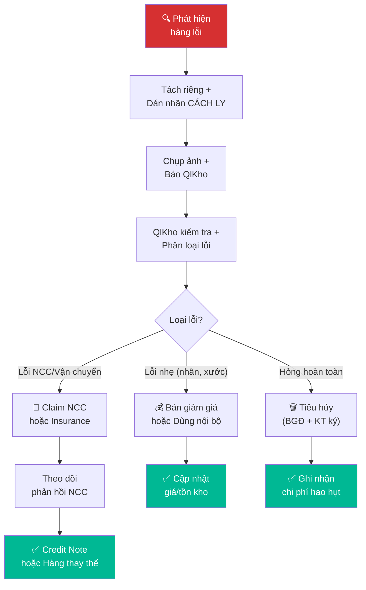

# 5.7 Xử lý Hàng lỗi & Hàng hư hỏng

## 1. Mục đích & Phạm vi
- **Mục đích:** Xử lý nhanh chóng và đúng quy trình các chai rượu bị lỗi/hư hỏng — từ phát hiện, phân loại, đến hành động (claim NCC, tiêu hủy, hoặc giảm giá bán).
- **Áp dụng:** Mọi trường hợp phát hiện hàng lỗi — khi nhập kho, trong quá trình bảo quản, khi KH trả hàng, hoặc khi kiểm kê.
- **Tần suất:** Mỗi khi phát hiện hàng lỗi.

## 2. Thuật ngữ
| Thuật ngữ | Giải thích |
|-----------|-----------|
| **Hàng lỗi NCC** | Lỗi từ sản xuất/vận chuyển quốc tế — trách nhiệm NCC |
| **Hàng hỏng bảo quản** | Hỏng do điều kiện kho (nhiệt, ẩm) — trách nhiệm nội bộ |
| **Hàng hỏng vận chuyển** | Hỏng khi giao cho KH — trách nhiệm shipper/nội bộ |
| **Hàng KH trả lại** | KH trả do lỗi chất lượng — cần xác minh |
| **TCA (Cork taint)** | Rượu bị mùi mốc/ẩm do nút bần nhiễm khuẩn |
| **Oxidized** | Rượu bị oxy hóa — màu nâu, mùi táo thối |
| **Cooked** | Rượu bị nấu do nhiệt — mùi mứt, caramel |

## 3. Trách nhiệm (RACI)

| Bước | Responsible | Approve | Consulted | Informed |
|------|------------|---------|-----------|----------|
| Phát hiện & Báo cáo | Bất kỳ ai phát hiện | — | — | Quản lý Kho |
| Kiểm tra & Phân loại | Quản lý Kho | — | BGĐ (nếu lô lớn) | — |
| Quyết định xử lý | BGĐ | — | Kế toán | Sales |
| Claim NCC / Insurance | Logistics / Kế toán | BGĐ | NCC | — |
| Tiêu hủy | Quản lý Kho + Kế toán | BGĐ | — | — |

## 4. Phân loại Hàng lỗi

### 4.1 Lỗi Ngoại quan (có thể nhìn thấy)
| Loại lỗi | Mô tả | Mức độ | Hành động |
|----------|-------|--------|----------|
| Chai nứt/vỡ | Thủy tinh bị nứt hoặc vỡ | 🔴 Nghiêm trọng | Hủy, claim NCC/Insurance |
| Nút bần đẩy lên | Cork bị đẩy ra ngoài cổ chai | 🟡 Nghi ngờ | Tách riêng, nếm thử |
| Nhãn bong tróc | Nhãn gốc hoặc nhãn phụ bong | 🟢 Nhẹ | Dán lại nếu còn tốt |
| Rò rỉ | Rượu chảy ra ngoài chai | 🔴 Nghiêm trọng | Hủy, claim |
| Cặn bất thường | Cặn quá nhiều hoặc lạ | 🟡 Nghi ngờ | Tách riêng, kiểm tra |
| Mức rượu thấp (ullage) | Mức dưới vai chai | 🟡 Nghi ngờ | Nếm thử, quyết định |

### 4.2 Lỗi Chất lượng (cần nếm thử)
| Loại lỗi | Triệu chứng | Nguyên nhân | Hành động |
|----------|-------------|------------|----------|
| TCA / Cork taint | Mùi mốc, ẩm, bìa carton ướt | Nút bần nhiễm khuẩn | Hủy chai, claim NCC |
| Oxidized | Màu nâu, mùi táo thối, mùi giấm nhẹ | Oxy hóa qua nút bần | Hủy, check lô |
| Cooked | Mùi mứt, caramel, kẹo cháy | Bị nóng quá mức | Hủy, check toàn lô |
| Brett (Brettanomyces) | Mùi chuồng ngựa, mồ hôi | Nhiễm men hoang | Nếu nhẹ: bán giảm giá. Nếu nặng: hủy |
| Volatile Acidity | Mùi giấm rõ, chua gắt | Nhiễm vi khuẩn acid acetic | Hủy |

## 5. Quy trình Chi tiết

### Bước 1: Phát hiện & Tách riêng
- **Khi nào:** Bất kỳ lúc nào phát hiện — nhập kho, bảo quản, đóng gói, KH phản hồi
- **Thao tác:**
  1. **NGAY LẬP TỨC** tách chai/lô nghi ngờ ra khỏi khu vực hàng tốt
  2. Dán nhãn **"HÀNG LỖI — CHỜ XỬ LÝ"** lên mỗi chai/thùng
  3. Đặt vào **khu vực cách ly** (góc kho riêng, có nhãn rõ)
  4. Chụp ảnh chi tiết: Toàn cảnh + Close-up lỗi
  5. Thông báo Quản lý Kho ngay (WhatsApp/trực tiếp)
- **Timeline:** Trong 15 phút kể từ phát hiện

### Bước 2: Kiểm tra & Phân loại
- **Thao tác:**
  1. Quản lý Kho kiểm tra trực tiếp:
     - Xác nhận loại lỗi (ngoại quan hay chất lượng?)
     - Kiểm tra phạm vi: 1 chai hay cả lô?
  2. Nếu nghi ngờ chất lượng → **mở 1 chai nếm thử**
  3. Kiểm tra thông tin lô:
     - Nhập từ đơn nào? (PNK nào?)
     - NCC nào? Ngày nhập? Điều kiện bảo quản?
  4. Điền **Biên bản Hàng lỗi** (Form 5.7-A)
- **Timeline:** Trong 24 giờ

### Bước 3: Quyết định Xử lý
- **Thao tác:** Quản lý Kho trình BGĐ quyết định:

| Quyết định | Điều kiện | Hành động tiếp |
|-----------|----------|---------------|
| **Claim NCC** | Lỗi từ sản xuất/vận chuyển QT, trong thời hạn claim | Gửi ảnh + biên bản cho NCC/Logistics |
| **Claim Bảo hiểm** | Hỏng do vận chuyển (container), có bảo hiểm | Gửi hồ sơ cho công ty BH |
| **Bán giảm giá** | Lỗi nhẹ (nhãn bong, cặn nhẹ), chất lượng OK | Marketing đề xuất giá mới |
| **Chuyển dùng nội bộ** | Chất lượng OK nhưng không bán được (nhãn sai, chai xước) | Dùng cho tasting event |
| **Tiêu hủy** | Hỏng hoàn toàn (vỡ, cooked, oxy hóa nặng) | Lập biên bản tiêu hủy và xử lý tài chính (xem chi tiết [8.9 Xử lý Tài chính](../08_tai_chinh/8.9_xu_ly_tai_chinh_hang_hong_vo.md)) |

### Bước 4: Thực hiện
- **Nếu Claim NCC:**
  1. Chuẩn bị hồ sơ: Ảnh, Biên bản, PNK gốc, Invoice
  2. Email NCC/Logistics kèm hồ sơ
  3. Theo dõi phản hồi — deadline: 30 ngày
  4. NCC đồng ý → credit note hoặc gửi hàng thay thế
  5. Cập nhật hồ sơ

- **Nếu Tiêu hủy:**
  1. Thực hiện thủ tục lập hồ sơ và ký biên bản tiêu hủy theo [8.9 Xử lý Tài chính Hàng hỏng vỡ & Hao hụt](../08_tai_chinh/8.9_xu_ly_tai_chinh_hang_hong_vo.md) (Form 8.9-A).
  2. Tiêu hủy vật lý (quay phim, chụp ảnh làm bằng chứng thuế).
  3. Kế toán ghi nhận chi phí hao hụt hợp lệ trên MISA.
  4. Cập nhật trừ tồn kho hệ thống.

## 6. Sơ đồ Quy trình

## 7. Biểu mẫu

### Form 5.7-A: Biên bản Hàng lỗi
📥 **Tải form:** [Form_5.7-A_Bien_ban_Hang_loi.xlsx](../../../sources/Forms/Form_5.7-A_Bien_ban_Hang_loi.xlsx)

**Nội dung form:**
- Thông tin lô hàng: SKU, NCC, PNK gốc, Invoice
- Loại lỗi: Checkbox (Chai vỡ, Rò rỉ, TCA, Oxidized, Cooked...)
- Số lượng lỗi + Mô tả chi tiết
- Nguyên nhân dự kiến + Đề xuất xử lý
- Chữ ký: Người phát hiện + Quản lý Kho + BGĐ

## 8. KPI & Đo lường

| KPI | Công thức | Mục tiêu | Tần suất |
|-----|----------|---------|----------|
| Tỷ lệ hàng lỗi | Chai lỗi / Tổng chai nhập | ≤ 1% | Hàng quý |
| Tỷ lệ claim thành công | Claim được chấp nhận / Tổng claim | ≥ 80% | Hàng năm |
| Thời gian xử lý | Từ phát hiện → quyết định xử lý | ≤ 3 ngày | Mỗi lần |
| Giá trị hao hụt | Tổng giá trị hàng tiêu hủy / năm | ≤ 0.5% doanh thu | Hàng năm |

## 9. Tài liệu Liên quan
- ← Liên quan: [5.1 Nhập kho](5.1_nhap_kho.md) | [6.6 Khiếu nại KH](../06_ban_hang/6.6_xu_ly_khieu_nai.md)
- → Sau: [4.7 Xử lý Sự cố Vận chuyển](../04_nhap_khau_logistics/4.7_xu_ly_su_co.md)
- ↔ Liên quan: [5.5 Kiểm kê](5.5_kiem_ke.md) | [8.4 Giá vốn COGS](../08_tai_chinh/8.4_gia_von_cogs.md) | [8.9 Xử lý Tài chính Hàng hỏng vỡ & Hao hụt](../08_tai_chinh/8.9_xu_ly_tai_chinh_hang_hong_vo.md)
