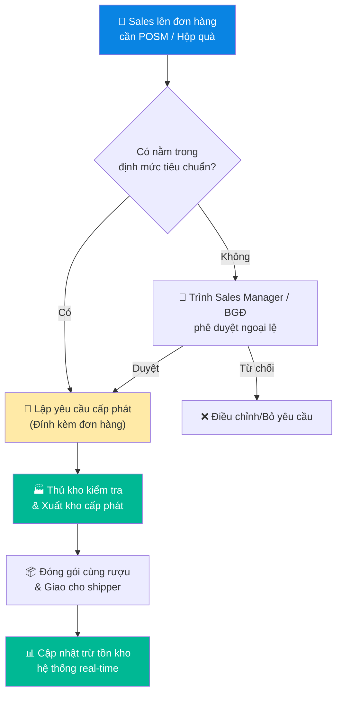

# 5.8 Quản lý POSM & Hộp quà

## 1. Mục đích & Phạm vi
- **Mục đích:** Đảm bảo kiểm soát chặt chẽ các vật phẩm hỗ trợ bán hàng (POSM) và bao bì/hộp quà tặng cao cấp từ khâu nhập kho, lưu kho, đến cấp phát bán hàng và kiểm kê định kỳ, hạn chế tối đa hao hụt và lãng phí chi phí.
- **Phạm vi:** Áp dụng cho toàn bộ các vật phẩm POSM (Ly pha lê, xô đá, khui rượu, khay phục vụ, tạp dề Sommelier...) và Hộp quà (Hộp gỗ cao cấp, hộp giấy mỹ thuật, túi giấy, ruy băng...) thuộc sở hữu của Lyscellar tại tất cả các kho.
- **Tần suất:** Cập nhật liên tục khi phát sinh nhập/xuất; kiểm kê định kỳ hàng tháng.

## 2. Thuật ngữ & Phân loại
| Thuật ngữ | Giải thích | Quy tắc mã hóa |
|-----------|-----------|----------------|
| **POSM** (Point of Sale Materials) | Vật phẩm hỗ trợ trưng bày, tiếp thị và phục vụ bán hàng (không bán thu tiền trực tiếp). | Tiền tố `POSM-` (Ví dụ: `POSM-LY-01` Ly Riedel, `POSM-XO-01` Xô đá). |
| **Gift Box** (Hộp quà) | Hộp đựng rượu đi kèm chai vang để tăng giá trị sản phẩm (tặng kèm theo chính sách hoặc bán kèm). | Tiền tố `GB-` (Ví dụ: `GB-GO-01` Hộp gỗ đơn, `GB-GI-02` Hộp giấy đôi). |

## 3. Trách nhiệm (RACI)

| Nghiệp vụ | Responsible | Approve | Consulted | Informed |
|-----------|------------|---------|-----------|----------|
| Nhập kho & dán nhãn POSM/Hộp quà | Thủ kho | Quản lý Kho | — | Kế toán |
| Đề xuất cấp phát POSM/Hộp quà | Sales Rep | — | — | Thủ kho |
| Phê duyệt cấp phát (ngoài định mức) | — | Sales Manager / BGĐ | Marketing | — |
| Xuất kho & Ghi nhận tồn kho | Thủ kho | — | — | Sales, Kế toán |
| Kiểm kê định kỳ & Báo cáo hao hụt | Thủ kho + Kế toán | Quản lý Kho | — | BGĐ |

## 4. Quy trình Chi tiết

### Bước 1: Nhập kho & Phân loại lưu trữ
- **Khi nhập hàng:**
  1. Thủ kho kiểm tra chất lượng ngoại quan:
     - Đối với ly thủy tinh/pha lê: Kiểm tra nứt vỡ, mờ đục.
     - Đối với hộp gỗ/giấy: Kiểm tra móp méo, trầy xước, nấm mốc.
  2. Lập Phiếu nhập kho (PNK) riêng cho POSM/Hộp quà (ghi rõ nguồn gốc: Mua ngoài hay NCC nước ngoài hỗ trợ kèm lô rượu).
  3. Gán mã SKU tương ứng và nhập số lượng vào phần mềm/Excel tồn kho.
- **Khi lưu trữ:**
  - Sắp xếp POSM và hộp quà tại khu vực riêng biệt, khô ráo, tránh ẩm ướt tuyệt đối để bảo vệ hộp gỗ và hộp giấy mỹ thuật khỏi bị mốc hoặc biến dạng.

### Bước 2: Đề xuất & Phê duyệt Cấp phát
- **Quy tắc cấp phát tiêu chuẩn (Định mức):**
  - **Hộp giấy & Túi giấy:** Cấp phát tương ứng 1:1 theo số lượng chai vang bán ra (áp dụng cho mọi phân khúc sản phẩm bán lẻ hoặc quà tặng).
  - **Hộp gỗ cao cấp (Đơn/Đôi/Sáu):** Chỉ tặng kèm miễn phí cho các dòng rượu Super Premium (Giá bán lẻ > 1.000.000 VNĐ/chai như Amarone, Barolo, Chianti Gran Selezione, Chateau Grand Cru). Đối với các dòng rượu phổ thông, nếu khách hàng yêu cầu hộp gỗ, sales phải tính thêm phí vỏ hộp vào đơn hàng.
  - **Ly vang, Xô đá, Khui rượu (Tặng đối tác HORECA/Đại lý):**
    - Đơn hàng lần đầu trị giá > 15.000.000 VNĐ: Tặng tối đa 1 xô đá + 6 ly vang tiêu chuẩn + 2 khui rượu.
    - Hợp đồng cam kết sản lượng năm: Cấp phát theo phụ lục hợp đồng đã duyệt.
- **Thực hiện đề xuất:**
  - Sales Rep lập **Phiếu yêu cầu cấp phát POSM & Hộp quà** (Form 5.8-A) kèm theo Đơn đặt hàng bán ra.
  - Nếu yêu cầu vượt định mức hoặc tặng cho khách hàng lẻ không thuộc chính sách: Sales Rep phải gửi trình Sales Manager phê duyệt, trường hợp giá trị quà tặng > 2.000.000 VNĐ phải trình BGĐ duyệt.

### Bước 3: Xuất kho & Ghi giảm tồn kho
- **Thao tác xuất kho:**
  1. Thủ kho kiểm tra Phiếu yêu cầu đã có đủ chữ ký phê duyệt hợp lệ.
  2. Thực hiện lấy hàng POSM/Hộp quà chính xác theo SKU và số lượng được duyệt.
  3. Đóng gói cẩn thận cùng hàng hóa rượu vang để shipper đi giao.
  4. Ghi nhận xuất kho và trừ tồn kho trên hệ thống real-time.

### Bước 4: Kiểm kê định kỳ & Xử lý hư hỏng
- **Tần suất:** Ngày 25 hàng tháng.
- **Thao tác:**
  1. Thủ kho phối hợp cùng Kế toán kho tiến hành kiểm đếm thực tế toàn bộ POSM và Hộp quà tại kho.
  2. Đối chiếu số liệu thực tế với sổ sách kế toán/phần mềm.
  3. Ghi nhận chênh lệch và lập biên bản kiểm kê.
  4. Nếu có ly vỡ, hộp mốc hỏng: Tách riêng ra khu cách ly và thực hiện thanh lý/tiêu hủy theo [8.9 Xử lý Tài chính Hàng hỏng vỡ & Hao hụt](../08_tai_chinh/8.9_xu_ly_tai_chinh_hang_hong_vo.md).

## 5. Sơ đồ Quy trình Cấp phát

## 6. Biểu mẫu
- 📥 **Tải biểu mẫu Excel:** [Form 5.8-A: Phiếu yêu cầu cấp phát POSM & Hộp quà](../../../sources/Forms/Form_5.8-A_Phieu_yeu_cau_cap_phat_POSM.xlsx)
  - *Nội dung:* Tên Sales Rep, Tên Khách hàng, Mã Đơn hàng liên kết, Danh sách POSM/Vỏ hộp yêu cầu (SKU, SL, Lý do cấp phát), Chữ ký Sales, Chữ ký Quản lý phê duyệt.
- **Form 5.8-B: Bảng kiểm kê POSM hàng tháng**
  - *Nội dung:* Danh sách SKU POSM/Hộp quà, Tồn sổ sách, Tồn thực tế, Chênh lệch, Trạng thái chất lượng (Tốt / Hỏng mốc / Bể vỡ).

## 7. KPI & Đo lường
- **Tỷ lệ sai lệch kiểm kê POSM:** Khớp 100% về số lượng thực tế so với hệ thống.
- **Tỷ lệ hư hại lưu kho:** Mức hao hụt hộp gỗ, hộp giấy do nấm mốc hoặc ẩm ướt duy trì dưới 0.5% tổng giá trị tồn kho/năm.

## 8. Tài liệu Liên quan
- ← Liên quan: [5.4 Quản lý Tồn kho](5.4_quan_ly_ton_kho.md) | [5.7 Xử lý Hàng lỗi & Hàng hư hỏng](5.7_xu_ly_hang_loi.md)
- → Sau: [8.9 Xử lý Tài chính Hàng hỏng vỡ & Hao hụt](../08_tai_chinh/8.9_xu_ly_tai_chinh_hang_hong_vo.md)
