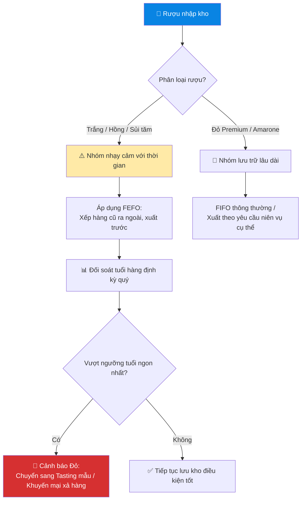

# 5.9 Quản lý Niên vụ & FEFO

## 1. Mục đích & Phạm vi
- **Mục đích:** Kiểm soát chất lượng rượu vang theo thời gian lưu trữ và quản lý sự khác biệt hương vị, giá trị giữa các năm thu hoạch (Niên vụ). Thiết lập nguyên tắc xuất kho FEFO (First Expired First Out) đối với các dòng rượu vang nhạy cảm với thời gian (vang trắng, vang hồng, vang sủi tăm) nhằm tối ưu chất lượng phục vụ và tránh lãng phí do rượu bị suy giảm hương vị.
- **Phạm vi:** Áp dụng cho toàn bộ danh mục sản phẩm rượu vang nhập khẩu của Lyscellar tại tất cả hệ thống kho hàng và trên phần mềm kế toán MISA.

## 2. Thuật ngữ & Nguyên tắc cốt lõi

### 2.1 Thuật ngữ
- **Niên vụ (Vintage):** Năm thu hoạch quả nho để làm ra chai rượu vang đó. Mỗi niên vụ có điều kiện thời tiết khác nhau dẫn đến chất lượng rượu, giá vốn nhập khẩu, điểm số đánh giá (scores) và thời điểm uống ngon nhất khác nhau.
- **FEFO (First Expired First Out):** Nguyên tắc xuất hàng có hạn dùng ngắn hơn ra trước. Đối với rượu vang (vốn không bắt buộc ghi hạn sử dụng cụ thể trên nhãn), hạn dùng được định nghĩa dựa trên **Vòng đời chất lượng khuyến nghị (Drinking Window)** kể từ niên vụ.

### 2.2 Vòng đời chất lượng khuyến nghị (Drinking Window)

| Phân nhóm rượu | Thời gian tối ưu (từ Niên vụ) | Hành động xuất kho |
|----------------|-----------------------------|--------------------|
| **[Vang sủi tăm / Sparkling](../../concepts/concept_phuong_phap_lam_vang_sui.md) (Non-Vintage - NV)** | 1 - 2 năm kể từ ngày đóng chai/nhập kho | Áp dụng FEFO nghiêm ngặt |
| **Vang trắng / Vang hồng phổ thông** ([Pinot Grigio](../../concepts/concept_nho_pinot_grigio.md), [Chardonnay](../../concepts/concept_nho_chardonnay.md), [Sauvignon Blanc](../../concepts/concept_nho_sauvignon_blanc.md)...) | 1 - 3 năm kể từ niên vụ | Áp dụng FEFO nghiêm ngặt |
| **Vang đỏ phổ thông** (Merlot, [Shiraz](../../concepts/concept_nho_shiraz_syrah.md), [Cabernet Sauvignon](../../concepts/concept_nho_cabernet_sauvignon.md) dòng Classic...) | 3 - 5 năm kể từ niên vụ | Áp dụng FEFO |
| **Vang Đỏ Premium / Super Premium** (Amarone, Barolo, Chateauneuf-du-Pape, Grand Cru...) | 5 - 15+ năm kể từ niên vụ | Không áp dụng FEFO (Bán theo yêu cầu của KH hoặc giá trị của niên vụ cụ thể) |

## 3. Quy trình Chi tiết

### Bước 1: Khai báo SKU theo niên vụ trên hệ thống MISA
- **QUY TẮC BẮT BUỘC:** Không dùng chung một mã SKU duy nhất cho nhiều niên vụ khác nhau của cùng một dòng rượu. 
- Khi nhập kho lô hàng mới có niên vụ khác biệt, Kế toán bắt buộc phải tạo mã SKU mới bằng cách thêm hậu tố niên vụ.
  - *Ví dụ:* Chai rượu vang *Arco dei Giovi Pinot Grigio delle Venezie* có mã cơ sở là `L10007`.
    - Niên vụ 2022 khai báo mã: `L10007-2022`
    - Niên vụ 2023 khai báo mã: `L10007-2023`
- **Lý do:** Đảm bảo hạch toán chính xác giá vốn (COGS) riêng biệt của từng niên vụ, theo dõi đúng tuổi tồn kho để kích hoạt FEFO, và cung cấp thông tin chính xác trên hóa đơn xuất cho khách hàng HORECA.

### Bước 2: Sắp xếp kho hàng theo FEFO
- Thủ kho khi xếp hàng lên kệ/pallet phải tuân thủ:
  1. Xếp các lô hàng có niên vụ cũ hơn (hoặc ngày nhập kho cũ hơn đối với sủi tăm NV) ở phía ngoài, dễ tiếp cận trước.
  2. Xếp các lô có niên vụ mới hơn ở phía trong hoặc phía dưới.
  3. Dán nhãn ghi chú niên vụ rõ ràng trước mỗi hàng/kệ để nhân viên soạn hàng không lấy nhầm.

### Bước 3: Quy trình Chuyển đổi Niên vụ (Vintage Transition Plan)
- Khi một mã niên vụ cũ còn dưới **10% tồn kho** hoặc dưới **24 chai** (đối với dòng Premium):
  1. **Kho thông báo cho Sales:** Bộ phận kho gửi cảnh báo sắp hết niên vụ cũ và chuẩn bị chuyển sang niên vụ mới.
  2. **Sales làm việc với Khách hàng:** Sales Rep liên hệ với các nhà hàng, khách sạn lớn (HORECA) đang list chai rượu này. Vì các nhà hàng thường in niên vụ cụ thể lên Menu rượu (Wine List) của họ, việc thay đổi niên vụ bắt buộc phải được thông báo trước để nhà hàng cập nhật Menu hoặc duyệt thử nếm (tasting) niên vụ mới.
  3. **Tổ chức Tasting nội bộ:** Tổ chức buổi nếm thử nhanh niên vụ mới cho Sales Team để cập nhật tài liệu bán hàng (Tasting Notes) và điểm số mới của hãng.

### Bước 4: Kiểm soát tuổi hàng & Cảnh báo tồn lâu (Stock Aging Alert)
- **Tần suất:** Hàng quý (vào ngày cuối cùng của quý).
- **Thao tác:**
  1. Kế toán kho chạy báo cáo Tuổi hàng (Stock Aging Report) phân loại theo niên vụ.
  2. Lọc ra các mặt hàng chạm **Ngưỡng cảnh báo đỏ (Red Alert Threshold)**:
     - Vang sủi tăm: Tồn kho quá 18 tháng kể từ ngày nhập kho.
     - Vang trắng / Vang hồng: Quá 2 năm kể từ niên vụ thu hoạch.
     - Vang đỏ phổ thông: Quá 4 năm kể từ niên vụ thu hoạch.
  3. Lập danh sách gửi BGĐ duyệt phương án giải phóng hàng tồn lâu:
     - Đề xuất chính sách khuyến mại đặc biệt (Mua 2 tặng 1, giảm giá sâu xả kho).
     - Chuyển đổi mục đích sử dụng sang làm rượu mẫu phục vụ sự kiện nếm thử (Wine Sample).
     - Sử dụng làm quà tặng đối tác trong các dịp lễ Tết.

## 4. Sơ đồ Vòng đời & Xử lý Niên vụ

## 5. Biểu mẫu
- **Form 5.9-A: Báo cáo Tuổi hàng & Niên vụ Tồn kho**
  - *Nội dung:* Mã SKU (gồm niên vụ), Tên rượu, Ngày nhập kho, Tuổi hàng (số tháng kể từ niên vụ/ngày nhập), Trạng thái cảnh báo (Bình thường / Cảnh báo vàng / Cảnh báo đỏ), Đề xuất xử lý.

## 6. KPI & Đo lường
- **Tỷ lệ hàng hỏng do quá tuổi ngon (Spoiled Stock Rate):** 0%.
- **Độ chính xác thông tin niên vụ:** 100% hóa đơn xuất ra ghi đúng niên vụ thực tế giao cho khách hàng.

## 7. Tài liệu Liên quan
- ← Liên quan: [5.4 Quản lý Tồn kho](5.4_quan_ly_ton_kho.md)
- → Sau: [6.4 Chính sách Giá & Chiết khấu](../06_ban_hang/6.4_chinh_sach_gia.md) | [8.10 Quản lý Chi phí Tasting & Tiếp khách](../08_tai_chinh/8.10_quan_ly_chi_phi_tasting_tiep_khach.md)
- ↔ Kiến thức: [Các Giống Nho Đỏ](../../concepts/concept_nho_cabernet_sauvignon.md) | [Các Giống Nho Trắng](../../concepts/concept_nho_sauvignon_blanc.md) | [Phương pháp làm Vang sủi](../../concepts/concept_phuong_phap_lam_vang_sui.md)
