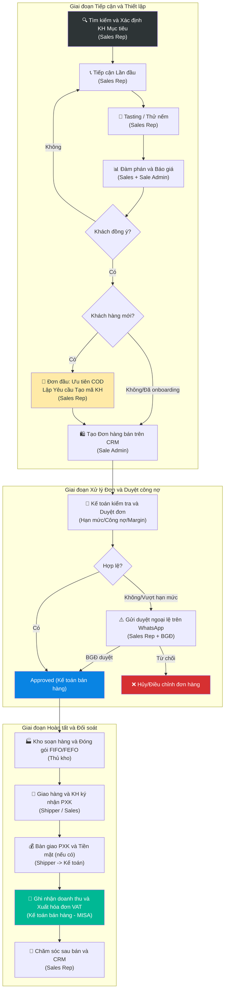
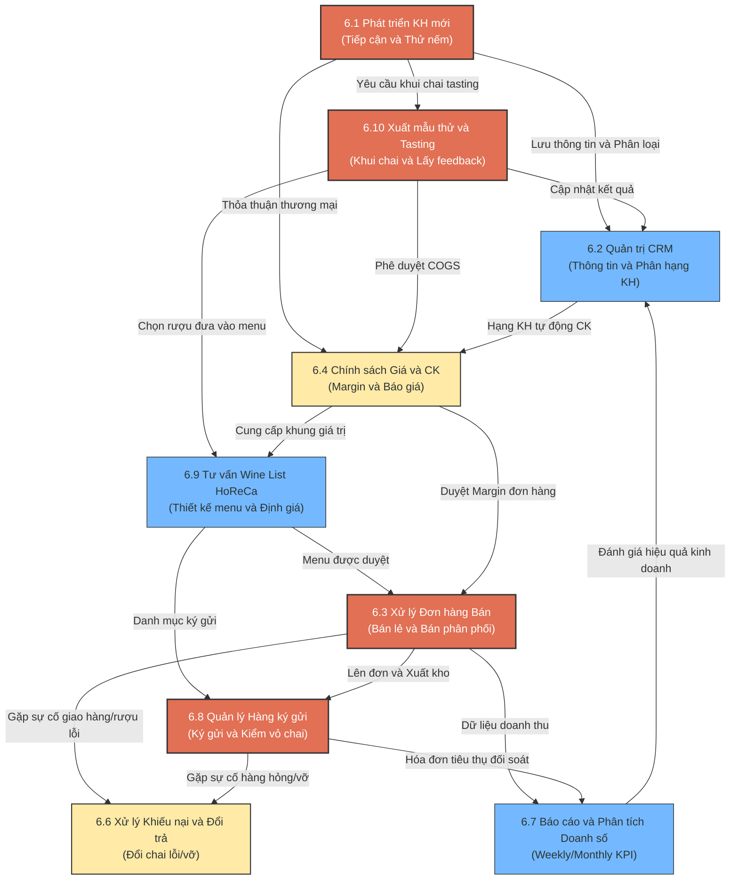

# 6.0 Tổng quan Quy trình Bán hàng Lyscellar

🌐 [English Version](6.0_tong_quan_quy_trinh_ban_hang_en.md)

Tài liệu này cung cấp tổng quan về quy trình kinh doanh và phân phối rượu vang tại Lyscellar — từ khâu tiếp cận khách hàng tiềm năng đến khi hoàn tất đơn hàng, đối soát tài chính và chăm sóc sau bán. Đây là tài liệu quy trình hướng dẫn phối hợp liên bộ phận (Kinh doanh, Kế toán, Kho, Vận chuyển) nhằm nâng cao hiệu quả vận hành và kiểm soát rủi ro.

---

## 1. Sơ đồ Dòng chảy Quy trình Tổng thể (Sales Lifecycle Workflow)

Dưới đây là sơ đồ phối hợp các bước nghiệp vụ trong vòng đời bán hàng của Lyscellar:

---

## 2. Kiến trúc Liên kết Hệ thống Quy trình Bán hàng (Sales Processes Map)

Để dễ hình dung cách các quy trình bán hàng con bổ trợ và kết nối với nhau, sơ đồ dưới đây mô tả mối liên hệ chặt chẽ giữa chúng:

---

## 3. Bảng Phân định Trách nhiệm Phối hợp (RACI Matrix)

Để vận hành trôi chảy, trách nhiệm của các bộ phận được chuẩn hóa như sau:
- **R (Responsible):** Bộ phận trực tiếp thực hiện.
- **A (Accountable):** Bộ phận phê duyệt cuối cùng và chịu trách nhiệm cao nhất.
- **C (Consulted):** Bộ phận tham vấn ý kiến.
- **I (Informed):** Bộ phận nhận thông tin sau khi hoàn thành.

| Giai đoạn / Nghiệp vụ | Nhân viên Sales (Sales Rep) | Sale Admin | Kế toán bán hàng | Thủ kho | Giám đốc Sales | Ban Giám Đốc (BGĐ) | Kế toán trưởng |
| :--- | :---: | :---: | :---: | :---: | :---: | :---: | :---: |
| **1. Xác định & tiếp cận lead** | **R** | — | — | — | **C** | **A** | — |
| **2. Báo giá & Chiết khấu đặc biệt** | **R** | **R** | **C** | — | **A** (Màu vàng) | **A** (Màu đỏ) | — |
| **3. Mở mã KH mới (Onboarding)** | **R** | — | **C** | — | — | **A** | — |
| **4. Lập đơn hàng (CRM)** | **C** | **R** | — | — | — | — | — |
| **5. Duyệt đơn (Tồn kho/Công nợ)** | — | **I** | **R** | **I** | — | **A** (Duyệt ngoại lệ) | — |
| **6. Soạn hàng & Xuất kho** | — | **I** | **I** | **R** | — | — | — |
| **7. Giao hàng & Ký nhận chứng từ** | **C** (Đơn VIP) | — | **I** | **I** | — | — | — |
| **8. Ghi nhận doanh thu & Xuất VAT** | — | — | **R** | **I** | — | **I** | **C** |
| **9. Đối soát tiêu thụ hàng ký gửi** | **R** | — | **R** | — | **C** | **I** | — |
| **10. Giải quyết khiếu nại, đổi trả, bồi thường (mọi giá trị)** | **R** | — | **I** | **C** | **C** | **A** | — |
| **11. Kiểm soát & Đối soát cuối ngày** | — | — | **R** | **I** | — | **I** | **A** |

---

## 4. Các Chốt chặn Kiểm soát Quan trọng (Critical Control Gates)

Đội ngũ nhân sự bắt buộc phải tuân thủ nghiêm ngặt 4 chốt chặn kiểm soát sau đây nhằm tránh rủi ro tài chính và thất thoát hàng hóa:

> [!IMPORTANT]
> **Chốt 1: Quy tắc thanh toán đơn đầu tiên**
> - Đơn giao hàng đầu tiên ưu tiên thanh toán COD (hoặc chuyển khoản trả trước trước khi giao hàng).
> - Nếu chưa có hợp đồng chính thức và chưa cung cấp Giấy phép Đăng ký kinh doanh (ĐKKD), bắt buộc phải thanh toán COD 100%. Các trường hợp muốn áp dụng hình thức khác khi chưa có đủ hợp đồng và ĐKKD bắt buộc phải lập Tờ trình duyệt cơ chế thanh toán đặc biệt được Ban Giám đốc phê duyệt.

> [!WARNING]
> **Chốt 2: Kiểm soát Biên lợi nhuận (Margin Checking)**
> Khi áp dụng chương trình khuyến mãi hoặc chiết khấu đặc biệt, nhân viên Sales phải nhập thông tin vào công cụ Margin Checking (sử dụng 2 biểu mẫu độc lập: Form check margin dành cho Sales và Form dành cho Quản lý) và tuân thủ thẩm quyền duyệt:
> - 🟢 **Màu xanh lá cây:** Sales/Sale Admin tự quyết định và lên đơn.
> - 🟡 **Màu vàng:** Anh Jeremie xem xét và phê duyệt trực tiếp qua WhatsApp/Email.
> - 🔴 **Màu đỏ:** Cần lập Tờ trình duyệt cơ chế đặc biệt (Form 6.4-C) gửi Ban Giám Đốc (BGĐ) phê duyệt trực tiếp.

> [!CAUTION]
> **Chốt 3: Duyệt đơn ngoại lệ công nợ/hạn mức**
> - Kế toán bán hàng chỉ duyệt đơn hàng sang trạng thái "Approved" khi KH không có nợ quá hạn và đơn hàng nằm trong hạn mức công nợ được duyệt.
> - Trường hợp vượt hạn mức hoặc có nợ quá hạn, Sales Rep phải gửi phiếu xin duyệt ngoại lệ lên **Nhóm chat WhatsApp** của công ty để BGĐ phê duyệt trực tiếp. Kế toán bán hàng căn cứ vào tin nhắn duyệt của BGĐ trên nhóm mới được phép thao tác duyệt đơn trên hệ thống.

> [!IMPORTANT]
> **Chốt 4: Quy tắc xuất kho của Thủ kho**
> - Thủ kho vật lý tuyệt đối **không tự ý soạn hàng và xuất kho** nếu đơn hàng chưa được Kế toán duyệt sang trạng thái **"Approved" (Đã duyệt)** trên hệ thống phần mềm.
> - Mọi trường hợp khẩn cấp vẫn phải tuân thủ quy trình duyệt đơn trước trên hệ thống.

> [!IMPORTANT]
> **Chốt 5: Xuất hóa đơn GTGT điện tử 100% trong ngày**
> - Kế toán bán hàng bắt buộc phải xuất hóa đơn GTGT điện tử trên phần mềm MISA **trước 18:30 hàng ngày** cho tất cả các đơn hàng đã giao thành công và được khách hàng ký nhận trong ngày (theo đúng Nghị định 123/2020/NĐ-CP).
> - Nghiêm cấm xuất hóa đơn trước khi hàng được giao và khách ký nhận, hoặc trì hoãn dồn sang ngày hôm sau.

---

## 5. Danh mục quy trình chi tiết & Biểu mẫu liên kết nhanh

Dưới đây là các tài liệu quy chuẩn hướng dẫn chi tiết cho từng cấu phần trong quy trình bán hàng:

### 5.1 Quy trình Chi tiết (Processes)
- [6.1 Phát triển Khách hàng Mới](6.1_phat_trien_kh.md): Quy định các bước từ xác định phân khúc khách hàng HoReCa/Retail/B2C, tasting giới thiệu sản phẩm và onboarding khách hàng mới.
- [6.2 Quản trị CRM](6.2_crm.md): Hướng dẫn cập nhật tương tác khách hàng, phân loại hạng KH (VIP, Gold, Regular, Dormant) hàng quý để chăm sóc phù hợp.
- [6.3 Xử lý Đơn hàng Bán](6.3_xu_ly_don_hang.md): Quy trình chi tiết đối với bán lẻ showroom và bán phân phối giao tận nơi.
- [6.4 Chính sách Giá & Chiết khấu](6.4_chinh_sach_gia.md): Quy định bảng giá bán buôn/lẻ, chiết khấu số lượng và quy trình Margin Checking.
- [6.5 Quản lý Kênh Bán hàng](6.5_kenh_ban_hang.md): Định hướng danh mục sản phẩm theo kênh và phương pháp phòng chống xung đột giá giữa các kênh.
- [6.6 Xử lý Khiếu nại & Đổi trả](6.6_xu_ly_khieu_nai.md): SLA và phương án giải quyết các sự cố chất lượng rượu (cork taint, oxy hóa), chai vỡ hỏng hoặc sai giá.
- [6.7 Báo cáo Doanh số & Phân tích](6.7_bao_cao_doanh_so.md): Hướng dẫn kết xuất báo cáo doanh thu và đánh giá hiệu quả kinh doanh.
- [6.8 Quy trình Quản lý Hàng Ký gửi HoReCa](6.8_quan_ly_hang_ky_gui.md): Quy chuẩn kiểm kê, thu hồi vỏ chai trống (Empty Bottle Audit) và hạch toán thuế VAT cho hàng tiêu thụ.
- [6.9 Tư vấn & Thiết kế Wine List cho Điểm bán HoReCa](6.9_tu_van_thiet_ke_wine_list.md): Hỗ trợ nhà hàng đối tác tối ưu thực đơn rượu vang để gia tăng doanh số.
- [6.10 Quy trình Xuất rượu Mẫu thử & Tasting cho Khách hàng](6.10_xuat_ruou_mau_thu_tasting.md): Quy chuẩn lập đề xuất khui chai, phê duyệt xuất kho mẫu thử, tổ chức tasting và cập nhật phản hồi CRM.

### 5.2 Biểu mẫu Thực hành (Forms & Templates)
- 📥 [Form 6.1-A: Danh sách Khách hàng Tiềm năng](../../../sources/Forms/Form_6.1-A_Danh_sach_KH_Tiem_nang.xlsx)
- 📥 [Form 6.2-A: Hồ sơ & Lịch sử Giao dịch Khách hàng](../../../sources/Forms/Form_6.2-A_Ho_so_Khach_hang.xlsx)
- 📥 [Form 6.3-A: Đơn đặt hàng bán (Sales Order)](../../../sources/Forms/Form_6.3-A_Don_hang_Ban.xlsx)
- 📥 [Form 6.4-A: Bảng giá Sản phẩm & Chiết khấu](../../../sources/Forms/Form_6.4-A_Bang_gia_San_pham.xlsx)
- 📥 [Form 6.4-B: Biểu mẫu Báo giá Khách hàng (Quotation)](../../../sources/Forms/Form_6.4-B_Ly_Cellars_Quotation_Template.xlsx)
- 📥 [Form 6.4-C: Tờ trình Cơ chế Đặc biệt](../../../sources/Forms/Form_6.4-C_To_trinh_Co_che_Dac_biet.xlsx)
- 📥 [Form 6.4-D (Template): Tờ trình Phê duyệt CTKM Sales](templates/mau_to_trinh_phe_duyet_ctkm.md)
- 📥 [Form 6.6-A: Phiếu Tiếp nhận Khiếu nại](../../../sources/Forms/Form_6.6-A_Phieu_Khieu_nai.xlsx)
- 📥 [Form 6.7-A: Mẫu Báo cáo Doanh số Kinh doanh](../../../sources/Forms/Form_6.7-A_Bao_cao_Doanh_so.xlsx)
- 📥 [Form 6.7-B: Biểu mẫu Báo cáo Tuần (Weekly Sales Report)](../../../sources/Forms/Form_6.7-B_Bao_cao_Tuan_Sales.xlsx)
- 📥 [Form 8.8-A: Phiếu yêu cầu mở mới & tạo mã khách hàng (Excel)](../../../sources/Forms/Form_8.8-A_Yeu_cau_Tao_ma_KH.xlsx)
- 📥 [Template: Thỏa thuận ký gửi hàng hóa HoReCa](templates/mau_thoa_thuan_ky_gui.md)
