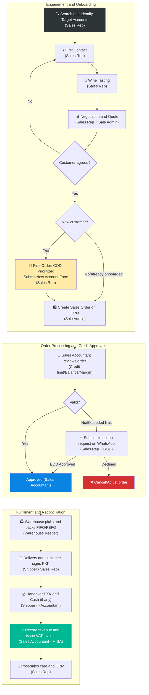
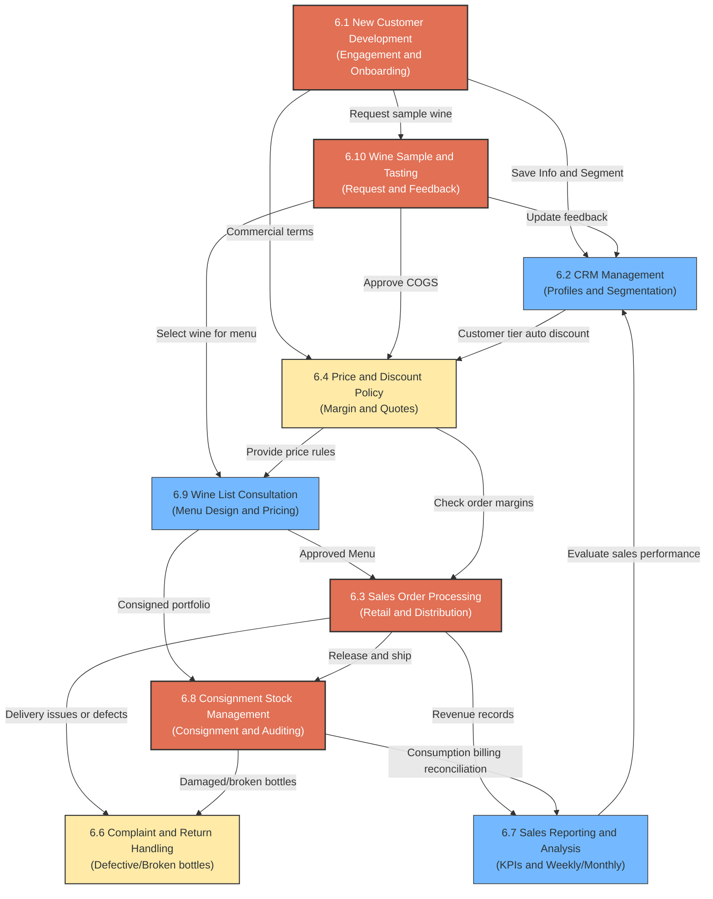

# 6.0 Sales Operations Overview

🌐 [Bản tiếng Việt](6.0_tong_quan_quy_trinh_ban_hang.md)

This document provides a general overview of the commercial and distribution lifecycle of Lyscellar wines — spanning from customer acquisition, order processing, inventory fulfillment, to financial reconciliation and post-sales care. It serves as a coordination manual for the Sales, Accounting, Warehouse, and Logistics teams to optimize operations and control financial risk.

---

## 1. Sales Lifecycle Workflow

The flowchart below describes the operational steps across the sales lifecycle at Lyscellar:

---

## 2. Sales Processes Map

The map below describes how the core sub-processes in Lyscellar Sales Operations interconnect:

---

## 3. RACI Matrix

To ensure clear ownership, departmental roles are defined as follows:
- **R (Responsible):** The role directly performing the activity.
- **A (Accountable):** The role approving the action and carrying ultimate responsibility.
- **C (Consulted):** The role providing expertise/advice.
- **I (Informed):** The role kept updated of progress.

| Sales Lifecycle Step | Sales Rep | Sale Admin | Sales Accountant | Warehouse Keeper | Sales Director | Board of Directors (BOD) | Chief Accountant |
|:---|:---:|:---:|:---:|:---:|:---:|:---:|:---:|
| **1. Identify & engage leads** | **R** | — | — | — | **C** | **A** | — |
| **2. Quotes & Special discounts** | **R** | **R** | **C** | — | **A** (Yellow Gate) | **A** (Red Gate) | — |
| **3. New Account Onboarding** | **R** | — | **C** | — | — | **A** | — |
| **4. Create Sales Order** | **C** | **R** | — | — | — | — | — |
| **5. Order Approval (Stock/Credit)** | — | **I** | **R** | **I** | — | **A** (Exceptions) | — |
| **6. Pick & Pack** | — | **I** | **I** | **R** | — | — | — |
| **7. Deliver & Sign receipts** | **C** (VIP) | — | **I** | **I** | — | — | — |
| **8. Revenue & VAT invoice** | — | — | **R** | **I** | — | **I** | **C** |
| **9. Reconcile Consignment Stock** | **R** | — | **R** | — | **C** | **I** | — |
| **10. Resolve complaints, returns & compensation (all values)** | **R** | — | **I** | **C** | **C** | **A** | — |
| **11. End-of-day Controls & Reconciliation** | — | — | **R** | **I** | — | **I** | **A** |

---

## 4. Critical Control Gates

All staff members must strictly observe the following four control gates to protect financial integrity and prevent inventory loss:

> [!IMPORTANT]
> **Gate 1: First Order Payment Policy**
> - The first delivery order prioritizes COD (or bank transfer prior to delivery).
> - 100% COD is strictly mandatory if the distribution contract and Business License are missing; otherwise, if they wish to apply for credit terms, a Proposal (Tờ trình) approved by the Board of Directors (BOD) is required.

> [!WARNING]
> **Gate 2: Profit Margin Controls**
> When setting special discounts or running promotions, Sales Reps must run terms through the Margin Checking tool (utilizing separate Sales and Manager templates) and follow the approval limits:
> - 🟢 **Green Gate:** Sales Rep / Sale Admin self-approves and enters the order.
> - 🟡 **Yellow Gate:** Mr. Jeremie reviews and approves directly via WhatsApp/Email.
> - 🔴 **Red Gate:** Requires direct approval from the Board of Directors (BOD) via a Special Mechanism Proposal (Form 6.4-C).

> [!CAUTION]
> **Gate 3: Credit Limit Exceptions**
> - The Sales Accountant only shifts order status to "Approved" if the customer has no overdue invoices and the order amount falls within their credit limit.
> - If limits are exceeded or overdue invoices exist, the Sales Rep must submit a WhatsApp exception request. The BOD must approve the exception text on the group chat before Accounting approves the order in MISA/ERP.

> [!IMPORTANT]
> **Gate 4: Outbound Release Control**
> - The Warehouse Keeper must **never physically release or pack goods** unless the sales order status shows as **"Approved"** on the ERP software.
> - Urgent releases must still be entered and approved on the system first.

> [!IMPORTANT]
> **Gate 5: 100% Same-Day E-Invoice Issuance**
> - The Sales Accountant must issue the electronic VAT invoice on MISA **before 18:30 daily** for all orders successfully delivered and signed by the customer on that day (in compliance with Decree 123/2020/NĐ-CP).
> - Issuing invoices before delivery/customer signature, or postponing to the next day is strictly prohibited.

---

## 5. Processes & Forms Directory

### 5.1 Core Sub-Processes
- [6.1 New Customer Onboarding](6.1_phat_trien_kh_en.md): From segment profiling to credit assessment and database onboarding.
- [6.2 CRM Management](6.2_crm_en.md): Tracking interaction histories and customer tiering (VIP, Gold, Regular, Dormant).
- [6.3 Sales Order Processing](6.3_xu_ly_don_hang_en.md): Order intake, MISA verification, showroom POS sales, and logistics delivery.
- [6.4 Pricing & Discount Policy](6.4_chinh_sach_gia_en.md): Public price list, margin calculations, and quotation templates.
- [6.5 Sales Channel Management](6.5_kenh_ban_hang_en.md): Distribution portfolio strategies and mitigating cross-channel price undercut conflicts.
- [6.6 Complaint & Return Handling](6.6_xu_ly_khieu_nai_en.md): Resolving wrong items, broken bottles, or wine quality complaints (corked/oxidized).
- [6.7 Sales Reporting & Analysis](6.7_bao_cao_doanh_so_en.md): Generating weekly targets and monthly commissions.
- [6.8 Consignment Stock Management](6.8_quan_ly_hang_ky_gui_en.md): Month-end stock audit, empty bottle reconciliation, and tax billing.
- [6.9 Wine List Consultation](6.9_tu_van_thiet_ke_wine_list_en.md): Menu design support, by-the-glass pricing strategies, and sommelier training.
- [6.10 Wine Sample & Tasting](6.10_xuat_ruou_mau_thu_tasting_en.md): Request vouchers, warehouse sample stickers, and conversion tracking.

### 5.2 Forms & Templates
- 📥 [Form 6.1-A: Prospect List](../../../sources/Forms/Form_6.1-A_Danh_sach_KH_Tiem_nang.xlsx)
- 📥 [Form 6.2-A: Customer Profiles Database](../../../sources/Forms/Form_6.2-A_Ho_so_Khach_hang.xlsx)
- 📥 [Form 6.3-A: Sales Order Template](../../../sources/Forms/Form_6.3-A_Don_hang_Ban.xlsx)
- 📥 [Form 6.4-A: Product Prices & Discounts](../../../sources/Forms/Form_6.4-A_Bang_gia_San_pham.xlsx)
- 📥 [Form 6.4-B: Quotation Template](../../../sources/Forms/Form_6.4-B_Ly_Cellars_Quotation_Template.xlsx)
- 📥 [Form 6.4-C: Special Mechanism Proposal](../../../sources/Forms/Form_6.4-C_To_trinh_Co_che_Dac_biet.xlsx)
- 📥 [Form 6.4-D (Template): Sales Promotion Proposal](templates/mau_to_trinh_phe_duyet_ctkm_en.md)
- 📥 [Form 6.6-A: Complaint Ticket](../../../sources/Forms/Form_6.6-A_Phieu_Khieu_nai.xlsx)
- 📥 [Form 6.7-A: Monthly Sales Report](../../../sources/Forms/Form_6.7-A_Bao_cao_Doanh_so.xlsx)
- 📥 [Form 6.7-B: Weekly Sales Report Template](../../../sources/Forms/Form_6.7-B_Bao_cao_Tuan_Sales.xlsx)
- 📥 [Form 8.8-A: New Account Form & Credit Matrix](../../../sources/Forms/Form_8.8-A_Yeu_cau_Tao_ma_KH.xlsx)
- 📥 [Template: HoReCa Consignment Agreement](templates/mau_thoa_thuan_ky_gui.md)
