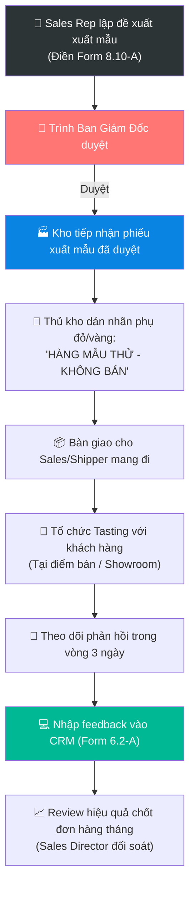

# 6.10 Quy trình Xuất rượu Mẫu thử & Tasting cho Khách hàng

🌐 [English Version](6.10_xuat_ruou_mau_thu_tasting_en.md)

## 1. Mục đích & Phạm vi
- **Mục đích:** Chuẩn hóa hoạt động đề xuất, duyệt xuất kho, thực hiện thử nếm (tasting) và theo dõi phản hồi của khách hàng sau khi thử rượu mẫu. Đảm bảo sử dụng rượu mẫu hiệu quả, tránh lãng phí, tuân thủ quy tắc tài chính và tối ưu hóa tỷ lệ chốt hợp đồng.
- **Phạm vi áp dụng:** Áp dụng đối với mọi trường hợp xuất rượu vang từ kho Lyscellar để làm hàng mẫu thử (Wine Samples) cho khách hàng B2B, HoReCa, Đại lý, B2C lớn, hoặc tổ chức tasting trực tiếp tại Showroom/Điểm bán của đối tác.

---

## 2. Trách nhiệm (RACI Matrix)

| Bước công việc | Sales Rep | Sales Director | Thủ kho | Kế toán bán hàng | Ban Giám Đốc |
|:---|:---:|:---:|:---:|:---:|:---:|
| **1. Lập Phiếu đề xuất xuất mẫu** | **R** | — | — | — | — |
| **2. Phê duyệt xuất mẫu** | — | — | — | — | **A** |
| **3. Dán nhãn phụ & Xuất kho vật lý** | — | — | **R** | — | — |
| **4. Thực hiện Tasting & Chăm sóc** | **R** | — | — | — | — |
| **5. Cập nhật CRM & Lấy ý kiến KH** | **R** | **I** | — | — | — |
| **6. Đối soát & Hạch toán chi phí** | — | — | — | **R** (TK 6418) | — |
| **7. Đánh giá hiệu quả (Conversion Rate)** | **C** | **R** | — | — | **I** |

---

## 3. Sơ đồ Quy trình Vận hành (Process Flowchart)

---

## 4. Các bước Vận hành Chi tiết

### Bước 1: Lập đề xuất xuất mẫu thử
Khi có nhu cầu xuất rượu vang cho khách hàng nếm thử chất lượng (listing menu mới, thử niên vụ mới, mở rộng đại lý), Sales Rep thực hiện:
1. Xác định đúng SKU rượu cần thử tương ứng với gu ẩm thực và định vị phân khúc của khách hàng.
2. Lập **Tờ trình wine tasting (Form 8.10-A / Wine Sample Request)** sử dụng biểu mẫu quy chuẩn [Form_8.10-A_To_trinh_Wine_Tasting.xlsx](../../../sources/Forms/Form_8.10-A_To_trinh_Wine_Tasting.xlsx) ghi rõ: Tên khách hàng, kênh bán, SKU rượu, số lượng chai, và lý do đề xuất.
3. Trình duyệt đề xuất xuất rượu:
   - **Mọi yêu cầu xuất rượu mẫu thử đều bắt buộc phải được Ban Giám đốc (BGĐ) phê duyệt trước khi thực hiện.**

### Bước 2: Xuất kho & Dán nhãn phụ bắt buộc
1. Sau khi đề xuất được phê duyệt, Sales Rep gửi Phiếu đề xuất đã ký duyệt (bản giấy hoặc ảnh chụp duyệt trên nhóm) cho bộ phận Kho.
2. Thủ kho tiến hành tạo **Phiếu xuất kho mẫu thử** trên hệ thống và chuẩn bị rượu.
3. > [!IMPORTANT]
   > **Quy tắc dán nhãn:**
   > Thủ kho bắt buộc phải dán nhãn phụ niêm phong màu đỏ hoặc màu vàng có dòng chữ nổi bật **"HÀNG MẪU THỬ - KHÔNG BÁN (WINE SAMPLE - NOT FOR SALE)"** lên thân mỗi chai rượu trước khi bàn giao ra khỏi kho. Đây là quy định bắt buộc của pháp luật thương mại và để tránh rủi ro lạm dụng rượu mẫu để bán lậu.
4. Bàn giao rượu và 01 liên Phiếu xuất kho cho nhân viên giao nhận hoặc trực tiếp cho Sales Rep mang đi.

### Bước 3: Thực hiện Tasting với Khách hàng
1. Sales Rep chuẩn bị đầy đủ tài liệu giới thiệu sản phẩm (Tasting Notes bằng tiếng Việt/Anh) trước khi gặp khách hàng. Lưu ý: Bản mô tả hương vị (tasting notes) luôn phải đi kèm thông tin niên vụ (Vintage) cụ thể của chai rượu được giới thiệu để đảm bảo tính chính xác chuyên môn.
2. Thực hiện khui chai và phục vụ rượu tại chỗ cho khách hàng theo đúng chuẩn mực dịch vụ rượu vang quy định tại [Quy trình phục vụ rượu vang tại bàn](../../concepts/concept_quy_trinh_phuc_vu_ruou_vang.md).
3. Hướng dẫn khách hàng thử nếm, giới thiệu về giống nho, vùng sản xuất, câu chuyện nhà làm rượu và gợi ý các món ăn ghép đôi (Wine pairing) phù hợp.

### Bước 4: Lấy phản hồi & Cập nhật CRM (SLA 3 ngày)
1. > [!WARNING]
   > **SLA cập nhật phản hồi:**
   > Trong vòng tối đa **03 ngày làm việc** kể từ khi mở chai tasting, Sales Rep bắt buộc phải liên hệ lại khách hàng để lấy phản hồi chi tiết về chất lượng rượu mẫu thử.
2. Nội dung phản hồi cần làm rõ:
   - Khách hàng đánh giá thế nào về màu sắc, hương thơm, vị rượu?
   - Mức giá sỉ của Lyscellar có phù hợp với phân khúc định giá bán lẻ trên menu của khách hàng không?
   - Khách hàng quyết định lựa chọn SKU nào đưa vào Wine List/Menu? (Listing decision).
3. Sales Rep đăng nhập vào hệ thống **CRM** và cập nhật toàn bộ phản hồi này vào **Lịch sử tương tác của Hồ sơ Khách hàng** ([Form 6.2-A](../../../sources/Forms/Form_6.2-A_Ho_so_Khach_hang.xlsx)).

### Bước 5: Đối soát & Đánh giá hiệu quả sử dụng rượu mẫu
1. Cuối mỗi tháng, Kế toán bán hàng tổng hợp danh sách rượu mẫu đã xuất từ kho, đối chiếu với các Phiếu đề xuất hợp lệ để hạch toán ghi nhận chi phí bán hàng vào tài khoản **TK 6418 (Chi phí bán hàng khác)**.
2. Sales Director thực hiện review đối chiếu hàng tháng:
   - So sánh lượng rượu mẫu xuất cho từng Sales Rep với số lượng đơn hàng mới chốt thành công ([QT 6.3](6.3_xu_ly_don_hang.md)) hoặc hợp đồng ký gửi mới ký kết ([QT 6.8](6.8_quan_ly_hang_ky_gui.md)) để tính **Tỷ lệ chuyển đổi mẫu thử (Sample-to-Sale Conversion Rate)**.
   - Nhân viên Sales có tỷ lệ chuyển đổi dưới 20% trong 2 tháng liên tiếp sẽ bị giới hạn hạn mức xuất mẫu thử trong tháng tiếp theo và phải giải trình trực tiếp với Sales Director.

---

## 5. KPI & Đo lường kiểm soát

| Chỉ số KPI | Phương pháp tính | Mục tiêu kiểm soát | Tần suất đo |
|:---|:---|:---:|:---:|
| **Tỷ lệ chuyển đổi mẫu thử** | (Số khách chốt mua hàng / Tổng số khách được tasting rượu mẫu) | **≥ 30%** | Hàng tháng |
| **SLA cập nhật CRM** | Thời gian từ lúc tasting đến lúc nhập feedback lên CRM | **≤ 3 ngày làm việc** | Theo từng đơn xuất mẫu |
| **Tỷ lệ dán nhãn mẫu thử** | Số chai dán nhãn "Không bán" khi xuất / Tổng số chai mẫu xuất | **100%** | Kiểm tra đột xuất |

---

## 6. Tài liệu & Biểu mẫu Liên quan
- ← Liên quan trực tiếp: [8.10 Quản lý Chi phí Tasting & Tiếp khách](../08_tai_chinh/8.10_quan_ly_chi_phi_tasting_tiep_khach.md)
- ↔ Hỗ trợ chuyên môn: [Quy trình Phục vụ Rượu vang tại bàn](../../concepts/concept_quy_trinh_phuc_vu_ruou_vang.md) | [Kịch bản xử lý từ chối của khách hàng](../../concepts/concept_kich_ban_sales_faq.md)
- 📥 Biểu mẫu xuất mẫu: [Form_8.10-A_To_trinh_Wine_Tasting.xlsx (Form 8.10-A)](../../../sources/Forms/Form_8.10-A_To_trinh_Wine_Tasting.xlsx) (sử dụng để đề xuất xuất rượu tasting).
