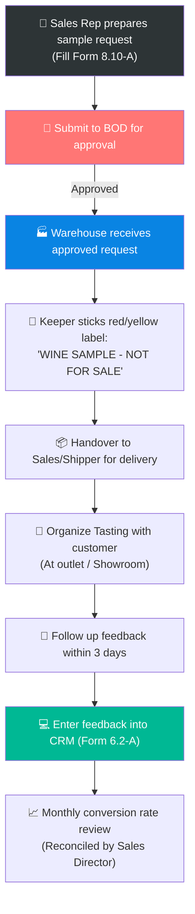

# 6.10 Wine Sample Issuance & Customer Tasting Process

🌐 [Bản tiếng Việt](6.10_xuat_ruou_mau_thu_tasting.md)

## 1. Purpose & Scope
- **Purpose:** Standardize requesting, warehouse release approval, organizing tasting sessions, and tracking customer feedback after tasting. Ensure wine samples are used efficiently, minimize waste, comply with financial rules, and optimize translation to sales (conversion rate).
- **Scope of Application:** Applies to all cases of releasing wines from Lyscellar warehouse for wine samples to B2B, HoReCa, Agents, large B2C customers, or organizing live tastings at Lyscellar showrooms or partners' premises.

---

## 2. RACI Matrix

| Process Steps | Sales Rep | Sales Director | Warehouse Keeper | Sales Accountant | Board of Directors (BOD) |
|:---|:---:|:---:|:---:|:---:|:---:|
| **1. Create Sample Request Form** | **R** | — | — | — | — |
| **2. Approve Sample Request** | — | — | — | — | **A** |
| **3. Stick labeling & Physical Release** | — | — | **R** | — | — |
| **4. Execute Tasting & Follow-up** | **R** | — | — | — | — |
| **5. Update CRM & Customer Feedback** | **R** | **I** | — | — | — |
| **6. Reconciliation & Expense Booking** | — | — | — | **R** (Acc 6418) | — |
| **7. Evaluate Efficiency (Conversion Rate)** | **C** | **R** | — | — | **I** |

---

## 3. Process Flowchart

---

## 4. Detailed Operational Steps

### Step 1: Submit Wine Sample Request
When there is a need to release wine for customer quality tasting (listing a new menu, tasting a new vintage, expanding distributors), the Sales Rep must:
1. Identify the correct wine SKU matching the cuisine and segment positioning of the customer.
2. Fill out the **Wine Tasting Proposal Form (Form 8.10-A / Wine Sample Request)** using the standard template [Form_8.10-A_To_trinh_Wine_Tasting.xlsx](../../../sources/Forms/Form_8.10-A_To_trinh_Wine_Tasting.xlsx), specifying: Customer name, channel, wine SKU, quantity of bottles, and request reason.
3. Submit the request for approval:
   - **All wine sample requests must be approved by the Board of Directors (BOD) prior to execution.**

### Step 2: Releasing Goods & Compulsory Labeling
1. Once approved, the Sales Rep sends the signed request (paper copy or photo/screenshot of approval on group chat) to the Warehouse department.
2. The Warehouse Keeper generates a **Sample Release Note** in the system and prepares the wine.
3. > [!IMPORTANT]
   > **Labeling Rule:**
   > The Warehouse Keeper is strictly required to stick a red or yellow seal label with the prominent text **"WINE SAMPLE - NOT FOR SALE (HÀNG MẪU THỬ - KHÔNG BÁN)"** onto the bottle body of every single bottle before handing it over. This is a mandatory commercial law requirement and prevents abuse of sample wines for illegal sales.
4. Hand over the wine and 01 copy of the release note to the shipper or directly to the Sales Rep.

### Step 3: Organize Tasting with Customer
1. Sales Rep prepares product materials (Tasting Notes in Vietnamese/English) before meeting the customer. Note: Tasting notes must always be accompanied by a specific Vintage to ensure professional accuracy.
2. Open and serve the wine on-site for the customer in accordance with the wine serving standards specified in the [Wine Service Standard Procedure at Table](../../concepts/concept_quy_trinh_phuc_vu_ruou_vang.md).
3. Guide the customer through the tasting, introduce the grape variety, region, winemaker story, and recommend food pairings.

### Step 4: Gather Feedback & Update CRM (SLA 3 days)
1. > [!WARNING]
   > **Feedback SLA:**
   > Within a maximum of **03 business days** from the tasting bottle opening, the Sales Rep must contact the customer to obtain detailed feedback on the wine sample quality.
2. The feedback must clarify:
   - What is the customer's evaluation of color, aroma, and palate?
   - Is Lyscellar's wholesale price suitable for the customer's menu retail pricing segment?
   - Which SKU did the customer decide to include in their Wine List/Menu? (Listing decision).
3. The Sales Rep logs into the **CRM** and records all feedback under the **Customer Interaction History** ([Form 6.2-A](../../../sources/Forms/Form_6.2-A_Ho_so_Khach_hang.xlsx)).

### Step 5: Monthly Reconciliation & Conversion Review
1. At the end of each month, the Sales Accountant compiles the list of released wine samples, matches them with valid requests, and books the sales expenses under **Account 6418 (Other Sales Expenses)**.
2. The Sales Director conducts a monthly reconciliation review:
   - Compare the sample wine volume released to each Sales Rep with their newly closed sales orders ([QT 6.3](6.3_xu_ly_don_hang.md)) or newly signed consignment agreements ([QT 6.8](6.8_quan_ly_hang_ky_gui.md)) to calculate the **Sample-to-Sale Conversion Rate**.
   - Sales Reps with a conversion rate below 20% for 2 consecutive months will have their sample limit restricted in the following month and must explain directly to the Sales Director.

---

## 5. KPI & Control Metrics

| KPI Indicator | Calculation Method | Control Target | Measurement Frequency |
|:---|:---|:---:|:---:|
| **Sample-to-Sale Conversion Rate** | (Number of customers placing order / Total customers who tasted samples) | **≥ 30%** | Monthly |
| **CRM Update SLA** | Time from tasting execution to entering feedback on CRM | **≤ 3 business days** | Per request |
| **Sample Labeling Rate** | Bottles labeled "Not for Sale" on release / Total sample bottles released | **100%** | Ad-hoc audit |

---

## 6. Related Documents & Forms
- ← Direct Relationship: [8.10 Expense Management for Tasting & Guest Entertainment](../08_tai_chinh/8.10_quan_ly_chi_phi_tasting_tiep_khach.md)
- ↔ Professional Support: [Wine Service Standard Procedure at Table](../../concepts/concept_quy_trinh_phuc_vu_ruou_vang.md) | [Sales Objection Handling & FAQ script](../../concepts/concept_kich_ban_sales_faq.md)
- 📥 Request Form: [Form_8.10-A_To_trinh_Wine_Tasting.xlsx (Form 8.10-A)](../../../sources/Forms/Form_8.10-A_To_trinh_Wine_Tasting.xlsx) (used to propose wine tasting).
