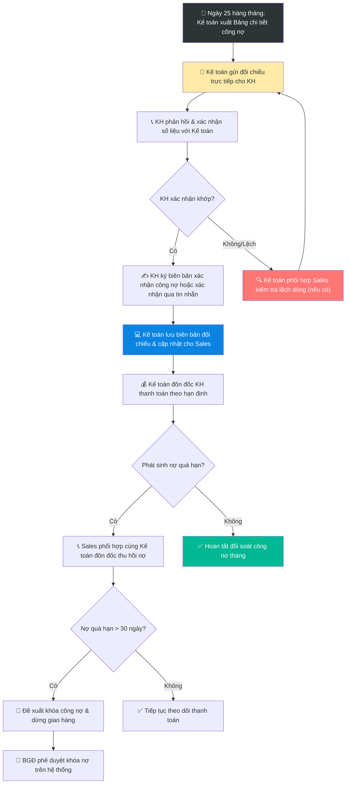

# 6.11 Quy trình Báo cáo & Đối chiếu Công nợ

🌐 [English Version](6.11_doi_chieu_cong_no_cuoi_thang_en.md)

## 1. Mục đích & Phạm vi
- **Mục đích:** Đảm bảo số liệu công nợ giữa Lyscellar, nhân viên Sales và khách hàng hoàn toàn khớp nhau vào cuối mỗi tháng. Xác định sớm các khoản nợ sắp đến hạn hoặc quá hạn, đôn đốc thu hồi nợ kịp thời và giảm thiểu nợ xấu.
- **Phạm vi:** Áp dụng cho toàn bộ các khách hàng có phát sinh giao dịch công nợ (HoReCa, Đại lý, B2B, Key Accounts).
- **Tần suất:** Hàng ngày (Báo cáo nhanh), Hàng tháng đối soát (từ ngày 25 đến ngày cuối tháng).

## 2. Trách nhiệm (RACI Matrix)

| Bước công việc | Sales Rep | Kế toán bán hàng | Giám đốc Sales | Ban Giám Đốc (BGĐ) |
| :--- | :---: | :---: | :---: | :---: |
| **1. Trích xuất & gửi đối chiếu cho KH** | **I** | **R** | — | — |
| **2. Xác nhận số liệu & Phản hồi** | **C** | **R** | — | — |
| **3. Xử lý chênh lệch số liệu** | **R** (Phối hợp) | **R** | — | — |
| **4. Đôn đốc thu hồi nợ thường** | — | **R** | — | — |
| **5. Phối hợp thu hồi nợ quá hạn** | **R** (Phối hợp) | **R** | **C** | — |
| **6. Báo cáo & Đề xuất khóa nợ** | — | **R** | **R** | **A** |

## 3. Sơ đồ Quy trình Vận hành (Process Flowchart)

## 4. Các bước Vận hành Chi tiết

### Bước 0: Báo cáo Công nợ Hàng ngày (Sale Admin) - Sử dụng Form 8.2-C
1. Hàng ngày, Sale Admin tổng hợp số liệu công nợ phải thu phát sinh trong ngày và danh sách khách hàng nợ quá hạn từ hệ thống CRM và sổ kế toán bán hàng.
2. Cập nhật dữ liệu vào **Báo cáo Công nợ Hàng ngày** (Form 8.2-C).
3. Gửi báo cáo cho đội ngũ Sales và Ban Giám Đốc trước **17:30** hàng ngày qua email/nhóm WhatsApp để phục vụ theo dõi và đôn đốc thu hồi nợ kịp thời.

### Bước 1: Trích xuất và Gửi dữ liệu Công nợ (Ngày 25 - 28 hàng tháng)
1. Kế toán bán hàng trích xuất báo cáo công nợ chi tiết của từng khách hàng từ phần mềm kế toán MISA (Sổ chi tiết công nợ phải thu - Form 8.2-A).
2. Kế toán phân loại công nợ theo từng nhân viên Sales phụ trách và gửi tệp Excel đối chiếu cho từng Sales Rep qua Email/WhatsApp.

### Bước 2: Gửi Đối chiếu và Xác nhận với Khách hàng (Ngày 26 - 30 hàng tháng)
1. Kế toán bán hàng trực tiếp gửi thông tin đối chiếu công nợ cho khách hàng (thông qua Biên bản đối chiếu công nợ chính thức hoặc tin nhắn xác nhận chi tiết bao gồm: Dư nợ đầu kỳ, doanh số mua trong tháng, số tiền đã thanh toán, và dư nợ cuối kỳ).
2. Khách hàng kiểm tra và phản hồi trực tiếp cho Kế toán bán hàng.
3. **Quy định về trách nhiệm:**
   - **Kế toán bán hàng** phụ trách chính trong việc gửi thông tin và thực hiện đối chiếu công nợ với khách hàng.
   - **Nhân viên Sales** phối hợp cùng Kế toán bán hàng khi khách hàng báo chênh lệch số liệu.

### Bước 3: Xử lý Chênh lệch và Xác nhận Khớp số liệu
1. Nếu khách hàng phản hồi lệch số liệu: Kế toán bán hàng phối hợp với nhân viên Sales để kiểm tra lại các hóa đơn VAT, phiếu xuất kho, chứng từ trả hàng hoặc chứng từ chuyển khoản để tìm nguyên nhân và điều chỉnh kịp thời.
2. Khi số liệu đã khớp: Kế toán bán hàng yêu cầu khách hàng ký đóng dấu xác nhận Biên bản đối chiếu công nợ (đối với khách hàng doanh nghiệp/chuỗi) hoặc nhắn tin xác nhận đồng ý với số dư công nợ cuối tháng (đối với khách hàng vừa và nhỏ).
3. Kế toán bán hàng lưu trữ Biên bản đối chiếu công nợ đã xác nhận làm bằng chứng trước ngày cuối cùng của tháng, đồng thời thông báo cho Sales Rep tình trạng đối soát hoàn tất.

### Bước 4: Đôn đốc Thu nợ và Đề xuất Khóa Công nợ quá hạn
1. Kế toán bán hàng đôn đốc khách hàng thanh toán công nợ thường theo hạn định đã cam kết.
2. **Trong trường hợp phát sinh nợ quá hạn:** Nhân viên Sales bắt buộc phải phối hợp cùng Kế toán bán hàng để trực tiếp liên hệ khách hàng, đôn đốc thu tiền và thực hiện các biện pháp thu hồi nợ kịp thời.
3. > [!WARNING]
   > **Quy tắc xử lý nợ quá hạn:**
   > Khách hàng có khoản nợ quá hạn trên **30 ngày** sẽ bị khóa công nợ trên hệ thống và dừng cấp hàng ngay lập tức theo quy định tại SOP 6.4. Sales Rep phối hợp Kế toán lập danh sách đề xuất gửi Sales Director và trình BGĐ phê duyệt khóa mã giao hàng trên CRM/MISA.

---

## 5. KPI & Đo lường

| Chỉ số KPI | Phương pháp tính | Mục tiêu | Tần suất |
| :--- | :--- | :---: | :---: |
| **Tỷ lệ hoàn thành đối chiếu công nợ** | (Số KH đã ký xác nhận đối chiếu / Tổng số KH có dư nợ) | **100%** | Hàng tháng |
| **SLA gửi đối chiếu của Kế toán** | Thời gian gửi báo cáo công nợ cho Sales | **Trước ngày 26** | Hàng tháng |
| **Thời hạn hoàn thành đối chiếu** | Hạn cuối nộp bản đối chiếu công nợ đã ký về Kế toán | **Ngày cuối tháng** | Hàng tháng |

---

## 6. Tài liệu & Biểu mẫu Liên quan
- ← Liên quan trực tiếp: [8.2 Quản lý Công nợ Phải thu (AR)](../08_tai_chinh/8.2_cong_no_phai_thu.md)
- 📥 Biểu mẫu đối chiếu: [Form 8.2-B (Biên bản đối chiếu công nợ khách hàng)](../../../sources/Forms/Form_8.2-B_Doi_chieu_Cong_no.xlsx)
- 📥 Biểu mẫu báo cáo công nợ: [Form 8.2-C (Báo cáo công nợ hàng ngày)](../../../sources/Forms/Form_8.2-C_Bao_cao_Cong_no_Hang_ngay.xlsx)
