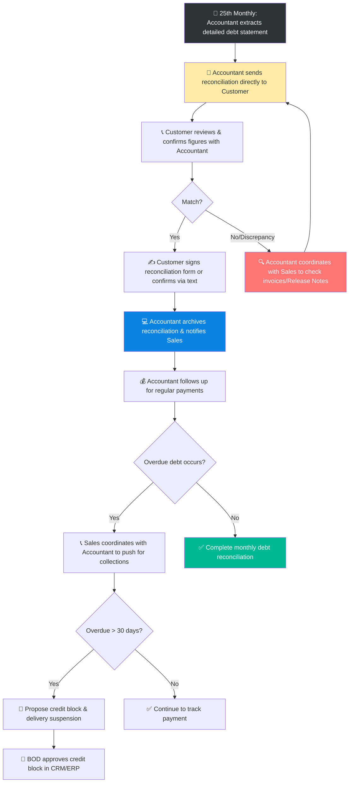

# 6.11 Debt Reporting & Reconciliation Process

🌐 [Bản tiếng Việt](6.11_doi_chieu_cong_no_cuoi_thang.md)

## 1. Purpose & Scope
- **Purpose:** Ensure that credit balances between Lyscellar, Sales representatives, and customers match perfectly at the end of each month. Identify pending or overdue debts early to accelerate collection and minimize bad debts.
- **Scope:** Applies to all customers with active credit balances (HoReCa, Agents, B2B, Key Accounts).
- **Frequency:** Daily (reporting updates), Monthly reconciliation (from the 25th to the end of the month).

## 2. RACI Matrix

| Process Steps | Sales Rep | Sales Accountant | Sales Director | Board of Directors (BOD) |
| :--- | :---: | :---: | :---: | :---: |
| **1. Extract & send reconciliation to Customer** | **I** | **R** | — | — |
| **2. Confirm figures & Feedback** | **C** | **R** | — | — |
| **3. Resolve discrepancies** | **R** (Coordinate) | **R** | — | — |
| **4. Regular debt collection follow-up** | — | **R** | — | — |
| **5. Coordinate on overdue debt collection** | **R** (Coordinate) | **R** | **C** | — |
| **6. Report & Propose credit block** | — | **R** | **R** | **A** |

## 3. Process Flowchart

## 4. Detailed Operational Steps

### Step 0: Daily Debt Reporting (Sale Admin) - Using Form 8.2-C
1. Daily, the Sale Admin compiles accounts receivable transactions and overdue debt lists from the CRM system and Sales Accountant records.
2. Updates the **Daily Debt Report** (Form 8.2-C).
3. Sends the report to the Sales team and BOD before **17:30** daily via email/WhatsApp group to facilitate timely debt monitoring and collection actions.

### Step 1: Export and Distribute Debt Data (25th - 28th of the Month)
1. The Sales Accountant exports the detailed accounts receivable report for each customer from the MISA accounting software (Accounts Receivable Ledger - Form 8.2-A).
2. The Accountant group-sorts balances by the responsible Sales Representative and sends the Excel statement files to each Sales Rep via Email/WhatsApp.

### Step 2: Send Statement and Confirm with Customers (26th - 30th of the Month)
1. The Sales Accountant directly sends the reconciliation statement to the customer (via an official Debt Reconciliation Statement or a detailed confirmation text message indicating: Beginning balance, monthly sales, payments received, and ending balance).
2. The customer reviews and responds directly to the Sales Accountant.
3. **Responsibility Rule:**
   - The **Sales Accountant** is primarily responsible for sending and reconciling the debt with the customer.
   - The **Sales Representative** coordinates closely with the Sales Accountant when the customer reports any discrepancies.

### Step 3: Resolve Discrepancies and Finalize Balances
1. If the customer reports a balance variance: The Sales Accountant coordinates with the Sales Representative to crosscheck VAT invoices, warehouse release notes, return vouchers, or bank transfers to find the root cause and make corrections.
2. Once finalized: The Sales Accountant requests the customer to sign and stamp the Debt Reconciliation Statement (for corporate/chain customers) or send a confirmation text message agreeing to the month-end balance (for small-to-medium outlets).
3. The Sales Accountant archives the confirmed Debt Reconciliation Statement before the last day of the month and notifies the Sales Rep.

### Step 4: Urge Debt Collection and Propose Credit Block
1. The Sales Accountant follows up with the customer for regular payments.
2. **In case of overdue debt:** The Sales Representative must coordinate with the Sales Accountant to directly contact the customer, push for payments, and execute collection actions.
3. > [!WARNING]
   > **Overdue Debt Rule:**
   > Customers with credit balances overdue for more than **30 days** will have their credit blocked in the system and shipments stopped immediately as per SOP 6.4. Sales Rep coordinates with Accounting to compile a list to suggest to the Sales Director, which is then submitted to the BOD to lock the account on CRM/MISA.

---

## 5. KPI & Measurement

| KPI Indicator | Calculation Method | Target | Frequency |
| :--- | :--- | :---: | :---: |
| **Debt Reconciliation Completion Rate** | (Reconciled & signed customers / Total customers with debt) | **100%** | Monthly |
| **Accountant Statement SLA** | Time to send debt report to Sales | **Before the 26th** | Monthly |
| **Reconciliation Deadline** | Target date to submit signed statement to Accounting | **Last day of the month** | Monthly |

---

## 6. Related Documents & Forms
- ← Direct Relationship: [8.2 Accounts Receivable Management (AR)](../08_tai_chinh/8.2_cong_no_phai_thu.md)
- 📥 Form: [Form 8.2-B (Customer Debt Reconciliation Statement)](../../../sources/Forms/Form_8.2-B_Doi_chieu_Cong_no.xlsx)
- 📥 Form: [Form 8.2-C (Daily Debt Report)](../../../sources/Forms/Form_8.2-C_Bao_cao_Cong_no_Hang_ngay.xlsx)
