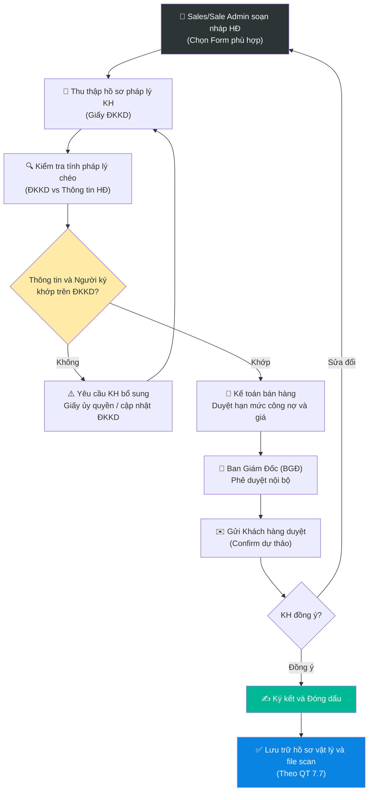

# 6.12 Quy trình Quản lý Hợp đồng Khách hàng

## 1. Mục đích & Phạm vi
- **Mục đích:** Thiết lập quy trình soạn thảo, kiểm soát pháp lý, phê duyệt và ký kết hợp đồng khách hàng nhằm bảo vệ quyền lợi hợp pháp của Lyscellar, phòng ngừa rủi ro tranh chấp và nợ xấu.
- **Phạm vi áp dụng:** Bộ phận Kinh doanh (Sales), bộ phận Sale Admin, bộ phận Kế toán và Ban Giám đốc (BGĐ).
- **Tần suất thực hiện:** Mỗi khi phát sinh khách hàng mới thuộc diện ký hợp đồng, hoặc gia hạn hợp đồng hàng năm.

---

## 2. Phân loại Biểu mẫu Hợp đồng (Contract Templates)

Tùy thuộc vào từng nhóm đối tượng khách hàng, bộ phận Sales/Sale Admin sử dụng đúng biểu mẫu quy chuẩn dưới đây:

| Loại hợp đồng | Đối tượng áp dụng | Đặc điểm cốt lõi | Biểu mẫu áp dụng |
|---|---|---|---|
| **Hợp đồng HoReCa (Không công nợ - COD)** | Nhà hàng, Khách sạn, quán Bar, Café | Hợp đồng nguyên tắc năm, thanh toán ngay khi giao hàng (COD). Có điều khoản về Wine List, hỗ trợ trưng bày, tài trợ ly/tủ rượu, đào tạo thử nếm (wine tasting). | [Contract Thang An - HORECA 2025 - COD.docx](../../../sources/Legal/Contract%20Thang%20An%20-%20HORECA%202025%20-%20COD.docx) |
| **Hợp đồng HoReCa (Có công nợ - DEBT)** | Nhà hàng, Khách sạn, quán Bar, Café | Hợp đồng nguyên tắc năm, có hạn mức và thời hạn công nợ được duyệt. Có điều khoản về Wine List, hỗ trợ trưng bày, tài trợ ly/tủ rượu, đào tạo thử nếm (wine tasting). | [Contract Thang An - HORECA 2025 - DEBT.docx](../../../sources/Legal/Contract%20Thang%20An%20-%20HORECA%202025%20-%20DEBT.docx) |
| **Hợp đồng Doanh nghiệp (Corporate)** | Các công ty mua quà tặng, sự kiện, trung thu, Tết | Hợp đồng thương mại nguyên tắc hoặc theo mùa vụ. Tập trung vào tiến độ giao nhận số lượng lớn, quy cách hộp quà và in ấn logo thương hiệu. | — |
| **Hợp đồng vụ việc (Từng lần)** | Khách hàng vãng lai mua đơn hàng lớn | Áp dụng cho một đơn hàng cụ thể, thanh toán dứt điểm. Không phát sinh các cam kết lâu dài về sau. | — |

---

## 3. Các Điều khoản Bắt buộc kiểm tra trong Hợp đồng (Core Clauses)

Khi soạn thảo hợp đồng, người lập phải ghi rõ các điều khoản thương mại đã đàm phán:

1. **Chính sách Giá bán:** Quy định rõ giá bán áp dụng (theo bảng giá chuẩn Q2/2026 hoặc phụ lục giá đính kèm).
2. **Điều khoản Công nợ & Thanh toán:**
   - Mức hạn mức công nợ (Credit Limit) tối đa.
   - Hạn thanh toán (Ví dụ: 15 ngày, 30 ngày kể từ ngày nhận hóa đơn).
   - Thông tin tài khoản ngân hàng thụ hưởng của công ty.
3. **Chính sách Marketing & Hỗ trợ:**
   - Mức chiết khấu marketing hoặc hoa hồng thương mại (nếu có).
   - Các hạng mục tài trợ vật phẩm (POSM, ly rượu, tủ mát) và cam kết thu hồi tài sản nếu dừng hợp tác.
   - Kế hoạch hỗ trợ thử nếm (Tasting) và đào tạo nhân viên phục vụ của khách hàng.
4. **Điều khoản Giao nhận:**
   - Địa điểm giao nhận hàng thực tế của các chi nhánh con.
   - Quy cách đóng gói, quy định về tỷ lệ hao hụt rơi vỡ trong quá trình vận chuyển.

---

## 4. Quy trình Thực hiện (Contract Approval Workflow)

### Bước 1: Soạn thảo dự thảo Hợp đồng
- Sales hoặc Sale Admin điền các thông tin thương mại vào biểu mẫu tương ứng.

### Bước 2: Thu thập hồ sơ & Kiểm tra pháp lý
- **Đối với hợp đồng trong nước:** Bắt buộc khách hàng phải cung cấp bản chụp **Giấy chứng nhận Đăng ký kinh doanh (ĐKKD) mới nhất có chữ ký, đóng dấu xác nhận (đóng dấu treo/sao y bản chính) hoặc được công chứng hợp lệ**.
- **Đối chiếu thông tin:**
  - Tên Công ty, Địa chỉ trụ sở, Mã số thuế trên hợp đồng phải **trùng khớp 100%** với thông tin ghi trên Giấy ĐKKD.
  - **Kiểm tra Thẩm quyền ký kết:** Người đứng tên ký hợp đồng bên phía khách hàng phải là **Người đại diện theo pháp luật** ghi trên Giấy ĐKKD.
  - **Trường hợp ngoại lệ (Ủy quyền):** Nếu người ký không phải là người đại diện pháp luật (ví dụ: Giám đốc chi nhánh, Quản lý mua hàng), bắt buộc phải yêu cầu khách hàng cung cấp **Giấy ủy quyền hợp lệ** đính kèm, ký bởi Người đại diện pháp luật.

> [!WARNING]
> **Nghiêm cấm:** Ký hợp đồng với người không có thẩm quyền ký kết hoặc không có giấy ủy quyền hợp lệ. Mọi hợp đồng không khớp thông tin đại diện trên Giấy ĐKKD đều bị coi là vô hiệu về mặt pháp lý.

### Bước 3: Phê duyệt nội bộ & Xác nhận với Khách hàng
- Gửi dự thảo cho **Kế toán bán hàng** soát xét về hạn mức nợ và chính sách giá.
- Trình **Ban Giám Đốc** phê duyệt trước khi gửi khách hàng.
- Gửi bản dự thảo cho Khách hàng rà soát và xác nhận (Confirm) các điều khoản bằng văn bản/email.

### Bước 4: Ký kết & Lưu trữ
- Tiến hành in ấn, ký và đóng dấu giáp lai (02 bản, mỗi bên giữ 01 bản).
- Sau khi ký xong, Sale Admin tiến hành scan hợp đồng kèm Giấy ĐKKD, lưu trữ bản mềm lên hệ thống CRM/ổ đĩa dùng chung, bản cứng lưu tại tủ hồ sơ pháp lý công ty theo quy trình [7.7 Lưu trữ hồ sơ](../07_phap_ly/7.7_luu_tru_ho_so.md).

---

## 5. Ma trận Trách nhiệm (RACI Matrix)

| Bước | Sales Rep | Sale Admin | Kế toán bán hàng | Ban Giám Đốc (BGĐ) |
|---|:---:|:---:|:---:|:---:|
| **1. Soạn thảo dự thảo HĐ** | **R** | **R** | — | — |
| **2. Thu thập GPKD & Kiểm tra pháp lý** | **R** | **R** | — | — |
| **3. Duyệt nội bộ (Giá & Hạn mức nợ)** | — | — | **R** | **A** |
| **4. Ký kết & Đóng dấu** | — | — | — | **A** |
| **5. Scan & Lưu trữ hồ sơ** | — | **R** | — | — |

---

## 6. Chỉ số hiệu quả (KPI Matrix)

| KPI | Công thức đo lường | Mục tiêu | Tần suất |
|---|---|---|---|
| **Tỷ lệ khớp thông tin ĐKKD** | Số hợp đồng khớp 100% / Tổng số hợp đồng đã ký | 100% | Hàng tháng |
| **Thời gian soạn thảo hợp đồng** | Thời gian từ khi nhận đủ thông tin từ Sales đến khi Sale Admin soạn xong HĐ nháp | ≤ 12 giờ | Hàng tháng |
| **Thời gian active công nợ** | Thời gian tạo mã & active công nợ sau khi nhận đủ hợp đồng ký đóng dấu | ≤ 1 ngày làm việc | Hàng tháng |

---

## 7. Tài liệu & Biểu mẫu Liên quan
- 👥 Khách hàng: [Khách hàng HORECA](../../entities/khach_hang_horeca.md) | [Khách hàng Corporate](../../entities/khach_hang_corporate.md)
- 💰 Tài chính: [8.2 Quản lý Công nợ Phải thu](../08_tai_chinh/8.2_cong_no_phai_thu.md)
- 🗄️ Lưu trữ: [7.7 Lưu trữ hồ sơ](../07_phap_ly/7.7_luu_tru_ho_so.md)
- 🤝 Quy trình liên quan: [6.1 Phát triển KH](6.1_phat_trien_kh.md) | [6.3 Xử lý Đơn hàng Bán](6.3_xu_ly_don_hang.md)
