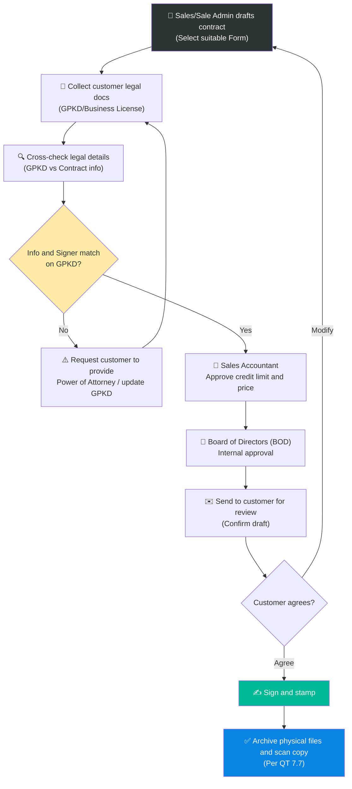

# 6.12 Customer Contract Management Process

## 1. Purpose & Scope
- **Purpose:** Establish the process of drafting, legal checking, approving, and signing customer contracts to protect Lyscellar's legal rights, prevent disputes, and mitigate bad debts.
- **Scope:** Sales Department, Sale Admin, Accounting, and Board of Directors (BOD).
- **Frequency:** Every time a new customer needs a contract, or annual renewal.

---

## 2. Classification of Contract Templates

Depending on the target customer group, the Sales/Sale Admin department must use the correct standardized template below:

| Contract Type | Target Audience | Core Characteristics | Applicable Template |
|---|---|---|---|
| **HoReCa Contract (No credit - COD)** | Restaurants, Hotels, Bars, Cafés | Annual principle contract, payment upon delivery (COD). Includes clauses on Wine List, display support, wine glass/cellar sponsorship, and wine tasting training. | [Contract Thang An - HORECA 2025 - COD.docx](../../../sources/Legal/Contract%20Thang%20An%20-%20HORECA%202025%20-%20COD.docx) |
| **HoReCa Contract (With credit - DEBT)** | Restaurants, Hotels, Bars, Cafés | Annual principle contract with approved credit limit and terms. Includes clauses on Wine List, display support, wine glass/cellar sponsorship, and wine tasting training. | [Contract Thang An - HORECA 2025 - DEBT.docx](../../../sources/Legal/Contract%20Thang%20An%20-%20HORECA%202025%20-%20DEBT.docx) |
| **Corporate Contract** | Companies purchasing gifts, events, Mid-Autumn, Tet | Trade principle or seasonal contract. Focuses on delivery schedules for large volumes, gift box specifications, and logo printing. | — |
| **Spot/Transaction Contract** | Walk-in customers with large one-time orders | Applied for a specific order, payment in full. No subsequent long-term commitments are generated. | — |

---

## 3. Mandatory Contract Clauses to Verify (Core Clauses)

When drafting contracts, the drafter must clearly state the negotiated commercial terms:

1. **Pricing Policy:** Clearly specify the applicable selling prices (according to the standardized Q2/2026 price list or attached price annex).
2. **Debt & Payment Terms:**
   - Maximum credit limit.
   - Payment deadline (e.g., 15 days, 30 days from invoice receipt date).
   - The company's beneficiary bank account details.
3. **Marketing & Support Policy:**
   - Marketing discount or trade commission rate (if any).
   - Sponsorship items (POSM, wine glasses, cooling cellars) and commitment to retrieve assets if cooperation ends.
   - Plans for wine tasting and staff training support for the client.
4. **Delivery Terms:**
   - Actual delivery locations for sub-branches.
   - Packaging specifications, regulation on breakage/wastage rate during transportation.

---

## 4. Execution Steps (Contract Approval Workflow)

### Step 1: Draft the Contract
- Sales or Sale Admin fills commercial details into the appropriate template.

### Step 2: Collect Documents & Legal Verification
- **For domestic contracts:** The customer must provide a copy of their **latest Business Registration Certificate (GPKD) with signature, stamp (company stamp or certified copy) or valid notarization**.
- **Cross-check details:**
  - Company name, headquarters address, and tax ID on the contract must **match 100%** with the GPKD.
  - **Check signing authority:** The person signing the contract on behalf of the customer must be the **Legal Representative** listed on the GPKD.
  - **Exception (Power of Attorney):** If the signer is not the legal representative (e.g., branch manager, purchasing manager), they must provide a valid **Power of Attorney** signed by the Legal Representative.

> [!WARNING]
> **Strictly Prohibited:** Signing contracts with unauthorized personnel or without a valid power of attorney. Any contract not matching representative details on the GPKD is considered legally void.

### Step 3: Internal Approval & Client Confirmation
- Send the draft to the **Sales Accountant** to review credit limits and pricing policies.
- Submit to the **Board of Directors (BOD)** for internal approval.
- Send the draft to the client to review and confirm the clauses via document or email.

### Step 4: Signing & Archiving
- Print, sign, and stamp (02 copies, 01 for each side).
- Once signed, the Sale Admin scans the contract and GPKD, saves the soft copy on CRM/shared drive, and archives the physical copy in the legal cabinet according to [7.7 Document Archiving](../07_phap_ly/7.7_luu_tru_ho_so.md).

---

## 5. Responsibility Matrix (RACI Matrix)

| Step | Sales Rep | Sale Admin | Sales Accountant | Board of Directors (BOD) |
|---|:---:|:---:|:---:|:---:|
| **1. Draft contract** | **R** | **R** | — | — |
| **2. Collect GPKD & Legal check** | **R** | **R** | — | — |
| **3. Internal approval (Price & Debt)** | — | — | **R** | **A** |
| **4. Sign & Stamp** | — | — | — | **A** |
| **5. Scan & Archive** | — | **R** | — | — |

---

## 6. Key Performance Indicators (KPI Matrix)

| KPI | Measurement Formula | Target | Frequency |
|---|---|---|---|
| **GPKD Detail Match Rate** | Contracts with 100% matched details / Total contracts signed | 100% | Monthly |
| **Drafting Turnaround Time** | Time from receiving complete information from Sales to Sale Admin drafting the contract | ≤ 12 hours | Monthly |
| **Credit Activation SLA** | Time to create customer code & active credit account after receiving signed contract | ≤ 1 business day | Monthly |

---

## 7. Related Documents & Templates
- 👥 Customers: [HoReCa Customers](../../entities/khach_hang_horeca.md) | [Corporate Customers](../../entities/khach_hang_corporate.md)
- 💰 Finance: [8.2 Accounts Receivable Management](../08_tai_chinh/8.2_cong_no_phai_thu.md)
- 🗄️ Archiving: [7.7 Document Archiving](../07_phap_ly/7.7_luu_tru_ho_so.md)
- 🤝 Related Processes: [6.1 Sales Development](6.1_phat_trien_kh.md) | [6.3 Sales Order Processing](6.3_xu_ly_don_hang.md)
