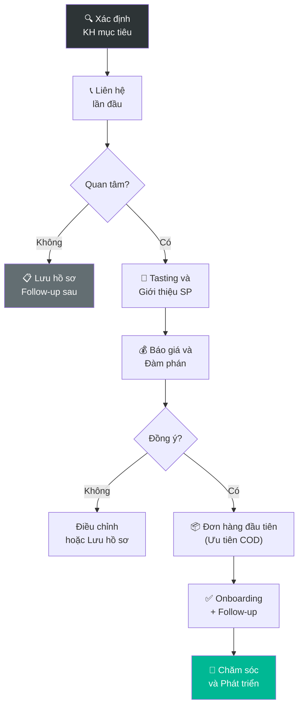

# 6.1 Phát triển Khách hàng Mới

🌐 [English Version](6.1_phat_trien_kh_en.md)

## 1. Mục đích & Phạm vi
- **Mục đích:** Tìm kiếm, tiếp cận và chuyển đổi khách hàng tiềm năng thành khách hàng mua hàng, mở rộng mạng lưới phân phối cho Lyscellar.
- **Áp dụng:** KH B2B (nhà hàng, khách sạn, quán bar, đại lý, siêu thị rượu) và KH B2C (cá nhân mua số lượng).
- **Tần suất:** Liên tục — hoạt động kinh doanh thường xuyên.

## 2. Thuật ngữ
| Thuật ngữ | Giải thích |
|-----------|-----------|
| **Lead** | KH tiềm năng, chưa liên hệ hoặc mới liên hệ lần đầu |
| **Prospect** | Lead đã quan tâm, đang tìm hiểu sản phẩm |
| **Qualified Lead** | Prospect có nhu cầu + ngân sách + quyền quyết định |
| **Conversion** | Chuyển đổi từ prospect → KH mua hàng lần đầu |
| **HoReCa** | Hotel – Restaurant – Café (kênh nhà hàng khách sạn) |

## 3. Trách nhiệm (RACI)

| Bước                              | Responsible | Approve             | Consulted | Informed |
| --------------------------------- | ----------- | ------------------- | --------- | -------- |
| Xác định KH mục tiêu              | Sales       | BGĐ                 | Marketing | —        |
| Liên hệ lần đầu (Cold call/Visit) | Sales       | —                   | —         | BGĐ      |
| Gửi mẫu/Tasting                   | Sales + Kho | BGĐ (phê duyệt mẫu) | —         | Kế toán  |
| Đàm phán giá & Điều khoản         | Sales       | BGĐ                 | Kế toán   | —        |
| Đơn hàng đầu tiên                 | Sales       | BGĐ                 | Kho       | Kế toán  |
| Chăm sóc sau bán                  | Sales       | —                   | —         | BGĐ      |

## 4. Quy trình Chi tiết

### Bước 1: Xác định KH Mục tiêu
- **Input:** Thông tin thị trường, giới thiệu, sự kiện
- **Thao tác:**
  1. Xác định **phân khúc KH mục tiêu:**
     - 🏨 **HoReCa:** Nhà hàng Pháp/Ý/Fine Dining, Khách sạn 4-5 sao, Wine bar
     - 🏪 **Retail:** Cửa hàng rượu, Siêu thị mini, Wine shop
     - 🏢 **Corporate:** Công ty cần rượu quà tặng, sự kiện
     - 👤 **B2C:** Cá nhân yêu rượu, collector
  2. Nguồn tìm KH:
     - Google Maps: Tìm nhà hàng/bar khu vực mục tiêu
     - Mạng xã hội: Follow FB/Instagram quán mới mở
     - Giới thiệu từ KH cũ (referral)
     - Hội chợ, sự kiện wine tasting
     - Danh sách hiệp hội nhà hàng/khách sạn
  3. Ghi thông tin vào **Danh sách KH Tiềm năng** (Form 6.1-A)
- **Output:** Danh sách lead có SĐT, Email, Người quyết định
- **Timeline:** Liên tục

### Bước 2: Tiếp cận Lần đầu (First Contact)
- **Thao tác:**
  1. **Gọi điện / Nhắn tin giới thiệu:**
     - Giới thiệu ngắn gọn: Lyscellar — nhà nhập khẩu rượu vang châu Âu
     - Hỏi nhu cầu: "Anh/Chị đang dùng rượu vang nào? Có quan tâm thử rượu Ý/Pháp mới không?"
     - Đề nghị gặp mặt hoặc gửi catalog
  2. **Gặp trực tiếp (Walk-in visit):**
     - Mang theo catalog + card + 1-2 chai mẫu (nếu được duyệt)
     - Gặp người quản lý/chủ quán
     - Tìm hiểu: Wine list hiện tại, Budget, Ai quyết định mua
  3. **Gửi email/Zalo:**
     - Catalog sản phẩm (PDF)
     - Bảng giá sơ bộ (theo phân khúc KH)
  4. Ghi kết quả liên hệ vào CRM / Excel
- **Output:** Lead đã liên hệ, có phản hồi hay không
- **Timeline:** Trong 1-2 ngày sau khi xác định lead

### Bước 3: Tasting & Giới thiệu Sản phẩm
- **Khi nào:** Prospect quan tâm, muốn thử rượu
- **Thao tác:**
  1. Xin phê duyệt BGĐ: Gửi mẫu (SL, loại, lý do)
  2. Chuẩn bị mẫu:
     - Chọn 3-5 SKU phù hợp với KH (ví dụ: nhà hàng Ý → rượu Ý)
     - Kèm tasting note bằng tiếng Việt (bắt buộc đi kèm niên vụ/Vintage cụ thể)
  3. Tổ chức tasting:
     - **Tại quán KH:** Sales mang rượu + ly đến, giới thiệu từng chai
     - **Tại showroom:** Mời KH đến Lyscellar
     - **Online:** Gửi mẫu + video call giới thiệu
  4. Ghi nhận phản hồi: KH thích chai nào? Budget? SL dự kiến?
- **Output:** Feedback tasting, shortlist sản phẩm KH quan tâm
- **Timeline:** 1-7 ngày sau first contact

### Bước 4: Báo giá & Đàm phán
- **Thao tác:**
  1. **Kiểm tra Margin:** Khi cần báo giá cho khách hàng, Sales Rep và Sales Director bắt buộc phải tiến hành kiểm tra biên lợi nhuận (Margin). Hoạt động này sử dụng 2 biểu mẫu độc lập: **Form Check Margin dành cho Sales** và **Form Check Margin dành cho Quản lý**.
  2. **Quy tắc chốt chặn Margin (Color Gates):** Khi điền số liệu vào Form Check Margin, hệ thống hiển thị màu sắc tương ứng:
     - 🟢 **Màu xanh lá cây (Green):** Sales Rep tự quyết định áp dụng và lên đơn hàng.
     - 🟡 **Màu vàng (Yellow):** Yêu cầu bắt buộc phải có sự phê duyệt từ **anh Jeremie** mới được phép áp dụng.
     - 🔴 **Màu đỏ (Red):** Tuyệt đối không được phép thực hiện (bị từ chối).
  3. **Yêu cầu báo giá:** Sales Rep gửi yêu cầu và các điều khoản thương mại đã thống nhất cho Sale Admin.
  4. **Lập báo giá:** **Sale Admin** thực hiện lập báo giá chính thức bằng cách điền thông tin vào **Biểu mẫu Báo giá** (Form 6.4-B) hoặc tạo trực tiếp trên phần mềm **CRM**.
  5. **Gửi báo giá:** Sale Admin (hoặc Sales Rep) gửi báo giá dưới dạng tệp PDF cho khách hàng qua Email hoặc Zalo để xác nhận (confirm).
  6. **Đàm phán & Thời gian lập Tờ trình:** Sales Rep thương lượng các điều khoản phát sinh. Đối với các cơ chế đặc biệt ngoài khung giá chuẩn, nhân viên Sales bắt buộc phải lập và hoàn thành **Tờ trình duyệt cơ chế** gửi cấp có thẩm quyền phê duyệt trong vòng **24 giờ sau khi chốt** thành công với khách hàng.
- **Output:** Báo giá được KH đồng ý, Tờ trình phê duyệt cơ chế được lập đúng hạn.
- **Timeline:** 1-14 ngày (tùy KH)

### Bước 5: Đơn hàng Đầu tiên & Onboarding
- **Thao tác:**
  1. **Yêu cầu GPKD & Soạn hợp đồng:** Đối với khách hàng B2B/HoReCa/Đại lý, nhân viên Sales yêu cầu khách hàng cung cấp bản sao **Giấy phép đăng ký kinh doanh (GPKD) có chữ ký, đóng dấu xác nhận (đóng dấu treo/sao y bản chính) hoặc được công chứng hợp lệ** để phòng Pháp lý tiến hành soạn thảo hợp đồng phân phối chính thức.
  2. **Quy tắc thanh toán đơn đầu:** **Đơn giao hàng đầu tiên ưu tiên thanh toán COD** (hoặc chuyển khoản trả trước trước khi giao hàng). Nếu khách hàng chưa ký hợp đồng phân phối chính thức và chưa cung cấp Giấy phép Đăng ký kinh doanh (ĐKKD), bắt buộc phải áp dụng hình thức thanh toán COD 100%. Mọi trường hợp ngoại lệ muốn áp dụng hình thức thanh toán khác khi chưa có hợp đồng và ĐKKD đều bắt buộc phải lập Tờ trình duyệt cơ chế thanh toán đặc biệt được Ban Giám đốc phê duyệt.
  3. **Lập Phiếu yêu cầu mở mới khách hàng (Open Account):** Sales điền đầy đủ thông tin vào [Form 8.8-A: Phiếu yêu cầu mở mới & tạo mã khách hàng (Open Account)](../../../sources/Forms/Form_8.8-A_Yeu_cau_Tao_ma_KH.xlsx) (đính kèm file ảnh/scan GPKD hợp lệ có chữ ký, đóng dấu hoặc công chứng). Nếu khách hàng được đề xuất giá đặc biệt, **bắt buộc phải lập và đính kèm** [Form_6.1-B_Phu_luc_Gia_Dac_biet.xlsx](../../../sources/Forms/Form_6.1-B_Phu_luc_Gia_Dac_biet.xlsx). Trong đó, **bắt buộc phải thực hiện đánh giá, chấm điểm các tiêu chí về Độ lớn và Uy tín của khách hàng** tại mục Credit Assessment Matrix của biểu mẫu Excel để làm căn cứ đề xuất hạn mức và thời gian công nợ, đồng thời ghi nhận rõ các **Lưu ý giao hàng (Delivery Instructions)** đặc biệt của khách hàng (giờ cấm tải, giờ giao nhận cho phép, người liên hệ nhận hàng riêng biệt, quy định tòa nhà/trung tâm thương mại...), sau đó trình kế toán và BGĐ duyệt.
     - **Trách nhiệm của Sales:** Nhân viên Sales đề xuất hạn mức công nợ phải tự chịu trách nhiệm về tính xác thực của hồ sơ đề xuất và có trách nhiệm trực tiếp trong việc đôn đốc đòi nợ, thu hồi toàn bộ công nợ quá hạn từ khách hàng đó.
  4. Tạo hồ sơ KH mới trong hệ thống (MISA/CRM):
     - Tên công ty/cá nhân, MST, Địa chỉ xuất hóa đơn, Địa chỉ nhận hàng, SĐT.
     - Người liên hệ, Kênh bán, Phân khúc.
     - Ghi chú/Lưu ý đặc biệt khi giao hàng (Delivery Instructions) để làm cơ sở cho bộ phận Kho và Shipper thực thi sau này.
     - Cập nhật đúng hình thức thanh toán tương ứng cho đơn hàng đầu tiên trên hệ thống (COD hoặc thanh toán theo Tờ trình đã được phê duyệt).
  5. Xử lý đơn hàng → [QT 6.3](6.3_xu_ly_don_hang.md)
  6. Giao hàng + theo dõi KH nhận → [QT 5.6](../05_kho_van/5.6_xuat_kho.md)
  7. **Follow-up 3 ngày sau giao:** "Anh/Chị đã thử chưa? Phản hồi thế nào?"
- **Output:** KH mua hàng lần đầu thành công, thông tin Master Data đã khai báo chuẩn.
- **Timeline:** 1-3 ngày

### Bước 6: Chăm sóc & Phát triển
- **Thao tác:**
  1. Follow-up định kỳ: 2 tuần/lần (tháng đầu), sau đó 1 lần/tháng
  2. Giới thiệu sản phẩm mới khi có hàng nhập
  3. Mời tham gia wine tasting events
  4. Theo dõi tần suất + giá trị đặt hàng → đánh giá tiềm năng
  5. Nếu KH ngưng mua > 2 tháng → gọi hỏi thăm, đề xuất ưu đãi
- **Mục tiêu:** Biến KH mới → KH trung thành (mua hàng tháng)

## 5. Sơ đồ Quy trình

## 6. Biểu mẫu
📥 **Form 6.1-A:** [Danh_sach_KH_Tiem_nang.xlsx](../../../sources/Forms/Form_6.1-A_Danh_sach_KH_Tiem_nang.xlsx)

**Nội dung form:**
- Thông tin KH: Tên, Loại (HoReCa/Retail/Corporate), Địa chỉ, SĐT
- Người quyết định, Nhu cầu, Budget ước tính
- Lịch sử liên hệ: Ngày, Kết quả, Next action
- Trạng thái: Lead → Prospect → Qualified → Customer

## 7. KPI & Đo lường

| KPI                     | Công thức                        | Mục tiêu     | Tần suất   |
| ----------------------- | -------------------------------- | ------------ | ---------- |
| Số KH mới/tháng         | Số KH mua lần đầu trong tháng    | ≥ 3 KH/tháng | Hàng tháng |
| Tỷ lệ chuyển đổi        | KH mua / Tổng lead liên hệ       | ≥ 15%        | Hàng quý   |
| Thời gian chuyển đổi    | Từ first contact → đơn hàng đầu  | ≤ 30 ngày    | Hàng quý   |
| Giá trị đơn hàng đầu TB | Tổng giá trị đơn đầu / Số KH mới | ≥ 5 triệu    | Hàng quý   |
| Tỷ lệ KH quay lại       | KH mua lần 2 / Tổng KH mới       | ≥ 50%        | 6 tháng    |

## 8. Xử lý Ngoại lệ

| Tình huống | Hành động | Escalation |
|-----------|----------|-----------|
| KH yêu cầu chiết khấu > 10% | Trình BGĐ duyệt | BGĐ |
| KH muốn ký gửi (consignment) | Đánh giá KH trước, BGĐ duyệt, giới hạn SL | BGĐ |
| KH lớn yêu cầu hợp đồng phân phối | → [QT 6.12 Ký kết HĐ](6.12_quan_ly_hop_dong_khach_hang.md) | BGĐ |
| KH từ chối sau tasting | Ghi nhận lý do, follow-up sau 1 tháng | — |

## 9. Tài liệu Liên quan
- → Sau: [6.2 CRM](6.2_crm.md) | [6.3 Xử lý Đơn hàng](6.3_xu_ly_don_hang.md)
- ↔ Liên quan: [6.4 Chính sách Giá](6.4_chinh_sach_gia.md) | [9.4 Wine Tasting](../09_marketing/9.4_wine_tasting.md)
