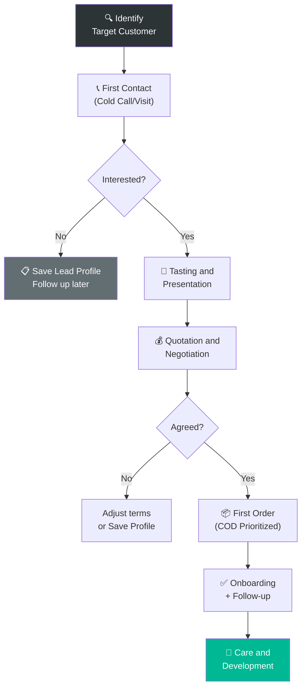

# 6.1 New Customer Development

🌐 [Bản tiếng Việt](6.1_phat_trien_kh.md)

## 1. Purpose & Scope
- **Purpose:** Search for, approach, and convert prospects into purchasing customers, expanding the distribution network for Lyscellar.
- **Application:** B2B customers (restaurants, hotels, bars, agents, wine supermarkets) and B2C customers (individuals buying in volume).
- **Frequency:** Continuous — regular business activity.

---

## 2. Terminology
| Term | Explanation |
|:---|:---|
| **Lead** | Potential customer, not yet contacted or contacted for the first time |
| **Prospect** | Lead who is interested and learning about products |
| **Qualified Lead** | Prospect with need + budget + decision-making authority |
| **Conversion** | Transition from prospect → first-time purchasing customer |
| **HoReCa** | Hotel – Restaurant – Café channel |

---

## 3. RACI Matrix

| Step | Responsible | Approve | Consulted | Informed |
|:---|:---:|:---:|:---:|:---:|
| **Identify target customers** | Sales Rep | BOD | Marketing | — |
| **First contact (Cold call/Visit)** | Sales Rep | — | — | BOD |
| **Send samples/Tasting** | Sales Rep + Warehouse | BOD (sample approval) | — | Sales Accountant |
| **Negotiate prices & terms** | Sales Rep | BOD | Sales Accountant | — |
| **First order** | Sales Rep | BOD | Warehouse Keeper | Sales Accountant |
| **Post-sales care** | Sales Rep | — | — | BOD |

---

## 4. Detailed Operational Steps

### Step 1: Identify Target Customers
- **Input:** Market information, referrals, events
- **Execution:**
  1. Identify **target customer segments:**
     - 🏨 **HoReCa:** French/Italian/Fine Dining restaurants, 4-5 star hotels, wine bars.
     - 🏪 **Retail:** Wine shops, mini supermarkets, boutique shops.
     - 🏢 **Corporate:** Companies needing corporate gifts, events.
     - 👤 **B2C:** Wine enthusiasts, collectors.
  2. Lead sourcing channels:
     - Google Maps: Find restaurants/bars in target areas.
     - Social Media: Follow Facebook/Instagram profiles of newly opened venues.
     - Referrals from existing customers.
     - Wine tasting events, exhibitions.
     - Restaurant & hotel association directories.
  3. Log lead details into the **Prospect List** (Form 6.1-A).
- **Output:** Lead list with phone numbers, emails, and decision-maker contact details.
- **Timeline:** Continuous.

### Step 2: First Contact
- **Execution:**
  1. **Introductory Call / Message:**
     - Brief introduction: Lyscellar — European wine importer.
     - Inquire about current needs: "Which wines are you currently serving? Are you interested in tasting new French/Italian wines?"
     - Suggest a meeting or catalog delivery.
  2. **Direct Meeting (Walk-in Visit):**
     - Bring catalog + business cards + 1-2 sample bottles (if approved).
     - Meet the manager or owner.
     - Research: Current wine list, budget, decision-maker.
  3. **Send Email/Zalo:**
     - Product Catalog (PDF).
     - Preliminary price list (matching customer segment).
  4. Log contact results in CRM / Excel.
- **Output:** Contacted leads with response details.
- **Timeline:** Within 1-2 days after identifying the lead.

### Step 3: Tasting & Product Presentation
- **When:** Prospect is interested and wishes to taste the wines.
- **Execution:**
  1. Seek BOD approval: Submit request (quantity, type, reason).
  2. Prepare samples:
     - Select 3-5 SKUs matching the customer profile (e.g., Italian restaurant → Italian wine).
     - Include Vietnamese/English tasting notes (must always be paired with specific vintage).
  3. Organize tasting:
     - **At customer venue:** Sales Rep brings wine + glasses, introduces each bottle.
     - **At Showroom:** Invite customer to Lyscellar showroom.
     - **Online:** Send sample bottles + video call introduction.
  4. Record feedback: Which bottles did the customer like? Budget? Expected volume?
- **Output:** Tasting feedback, shortlist of SKUs customer is interested in.
- **Timeline:** 1-7 days after first contact.

### Step 4: Quotation & Negotiation
- **Execution:**
  1. **Margin Check:** When a quotation is required for a customer, both the Sales Rep and Sales Director must perform a profit margin check. This process utilizes two separate templates: **Sales Margin Check Form** and **Manager Margin Check Form**.
  2. **Margin Gate Colors:** When inputting data into the Margin Check Form, the system displays the corresponding control status color:
     - 🟢 **Green Gate:** The Sales Rep is authorized to decide and place the order.
     - 🟡 **Yellow Gate:** Requires formal approval from **Mr. Jeremie** before application.
     - 🔴 **Red Gate:** Strictly prohibited (rejected).
  3. **Request Quotation:** Sales Rep sends quotation request and negotiated commercial terms to the Sale Admin.
  4. **Generate Quotation:** **Sale Admin** prepares the official quotation using the **Quotation Template** (Form 6.4-B) or generates it directly on the **CRM** software.
  5. **Send Quotation:** Sale Admin (or Sales Rep) sends the quotation as a PDF to the customer via Email or Zalo for confirmation.
  6. **Negotiation & SLA for Proposals:** Sales Rep negotiates any outstanding clauses. For special mechanisms outside the standard price list, the Sales Representative must draft and submit a **Proposal Form (Tờ trình)** for authority approval **within 24 hours post-close** (after successfully reaching a verbal or preliminary agreement with the customer).
- **Output:** Approved quotation by the customer, and the Proposal Form submitted on time.
- **Timeline:** 1-14 days (depending on customer).

### Step 5: First Order & Onboarding
- **Execution:**
  1. **Request Business License & Draft Contract:** For B2B/HoReCa/Distributors, Sales Rep requests the customer to provide a copy of their **Business License (which must be signed, stamped, or notarized)** for the Legal team to draft the official distribution contract.
  2. > [!IMPORTANT]
     > **First Order Payment Gate:**
     > **The first delivery order prioritizes COD** (or bank transfer prior to delivery). If the customer has not signed the official distribution contract and has not provided their Business License (ĐKKD), 100% COD is strictly mandatory. Otherwise, if they wish to apply for credit terms without a contract and Business License, Sales must submit a Proposal (Tờ trình) and obtain approval from the Board of Directors (BOD).
  3. **Submit New Account Form (Open Account):** Sales Rep fills out [Form 8.8-A: New Account Registration & Code Creation Form (Open Account)](../../../sources/Forms/Form_8.8-A_Yeu_cau_Tao_ma_KH.xlsx) (attaching a scan/photo of the valid signed, stamped, or notarized business license). If the customer is proposed for a special pricing mechanism, Sales **must prepare and attach** [Form_6.1-B_Phu_luc_Gia_Dac_biet.xlsx](../../../sources/Forms/Form_6.1-B_Phu_luc_Gia_Dac_biet.xlsx). Sales **must evaluate and score customer scale and reputation** under the Credit Assessment Matrix in the Excel form to propose credit limits and payment terms, and must note down any special **Delivery Instructions** (e.g., restricted traffic hours, allowable delivery times, designated contact for receipt, building/mall specific guidelines), which are then submitted to Finance and BOD for approval.
     - **Sales Responsibility:** The Sales Representative proposing the credit limit must take full responsibility for the authenticity of the proposed client file and has direct responsibility for urging payment and collecting all overdue debts from that customer.
  4. Create new customer profile in MISA/CRM:
     - Company/Individual name, Tax code, Billing address, Delivery address, Phone number.
     - Contact person, Sales channel, Segment.
     - Special delivery instructions (Delivery Instructions) to serve as operational guidelines for the Warehouse and Shipper.
     - Apply the correct payment term for the first order on the system (COD or terms approved via the Proposal).
  5. Process the order → [QT 6.3](6.3_xu_ly_don_hang.md)
  6. Deliver & track confirmation → [QT 5.6](../05_kho_van/5.6_xuat_kho.md)
  7. **Follow up 3 days after delivery:** "Have you opened the wine? How was the feedback?"
- **Output:** Successful first delivery, master data correctly updated.
- **Timeline:** 1-3 days.

### Step 6: Post-Sales Care & Customer Development
- **Execution:**
  1. Regular follow-up: Every 2 weeks (first month), then once a month.
  2. Introduce new arrivals when new containers arrive.
  3. Invite to wine tasting events.
  4. Track ordering frequency + purchase value to assess potential.
  5. If customer stops buying for > 2 months → call/visit to inquire and offer promotions.
- **Goal:** Turn new customers into loyal accounts (ordering monthly).

---

## 5. Process Flowchart

---

## 6. Forms & Templates
📥 **Form 6.1-A:** [Prospect_List.xlsx](../../../sources/Forms/Form_6.1-A_Danh_sach_KH_Tiem_nang.xlsx)

---

## 7. KPI & Control Metrics

| KPI | Calculation Formula | Target | Frequency |
|:---|:---|:---:|:---:|
| **New Customers / Month** | Number of first-time buyers in the month | **≥ 3 customers/month** | Monthly |
| **Conversion Rate** | Purchasing Customers / Total contacted leads | **≥ 15%** | Quarterly |
| **Conversion Cycle Time** | Time from first contact to first order | **≤ 30 days** | Quarterly |
| **Avg First Order Value** | Total value of first orders / Number of new customers | **≥ 5 Million VND** | Quarterly |
| **Retention Rate** | Customers ordering 2nd time / Total new customers | **≥ 50%** | Bi-annually |

---

## 8. Exception Handling

| Incident | Action | Escalation |
|:---|:---|:---|
| **Customer requests discount > 10%** | Submit to BOD for approval | BOD |
| **Customer requests consignment** | Evaluate profile first, BOD approves, limit volume | BOD |
| **Large customer requests distribution contract** | Refer to [QT 6.12 Customer Contract Management](6.12_quan_ly_hop_dong_khach_hang.md) | BOD |
| **Customer declines after tasting** | Record reasons, follow up in 1 month | — |

---

## 9. Related Documents & Links
- → Next: [6.2 CRM](6.2_crm.md) | [6.3 Order Processing](6.3_xu_ly_don_hang.md)
- ↔ Related: [6.4 Pricing Policy](6.4_chinh_sach_gia.md) | [9.4 Wine Tasting](../09_marketing/9.4_wine_tasting.md)
