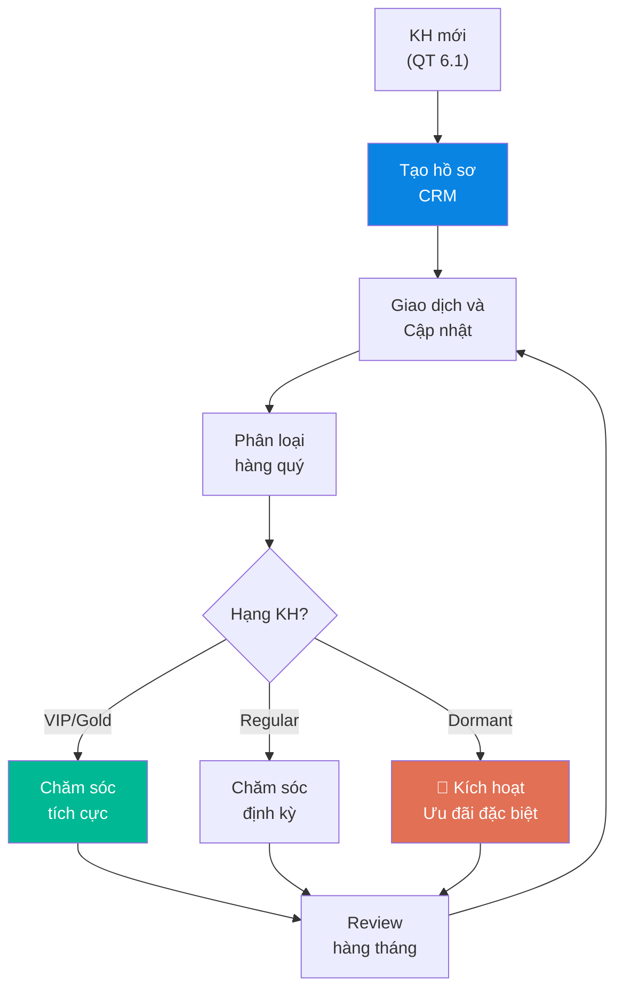

# 6.2 Quản lý Quan hệ Khách hàng (CRM)

🌐 [English Version](6.2_crm_en.md)

## 1. Mục đích & Phạm vi
- **Mục đích:** Quản lý thông tin, lịch sử giao dịch, và mối quan hệ với từng KH một cách hệ thống — giúp bán hàng hiệu quả hơn, giữ chân KH lâu dài.
- **Áp dụng:** Toàn bộ KH đang hoạt động + KH tiềm năng.
- **Tần suất:** Cập nhật liên tục. Review hàng tuần/tháng.

## 2. Trách nhiệm (RACI)

| Hạng mục | Responsible | Approve | Consulted | Informed |
|----------|------------|---------|-----------|----------|
| Nhập/cập nhật dữ liệu KH | Sales | — | — | — |
| Phân loại & đánh giá KH | Sales | Giám đốc Kinh doanh | — | BGĐ, Kế toán |
| Review KH hàng tháng | Sales + Giám đốc Kinh doanh | Giám đốc Kinh doanh | Kế toán | BGĐ |
| Thiết kế ưu đãi giữ chân | Giám đốc Kinh doanh + Marketing | BGĐ | — | Sales |

## 3. Quy trình Chi tiết

### Bước 1: Tạo Hồ sơ KH Mới
- **Khi nào:** Ngay khi KH đặt đơn hàng đầu tiên
- **Thao tác:**
  1. Tạo hồ sơ trong hệ thống CRM / Excel:
     - **Thông tin cơ bản:** Tên, Địa chỉ, SĐT, Email, MST
     - **Người liên hệ:** Tên, Chức vụ, SĐT/Zalo
     - **Phân loại:** HoReCa / Retail / Corporate / B2C
     - **Kênh bán:** On-trade / Off-trade
     - **Điều khoản:** Thanh toán (COD/CK/Công nợ), Hạn thanh toán
  2. Gắn **mã KH:** KH-[Năm]-[Số thứ tự] (VD: KH-2026-042)
  3. Lưu file liên quan: HĐ, Giấy phép (nếu có)
- **Output:** Hồ sơ KH hoàn chỉnh trong hệ thống

### Bước 2: Cập nhật Sau Mỗi Giao dịch
- **Khi nào:** Sau mỗi lần bán hàng, gọi điện, visit, tasting
- **Thao tác:**
  1. Ghi nhận đơn hàng: Ngày, SKU, SL, Giá trị, Đã thanh toán?
  2. Ghi nhận tương tác: Gọi điện, Visit, Phản hồi KH
  3. Ghi nhận yêu cầu đặc biệt: Muốn thử SP mới, Cần giá tốt hơn...
- **Lưu ý:** Cập nhật **trong ngày**, không để tồn

### Bước 3: Phân loại KH (Hàng quý)
- **Thao tác:**
  1. **Lập đề xuất:** Hàng quý (ngày 1-3 đầu quý mới), Sale Admin kết xuất doanh số 3 tháng gần nhất của từng khách hàng từ phần mềm kế toán MISA, tính toán doanh thu và lập đề xuất phân hạng.
  2. **Phê duyệt:** Giám đốc Kinh doanh xem xét, phê duyệt danh sách phân hạng chính thức và quyết định các trường hợp điều chỉnh ngoại lệ (ví dụ: các khách hàng tiềm năng lớn dù chưa đạt mốc doanh số).
  3. **Cập nhật & Áp dụng:** Sale Admin cập nhật hạng khách hàng trên CRM/MISA để đội ngũ Sales theo dõi và thực hiện tần suất chăm sóc. Việc phân loại khách hàng **không đi kèm chính sách chiết khấu hay ưu đãi tự động/cố định** (mọi cơ chế chiết khấu hay báo giá đặc biệt đều phải lập tờ trình duyệt theo [QT 6.4](6.4_chinh_sach_gia.md)).
  4. **Thông báo:** Gửi danh sách đã duyệt cho Kế toán bán hàng đối soát và báo cáo Ban Giám đốc (BGĐ).

| Hạng           | Tiêu chí                             | Tần suất chăm sóc |
| -------------- | ------------------------------------ | ----------------- |
| 🥇 **VIP**     | Mua > 30 triệu/quý HOẶC > 12 đơn/quý | 1 lần/tuần        |
| 🥈 **Gold**    | Mua 10-30 triệu/quý                  | 2 lần/tháng       |
| 🥉 **Regular** | Mua < 10 triệu/quý                   | 1 lần/tháng       |
| 💤 **Dormant** | Không mua > 2 tháng                  | Cần liên hệ ngay (ASAP) |

  5. Cập nhật hạng vào hồ sơ KH

### Bước 4: Hoạt động Giữ chân KH
- **Cơ chế hoạt động:**
  - Không quy định các chính sách ưu đãi, tặng rượu mẫu hay quà tặng giữ chân cố định hoặc tự động cho từng hạng khách hàng nhằm kiểm soát tối đa chi phí và tối ưu hóa hiệu quả thực tế.
  - Khi phát sinh nhu cầu triển khai hoạt động giữ chân đối tác (tặng quà lễ tết, tài trợ sự kiện, tổ chức tasting riêng, cấp rượu thử niên vụ mới, hay áp dụng chính sách chăm sóc đặc biệt), nhân viên Sales phụ trách phải lập **Phiếu đề xuất hoạt động giữ chân khách hàng (Form đề xuất của Sales)** gửi Giám đốc Kinh doanh và Ban Giám đốc (BGĐ) xem xét phê duyệt theo từng trường hợp cụ thể.
  - Nội dung đề xuất phải làm rõ: thông tin đối tác, lịch sử doanh số, chi tiết hoạt động đề xuất, dự toán chi phí/rượu mẫu và hiệu quả doanh thu kỳ vọng mang lại.

### Bước 5: Review Hàng tháng
- **Tần suất:** Đầu mỗi tháng
- **Thao tác:**
  1. **Chuẩn bị dữ liệu:** Sale Admin xuất báo cáo khách hàng: Top 10 KH theo doanh thu, danh sách KH dormant, danh sách KH mới.
  2. **Họp Review:** Giám đốc Kinh doanh chủ trì họp giao ban review khách hàng với đội ngũ Sales:
     - KH nào giảm mua? → Tìm hiểu nguyên nhân và lập phương án khắc phục.
     - KH nào tăng trưởng tốt? → Lên kế hoạch tăng chăm sóc, khai thác thêm nhu cầu.
     - KH dormant → Lập kế hoạch kích hoạt cụ thể và giao chỉ tiêu cho từng Sales Rep.
  3. **Phê duyệt & Đặt mục tiêu:** Giám đốc Kinh doanh quyết định mục tiêu tháng tới: Khách hàng cần viếng thăm trực tiếp, đề xuất ưu đãi đặc biệt trình BGĐ duyệt.
  4. **Báo cáo BGĐ:** Giám đốc Kinh doanh tổng hợp kết quả review và phương án hành động gửi báo cáo cho Ban Giám đốc (BGĐ) trước ngày 5 hàng tháng.

## 4. Tiêu chuẩn Thời gian Phản hồi Khách hàng (SLA)

Để duy trì tính chuyên nghiệp và nâng cao trải nghiệm dịch vụ của Lyscellar, đội ngũ Sales bắt buộc phải tuân thủ nghiêm ngặt thời hạn phản hồi khách hàng dưới đây:

| Kênh/Loại yêu cầu | Khách hàng B2C / Cá nhân | Đối tác B2B (HoReCa, Đại lý, Doanh nghiệp) |
| :--- | :--- | :--- |
| **Phản hồi Nhanh (WhatsApp, Zalo, Chat, Call)** | Trong vòng **15 phút** (trong giờ làm việc: 8:00 - 21:00 hàng ngày) | Trong vòng **30 phút** (trong giờ làm việc: 8:30 - 18:00 Thứ 2 - Thứ 7) |
| **Yêu cầu Báo giá (Quotation Request)** | Gửi báo giá chính thức trong vòng **30 phút** | Báo giá chuẩn: Trong vòng **2 giờ** làm việc Báo giá cơ chế đặc biệt: Trong vòng **24 giờ** làm việc (sau khi duyệt) |
| **Xác nhận & Lên đơn hàng (Order Entry)** | Xác nhận đơn và chuyển bộ phận chuẩn bị trong vòng **30 phút** | Xác nhận đơn và lên hệ thống CRM/MISA trong vòng **1 giờ** làm việc |
| **Tiếp nhận & Xử lý Khiếu nại (Complaints)** | Xác nhận tiếp nhận trong vòng **15 phút** Xử lý hoàn tất theo SLA quy trình 6.6 | Xác nhận tiếp nhận trong vòng **30 phút** Xử lý hoàn tất theo SLA quy trình 6.6 |

## 5. Sơ đồ Quy trình

## 6. Biểu mẫu
📥 **Form 6.2-A:** [Ho_so_Khach_hang.xlsx](../../../sources/Forms/Form_6.2-A_Ho_so_Khach_hang.xlsx)

**Nội dung form:**
- Sheet 1: Danh sách KH — Mã KH, Tên, Phân loại, Hạng, Liên hệ
- Sheet 2: Lịch sử Giao dịch — Ngày, Đơn hàng, Giá trị, Trạng thái thanh toán
- Sheet 3: Lịch sử Tương tác — Ngày, Loại (Visit/Call/Tasting), Kết quả, Next action

## 7. KPI & Đo lường

| KPI | Công thức | Mục tiêu | Tần suất |
|-----|----------|---------|----------|
| Tỷ lệ giữ chân KH | KH mua lại / Tổng KH | ≥ 70% | Hàng quý |
| Tỷ lệ KH dormant | KH dormant / Tổng KH | ≤ 15% | Hàng tháng |
| Doanh thu/KH trung bình | Tổng doanh thu / Số KH hoạt động | Tăng 10%/năm | Hàng quý |
| Tần suất liên hệ | Số lần contact / KH / tháng | Theo hạng KH | Hàng tháng |

## 8. Tài liệu Liên quan
- ← Trước: [6.1 Phát triển KH](6.1_phat_trien_kh.md)
- → Sau: [6.3 Xử lý Đơn hàng](6.3_xu_ly_don_hang.md)
- ↔ Liên quan: [6.4 Chính sách Giá](6.4_chinh_sach_gia.md) | [8.2 Công nợ Phải thu](../08_tai_chinh/8.2_cong_no_phai_thu.md)
