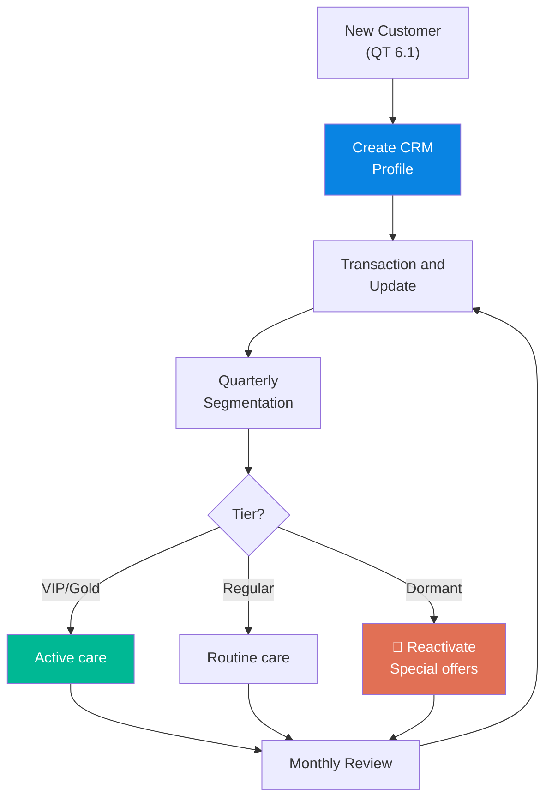

# 6.2 Customer Relationship Management (CRM)

🌐 [Bản tiếng Việt](6.2_crm.md)

## 1. Purpose & Scope
- **Purpose:** Systematically manage customer information, purchase histories, and relationships to drive sales efficiency and improve customer retention.
- **Application:** All active and prospective customers of Lyscellar.
- **Frequency:** Continuous updates; weekly/monthly reviews.

---

## 2. RACI Matrix

| Activity | Responsible | Approve | Consulted | Informed |
|:---|:---:|:---:|:---:|:---:|
| **Input/Update customer data** | Sales Rep | — | — | — |
| **Segment & evaluate customers** | Sales Rep | Sales Director | — | BOD, Sales Accountant |
| **Monthly customer review** | Sales Rep + Sales Director | Sales Director | Sales Accountant | BOD |
| **Design retention incentives** | Sales Director + Marketing | BOD | — | Sales Rep |

---

## 3. Detailed Operational Steps

### Step 1: Create New Customer Profile
- **When:** Immediately when a customer places their first order.
- **Execution:**
  1. Create a profile in the CRM system / Excel:
     - **Basic Info:** Name, Tax code, Billing address, Delivery address, Phone, Email.
     - **Contact Person:** Name, Title, Phone/Zalo.
     - **Segment:** HoReCa / Retail / Corporate / B2C.
     - **Channel:** On-trade / Off-trade.
     - **Payment Terms:** Payment method (COD/Bank transfer/Credit), Credit terms, and Payment due dates.
  2. Assign **Customer Code:** KH-[Year]-[Sequence Number] (e.g., KH-2026-042).
  3. Store relevant documents: Signed contracts, Business licenses (if any).
- **Output:** Complete customer profile on the system.

### Step 2: Post-Transaction Updates
- **When:** After each sales order, call, visit, or tasting.
- **Execution:**
  1. Record orders: Date, SKU, quantity, value, payment status.
  2. Record interactions: Calls, visits, customer feedback.
  3. Record special requests: New wine tasting requests, price negotiations, etc.
- **Rule:** Update **within the same business day** — no backlog.

### Step 3: Customer Segmentation (Quarterly)
- **Execution:**
  1. **Draft Proposal:** Every quarter (days 1-3 of the new quarter), the Sale Admin exports each customer's sales volume for the last 3 months from the MISA accounting software, calculates the revenue, and drafts the customer tier proposal.
  2. **Approval:** The Sales Director reviews and officially approves the customer tier list, and decides on any exceptional adjustments (e.g. key strategic accounts that do not meet the revenue thresholds but hold high potential).
  3. **Update & Apply:** The Sale Admin updates the customer tiers in CRM/MISA as database records for the Sales team to follow care frequencies. Customer classification **does NOT come with any automatic or fixed discount or promotional policies** (any special pricing/discounts must be proposed and approved via formal proposal forms as defined in [QT 6.4](6.4_chinh_sach_gia_en.md)).
  4. **Notify:** Sends the approved list to the Sales Accountant for audit and reports it to the Board of Directors (BOD).

| Tier | Criteria | Care Frequency |
|:---|:---|:---|
| 🥇 **VIP** | Quarterly purchase > 30M VND OR > 12 orders/quarter | Once a week |
| 🥈 **Gold** | Quarterly purchase 10M - 30M VND | Twice a month |
| 🥉 **Regular** | Quarterly purchase < 10M VND | Once a month |
| 💤 **Dormant** | No orders for > 2 months | ASAP |

  5. Update customer tier status in their CRM profile.

### Step 4: Retention Activities
- **Operational Mechanism:**
  - Standard, fixed, or automatic retention incentives, free wine samples, or holiday gifts are not predefined by tier in order to tightly control costs and optimize ROI.
  - When there is a business need to initiate customer retention activities (such as holiday gifting, event sponsorship, private wine tastings, new vintage samples, or tailored care packages), the responsible Sales Representative must prepare and submit a **Customer Retention Proposal Form (Form đề xuất của Sales)** to the Sales Director and Board of Directors (BOD) for review and approval on a case-by-case basis.
  - The proposal must detail the customer profile, historical purchase volume, specific proposed activity, budget/wine samples requested, and the expected revenue/retention outcome.

### Step 5: Monthly Review
- **Frequency:** Beginning of every month.
- **Execution:**
  1. **Prepare Data:** The Sale Admin exports customer reports: Top 10 customers by revenue, the dormant customer list, and the newly registered list.
  2. **Review Meeting:** The Sales Director hosts the monthly review meeting with the Sales Reps:
     - Check which customers show drop in volume $\rightarrow$ Investigate the root cause and propose solutions.
     - Check which customers show growth $\rightarrow$ Plan to increase engagement and explore new needs.
     - Reactivate Dormant accounts $\rightarrow$ Formulate specific action plans and assign targets to each Sales Rep.
  3. **Approve & Target:** The Sales Director decides next month's targets: Key accounts to visit in person and proposals for special pricing approvals to be submitted to the BOD.
  4. **Report to BOD:** The Sales Director consolidates the review results and action plan, and reports to the Board of Directors (BOD) by the 5th of each month.

---

## 4. Customer Response Time Standards (SLA)

To maintain Lyscellar's service quality and professionalism, Sales Reps must strictly follow the customer response SLA standards below:

| Request Channel/Type | B2C / Individual Customers | B2B Partners (HoReCa, Agents, Corporate) |
| :--- | :--- | :--- |
| **Quick Response (WhatsApp, Zalo, Chat, Call)** | Within **15 minutes** (working hours: 8:00 - 21:00 daily) | Within **30 minutes** (working hours: 8:30 - 18:00 Mon - Sat) |
| **Quotation Request** | Send quotation within **30 minutes** | Standard quotes: Within **2 hours** Special pricing quotes: Within **24 business hours** (after approval) |
| **Order Confirmation & Entry** | Confirm and prepare order within **30 minutes** | Confirm and enter into CRM/MISA within **1 business hour** |
| **Complaint Intake & Resolution** | Confirm intake within **15 minutes** Resolution finalized as per SOP 6.6 SLA | Confirm intake within **30 minutes** Resolution finalized as per SOP 6.6 SLA |

## 5. Process Flowchart

---

## 6. Forms & Templates
📥 **Form 6.2-A:** [Customer_Profiles_Database.xlsx](../../../sources/Forms/Form_6.2-A_Ho_so_Khach_hang.xlsx)

---

## 6. KPI & Control Metrics

| KPI | Calculation Formula | Target | Frequency |
|:---|:---|:---:|:---:|
| **Customer Retention Rate** | Customers repurchasing / Total customer base | **≥ 70%** | Quarterly |
| **Dormant Customer Rate** | Dormant customers / Total customer base | **≤ 15%** | Monthly |
| **Average Revenue per Customer** | Total revenue / Number of active customers | **+10% Year-over-Year** | Quarterly |
| **Contact Frequency** | Number of contacts per customer per month | By customer tier | Monthly |

---

## 8. Related Documents & Links
- ← Previous: [6.1 New Customer Development](6.1_phat_trien_kh_en.md)
- → Next: [6.3 Order Processing](6.3_xu_ly_don_hang_en.md)
- ↔ Related: [6.4 Pricing Policy](6.4_chinh_sach_gia_en.md) | [8.2 Accounts Receivable](../08_tai_chinh/8.2_cong_no_phai_thu.md)
