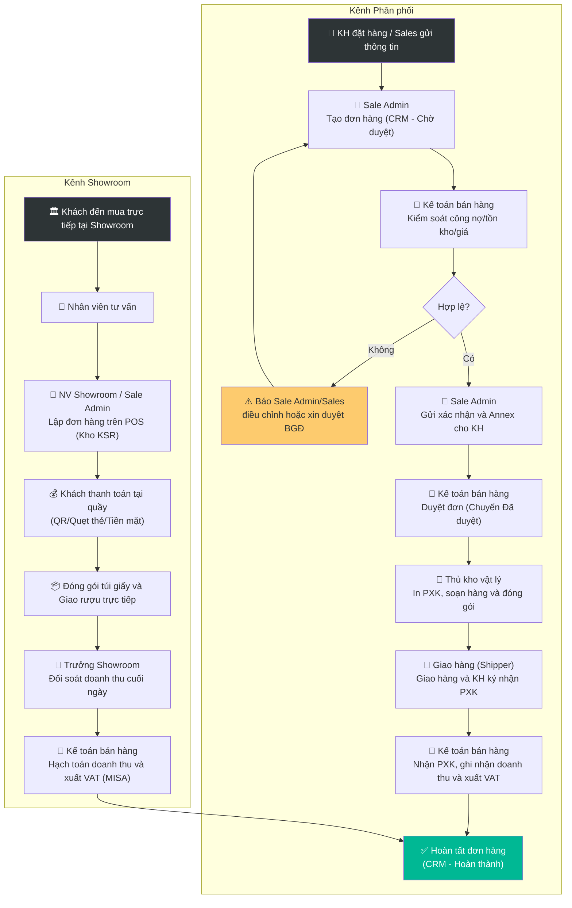

# 6.3 Xử lý Đơn hàng Bán

🌐 [English Version](6.3_xu_ly_don_hang_en.md)

## 1. Mục đích & Phạm vi
- **Mục đích:** Xử lý đơn hàng từ KH nhanh chóng, chính xác — từ khi nhận đơn → kiểm tra tồn → xác nhận → xuất kho → thu tiền.
- **Áp dụng:** Mọi đơn hàng bán ra (B2B, B2C, consignment, quà tặng).
- **Tần suất:** Hàng ngày.

## 2. Trách nhiệm (RACI)

| Bước | Responsible | Approve | Consulted | Informed |
|------|------------|---------|-----------|----------|
| Nhận & lên đơn (CRM) | Sale Admin | — | Sales | Kế toán bán hàng |
| Kiểm soát & duyệt đơn | Kế toán bán hàng | BGĐ (nếu giá/CK đặc biệt hoặc vượt công nợ) | Sale Admin | Thủ kho |
| Soạn hàng & Đóng gói | Thủ kho | Kế toán bán hàng (qua lệnh duyệt) | — | Shipper |
| Giao hàng & Đối soát | Shipper | Kế toán bán hàng | Sales | BGĐ |

---

## 3. Quy trình Chi tiết

### 3.1 Quy trình Bán lẻ & Xử lý Đơn hàng trực tiếp tại Showroom (On-the-spot Sales)
Đối với hoạt động bán lẻ trực tiếp cho khách hàng vãng lai hoặc đối tác đến tham quan/tasting tại Showroom Lyscellar, quy trình được tối giản để phục vụ tại chỗ nhanh chóng:
- **Thao tác:**
  1. **Tư vấn sản phẩm:** Nhân viên Showroom tư vấn sản phẩm cho khách hàng.
  2. **Chốt sản phẩm và Lập đơn:** Nhân viên showroom tạo đơn hàng trực tiếp trên phần mềm ERP/POS bán hàng tại quầy:
     - Chọn kho xuất: **`KSR`** (Kho Showroom).
     - Nhập mã SKU, Số lượng, và thông tin Khách hàng (hoặc mã Khách vãng lai).
  3. **Thanh toán tại chỗ:** Khách hàng thực hiện thanh toán ngay bằng hình thức:
     - Chuyển khoản qua mã QR động (phần mềm tự sinh khớp số tiền đơn).
     - Quẹt thẻ qua máy POS ngân hàng tại showroom.
     - Tiền mặt (thu ngân đếm và cất vào két an toàn của showroom).
  4. **Xuất hàng & Đóng gói trực tiếp:** Nhân viên showroom lấy hàng trực tiếp từ kệ trưng bày hoặc kho mát showroom, đóng gói vào túi giấy Lyscellar có bọc giấy chống sốc đầu chai và bàn giao ngay cho khách hàng kèm Hóa đơn bán lẻ/Hóa đơn VAT (nếu khách yêu cầu).
  5. **Bổ sung kệ trưng bày (Showroom Replenishment):** Nhân viên showroom phải đảm bảo tất cả hàng hóa lấy tại showroom để bán đều được bổ sung đầy đủ lên kệ trưng bày trong vòng **1 tiếng** sau khi lấy hàng bán để đảm bảo thẩm mỹ và số lượng trưng bày theo quy định.
  6. **Đối soát cuối ngày:** 
     - Trưởng showroom kết xuất báo cáo doanh thu bán hàng tại quầy trong ngày từ hệ thống POS.
     - Kiểm đếm tiền mặt thực tế trong két, đối chiếu số tiền quẹt thẻ và chuyển khoản thành công.
     - Bàn giao báo cáo đối soát doanh thu và tiền mặt cho Kế toán bán hàng vào sáng ngày hôm sau.
- **Timeline:** Hoàn tất đơn hàng ≤ 15 phút tại quầy.
- **Lưu ý:** Không tự ý xuất rượu làm quà tặng hoặc uống thử nếu không có phiếu chi phí tiếp khách/tasting được duyệt trên hệ thống.

### 3.2 Quy trình Xử lý Đơn hàng Bán phân phối (B2B, B2C Giao tận nơi)

#### Bước 1: Nhận Đơn hàng & Lên đơn (CRM)
- **Input:** KH đặt hàng qua Zalo/Điện thoại/Email hoặc Sales thị trường chuyển thông tin.
- **Thao tác:**
  1. **Quy định Onboarding & Thiết lập thông tin (khách hàng mới):**
     - Sau khi đàm phán thành công, Sales bắt buộc phải lập và hoàn thành tờ trình thông tin khách hàng, cơ chế giá và hạn mức công nợ: **trong vòng 24 giờ sau khi chốt** thành công.
     - Kế toán soạn Hợp đồng mua bán (HĐMB) gửi khách hàng ký: tối đa **2 ngày** kể từ ngày nhận tờ trình được duyệt.
     - Nếu khách hàng yêu cầu, Sales làm báo giá 3 bên có đầy đủ hình ảnh, thông tin, giá tiền trong vòng **2 ngày** kể từ ngày nhận hợp đồng.
  5. **Quy định Giao hàng Buổi tối / Ngoài giờ (Evening/After-Hours Delivery):**
     - **Thời gian chốt đơn (Cut-off Time):** Để phục vụ giao hàng trong buổi tối cùng ngày, đơn hàng bắt buộc phải được tạo trên CRM và được Kế toán duyệt trước **18:00 (6h00 tối)**. Mọi đơn hàng duyệt sau 18:00 sẽ mặc định chuyển sang giao vào sáng ngày làm việc tiếp theo, trừ trường hợp khẩn cấp được BGĐ phê duyệt ngoại lệ.
     - **Ghi chú giao nhận:** Nhân viên Sales phải ghi rõ thời gian giao yêu cầu cụ thể của buổi tối (ví dụ: *Giao từ 19:00 - 20:30*), thông tin liên hệ của người nhận ca tối (nhân viên nhận hàng ca tối của nhà hàng/bar thường khác ca ngày) vào trường Ghi chú trên CRM để Sale Admin sao chép vào đơn hàng.
     - **Xử lý đơn đặt muộn/tối hôm trước:** Đối với các đơn hàng phát sinh ngoài giờ làm việc từ tối hôm trước, Sale Admin có trách nhiệm tổng hợp, kiểm tra và tạo đơn trên CRM trước **08h30 sáng** ngày hôm sau.
  2. **Sale Admin** tiếp nhận và ghi nhận yêu cầu KH:
     - Tên KH / Mã KH
     - Danh sách SKU + SL yêu cầu
     - Ngày giao yêu cầu
     - Địa chỉ giao (nếu khác mặc định)
  3. **Nhắn tin trên nhóm WhatsApp của admin trước khi lên đơn:** Để bảo đảm sự phối hợp và chuẩn bị kịp thời từ bộ phận kho và kế toán, Sale Admin phải gửi tin nhắn thông báo tóm tắt về đơn hàng mới (Tên khách hàng, sản phẩm chính, số lượng, địa chỉ và thời gian giao dự kiến) lên nhóm WhatsApp "Admin Group" trước khi chính thức tạo đơn hàng trên hệ thống CRM.
  4. **Sale Admin** truy xuất hồ sơ CRM của khách hàng, đối chiếu thông tin **Lưu ý giao hàng (Delivery Instructions)** đã được thiết lập khi onboarding để sao chép nguyên văn vào trường "Ghi chú giao nhận" trên Đơn hàng (Sales Order).
  5. Sale Admin tạo **Đơn hàng bán (Sales Order)** trên phần mềm CRM ở trạng thái **"Chờ duyệt (Pending)"**.
  6. Gán mã đơn: DH-[Năm][Tháng]-[Số] (VD: DH-202606-015)
- **Timeline:** 15 phút

#### Bước 2: Kiểm soát & Duyệt đơn hàng (Kế toán bán hàng)
- **Thao tác:**
  1. **Kế toán bán hàng** kiểm soát đơn hàng ở trạng thái "Chờ duyệt" từ hệ thống CRM.
  2. **Active công nợ khách hàng:** Kế toán tiến hành tạo mã và active công nợ trên phần mềm trong vòng **1 ngày** sau khi nhận đủ hợp đồng ký đóng dấu. Trong thời gian chưa active công nợ, nếu phát sinh đơn hàng thì NVKD phải thu tiền mặt/chuyển khoản 100% trước, NVKD hoàn toàn chịu trách nhiệm nếu phát sinh công nợ trước khi active.
  3. Kiểm tra tồn kho khả dụng cho từng SKU trên hệ thống phần mềm (theo [QT 5.4 Quản lý Tồn kho](../05_kho_van/5.4_quan_ly_ton_kho.md)). Nếu thiếu hàng $\rightarrow$ thông báo Sale Admin để điều chỉnh với khách hàng.
  4. Kiểm tra giá bán & chiết khấu theo chính sách ([QT 6.4 Chính sách Giá](6.4_chinh_sach_gia.md)). Nếu đơn hàng áp dụng giá đặc biệt/CTKM $\rightarrow$ đối chiếu xem đơn hàng đã được duyệt bởi đúng cấp thẩm quyền tương ứng với Biên lợi nhuận (anh Jeremie duyệt cho Margin 41%-45% [màu vàng], còn Margin < 41% [màu đỏ] cần có phê duyệt trực tiếp của Ban Giám Đốc [BGĐ]) dựa trên tệp Margin Checking gửi kèm.
  5. Kiểm tra điều kiện thanh toán và công nợ ([QT 8.2 Quản lý Công nợ Phải thu](../08_tai_chinh/8.2_cong_no_phai_thu.md)):
     - Khách hàng trả trước: Xác nhận tiền đã về tài khoản trước khi duyệt.
     - Khách hàng công nợ: Kiểm tra hạn mức và nợ quá hạn. Nếu vượt hạn mức hoặc có nợ quá hạn $\rightarrow$ yêu cầu thanh toán trước hoặc làm thủ tục xin duyệt ngoại lệ qua nhóm WhatsApp của công ty. Nhân viên Sales gửi Phiếu yêu cầu duyệt ngoại lệ lên nhóm WhatsApp duyệt đơn của công ty để BGĐ phê duyệt trực tiếp bằng tin nhắn trước khi Kế toán bán hàng thao tác duyệt đơn.
     - **Chốt chặn gia hạn công nợ:** Khách hàng tuyệt đối không được còn các khoản nợ quá hạn trên 30 ngày. Trường hợp đã thanh toán hết các khoản nợ quá hạn trên 30 ngày, tối thiểu **1 tháng (30 ngày)** kể từ ngày thanh toán công nợ quá hạn đó, khách hàng mới được tiếp tục gia hạn hợp đồng công nợ và cấp lại hạn mức.
  6. Sau khi kiểm soát hợp lệ (hoặc có phê duyệt ngoại lệ của BGĐ trên WhatsApp), Kế toán bán hàng chuyển trạng thái đơn hàng trên hệ thống sang **"Đã duyệt / Sẵn sàng xuất kho (Approved)"**. 
- **Timeline:** 30-60 phút
- **Lưu ý:** Đây là chốt chặn quan trọng, Thủ kho tuyệt đối không tự ý in đơn soạn hàng nếu đơn chưa được Kế toán duyệt sang trạng thái "Đã duyệt".

#### Bước 3: Xác nhận Đơn hàng & Ký Phụ lục với KH
- **Thao tác:**
  1. **Sale Admin** gửi **xác nhận đơn hàng** đã duyệt cho KH (Zalo/Email).
  2. Lập và gửi kèm **Phụ lục bổ sung danh mục rượu và giá** (Annex) đi kèm tương ứng với mỗi đơn hàng để KH ký nhận.
- **Timeline:** Trong ngày

#### Bước 4: Soạn hàng & Xuất kho (Thủ kho)
- **Thao tác:**
  1. **Thủ kho vật lý** kiểm tra danh sách đơn hàng đã ở trạng thái **"Đã duyệt"** trên hệ thống, tiến hành in **Phiếu xuất kho (PXK)**. **Thủ kho kiểm tra kỹ trường thông tin Ghi chú giao nhận / Lưu ý giao hàng** in trên phiếu để tiến hành đóng gói phù hợp và lưu ý riêng cho Shipper trước khi bốc xếp.
  2. Thực hiện lấy hàng (Pick) tại kho theo nguyên tắc FIFO/FEFO (hàng cũ xuất trước) và đóng gói (Pack) theo quy chuẩn bảo quản rượu vang (theo [QT 5.6 Xuất kho](../05_kho_van/5.6_xuat_kho.md)).
  3. Yêu cầu một nhân sự khác (Sale Admin hoặc Kế toán) tiến hành kiểm tra chéo (Double check) số lượng, chủng loại và tem nhãn trước khi dán niêm phong thùng hàng.
  4. Bàn giao hàng hóa và PXK giấy cho **Người giao hàng (Shipper)**.
  5. **Chuẩn bị đơn hàng tồn từ tối hôm trước:** Đối với tất cả các đơn hàng phát sinh từ tối hôm trước, Sale Admin và Thủ kho có trách nhiệm hoàn thành các bước chuẩn bị (in PXK, soạn hàng, đóng gói, kiểm tra chéo) trước **09:00 sáng** để sẵn sàng giao hàng ngay đầu giờ sáng.
- **Timeline:** Giao trong vòng ≤ 1 giờ kể từ khi duyệt (nếu đặt trước 18h00) hoặc trước 10h00 sáng ngày làm việc tiếp theo. Đối với đơn gấp, giao trong vòng ≤ 0.5 giờ kể từ khi duyệt.

#### Bước 5: Giao hàng & Hoàn tất
- **Thao tác:**
  1. **Người giao hàng (Shipper)** tiếp nhận hàng và các **Lưu ý giao hàng (Delivery Instructions)** cụ thể từ Thủ kho. Tiến hành giao hàng cho khách hàng và bắt buộc phải tuân thủ nghiêm ngặt các chỉ dẫn này (đúng giờ nhận, giao đúng cổng, liên hệ đúng người...). Thực hiện thu tiền mặt (COD) hoặc yêu cầu khách ký nhận vào PXK bản gốc.
     - *Chú ý các đặc điểm giao hàng của khách (Customer Delivery Characteristics Note):* Khi bốc xếp và vận chuyển hàng hóa, cả Thủ kho và Shipper phải kiểm tra kỹ các đặc trưng địa điểm giao nhận của từng khách hàng (ví dụ: cung đường cấm tải/cấm xe máy theo giờ, quy định thẻ ra vào tòa nhà, thủ tục an ninh tại hầm chung cư, quy trình vận chuyển bằng thang máy chuyên dụng, hoặc thông tin người nhận trực tiếp tại điểm giao). Các lưu ý đặc thù này phải được ghi nhận rõ trên phiếu giao hàng để tránh làm phát sinh sự cố hoặc chậm trễ.
     - *Đối soát tiền mặt giao ca tối (Evening COD Handover):* Đối với các đơn hàng giao buổi tối có thu tiền mặt (COD), Shipper có trách nhiệm bảo quản tiền mặt an toàn qua đêm và bàn giao đầy đủ cho Kế toán bán hàng trước **09:00 sáng ngày làm việc tiếp theo**.
  2. Cuối ngày, Shipper mang tiền mặt đã thu (nếu có) và PXK bản gốc có chữ ký của khách hàng về bàn giao cho **Kế toán bán hàng**.
  3. **Đối soát & Xuất hóa đơn GTGT điện tử 100% trong ngày (Kế toán bán hàng):** 
     - Căn cứ Phiếu xuất kho và xác nhận giao hàng thành công từ Shipper, tiến hành xuất Hóa đơn GTGT điện tử trên phần mềm MISA **trước 18:30 hàng ngày** theo đúng quy định của Nghị định 123/2020 và Thông tư 78/2021.
     - Nghiêm cấm xuất hóa đơn trước khi hàng được giao và khách ký nhận, hoặc để dồn sang ngày hôm sau.
     - Chuyển trạng thái đơn hàng trên phần mềm thành **"Hoàn thành (Completed)"**.
  4. **Kiểm soát cuối ngày (Kế toán trưởng hoặc người được ủy quyền):**
     - Đối chiếu tổng thể: Doanh thu ↔ Hóa đơn ↔ Phiếu xuất kho ↔ Tiền mặt/tiền chuyển khoản thực tế thu về trong ngày.
     - Đối chiếu tồn kho cuối ngày: Số lượng trên Thẻ kho ↔ Phần mềm kế toán MISA ↔ Thực tế.
     - Cập nhật số liệu tồn kho trên link stock theo mẫu quản lý của công ty.
- **Timeline:** Trong ngày giao (Hóa đơn xuất trước 18:30, Kế toán trưởng đối soát và duyệt báo cáo ngày trước khi chốt số liệu).

---

## 4. Sơ đồ Quy trình

---

## 5. Biểu mẫu
📥 **Form 6.3-A:** [Don_hang_Ban.xlsx](../../../sources/Forms/Form_6.3-A_Don_hang_Ban.xlsx)

**Nội dung form:**
- Mã đơn, Ngày, KH, Địa chỉ giao, SĐT
- Bảng chi tiết: SKU, Tên SP, SL, Đơn giá, CK, Thành tiền
- Tổng giá trị, Hình thức thanh toán, Ngày giao
- Trạng thái: Mới → Xác nhận → Đang giao → Hoàn thành

---

## 6. KPI & Đo lường

| KPI                       | Công thức                    | Mục tiêu                                 | Tần suất   |
| ------------------------- | ---------------------------- | ---------------------------------------- | ---------- |
| Thời gian xử lý tại kho   | Nhận đơn → Xuất kho          | ≤ 0.5 giờ (nội thành)                | Mỗi đơn    |
| Thời gian giao đơn thường | Từ khi duyệt → hoàn tất giao | ≤ 1 giờ (nội thành, đặt trước 18h00) | Mỗi đơn    |
| Thời gian giao đơn gấp    | Từ khi duyệt → hoàn tất giao | ≤ 0.5 giờ (nội thành)                | Mỗi đơn    |
| Tỷ lệ đơn hoàn thành      | Đơn giao OK / Tổng đơn       | ≥ 99%                                | Hàng tháng |
| Tỷ lệ đơn hủy             | Đơn hủy / Tổng đơn           | ≤ 1%                                 | Hàng tháng |
| Giá trị đơn TB            | Tổng doanh thu / Số đơn      | Tăng 5%/quý                              | Hàng quý   |

---

## 7. Xử lý Ngoại lệ

| Tình huống                    | Hành động                                         | Escalation  |
| ----------------------------- | ------------------------------------------------- | ----------- |
| KH đặt SP hết hàng            | Đề xuất SP tương đương, hoặc đặt cọc chờ hàng mới | Sales       |
| KH yêu cầu giao gấp (< 2 giờ) | Kiểm tra khả năng, phụ thu nếu cần                | Quản lý Kho |
| KH từ chối nhận hàng          | Nhận hàng về, tìm hiểu lý do → QT 6.6             | Sales → BGĐ |
| Sai hàng / Thiếu hàng         | Xin lỗi KH, giao bù ngay trong ngày               | Sales + Kho |

---

## 8. Tài liệu Liên quan
- ← Trước: [6.1 Phát triển KH](6.1_phat_trien_kh.md) | [6.2 CRM](6.2_crm.md)
- → Sau: [5.6 Xuất kho](../05_kho_van/5.6_xuat_kho.md) | [8.2 Công nợ](../08_tai_chinh/8.2_cong_no_phai_thu.md)
- ↔ Liên quan: [6.4 Chính sách Giá](6.4_chinh_sach_gia.md) | [6.6 Khiếu nại](6.6_xu_ly_khieu_nai.md)
