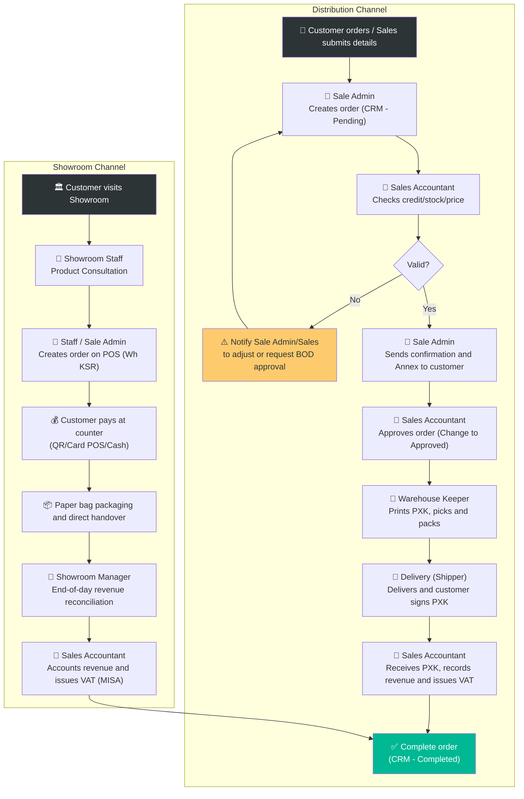

# 6.3 Sales Order Processing

🌐 [Bản tiếng Việt](6.3_xu_ly_don_hang.md)

## 1. Purpose & Scope
- **Purpose:** Process customer orders quickly and accurately — from order intake, inventory check, confirmation, warehouse release, to payment collection.
- **Application:** All sales orders (B2B, B2C, consignment, gifts).
- **Frequency:** Daily.

---

## 2. RACI Matrix

| Step | Responsible | Approve | Consulted | Informed |
|:---|:---:|:---:|:---:|:---:|
| **Order intake & entry (CRM)** | Sale Admin | — | Sales Rep | Sales Accountant |
| **Control & approve order** | Sales Accountant | BOD (for special prices/discounts or credit limit overflow) | Sale Admin | Warehouse Keeper |
| **Pick & Pack** | Warehouse Keeper | Sales Accountant (in case of exceptions) | Sale Admin | Shipper / Sales Rep |
| **Delivery & payment collection** | Shipper / Sales Rep | — | — | Sales Accountant |

---

## 3. Detailed Operational Steps

### 3.1 Retail & On-the-spot Sales at Showroom
For walk-in retail customers or partners visiting the Lyscellar Showroom, the process is streamlined for rapid on-site service:
- **Execution:**
  1. **Product Consultation:** Showroom staff consults the customer on products.
  2. **Select Products and Create Order:** Staff creates the order directly on the ERP/POS counter software:
     - Select warehouse: **`KSR`** (Showroom Warehouse).
     - Enter SKU, quantity, and customer information.
  3. **On-the-spot Payments:** The customer pays immediately via:
     - Dynamic QR code bank transfer.
     - Card swipe/tap on the showroom bank POS terminal.
     - Cash (cashier counts and stores in the showroom safe).
  4. **Packaging & Handover:** Showroom staff picks the items from shelves or wine coolers, packs them in Lyscellar paper bags with shockproof bottle neck sleeves, and hands them over to the customer with a retail receipt or VAT invoice.
  5. **Showroom Replenishment:** Showroom staff must ensure that all items retrieved from the showroom display for sales are fully replenished onto the display shelves within **1 hour** to maintain visual appeal and required display quantities.
  6. **Daily Reconciliation:**
     - The Showroom Manager exports the daily POS revenue report.
     - Count physical cash in the safe and reconcile against card transactions and QR transfers.
     - Hand over the reconciliation report and cash to the Sales Accountant the next morning.
- **Timeline:** Complete counter sales within ≤ 15 minutes.
- **Note:** Do not dispatch wine for gifts or tastings without approved hospitality vouchers.

### 3.2 Distribution Sales Order Processing (B2B, B2C Delivery)

#### Step 1: Order Intake & Entry (CRM)
- **Input:** Customer orders via Zalo/Phone/Email or Sales Rep submits lead details.
- **Execution:**
  1. **Onboarding & Info Configuration (New Customers):**
     - Upon successful negotiation, Sales Rep must draft and submit a proposal for customer details, pricing rules, and credit limit: **within 24 hours post-close**.
     - Accounting drafts and sends the Sales Contract (HĐMB) for customer signature: max **2 days** from the proposal approval date.
     - If requested by the customer, Sales Rep creates a 3-party quotation with photos, descriptions, and pricing within **2 days** from contract receipt.
  5. **Evening/After-Hours Delivery Rules:**
     - **Order Cut-off Time:** To qualify for same-day evening delivery, orders must be entered into the CRM and approved by Accounting before **18:00 (6:00 PM)**. Any orders approved after 18:00 will default to delivery on the next business morning, unless an emergency exception is approved by the BOD.
     - **Delivery Notes:** Sales Reps must specify the exact requested evening delivery window (e.g., *Deliver between 19:00 - 20:30*) and the contact details of the evening receiver (restaurant/bar night shift staff typically differ from day shift staff) in the CRM notes for Sale Admin to copy to the order.
     - **Handling of Night-Before Orders:** For orders received outside working hours the previous evening, the Sale Admin is responsible for summarizing, checking, and creating the orders in the CRM before **08:30 AM** the next morning.
  2. **Sale Admin** receives and records customer requirements:
     - Customer Name / Customer Code.
     - List of SKUs and requested quantities.
     - Requested delivery date.
     - Shipping address (if different from default).
  3. **Message on the Admin WhatsApp group before creating the order:** To ensure timely coordination and preparation from the warehouse and accounting departments, the Sale Admin must send a brief notification message about the new order (Customer name, key products, quantities, shipping address, and expected delivery window) to the "Admin Group" WhatsApp chat before officially generating the Sales Order (SO) in the CRM.
  4. **Sale Admin** retrieves the customer's CRM profile, cross-checks any pre-configured **Delivery Instructions (Lưu ý giao hàng)**, and copies them verbatim into the "Shipping Notes" field on the Sales Order (SO).
  5. Sale Admin creates a **Sales Order (SO)** on the CRM software in the **"Pending (Chờ duyệt)"** status.
  6. Assign order code: DH-[Year][Month]-[Sequence Number] (e.g., DH-202606-015).
- **Timeline:** 15 minutes.

#### Step 2: Controls & Approvals (Sales Accountant)
- **Execution:**
  1. **Sales Accountant** monitors "Pending" sales orders from the CRM system.
  2. **Credit Account Activation:** Accounting creates customer codes and activates credit on the software within **1 day** after receiving the fully signed and stamped contracts. Until active, any order must be prepaid 100% via cash/transfer, and the Sales Rep is fully responsible for any credit risk before activation.
  3. Reconcile physical inventory for each SKU on the ERP software ([QT 5.4 Inventory Management](../05_kho_van/5.4_quan_ly_ton_kho.md)). If items are out of stock $\rightarrow$ notify Sale Admin to adjust with the customer.
  4. Check sale prices and discounts against policy ([QT 6.4 Pricing Policy](6.4_chinh_sach_gia.md)). If special pricing or promotions apply $\rightarrow$ verify that the order has been approved by the appropriate authority level based on Margin Checking sheets (Mr. Jeremie approves for Margin 41%-45% [Yellow Gate], whereas Margin < 41% [Red Gate] requires Board of Directors [BOD] approval).
  5. Verify payment terms and outstanding credit ([QT 8.2 Accounts Receivable](../08_tai_chinh/8.2_cong_no_phai_thu.md)):
     - Prepaid customers: Reconcile bank transfer success before approval.
     - Credit term customers: Check credit limits and overdue invoices. If credit limit is exceeded or overdue invoices exist $\rightarrow$ request prepayment or initiate a credit exception request via the company Zalo/WhatsApp group chat. The Sales Rep uploads the exception request form, and the BOD approves it via text on the chat before the Accountant moves the order.
     - **Credit Suspension Rule:** Customers must not have outstanding overdue balances exceeding 30 days. If overdue balances (>30 days) are cleared, a minimum **1-month (30 days)** probation period from the payment date is required before the credit terms can be reinstated.
  6. Once validated (or exception is approved on WhatsApp), the Sales Accountant changes the order status to **"Approved (Đã duyệt / Sẵn sàng xuất kho)"**.
- **Timeline:** 30-60 minutes.
- **Note:** This is a critical gate. The Warehouse Keeper is strictly forbidden from printing release documents or packing goods if the order status is not "Approved".

#### Step 3: Order Confirmation & Annex Signing
- **Execution:**
  1. **Sale Admin** sends the approved **order confirmation** to the customer (Zalo/Email).
  2. Draft and attach the **Wine Pricing Annex** matching each order for the customer to sign.
- **Timeline:** Within the business day.

#### Step 4: Pick & Pack (Warehouse Keeper)
- **Execution:**
  1. **Warehouse Keeper** checks the list of "Approved" orders on the system and prints the **Release Note (PXK)**. **The Warehouse Keeper must double-check the Shipping Notes / Delivery Instructions** field printed on the Release Note to pack the goods appropriately and issue any special instructions to the Shipper before dispatch.
  2. Pick the items from the racks following FIFO/FEFO principles and pack them in accordance with wine storage standards (refer to [QT 5.6 Outbound Release](../05_kho_van/5.6_xuat_kho.md)).
  3. Request a double check by another staff member (Sale Admin or Accountant) on quantities, SKUs, and duty stamps before sealing the box.
  4. Hand over the sealed box and paper Release Note to the **Shipper**.
  5. **Preparation of Pending Orders from the Previous Evening:** For all orders received from the previous evening, the Sale Admin and Warehouse Keeper are responsible for completing all preparation steps (printing Release Notes, picking, packing, and double checking) before **09:00 AM** to be ready for morning delivery.
- **Timeline:** Deliver within ≤ 1 hour for orders approved before 18:00, or before 10:00 AM of the next business day. Urgent deliveries must be shipped within ≤ 0.5 hours.

#### Step 5: Delivery & Fulfillment
- **Execution:**
  1. **Shipper** receives the goods along with specific **Delivery Instructions** from the Warehouse Keeper. The Shipper delivers goods to the customer and must strictly adhere to these instructions (correct time, designated gate, specific contact person, etc.). Reconcile cash (if COD) and request the customer's signature on the original Release Note.
      - *Customer Delivery Characteristics Note:* When preparing and executing deliveries, the Warehouse and Shipper must carefully check and adhere to specific delivery characteristics of each client: e.g., rush-hour vehicle restrictions, building access pass requirements, security clearance procedures in apartment/office basements, dedicated freight elevator regulations, or specific receiver contact details for each venue. These instructions must be printed clearly on the Release Note.
      - *Evening COD Handover:* For evening deliveries with cash-on-delivery (COD) collections, the Shipper is responsible for keeping the collected cash secure overnight and handing it over to the Sales Accountant before **09:00 AM on the next business morning**.
  2. At the end of the day, the Shipper returns collected cash and signed release notes to the **Sales Accountant**.
  3. **Reconciliation & E-Invoice Issuance (Sales Accountant):**
     - Based on the Release Note and delivery confirmation from the Shipper, issue the electronic VAT invoice on MISA **before 18:30 daily** according to Decree 123/2020/NĐ-CP and Circular 78/2021/TT-BTC.
     - Issuing e-invoices prior to delivery/customer signature, or postponing to the next day is strictly prohibited.
     - Change order status on the software to **"Completed (Hoàn thành)"**.
  4. **End-of-day Controls (Chief Accountant or authorized person):**
     - Conduct overall reconciliation: Sales Revenue ↔ VAT Invoices ↔ Release Notes ↔ Cash/Bank collections of the day.
     - Conduct physical inventory reconciliation: Quantity on stock card ↔ MISA accounting records ↔ Physical stock.
     - Update stock levels on the company stock link.
- **Timeline:** Within the delivery day (Invoices issued before 18:30, Chief Accountant reconciles and signs off before chốt daily numbers).

---

## 4. Process Flowchart

---

## 5. Forms & Templates
📥 **Form 6.3-A:** [Sales_Order_Template.xlsx](../../../sources/Forms/Form_6.3-A_Don_hang_Ban.xlsx)

---

## 6. KPI & Control Metrics

| KPI | Calculation Formula | Target | Frequency |
|:---|:---|:---:|:---:|
| **Warehouse Pick-to-Ship Time** | Time from order approval to shipper pickup | **≤ 0.5 hours** (inner city) | Per order |
| **Standard Delivery Cycle** | Time from order approval to customer delivery | **≤ 1 hour** (same day) | Per order |
| **Urgent Delivery Cycle** | Time from order approval to customer delivery | **≤ 0.5 hours** (inner city) | Per order |
| **Completed Delivery Rate** | Successful deliveries / Total dispatched orders | **≥ 99%** | Monthly |
| **Order Cancellation Rate** | Canceled orders / Total entered orders | **≤ 1%** | Monthly |
| **Average Sales Order Value** | Total monthly revenue / Number of sales orders | **+5% Quarter-over-Quarter** | Quarterly |

---

## 7. Exception Handling

| Incident | Action | Escalation |
|:---|:---|:---|
| **Out of stock SKU ordered** | Propose alternative SKUs, or request deposit for future arrivals | Sales Rep |
| **Customer requests delivery < 2 hours** | Check shipper availability, charge surcharge if applicable | Warehouse Manager |
| **Customer refuses delivery** | Retrieve items, investigate reasons $\rightarrow$ refer to [QT 6.6](6.6_xu_ly_khieu_nai.md) | Sales Rep → BOD |
| **Wrong / missing items delivered** | Apologize to customer, arrange redelivery within the same day | Sales Rep + Warehouse |

---

## 8. Related Documents & Links
- ← Previous: [6.1 New Customer Development](6.1_phat_trien_kh.md) | [6.2 CRM](6.2_crm.md)
- → Next: [5.6 Outbound Release](../05_kho_van/5.6_xuat_kho.md) | [8.2 Accounts Receivable](../08_tai_chinh/8.2_cong_no_phai_thu.md)
- ↔ Related: [6.4 Pricing Policy](6.4_chinh_sach_gia.md) | [6.6 Complaint & Return Handling](6.6_xu_ly_khieu_nai.md)
