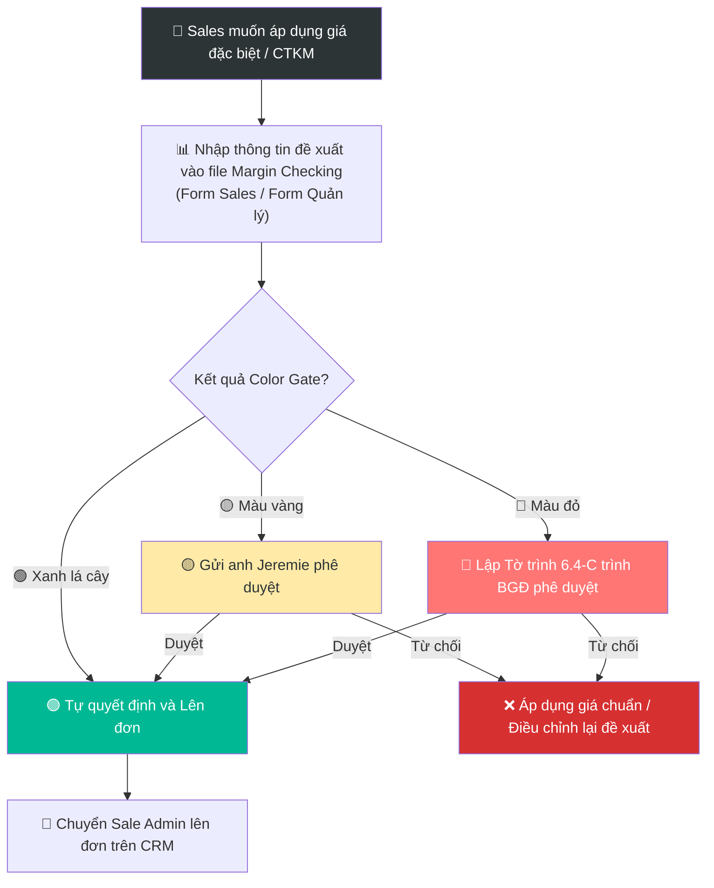

# 6.4 Chính sách Giá & Chiết khấu

🌐 [English Version](6.4_chinh_sach_gia_en.md)

## 1. Mục đích & Phạm vi
- **Mục đích:** Quy định cách tính giá bán, các mức chiết khấu, và quy trình phê duyệt giá đặc biệt — đảm bảo lợi nhuận và nhất quán giữa các Sales.
- **Áp dụng:** Toàn bộ sản phẩm, mọi kênh bán.
- **Tần suất:** Review giá mỗi quý hoặc khi có lô hàng mới.

## 2. Trách nhiệm (RACI)

| Hạng mục | Responsible | Approve | Consulted | Informed |
|----------|------------|---------|-----------|----------|
| Tính giá bán lẻ (MSP) | BGĐ | — | Kế toán (COGS) | Sales |
| Thiết lập chính sách CK | BGĐ | — | Sales | Kế toán |
| Áp dụng CK theo policy | Sales | — | — | — |
| Duyệt CK ngoài policy | — | BGĐ | Sales, Kế toán | — |
| Review giá hàng quý | BGĐ + Kế toán | — | Sales | — |

## 3. Chính sách Giá bán theo Kênh

### 3.1 Bảng Giá Theo Kênh Bán hàng

| Kênh | Mức giá | Ghi chú |
|------|---------|--------|
| **Giá bán lẻ (MSP)** | 100% | Giá niêm yết, cho KH B2C lẻ |
| **Giá HoReCa** | MSP × 65% (hoặc thấp hơn) | Chiết khấu bắt đầu từ 35% cho nhà hàng/khách sạn |
| **Giá đại lý / Wholesale** | MSP × 65% (hoặc thấp hơn) | Chiết khấu bắt đầu từ 35% cho đại lý mua số lượng lớn (giá trị ngang nhau với HoReCa) |
| **Giá nhân viên** | MSP × 70% | CK 30% cho nội bộ |

*Lưu ý:* Giá bán kênh HoReCa và Wholesale được thiết lập độc lập ở các dòng riêng biệt nhưng có giá trị ngang nhau (đều chiết khấu từ 35% trở lên từ giá bán lẻ MSP). Ngoài ra, có thể áp dụng mức giá sỉ Wholesale ưu đãi này cho Tổng quản lý (GM) của các khách sạn lớn.

## 4. Chính sách Chiết khấu
- Nhằm kiểm soát hiệu quả tài chính và biên lợi nhuận, Lyscellar **không áp dụng** các chính sách chiết khấu tự động, cố định hay mặc định theo hạng khách hàng hay số lượng đơn hàng thông thường.
- Khi có nhu cầu áp dụng chiết khấu đặc biệt hoặc cơ chế ưu đãi cho khách hàng/dự án/chương trình cụ thể, bộ phận Sales bắt buộc phải lập **Tờ trình phê duyệt cơ chế** sử dụng biểu mẫu quy chuẩn [Form_6.4-C_To_trinh_Co_che_Dac_biet.xlsx](../../../sources/Forms/Form_6.4-C_To_trinh_Co_che_Dac_biet.xlsx) (bắt buộc phải có cho tất cả khách hàng được áp dụng giảm giá).
- Tờ trình phải đi kèm bảng đối chiếu kết quả Margin Check (chạy trên Form check margin dành cho Sales hoặc Form dành cho Quản lý) và trình cấp có thẩm quyền phê duyệt trước khi gửi báo giá hoặc thực hiện đơn hàng.

### 4.2 Phân quyền Quyết định theo Biên Lợi nhuận (Margin) & Chốt chặn Màu sắc (Color Gates)
Để kiểm soát hiệu quả kinh doanh, việc phê duyệt giá bán đặc biệt hoặc chạy CTKM (bao gồm cả hàng tặng FOC và tiền thưởng bán hàng Incentive) phải được đối chiếu qua công cụ **Margin Checking** (sử dụng tệp Excel độc lập: "Form Check Margin dành cho Sales" và "Form Check Margin dành cho Quản lý" trên hệ thống).

Quy định cấp phê duyệt dựa trên Biên lợi nhuận gộp (Margin) của đơn hàng sau chiết khấu/khuyến mãi và chốt chặn màu hiển thị trên biểu mẫu:

| Màu chốt chặn (Color Gate) | Cấp phê duyệt quyết định |
|---------------------|---------------------------|
| 🟢 Xanh lá cây | **Nhân viên Sales / Sale Admin** tự quyết định và lên đơn. |
| 🟡 Màu vàng | **Anh Jeremie** xem xét và phê duyệt trực tiếp. |
| 🔴 Màu đỏ | **Cần phê duyệt trực tiếp từ Ban Giám Đốc (BGĐ)** (Sử dụng Tờ trình 6.4-C). |

*Lưu ý:* Biên lợi nhuận được tính trên Giá bán thực tế cuối cùng trừ đi Giá vốn (COGS) sau khi đã quy đổi tất cả các khoản chiết khấu, chương trình tặng kèm (FOC - Buy X Get Y), và tiền thưởng bán hàng (Incentive).

### 4.3 Chiết khấu Thanh toán & Giảm giá Marketing
- **Chiết khấu thanh toán & Giảm giá marketing:** Không áp dụng tự động theo biểu phí cố định hay chính sách hạng khách hàng thông thường. Các khoản giảm giá này được thỏa thuận và xác nhận riêng qua **email** với từng khách hàng cho từng thời kỳ hoặc chương trình cụ thể.
- **Phụ lục rượu và giá đi kèm:** Đối với mỗi đơn hàng phát sinh, phải lập và gửi kèm **phụ lục bổ sung danh mục rượu và giá** (annex) đi kèm tương ứng với đơn hàng đó để làm căn cứ giao nhận và toán.

### 4.4 Quy trình Phê duyệt Chương trình Khuyến mãi (CTKM) của Sales
Để triển khai một Chương trình Khuyến mãi (CTKM) cho một khách hàng cụ thể hoặc trên toàn kênh bán lẻ/HoReCa/Đại lý, nhân viên Sales bắt buộc phải lập Tờ trình đề xuất CTKM và trình ký phê duyệt trước khi công bố thông tin hoặc lên đơn hàng.

1. **Lập Tờ trình Phê duyệt Khuyến mãi:** Sales phụ trách phải soạn tờ trình (theo mẫu quy chuẩn [mau_to_trinh_phe_duyet_ctkm.md](templates/mau_to_trinh_phe_duyet_ctkm.md)) và cung cấp đầy đủ các thông tin cốt lõi sau:
   - **Thông tin về Giá & Cơ chế thương mại:** Chi tiết cơ chế KM (chiết khấu trực tiếp, mua X tặng Y - FOC, gối đầu, incentive...), sản phẩm áp dụng, giá bán lẻ niêm yết (MSP), giá đề xuất sau khuyến mãi, dự kiến số lượng và doanh thu, kèm theo kết quả đối chiếu biên lợi nhuận gộp (Margin Check Color Gate).
   - **Thông tin về Thiết kế:** Xác định chương trình có cần thiết kế ấn phẩm truyền thông, banner, poster, standee, hay wine list/menu đặc biệt không. Ghi rõ nội dung yêu cầu thiết kế và nhân sự/bộ phận chịu trách nhiệm.
   - **Thông tin về In ấn:** Xác định chương trình có cần in ấn vật lý không (in standee, in menu, in flyer, in voucher...). Ghi rõ số lượng, quy cách và dự toán chi phí in ấn.
   - **Thông tin về POSM:** Xác định chương trình có đi kèm cấp phát hoặc trưng bày vật phẩm POSM hỗ trợ bán hàng không (ly pha lê, xô đá, tạp dề, khui rượu...). Ghi rõ chủng loại, số lượng, giá trị quy đổi (COGS POSM) và tình trạng tồn kho thực tế.
2. **Cấp Phê duyệt Quyết định:**
   - Nếu CTKM nằm trong hạn mức ngân sách tiêu chuẩn và kết quả Margin gộp đạt **🟢 Màu xanh lá cây**: **Giám đốc Sales (Sales Director)** phê duyệt trực tiếp.
   - Nếu kết quả Margin gộp đạt **🟡 Màu vàng**: Gửi yêu cầu trình **anh Jeremie** phê duyệt qua WhatsApp/Email trước khi triển khai.
   - Nếu kết quả Margin gộp đạt **🔴 Màu đỏ**, hoặc CTKM có chi phí in ấn/thiết kế/POSM vượt quá hạn mức thông thường: Bắt buộc lập tờ trình chi tiết trình **Ban Giám Đốc (BGĐ)** phê duyệt trực tiếp.
3. **Phối hợp Triển khai:** Khi tờ trình được duyệt hợp lệ, Sales chuyển thông tin cho Sale Admin để tạo đơn hàng trên CRM, đồng thời phối hợp với bộ phận Marketing để thực hiện thiết kế, in ấn ấn phẩm và cấp phát POSM theo đúng nội dung được duyệt.

## 5. Quy trình Phê duyệt Giá Đặc biệt (Margin Check Workflow)

Khi Sales muốn áp dụng mức chiết khấu ngoài chính sách tự động hoặc chạy chương trình khuyến mãi riêng cho khách hàng, quy trình thực hiện như sau:

1. **Lập bảng đối chiếu (Margin Check):** Sales nhập thông tin đề xuất (SKU, số lượng, giá đề xuất, chương trình FOC hoặc Incentive) vào file **Margin Checking** phù hợp (Form Sales hoặc Form Quản lý).
2. **Xác định cấp duyệt theo chốt chặn màu:** Hệ thống tự động tính toán ra kết quả chốt chặn màu của đơn hàng:
   - Nếu **🟢 Màu xanh lá cây** $\rightarrow$ Sales tự động áp dụng và chuyển Sale Admin lên đơn.
   - Nếu **🟡 Màu vàng** $\rightarrow$ Sales gửi yêu cầu trình **anh Jeremie** phê duyệt qua WhatsApp/Email trước khi áp dụng.
   - Nếu **🔴 Màu đỏ** $\rightarrow$ Đơn hàng bị hệ thống chặn lại, **nhân viên Sales tuyệt đối không được tự ý thực hiện**. Các đơn hàng đặc biệt này chỉ được thực hiện khi bộ phận Quản lý/Sales Manager lập Tờ trình 6.4-C trình Ban Giám đốc (BGĐ) phê duyệt ngoại lệ theo quy trình tại [6.3 Xử lý Đơn hàng Bán](6.3_xu_ly_don_hang.md#L81).
3. **Ghi nhận & Lên đơn:** Sau khi được phê duyệt hợp lệ (ở mức xanh hoặc vàng, hoặc có phê duyệt ngoại lệ của BGĐ cho chốt chặn đỏ), Sales gửi đơn hàng kèm minh chứng phê duyệt và file Margin Checking cho Sale Admin để tạo đơn hàng trên CRM ở trạng thái "Chờ duyệt", kèm theo file Margin Checking đã duyệt làm minh chứng cho Kế toán đối chiếu.

## 6. Quy trình lập và gửi Báo giá Khách hàng

Khi có nhu cầu báo giá cho khách hàng mới hoặc gửi báo giá bổ sung cho khách hàng hiện tại:

1. **Yêu cầu báo giá:** Nhân viên Sales gửi thông tin yêu cầu báo giá cho **Sale Admin** (thông tin KH, danh sách sản phẩm, số lượng dự kiến, chiết khấu hoặc chương trình đặc biệt đã được phê duyệt dựa trên mức Margin quy định).
2. **Thao tác lập báo giá:** **Sale Admin** thực hiện xuất báo giá bằng một trong hai hình thức:
   - **Cách 1 (Sử dụng Biểu mẫu báo giá - Form 6.4-B):** Sử dụng tệp Excel template quy chuẩn của Lyscellar để điền thông tin và xuất bản PDF.
   - **Cách 2 (Sử dụng phần mềm CRM):** Tạo báo giá trực tiếp trên phân hệ Báo giá của phần mềm CRM của công ty để quản lý tập trung dữ liệu.
3. **Gửi khách hàng:** Gửi file báo giá chính thức dưới dạng PDF cho khách hàng qua Email hoặc Zalo để xác nhận (confirm) trước khi tiến hành lên đơn bán hàng chính thức.

---

## 7. Quy trình Review Giá (Hàng quý)

1. Kế toán cung cấp **COGS thực tế** cho mỗi SKU → [QT 8.4](../08_tai_chinh/8.4_gia_von_cogs.md)
2. BGĐ review: Biên lợi nhuận thực tế vs Mục tiêu
3. Điều chỉnh giá nếu cần:
   - COGS tăng (do tỷ giá, thuế) → tăng MSP
   - Hàng bán chậm → giảm MSP hoặc tạo combo
   - Đối thủ giảm giá → xem xét điều chỉnh
4. Cập nhật **Bảng giá** mới → gửi Sales team
5. Sales thông báo KH (nếu thay đổi đáng kể)

---

## 8. Biểu mẫu
- 📥 **Form 6.4-A: Bảng giá Sản phẩm & Chiết khấu** - [Bang_gia_San_pham.xlsx](../../../sources/Forms/Form_6.4-A_Bang_gia_San_pham.xlsx) (Bảng giá và chiết khấu chuẩn).
- 📥 **Form 6.4-B: Biểu mẫu Báo giá Khách hàng** - [Form_6.4-B_Ly_Cellars_Quotation_Template.xlsx](../../../sources/Forms/Form_6.4-B_Ly_Cellars_Quotation_Template.xlsx) (Tệp mẫu Excel dùng để soạn báo giá gửi khách).
- 📥 **Form Tờ trình Cơ chế Đặc biệt:** [Form_6.4-C_To_trinh_Co_che_Dac_biet.xlsx](../../../sources/Forms/Form_6.4-C_To_trinh_Co_che_Dac_biet.xlsx) (Bắt buộc phải lập cho tất cả khách hàng có giá giảm giá/chiết khấu đặc biệt).
- 📥 **Form 6.4-D (Template): Tờ trình Phê duyệt CTKM Sales** - [mau_to_trinh_phe_duyet_ctkm.md](templates/mau_to_trinh_phe_duyet_ctkm.md) (Bắt buộc lập khi Sales đề xuất chạy chương trình khuyến mãi/chiết khấu/quà tặng đi kèm in ấn, thiết kế, POSM).

---

## 9. KPI & Đo lường

| KPI | Công thức | Mục tiêu | Tần suất |
|-----|----------|---------|----------|
| Biên LN gộp TB | (Doanh thu - COGS) / Doanh thu | ≥ 35% | Hàng tháng |
| Tỷ lệ đơn có CK đặc biệt | Đơn CK đặc biệt / Tổng đơn | ≤ 10% | Hàng tháng |
| Giá bán TB / chai | Tổng doanh thu / Tổng chai bán | Không giảm quá 5%/quý | Hàng quý |

---

## 10. Tài liệu Liên quan
- ← Liên quan: [6.2 CRM](6.2_crm.md) | [6.3 Xử lý Đơn hàng](6.3_xu_ly_don_hang.md)
- ↔ Liên quan: [8.4 Giá vốn COGS](../08_tai_chinh/8.4_gia_von_cogs.md) | [1.3 Chiến lược Định giá](../01_chien_luoc/1.3_chien_luoc_dinh_gia.md)
