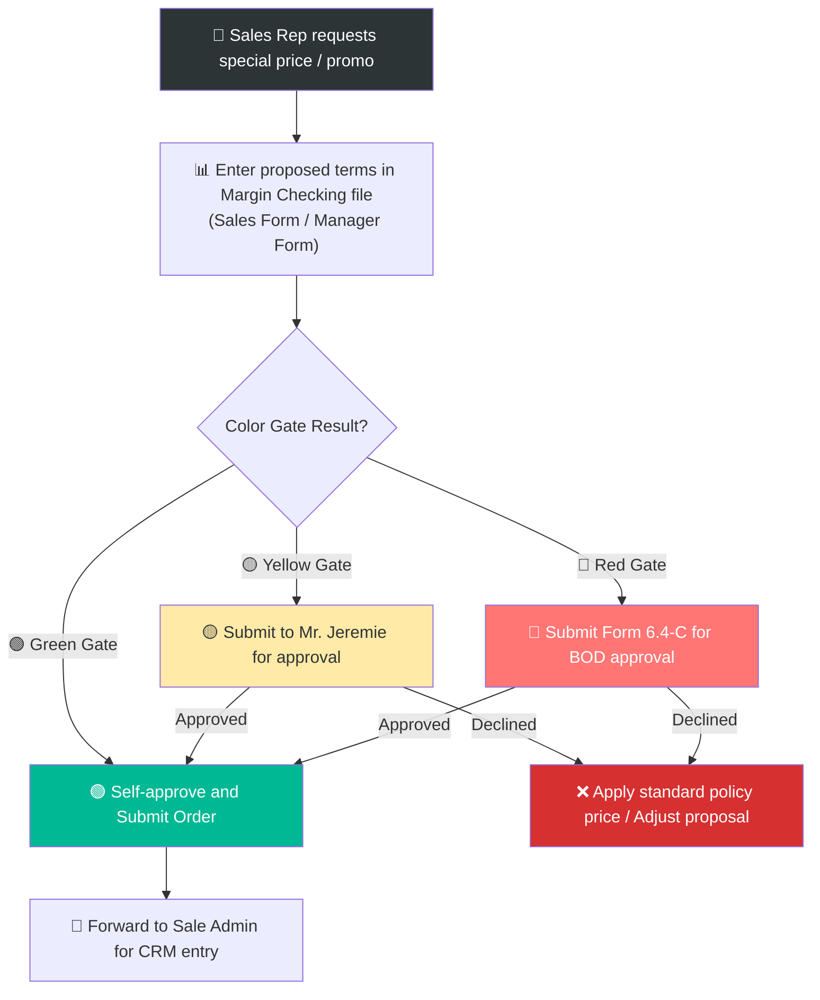

# 6.4 Pricing & Discount Policy

🌐 [Bản tiếng Việt](6.4_chinh_sach_gia.md)

## 1. Purpose & Scope
- **Purpose:** Regulate retail and wholesale pricing calculation, discount tiers, and special price approval processes to secure profit margins and maintain consistency across Sales Reps.
- **Application:** All products and sales channels.
- **Frequency:** Quarterly price reviews or when new shipments arrive.

---

## 2. RACI Matrix

| Activity | Responsible | Approve | Consulted | Informed |
|:---|:---:|:---:|:---:|:---:|
| **Calculate Suggested Retail Price (MSP)** | BOD | — | Sales Accountant (COGS) | Sales Rep |
| **Establish discount policy** | BOD | — | Sales Rep | Sales Accountant |
| **Apply discount per policy** | Sales Rep | — | — | — |
| **Approve discount outside policy** | — | BOD | Sales Rep, Accountant | — |
| **Quarterly price review** | BOD + Accountant | — | Sales Rep | — |

---

## 3. Pricing Policy by Channel
*Note: The formula for calculating the Suggested Retail Price (MSP) and markup coefficients are securely stored in the Board of Directors' [1.3 Pricing Strategy](../01_chien_luoc/1.3_chien_luoc_dinh_gia.md) document.*

### 3.1 Channel Price List

| Channel | Price Tier | Notes |
|:---|:---:|:---|
| **Retail Price (MSP)** | 100% | Listed public price, for B2C retail |
| **HoReCa Price** | MSP × 65% (or lower) | Discount starts from 35% for restaurants/hotels |
| **Wholesale / Agent Price** | MSP × 65% (or lower) | Discount starts from 35% for bulk agents (price equivalent to HoReCa) |
| **Staff Price** | MSP × 70% | 30% discount for internal staff |

*Note:* HoReCa and Wholesale prices are maintained in separate rows for clarity but are set at equivalent values (both start at a 35% discount off the Suggested Retail Price - MSP). GMs (General Managers) of major hotels can also be offered this wholesale rate.

## 4. Discount Policy
- To strictly control financial returns and margins, Lyscellar **does not apply** automated, fixed, or default discount tables based on customer tiers or quantity thresholds.
- When there is a business need to apply a special discount, rebate, or pricing structure to a specific client/program/deal, Sales must prepare a formal **Proposal Form (Tờ trình)** using the standardized [Form_6.4-C_To_trinh_Co_che_Dac_biet.xlsx](../../../sources/Forms/Form_6.4-C_To_trinh_Co_che_Dac_biet.xlsx) (mandatory for all customers with discounted prices).
- The proposal must be submitted with the matching Margin Check results (run on the Sales Margin Check Form or Manager Margin Check Form) and approved by the corresponding authority level before quoting the customer or creating the order.

### 4.2 Gross Margin Authority & Color Gates
To control business profitability, the approval of special pricing or promotional campaigns (including FOC items and sales incentives) must be checked using the **Margin Checking** tool (using separate templates: "Sales Margin Check Form" and "Manager Margin Check Form").

The approval levels based on the order's gross margin after discounts/promotions and the color gates shown on the form are defined below:

| Color Gate Alert | Approval Authority |
|:---:|:---|
| 🟢 Green Gate | **Sales Rep / Sale Admin** decides and registers order. |
| 🟡 Yellow Gate | **Mr. Jeremie** reviews and approves directly. |
| 🔴 Red Gate | **Requires direct approval from the Board of Directors (BOD)** (using Form 6.4-C). |

*Note:* Gross margin is calculated as the final sales price minus COGS, after taking into account all discounts, FOC items (Buy X Get Y), and sales incentives.

### 4.3 Payment & Marketing Discounts
- **Payment & Marketing Discounts:** These are not automatically applied based on fixed fees or tier policies. They must be negotiated and confirmed individually via **email** with each customer for specific periods or programs.
- **Order Pricing Annex:** Every sales order must be accompanied by a signed **Wine and Price Annex** defining the list of wines and prices for delivery and billing reconciliation.

### 4.4 Sales Promotion (CTKM) Approval Process
To launch a Sales Promotion (CTKM) for a specific customer or across retail/HoReCa/Distributor channels, Sales Representatives must prepare a formal Promotion Proposal and obtain the necessary approvals before announcing the promotion or entering orders.

1. **Drafting the Promotion Proposal:** The proposing Sales Rep must draft the proposal (using the standardized template [mau_to_trinh_phe_duyet_ctkm_en.md](templates/mau_to_trinh_phe_duyet_ctkm_en.md)) and detail the following key information:
   - **Pricing & Commercial Terms:** Specify the promotional mechanics (direct invoice discounts, FOC - Buy X Get Y, volume rebate, sales incentive, etc.), applied SKUs, standard retail price (MSP), proposed promotional sales price, projected quantity and revenue, and the gross margin (Margin Check Color Gate) calculation.
   - **Design Requirements:** Determine if the campaign requires marketing artwork, digital banners, social media posts, standees, or custom wine lists/menus. Detail the brief and responsible design resource.
   - **Printing Requirements:** Determine if physical collateral needs printing (standees, menus, flyers, vouchers, etc.). Specify the quantities, print specs, and estimated printing budget.
   - **POSM Requirements:** Indicate if POSM items should be distributed or displayed (crystal glasses, ice buckets, aprons, corkscrews, etc.). Specify the type, quantity, conversion value (COGS POSM), and actual stock availability.
2. **Approval Thresholds:**
   - If the promotion is within standard parameters and the gross margin result is **🟢 Green Gate**: The **Sales Director** has direct authority to approve.
   - If the gross margin result is **🟡 Yellow Gate**: Proposing Sales Rep must submit the request to **Mr. Jeremie** for approval via WhatsApp/Email.
   - If the gross margin result is **🔴 Red Gate**, or the printing/design/POSM costs exceed standard channel budget parameters: The proposal must be submitted directly to the **Board of Directors (BOD)** for formal review and approval.
3. **Execution Coordination:** Once approved, Sales forwards the approved proposal to the Sale Admin to create the order on CRM and coordinates with the Marketing department to execute the design, printing, and POSM requirements.

---

## 5. Special Price Approval Process (Margin Check Workflow)

When Sales Reps wish to apply discounts outside of automated policy or run a dedicated promotion, the following workflow applies:

1. **Perform Margin Check:** Sales Rep enters proposed terms (SKUs, quantities, proposed prices, FOC or incentives) into the appropriate **Margin Checking** tool (Sales Form or Manager Form).
2. **Determine Approval Level via Color Gates:** The tool automatically calculates the color gate result for the order:
   - If **🟢 Green Gate** $\rightarrow$ Sales Rep applies the price and requests Sale Admin to enter the order.
   - If **🟡 Yellow Gate** $\rightarrow$ Sales Rep submits the request to **Mr. Jeremie** for approval via WhatsApp/Email before proceeding.
   - If **🔴 Red Gate** $\rightarrow$ The order is blocked by the system, and **Sales representatives are strictly forbidden from executing it**. These special orders can only be executed if Management/Sales Manager drafts Proposal Form 6.4-C to submit to the Board of Directors (BOD) for exception approval according to the process in [6.3 Sales Order Processing](6.3_xu_ly_don_hang_en.md#L81).
3. **Register Order:** Once approved under Green or Yellow status, or with BOD exception approval for Red status, Sales Rep forwards the approved terms to the Sale Admin to create the order in the CRM system (Pending status), appending the approved Margin Checking file as verification for Accounting.

---

## 6. Quotation Creation & Delivery Process

When creating a quote for a new customer or sending an updated pricing quote to an existing client:

1. **Quotation Request:** Sales Rep submits details to the **Sale Admin** (customer info, product list, estimated quantities, and approved discounts/promotions based on the margin limits).
2. **Generate Quotation:** **Sale Admin** creates the official quotation using one of two methods:
   - **Method 1 (Form 6.4-B template):** Fill in the official Excel template and export as a PDF.
   - **Method 2 (CRM System):** Create the quotation directly in the Quotation module of the company CRM for centralized tracking.
3. **Send to Customer:** Send the PDF quotation to the customer via Email or Zalo for confirmation before processing the sales order.

---

## 7. Price Review Process (Quarterly)

1. Accounting provides the **actual COGS** for each SKU → [QT 8.4](../08_tai_chinh/8.4_gia_von_cogs.md)
2. BOD reviews actual gross margins vs. targets.
3. Adjust prices as needed:
   - COGS increases (due to exchange rates, taxes) $\rightarrow$ increase MSP.
   - Slow-moving stock $\rightarrow$ reduce MSP or design bundles.
   - Competitor pricing drops $\rightarrow$ consider adjustments.
4. Update the **Price List** $\rightarrow$ distribute to the Sales team.
5. Sales Reps notify customers of significant changes.

---

## 8. Forms & Templates
- 📥 **Form 6.4-A:** [Product_Prices_&_Discounts.xlsx](../../../sources/Forms/Form_6.4-A_Bang_gia_San_pham.xlsx)
- 📥 **Form 6.4-B:** [Quotation_Template.xlsx](../../../sources/Forms/Form_6.4-B_Ly_Cellars_Quotation_Template.xlsx)
- 📥 **Special Mechanism Proposal Form:** [Form_6.4-C_To_trinh_Co_che_Dac_biet.xlsx](../../../sources/Forms/Form_6.4-C_To_trinh_Co_che_Dac_biet.xlsx) (Mandatory for all customers with discounted pricing/special discounts).
- 📥 **Form 6.4-D (Template): Sales Promotion Proposal** - [mau_to_trinh_phe_duyet_ctkm_en.md](templates/mau_to_trinh_phe_duyet_ctkm_en.md) (Mandatory when Sales proposes promotions, discounts, or gifts involving printing, design, or POSM).

---

## 9. KPI & Control Metrics

| KPI | Calculation Formula | Target | Frequency |
|:---|:---|:---:|:---:|
| **Avg Gross Margin** | (Revenue - COGS) / Revenue | **≥ 35%** | Monthly |
| **Special Discount Ratio** | Orders with special discounts / Total orders | **≤ 10%** | Monthly |
| **Avg Price per Bottle** | Total Revenue / Total bottles sold | **No decrease > 5%/quarter** | Quarterly |

---

## 10. Related Documents & Links
- ← Related: [6.2 CRM](6.2_crm.md) | [6.3 Order Processing](6.3_xu_ly_don_hang.md)
- ↔ Related: [8.4 COGS Pricing](../08_tai_chinh/8.4_gia_von_cogs.md) | [1.3 Pricing Strategy](../01_chien_luoc/1.3_chien_luoc_dinh_gia.md)
