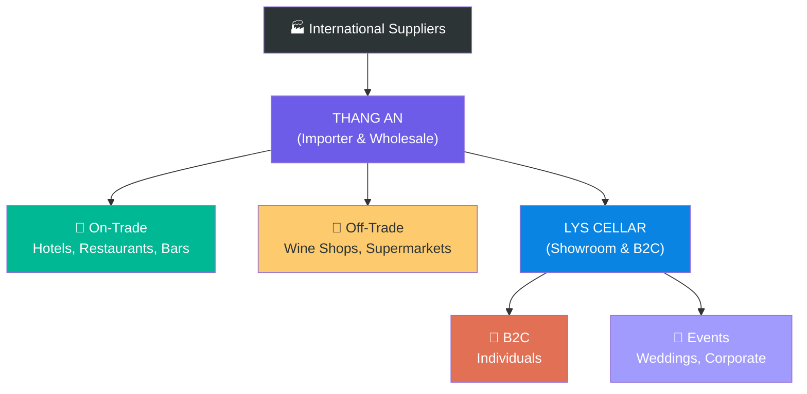

# 6.5 Sales Channel Management

🌐 [Bản tiếng Việt](6.5_kenh_ban_hang.md)

## 1. Purpose & Scope
- **Purpose:** Manage and develop wine distribution channels, optimizing revenue and gross margins by channel.
- **Application:** All active and future sales channels of Lyscellar.

---

## 2. Classification of Sales Channels
*Note: Distribution channels such as On-Trade (on-premise consumption) and Off-Trade (take-home retail) are supplied and distributed at wholesale directly by **Thang An** at wholesale prices. The **Lys Cellar** brand focuses on operating the physical Showroom and direct B2C sales (individual consumers and private events) at retail prices.*

### 2.1 On-Trade (On-Premise Consumption)

| Channel | Description | Features | Strategy |
|:---|:---|:---|:---|
| 🏨 **4-5 Star Hotels** | Wine list for hotel restaurants/bars | High volume, stable orders, slow payment cycles | 15-20% discount, staff training support |
| 🍽️ **Fine Dining Restaurants** | Wine pairing, by-the-glass offerings | Medium volume, high margin | Menu printing support, chef tasting sessions |
| 🍕 **Casual Dining Restaurants** | House wine, simple food pairing | High volume, entry-level wines | Volume-based discounts, combo deals |
| 🍸 **Wine Bars / Lounges** | By-the-glass, wine flights | Diverse SKUs, rapid inventory turnover | Glassware support, open bottle samples |
| ☕ **Cafés / Bistros** | Wine paired with light snacks | Small volume, entry-level | Coffee + wine bundle promotions |

### 2.2 Off-Trade (Take-Home / Retail)

| Channel | Description | Features | Strategy |
|:---|:---|:---|:---|
| 🏪 **Specialized Wine Shops** | Specialized wine retailers | High wine knowledge, lower margins | Priority allocation of exclusive SKUs |
| 🛒 **Supermarkets / Minimarts** | Mass retail | High volume, strict invoicing/contracts | Entry-level, highly competitive pricing |
| 📦 **E-Commerce** | Website, Shopee, Lazada, etc. | Wide reach, shipping cost intensive | Combo sets, gift packaging focus |
| 🏛️ **Lyscellar Showroom** | Direct retail at Giang Van Minh showroom | Premium experience, B2C, high margin | Wine tastings, membership loyalty, gift sets |
| 👤 **Direct B2C** | Individual buyers (via sales force) | High margin | Zalo, Facebook, referrals |

### 2.3 Special Channels

| Channel | Description | Frequency |
|:---|:---|:---|
| 🎁 **Corporate Gifts** | Gift sets for Tet, anniversaries, corporate events | Seasonal (Tet, Q4) |
| 💒 **Weddings / Events** | Wines for wedding banquets, conferences | Booking-based |
| ✈️ **Duty-Free / Export** | Sales to duty-free shops or international buyers | Contract-based |

---

## 3. Channel Management Processes

### Step 1: Channel Performance Review (Quarterly)
- **Execution:**
  1. Compile sales revenue broken down by channel.
  2. Compare: Current quarter vs. previous quarter vs. quarterly targets.
  3. Analyze:
     - Which channels grew or declined? Why?
     - Which SKUs perform best in which channels?
     - Channel margins after discounts.
  4. Complete the quarterly channel performance report.

### Step 2: Portfolio Optimization by Channel
- **Execution:**
  1. Define a **matching product catalog** for each channel:
     - *HoReCa:* Premium Italian/French wines with storytelling potential.
     - *Retail:* Easy-drinking entry-level wines with attractive pricing.
     - *B2C / Showroom:* Premium, limited-edition allocations, gift boxes.
  2. Build **recommended Wine Lists** for each customer type.
  3. Update lists upon new container arrivals.

### Step 3: Channel Support Actions
- **Actions based on channel:**

| Support | On-Trade | Off-Trade | Showroom | B2C |
|:---|:---:|:---:|:---:|:---:|
| **Staff Training** | ✅ | Optional | ✅ (Sommelier Training) | ❌ |
| **Branded Glassware** | ✅ | ❌ | ✅ (On-counter use) | ❌ |
| **POSM (Standees/Wobblers)** | ✅ | ✅ | ✅ (Showroom display) | ❌ |
| **Menu/Wine List Printing** | ✅ | ❌ | ✅ (Tasting menu) | ❌ |
| **Wine Tasting Events** | ✅ | ✅ | ✅ (Regular schedules) | ✅ |
| **Social Media Co-marketing** | Optional | Optional | ✅ (Check-in promo) | ✅ |

### Step 4: Channel Conflict Mitigation (Wholesale/Retail Segmentation)
- **Principle:** Clearly segment wholesale and retail operations to prevent pricing conflicts and channel overlaps.
- **Solutions:**
  1. **Price Separation:** Lyscellar sells products at retail prices directly to end-consumers. Thang An distributes at wholesale prices to sub-dealers, agents, and restaurants.
  2. **Exclusive SKUs:** Allocate specific SKUs exclusively for the On-Trade (HoReCa) channel, keeping them off the general retail market to avoid price comparison.
  3. **Dedicated Packaging:** Design distinct gift boxes or bundled packages exclusively for Lyscellar's events and B2C showroom sales.

---

## 4. Distribution Channel Map

---

## 5. KPI & Control Metrics

| KPI | Calculation Formula | Target | Frequency |
|:---|:---|:---:|:---:|
| **Channel Revenue Growth** | Revenue of each channel vs. target | **+15% Year-over-Year** | Quarterly |
| **Channel Share** | Channel Revenue / Total Revenue | **On-Trade ≥ 50%** | Quarterly |
| **Active Outlets** | Number of active purchasing outlets by channel | **+20% Year-over-Year** | Quarterly |
| **Channel Margin** | Gross Margin after channel discounts | **≥ 30%** | Quarterly |

---

## 6. Related Documents & Links
- ← Related: [6.1 New Customer Development](6.1_phat_trien_kh.md) | [6.4 Pricing Policy](6.4_chinh_sach_gia.md)
- ↔ Related: [9.1 Brand & Marketing](../09_marketing/9.1_thuong_hieu.md) | [1.2 Portfolio Management](../01_chien_luoc/1.2_quan_ly_danh_muc.md)
