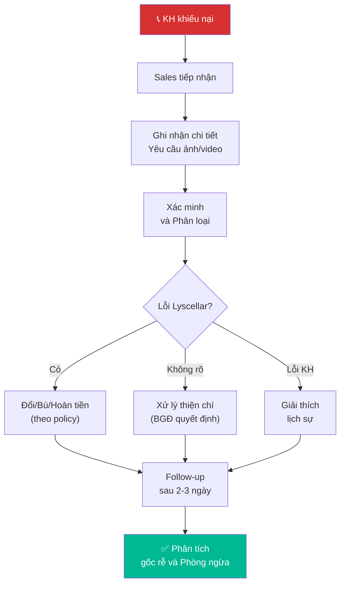

# 6.6 Xử lý Khiếu nại & Đổi trả

🌐 [English Version](6.6_xu_ly_khieu_nai_en.md)

## 1. Mục đích & Phạm vi
- **Mục đích:** Xử lý nhanh chóng, chuyên nghiệp mọi khiếu nại từ KH — đảm bảo KH hài lòng và giữ uy tín thương hiệu.
- **Áp dụng:** Mọi phản hồi tiêu cực / yêu cầu đổi trả từ KH B2B và B2C.
- **Tần suất:** Mỗi khi có khiếu nại.

## 2. Trách nhiệm (RACI)

| Bước                 | Responsible | Approve | Consulted      | Informed |
| -------------------- | ----------- | ------- | -------------- | -------- |
| Tiếp nhận khiếu nại  | Sales       | —       | —              | BGĐ      |
| Xác minh & Phân loại | Sales + Kho | —       | QC             | —        |
| Quyết định xử lý     | BGĐ         | —       | Sales, Kế toán | KH       |
| Đổi/Trả/Bồi thường   | Sales + Kho | BGĐ     | Kế toán        | —        |
| Follow-up sau xử lý  | Sales       | —       | —              | BGĐ      |

## 3. Phân loại Khiếu nại

| Loại                   | Mô tả                               | Mức độ       | SLA xử lý |
| ---------------------- | ----------------------------------- | ------------ | --------- |
| 🔴 **Chất lượng rượu** | Cork taint, oxidized, cooked, vị lạ | Nghiêm trọng | 2 giờ     |
| 🟡 **Giao hàng**       | Sai hàng, thiếu hàng, giao trễ      | Trung bình   | 4 giờ     |
| 🟡 **Chai vỡ/hỏng**    | Vỡ khi giao, nứt, rò rỉ             | Trung bình   | 12 giờ    |
| 🟢 **Nhãn/Tem**        | Nhãn bong, tem rách, sai thông tin  | Nhẹ          | 24 giờ    |
| 🟢 **Giá/Hóa đơn**     | Sai giá, thiếu CK, sai hóa đơn      | Nhẹ          | 24 giờ    |

## 4. Quy trình Chi tiết

### Bước 1: Tiếp nhận Khiếu nại
- **Thao tác:**
  1. Lắng nghe KH — **KHÔNG phản bác ngay**
  2. Ghi nhận đầy đủ:
     - Tên KH, Mã KH
     - Mã đơn hàng / Ngày mua
     - SKU + SL bị lỗi
     - Mô tả vấn đề chi tiết
     - **Yêu cầu ảnh/video từ KH** (bắt buộc nếu khiếu nại chất lượng)
  3. Tiếp nhận thông tin và cam kết thời gian phản hồi:
     - "Cảm ơn anh/chị đã thông báo. Chúng tôi sẽ kiểm tra và phản hồi trong vòng [X] giờ"
  4. Tạo **Phiếu Khiếu nại** (Form 6.6-A)
- **Timeline:** Trong 30 phút kể từ khi nhận

### Bước 2: Xác minh & Phân loại
- **Thao tác:**
  1. Kiểm tra đơn hàng gốc: PXK, ảnh đóng gói
  2. Nếu **sai hàng/thiếu hàng:** Đối chiếu PXK vs yêu cầu KH
  3. Nếu **chất lượng rượu:**
     - Yêu cầu KH giữ chai (không đổ) → lấy về kiểm tra
     - Quản lý Kho/BGĐ nếm thử xác nhận
     - Kiểm tra: Cùng lô (PNK) có chai nào khác bị không? → [QT 5.7](../05_kho_van/5.7_xu_ly_hang_loi.md)
  4. Nếu **chai vỡ:** Kiểm tra ảnh, xác nhận vỡ khi giao hay KH tự làm
  5. Ghi kết quả xác minh vào Phiếu Khiếu nại
- **Timeline:** 2-4 giờ (sai hàng) | 24 giờ (chất lượng)

### Bước 3: Quyết định Xử lý

| Loại khiếu nại | Nếu lỗi Lyscellar | Nếu không rõ | Nếu lỗi KH |
|---------------|-------------------|-------------|------------|
| Sai hàng | Giao đúng hàng ngay | — | — |
| Thiếu hàng | Giao bù | — | — |
| Chai vỡ khi giao | Đổi chai mới miễn phí | Đổi 50% giá | KH chịu |
| Cork taint / Lỗi rượu | Đổi chai mới | Đổi chai mới (thiện chí) | Giải thích |
| Nhãn bong | Dán lại hoặc đổi chai | — | — |
| Sai giá/hóa đơn | Xuất lại hóa đơn + hoàn chênh lệch | — | — |

**Quy tắc phê duyệt:** Mọi phương án xử lý khiếu nại, bao gồm đổi trả, bồi thường hoặc hoàn tiền (không phân biệt giá trị lớn hay nhỏ) đều bắt buộc phải lập Phiếu khiếu nại (Form 6.6-A) và trình Ban Giám đốc (BGĐ) phê duyệt chính thức trước khi thực hiện. Nhân viên Sales và bộ phận Kho tuyệt đối không được tự ý quyết định xử lý đền bù cho khách hàng.

### Bước 4: Thực hiện Xử lý
- **Thao tác:**
  1. Thông báo KH kết quả + phương án xử lý
  2. **Đổi hàng / Nhận lại hàng:** Xuất hàng mới → giao cho KH → ký nhận và thu hồi chai lỗi về bằng **Biên bản nhận lại hàng lỗi (Form 6.6-B)**
  3. **Hoàn tiền:** Kế toán chuyển khoản hoặc trừ công nợ
  4. **Bồi thường thiện chí:** Tặng thêm 1 chai rượu khác (BGĐ duyệt)
  5. Cập nhật Phiếu Khiếu nại: Kết quả xử lý + Chữ ký

### Bước 5: Follow-up & Phòng ngừa
- **Thao tác:**
  1. Gọi KH sau 2-3 ngày: "Anh/Chị đã nhận hàng thay thế chưa? Hài lòng không?"
  2. Ghi nhận vào CRM — tránh sai lại
  3. **Phân tích gốc rễ:**
     - Nếu cùng SKU bị nhiều KH phản hồi → kiểm tra toàn lô
     - Nếu do đóng gói → cải thiện quy cách đóng (QT 5.6)
     - Nếu do shipper → đổi đơn vị vận chuyển

## 5. Chính sách Đổi/Trả hàng

| Điều kiện | Chấp nhận đổi/trả? | Ghi chú |
|-----------|-------------------|--------|
| Trong 7 ngày kể từ giao | ✅ | Mọi lý do hợp lý |
| 7-30 ngày | ✅ Chỉ nếu lỗi chất lượng | Cần ảnh + giữ chai |
| > 30 ngày | ❌ | Trừ trường hợp đặc biệt (BGĐ duyệt) |
| Chai đã mở > 50% | ❌ | Không đổi/trả (trừ cork taint rõ ràng) |
| Hàng consignment | Quy định riêng | Theo HĐ ký gửi |

## 6. Sơ đồ Quy trình

## 7. Biểu mẫu
📥 **Form 6.6-A:** [Phieu_Khieu_nai.xlsx](../../../sources/Forms/Form_6.6-A_Phieu_Khieu_nai.xlsx)
📥 **Form 6.6-B:** [Bien_ban_Nhan_lai_Hang_loi.xlsx](../../../sources/Forms/Form_6.6-B_Bien_ban_Nhan_lai_Hang_loi.xlsx)

**Nội dung các form:**
- **Form 6.6-A (Phiếu khiếu nại):** Thông tin KH, Mã đơn hàng, SKU bị lỗi, loại khiếu nại, kết quả xác minh, quyết định xử lý và chữ ký duyệt của BGĐ.
- **Form 6.6-B (Biên bản nhận lại hàng lỗi):** Biên bản bàn giao nhận lại hàng lỗi, ghi nhận chi tiết hiện trạng chai rượu thu hồi (đã mở nắp/chưa mở nắp, lượng rượu còn lại, nhãn mác, nút bần) và chữ ký xác nhận của Bên giao và Bên nhận.

## 8. KPI & Đo lường

| KPI | Công thức | Mục tiêu | Tần suất |
|-----|----------|---------|----------|
| Thời gian phản hồi | Từ nhận → liên hệ lại KH | ≤ 4 giờ | Mỗi case |
| Thời gian xử lý | Từ nhận → hoàn tất | ≤ 48 giờ | Mỗi case |
| Tỷ lệ khiếu nại | Số khiếu nại / Tổng đơn | ≤ 2% | Hàng tháng |
| KH hài lòng sau xử lý | KH đánh giá OK / Tổng case | ≥ 90% | Hàng quý |

## 9. Tài liệu Liên quan
- ← Liên quan: [6.3 Xử lý Đơn hàng](6.3_xu_ly_don_hang.md) | [5.6 Xuất kho](../05_kho_van/5.6_xuat_kho.md)
- ↔ Liên quan: [5.7 Xử lý Hàng lỗi](../05_kho_van/5.7_xu_ly_hang_loi.md) | [8.2 Công nợ](../08_tai_chinh/8.2_cong_no_phai_thu.md)
