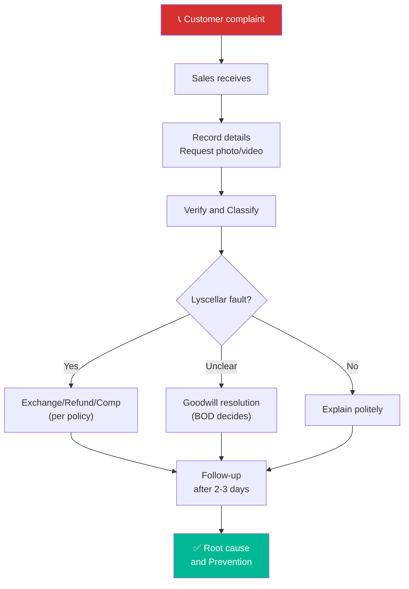

# 6.6 Complaint & Return Handling

🌐 [Bản tiếng Việt](6.6_xu_ly_khieu_nai.md)

## 1. Purpose & Scope
- **Purpose:** Handle all customer complaints quickly and professionally to ensure customer satisfaction and protect brand reputation.
- **Application:** All negative feedback and return/exchange requests from B2B and B2C customers.
- **Frequency:** Actioned per incident.

---

## 2. RACI Matrix

| Step | Responsible | Approve | Consulted | Informed |
|:---|:---:|:---:|:---:|:---:|
| **Complaint reception** | Sales Rep | — | — | BOD |
| **Verification & classification** | Sales Rep + Warehouse | — | QC Staff | — |
| **Resolution decision** | BOD | — | Sales Rep, Accountant | Customer |
| **Exchange/Return/Compensation** | Sales Rep + Warehouse | BOD | Sales Accountant | — |
| **Post-resolution follow-up** | Sales Rep | — | — | BOD |

---

## 3. Complaint Classification

| Category | Description | Severity | Resolution SLA |
|:---|:---|:---:|:---:|
| 🔴 **Wine Quality** | Cork taint (TCA), oxidized, cooked wine, off-flavors | High | 2 Hours |
| 🟡 **Delivery Issue** | Wrong items, missing items, delayed delivery | Medium | 4 Hours |
| 🟡 **Broken/Damaged Bottle** | Broken during delivery, cracked bottle, leaking seal | Medium | 12 Hours |
| 🟢 **Label/Duty Stamp** | Loose labels, torn duty stamps, wrong product description | Low | 24 Hours |
| 🟢 **Pricing / Invoicing** | Incorrect price, missing discount, wrong tax invoice | Low | 24 Hours |

---

## 4. Detailed Operational Steps

### Step 1: Complaint Reception
- **Execution:**
  1. Listen to the customer attentively — **DO NOT argue immediately**.
  2. Record full details:
     - Customer Name, Customer Code.
     - Sales Order ID / Purchase Date.
     - Affected wine SKU & Quantity.
     - Detailed description of the problem.
     - **Request photos/videos from customer** (compulsory for quality and breakage claims).
  3. Receive information and commit to a feedback timeline:
     - *"Thank you for informing us. We will verify and get back to you within [X] hours."*
  4. Create a **Complaint Ticket** (Form 6.6-A).
- **Timeline:** Within 30 minutes of reception.

### Step 2: Verification & Classification
- **Execution:**
  1. Check original order: printed Release Note, packaging photos.
  2. If **wrong/missing items:** Cross-check the Release Note against the customer's request.
  3. If **wine quality issue:**
     - Instruct the customer to retain the bottle (do not discard or empty) $\rightarrow$ retrieve the bottle for verification.
     - Showroom Manager or BOD conducts tasting verification.
     - Check: Are there other complaints from the same batch (received shipment)? $\rightarrow$ refer to [QT 5.7 Defective Goods Handling](../05_kho_van/5.7_xu_ly_hang_loi.md).
  4. If **broken bottle:** Check delivery photos to confirm whether the breakage occurred during transit or after handover.
  5. Log verification results in the Complaint Ticket.
- **Timeline:** 2-4 hours (delivery claims) | 24 hours (quality claims).

### Step 3: Resolution Decision

| Complaint Type | If Lyscellar's Error | If Cause is Unclear | If Customer's Error |
|:---|:---|:---|:---|
| **Wrong items** | Redeliver correct items | — | — |
| **Missing items** | Redeliver missing items | — | — |
| **Broken bottle** | Free replacement bottle | Replace at 50% cost | Customer's expense |
| **Cork taint / Defect** | Replace bottle | Replace bottle (goodwill) | Explain politely |
| **Loose labels** | Re-glue label or replace bottle | — | — |
| **Pricing / Invoice** | Re-issue invoice + Refund difference | — | — |

**Approval Authority Policy:** All complaint resolution outcomes, including exchanges, returns, compensations, or refunds (regardless of value), must be documented on a Complaint Ticket (Form 6.6-A) and formally approved by the Board of Directors (BOD) before implementation. Sales Representatives and Warehouse Staff are strictly prohibited from resolving complaints or initiating exchanges/returns without BOD authorization.

### Step 4: Execution
- **Execution:**
  1. Inform the customer of verification results and the agreed solution.
  2. **Exchange / Product Return:** Dispatch replacement items $\rightarrow$ deliver to customer $\rightarrow$ collect defective bottle with signatures on the **Returned Goods Receipt (Form 6.6-B)**.
  3. **Refund:** Accountant transfers funds or deducts from outstanding credit.
  4. **Goodwill gesture:** Send a complimentary bottle of a different SKU (requires BOD approval).
  5. Update Complaint Ticket status with signatures.

### Step 5: Follow-up & Prevention
- **Execution:**
  1. Call the customer after 2-3 days: *"Have you received the replacement? Is everything satisfactory?"*
  2. Log resolution in the CRM system to avoid future mistakes.
  3. **Root-Cause Analysis:**
     - If multiple complaints focus on the same SKU $\rightarrow$ audit the entire batch.
     - If caused by packing methods $\rightarrow$ adjust wrapping standards (QT 5.6).
     - If caused by courier service $\rightarrow$ adjust shipper partners.

---

## 5. Return/Exchange Policy

| Condition | Accept Return/Exchange? | Notes |
|:---|:---:|:---|
| **Within 7 days of delivery** | ✅ | For any reasonable cause, bottle must be sealed |
| **Between 7 - 30 days** | ✅ Only for quality defects | Photos + bottle retention required |
| **More than 30 days** | ❌ | Except special exceptions (BOD approved) |
| **Bottle opened > 50%** | ❌ | No exchange/return (except clear cork taint) |
| **Consignment goods** | Separate terms | Governed by Consignment Agreement |

---

## 6. Process Flowchart

---

## 7. Forms & Templates
📥 **Form 6.6-A:** [Complaint_Ticket.xlsx](../../../sources/Forms/Form_6.6-A_Phieu_Khieu_nai.xlsx)
📥 **Form 6.6-B:** [Returned_Goods_Receipt.xlsx](../../../sources/Forms/Form_6.6-B_Bien_ban_Nhan_lai_Hang_loi.xlsx)

**Forms description:**
- **Form 6.6-A (Complaint Ticket):** Records customer info, sales order ID, defective SKU, complaint category, verification results, resolution decisions, and signature for BOD approval.
- **Form 6.6-B (Returned Goods Receipt):** Handover document signed between parties to retrieve the defective bottle, noting the bottle's current status (opened/sealed, remaining ratio, labels, cork) and signatures of the Giver (Bên giao) and Receiver (Bên nhận).

---

## 8. KPI & Control Metrics

| KPI | Calculation Formula | Target | Frequency |
|:---|:---|:---:|:---:|
| **Initial Response SLA** | Time from claim intake to initial callback | **≤ 4 hours** | Per claim |
| **Resolution Cycle Time** | Time from claim intake to final resolution | **≤ 48 hours** | Per claim |
| **Complaint Ratio** | Total complaints / Total orders | **≤ 2%** | Monthly |
| **Retention Sat Rate** | Customers satisfied / Total resolved claims | **≥ 90%** | Quarterly |

---

## 9. Related Documents & Links
- ← Related: [6.3 Order Processing](6.3_xu_ly_don_hang.md) | [5.6 Outbound Release](../05_kho_van/5.6_xuat_kho.md)
- ↔ Related: [5.7 Defective Goods Handling](../05_kho_van/5.7_xu_ly_hang_loi.md) | [8.2 Accounts Receivable](../08_tai_chinh/8.2_cong_no_phai_thu.md)
