# 6.7 Báo cáo Doanh số & Phân tích Bán hàng

🌐 [English Version](6.7_bao_cao_doanh_so_en.md)

## 1. Mục đích & Phạm vi
- **Mục đích:** Theo dõi, phân tích doanh số bán hàng theo nhiều chiều (thời gian, SP, KH, kênh), phục vụ ra quyết định kinh doanh.
- **Áp dụng:** Toàn bộ hoạt động bán hàng.
- **Tần suất:** Hàng tuần (tổng hợp), Hàng tháng/quý (chi tiết).

## 2. Trách nhiệm (RACI)

| Báo cáo       | Lập             | Review | Nhận         |
| ------------- | --------------- | ------ | ------------ |
| Báo cáo tuần  | Sales           | BGĐ    | Team         |
| Báo cáo tháng | Sales + Kế toán | BGĐ    | Ban lãnh đạo |
| Phân tích quý | BGĐ + Kế toán   | —      | Cổ đông      |

## 3. Sơ đồ Chu kỳ Báo cáo (Reporting Process Flow)

```mermaid
flowchart TD
    subgraph "Hàng tuần (Weekly)"
        B1["📊 Báo cáo tuần trước & Lập Kế hoạch tuần mới"] --> B2["💼 Họp giao ban đầu tuần (Thứ Hai)"]
        B2 --> B3["👥 Đội ngũ Sales và BGĐ (Duyệt Kế hoạch & Pipeline)"]
    end

    subgraph "Hàng tháng (Monthly)"
        C1["📁 Kết xuất MISA và Đối soát hoa hồng đại lý (Ngày 2)"] --> C2["🧾 Lập Báo cáo Tháng và Commission (Ngày 5-6)"]
        C2 --> C3["🏢 Ban lãnh đạo (Đánh giá KPI và Phê duyệt chi hoa hồng)"]
    end

    subgraph "Hàng quý (Quarterly)"
        D1["📈 Phân tích Pareto ABC và So sánh Kế hoạch năm"] --> D2["🎯 Lập Báo cáo Quý và Đề xuất Chiến lược mới"]
        D2 --> D3["👥 Cổ đông và Ban Giám doc (Duyệt kế hoạch quý tới)"]
    end

    style B2 fill:#74b9ff,color:#fff
    style C2 fill:#a29bfe,color:#fff
    style D2 fill:#55efc4,color:#2d3436
```



## 4. Hệ thống Báo cáo

### 4.2 Báo cáo & Kế hoạch Tuần (Weekly Summary & Planning) - Sử dụng Form 6.7-B
- **Thời gian lập:** Trước 09:00 sáng thứ Hai hàng tuần (Báo cáo kết quả tuần trước và nộp Kế hoạch hoạt động tuần mới).
- **Nội dung:**

| Mục | Chi tiết |
|-----|---------|
| Doanh thu tuần | Tổng + So với tuần trước + So với cùng kỳ |
| Top 5 SP bán chạy | SKU, SL, Giá trị |
| Top 5 KH mua nhiều | Tên KH, Giá trị |
| Đơn hàng mới | Số lượng, Giá trị TB |
| Tồn kho cần chú ý | SKU sắp hết, SKU chậm bán |
| Pipeline | Lead mới, Prospect đang follow |
| Kế hoạch tuần mới | Chỉ tiêu doanh số tuần + Lịch trình đi thị trường/viếng thăm KH + Đề xuất hỗ trợ (rượu mẫu thử, POSM...) |

- **Quy trình Lên Kế hoạch Tuần mới (Weekly Sales Planning):**
  Bên cạnh báo cáo kết quả tuần trước, mỗi nhân viên Sales bắt buộc phải lập và gửi Kế hoạch hoạt động tuần mới trước **09:00 sáng thứ Hai hàng tuần** cho Sales Manager/Ban Giám Đốc. Kế hoạch tuần mới bao gồm:
  - **Mục tiêu Doanh số Tuần:** Chỉ tiêu doanh số phân bổ cụ thể theo tuần để bám sát và đảm bảo đạt KPI tháng.
  - **Kế hoạch Gặp gỡ Khách hàng:** Lịch trình cụ thể các khách hàng (HoReCa, đại lý, đối tác) dự kiến viếng thăm hoặc làm việc trực tiếp trong tuần.
  - **Pipeline Actions:** Danh sách các cơ hội kinh doanh/dự án quan trọng cần tập trung chốt, giải pháp xử lý các vướng mắc của tuần trước.
  - **Đề xuất hỗ trợ:** Đề xuất xuất rượu thử tasting (Form 8.10-A), POSM, hoặc đề xuất cơ chế giá đặc biệt cho tuần.
  - **Họp giao ban tuần (Weekly Meeting):** Tổ chức vào sáng thứ Hai hàng tuần để đánh giá kết quả báo cáo tuần trước, thống nhất và duyệt Kế hoạch tuần mới của từng nhân viên.

### 4.3 Báo cáo Tháng (Monthly Report)
- **Thời gian lập:** Dự thảo hoàn thành vào ngày 2 hàng tháng (R) để gửi duyệt. Phát hành báo cáo chính thức vào ngày 5 tháng sau.
- **Nội dung chi tiết:**

#### A. Tổng quan Doanh thu
| Chỉ số | Tháng này | Tháng trước | % Thay đổi | Mục tiêu | Đạt? |
|--------|----------|------------|-----------|---------|------|
| Doanh thu | | | | | |
| Số đơn hàng | | | | | |
| Giá trị đơn TB | | | | | |
| Số KH hoạt động | | | | | |
| KH mới | | | | | |

#### B. Phân tích theo Sản phẩm
| Mã SKU | Tên SP | SL bán | Doanh thu | % Tổng DT | Trend |
|--------|--------|--------|----------|----------|-------|
(Top 20 SKU + Bottom 10 SKU)

#### C. Phân tích theo Khách hàng
| Mã KH | Tên KH | Giá trị mua | Hạng | Trend |
|-------|--------|------------|------|-------|
(Top 10 KH + KH dormant)

#### D. Phân tích theo Kênh
| Kênh | Doanh thu | % Tổng | Số KH | Trend |
|------|----------|--------|-------|-------|

#### E. Phân tích theo Quốc gia (Origin)
| Quốc gia | SL chai | Doanh thu | % Tổng |
|----------|---------|----------|--------|
| 🇮🇹 Ý | | | |
| 🇫🇷 Pháp | | | |
| 🇨🇱 Chile | | | |
| 🇦🇺 Úc | | | |
| 🇳🇿 New Zealand | | | |
| 🇪🇸 Tây Ban Nha | | | |

#### F. Báo cáo Chi hoa hồng (Commission Report)
- **Thời gian lập:** Ngày 6 hàng tháng (R).
- **Nội dung:** Chi tiết số lượng và giá trị chiết khấu, hoa hồng thực tế chi trả cho các đại lý, cộng tác viên và đối tác giới thiệu khách hàng phát sinh trong tháng trước. Báo cáo được gửi cho Phòng Kế toán đối chiếu và thực hiện thanh toán.

### 4.4 Báo cáo Quý (Quarterly Review)
- **Thời gian lập:** Tháng đầu quý mới
- **Nội dung bổ sung:**
  - So sánh thực tế vs Kế hoạch năm
  - Phân tích ABC (Pareto 80/20): SKU nào chiếm 80% doanh thu?
  - Phân tích xu hướng: SP nào đang tăng/giảm?
  - Đề xuất chiến lược quý tới
  - Review Safety Stock + Kế hoạch nhập hàng

### 4.5 Yêu cầu Báo cáo Nội bộ (Ad-hoc Internal Requests)
- **Quy tắc phối hợp:** Bộ phận Kế toán (Kế toán bán hàng) có trách nhiệm hỗ trợ, kết xuất và gửi báo cáo chi tiết doanh số bán hàng, công nợ khách hàng hoặc chi tiết thanh toán cho nhân viên Sales (Sales Rep) khi nhận được yêu cầu để phục vụ công việc chăm sóc khách hàng và đối chiếu dữ liệu.
- **SLA phản hồi:** Kế toán phải gửi báo cáo được yêu cầu cho bộ phận Sales trong vòng **04 giờ làm việc** kể từ khi nhận được yêu cầu chính thức qua Email/WhatsApp.

## 5. Dashboard Chỉ số Chính (KPI Board)

```
┌────────────────────────────────────────────────────────┐
│                 📊 SALES DASHBOARD                      │
├──────────────┬──────────────┬──────────────┬───────────┤
│  DOANH THU   │   SỐ ĐƠN    │   KH MỚI    │  MARGIN   │
│  THÁNG NÀY   │  THÁNG NÀY  │  THÁNG NÀY  │   GỘP     │
│  ___ triệu   │  ___ đơn    │  ___ KH     │   ___%    │
│  vs KH: ___  │  vs KH: ___ │  vs KH: ___ │  vs KH:___│
├──────────────┴──────────────┴──────────────┴───────────┤
│  TOP SKU: _____________ | TOP KH: _____________       │
│  ⚠️ CẢNH BÁO: _______________________________________ │
└────────────────────────────────────────────────────────┘
```

## 6. Biểu mẫu
📥 **Form 6.7-A:** [Bao_cao_Doanh_so_Thang.xlsx](../../../sources/Forms/Form_6.7-A_Bao_cao_Doanh_so.xlsx)

**Nội dung form:**
- Sheet 1: Tổng quan — Dashboard KPI tháng
- Sheet 2: Theo SP — Doanh thu từng SKU, Trend, ABC analysis
- Sheet 3: Theo KH — Doanh thu từng KH, Hạng, Retention
- Sheet 4: Theo Kênh — On-Trade vs Off-Trade vs B2C
- Sheet 5: Dữ liệu gốc — Danh sách đơn hàng chi tiết

📥 **Form 6.7-B:** [Bao_cao_Tuan_Sales.xlsx](../../../sources/Forms/Form_6.7-B_Bao_cao_Tuan_Sales.xlsx)

**Nội dung form:**
- Báo cáo kết quả tuần trước: Doanh số đạt được so với mục tiêu tuần, danh sách đơn hàng đã chốt, số lượng khách hàng mới tiếp cận.
- Kế hoạch hoạt động tuần mới: Mục tiêu doanh thu phân bổ theo ngày/khách hàng, lịch trình di chuyển đi thị trường và viếng thăm đối tác HoReCa cụ thể, các cơ hội kinh doanh đang theo dõi (pipeline), và đề xuất hỗ trợ (rượu mẫu thử, POSM...).

## 7. KPI & Đo lường

| KPI | Mục tiêu | Tần suất đo |
|-----|---------|------------|
| Doanh thu tháng | Theo kế hoạch năm | Hàng tháng |
| Tăng trưởng YoY | ≥ 20% so với cùng kỳ năm trước | Hàng quý |
| Số KH hoạt động | Tăng 20%/năm | Hàng tháng |
| Giá trị đơn TB | ≥ 5 triệu/đơn | Hàng tháng |
| Tỷ lệ lặp lại | ≥ 70% KH mua lại trong quý | Hàng quý |
| SKU bán / Tổng SKU | ≥ 80% SKU có giao dịch | Hàng quý |

## 8. Tài liệu Liên quan
- ← Liên quan: [6.3 Xử lý Đơn hàng](6.3_xu_ly_don_hang.md) | [6.2 CRM](6.2_crm.md)
- ↔ Liên quan: [8.7 Báo cáo Tài chính](../08_tai_chinh/8.7_bao_cao_tai_chinh.md) | [1.1 Kế hoạch KD](../01_chien_luoc/1.1_ke_hoach_kinh_doanh.md)
