# 6.7 Sales Reporting & Analysis

🌐 [Bản tiếng Việt](6.7_bao_cao_doanh_so.md)

## 1. Purpose & Scope
- **Purpose:** Monitor, track, and analyze sales performance across multiple dimensions (time, product, customer, channel) to support strategic and operational business decisions.
- **Application:** All sales and distribution activities.
- **Frequency:** Weekly (summaries), Monthly/Quarterly (detailed reviews).

---

## 2. RACI Matrix

| Report | Prepared by | Reviewed by | Received by |
|:---|:---|:---|:---|
| **Weekly Summary** | Sales Rep | BOD | Sales Team |
| **Monthly Report** | Sales Rep + Sales Accountant | BOD | Management |
| **Quarterly Review** | BOD + Sales Accountant | — | Shareholders |

---

## 3. Reporting Process Flow

```mermaid
flowchart TD
    subgraph Weekly
        B1["📊 Report past week & Draft Weekly Plan"] --> B2["💼 Monday Morning Briefing Meeting"]
        B2 --> B3["👥 Sales Team and BOD (Approve Plan & Pipeline)"]
    end

    subgraph Monthly
        C1["📁 Export MISA data and reconcile agency commissions (Day 2)"] --> C2["🧾 Generate Monthly Report and Commission (Day 5-6)"]
        C2 --> C3["🏢 Management (KPI evaluation and Commission approval)"]
    end

    subgraph Quarterly
        D1["📈 Pareto ABC Analysis and Annual Target check"] --> D2["🎯 Generate Quarterly Report and Strategy proposal"]
        D2 --> D3["👥 Shareholders and BOD (Approve next quarter plan)"]
    end

    style B2 fill:#74b9ff,color:#fff
    style C2 fill:#a29bfe,color:#fff
    style D2 fill:#55efc4,color:#2d3436
```



---

## 4. Reporting System

### 4.2 Weekly Summary & Planning - Using Form 6.7-B
- **Timeline:** Before 09:00 AM every Monday (Reporting previous week's performance and submitting the new Weekly Action Plan).
- **Contents:**

| Category | Details |
|:---|:---|
| **Weekly Revenue** | Total + vs. previous week + vs. same period last year |
| **Top 5 Selling SKUs** | SKU, quantity sold, value |
| **Top 5 Customers** | Customer Name, purchase value |
| **New Orders** | Quantity, average order value |
| **Inventory Alerts** | Low-stock SKUs, slow-moving SKUs |
| **Sales Pipeline** | New leads, active prospects follow-up |
| **Weekly Action Plan** | Weekly sales targets + Market visit/client meeting schedules + Operational support requests (samples, POSM...) |

- **Weekly Sales Planning Process:**
  Along with reporting the previous week's performance, each Sales Rep must compile and submit a Weekly Action Plan before **09:00 AM every Monday** to the Sales Manager and BOD. The Weekly Plan consists of:
  - **Weekly Sales Target:** Specific sales revenue goals allocated by week to stay aligned with monthly KPIs.
  - **Client Visit & Engagement Plan:** Concrete list of accounts (HoReCa outlets, agents, partners) scheduled for physical visits or direct meetings during the week.
  - **Pipeline Actions:** Key focus deals/opportunities to move forward or close, and mitigation plans for previous week's blockers.
  - **Support Requests:** Required tasting sample request submissions (Form 8.10-A), POSM allocation requests, or custom pricing mechanism approvals needed for the week.
  - **Monday Morning Briefing:** A weekly meeting held every Monday morning to review the past week's reports and discuss and approve the new Weekly Action Plan for each rep.

### 4.3 Monthly Report
- **Timeline:** Draft compiled on Day 2 of each month for review. Official release on Day 5 of the following month.
- **Detailed Contents:**

#### A. Revenue Overview

| Metric | This Month | Previous Month | % Change | Monthly Target | Met? |
|:---|:---:|:---:|:---:|:---:|:---:|
| **Revenue** | | | | | |
| **Total Orders** | | | | | |
| **Avg Order Value** | | | | | |
| **Active Customers** | | | | | |
| **New Accounts** | | | | | |

#### B. Product Portfolio Analysis

| SKU | Wine Name | Qty Sold | Revenue | % of Total Revenue | Trend |
|:---|:---|:---:|:---:|:---:|:---:|
| | (Top 20 SKUs + Bottom 10 SKUs) | | | | |

#### C. Customer Account Analysis

| Customer Code | Customer Name | Purchase Value | Tier Status | Trend |
|:---|:---|:---:|:---:|:---:|
| | (Top 10 Key Accounts + Dormant list) | | | |

#### D. Sales Channel Analysis

| Channel | Revenue | % of Total | Customer Count | Trend |
|:---|:---:|:---:|:---:|:---:|
| **On-Trade** | | | | |
| **Off-Trade** | | | | |
| **B2C** | | | | |

#### E. Country of Origin Analysis

| Origin | Bottles Sold | Revenue | % of Total |
|:---|:---:|:---:|:---:|
| 🇮🇹 **Italy** | | | |
| 🇫🇷 **France** | | | |
| 🇨🇱 **Chile** | | | |
| 🇦🇺 **Australia** | | | |
| 🇳🇿 **New Zealand** | | | |
| 🇪🇸 **Spain** | | | |

#### F. Commission Report
- **Timeline:** Day 6 of each month.
- **Contents:** Breakdown of discount percentages and actual commission payouts calculated for agents, affiliates, and introduction partners from the previous month. Forwarded to Finance for audit and payment.

### 4.4 Quarterly Review
- **Timeline:** First month of the new quarter.
- **Contents:**
  - Actual vs. Annual Target comparison.
  - Pareto ABC Analysis (which SKUs contribute 80% of revenue).
  - Market trends: which SKUs are rising/declining.
  - Proposed sales strategies for the next quarter.
  - Safety Stock Review + import replenishment plan.

### 4.5 Ad-hoc Internal Report Requests
- **Coordination Rules:** The Accounting department (Sales Accountant) is responsible for supporting, exporting, and sending detailed sales revenue, customer credit limits, or payment details to the Sales Reps upon request to assist with client service and data alignment.
- **Response SLA:** Accounting must send the requested report to the Sales team within **04 business hours** from receiving the official request via Email/WhatsApp.

---

## 5. Sales Dashboard Layout

```
┌────────────────────────────────────────────────────────┐
│                 📊 SALES DASHBOARD                      │
├──────────────┬──────────────┬──────────────┬───────────┤
│  REVENUE     │  SO COUNT    │  NEW ACCTS   │   GROSS   │
│  THIS MONTH  │  THIS MONTH  │  THIS MONTH  │  MARGIN % │
│  ___ M VND   │  ___ orders  │  ___ accts   │   ___%    │
│  vs Target:__│  vs Target:__│  vs Target:__│ vs Target:│
├──────────────┴──────────────┴──────────────┴───────────┤
│  TOP SKU: _____________ | TOP KEY ACCT: ___________   │
│  ⚠️ ALERT: __________________________________________   │
└────────────────────────────────────────────────────────┘
```

---

## 6. Forms & Templates
- 📥 **Form 6.7-A:** [Monthly_Sales_Report.xlsx](../../../sources/Forms/Form_6.7-A_Bao_cao_Doanh_so.xlsx)
- 📥 **Form 6.7-B:** [Weekly_Sales_Report.xlsx](../../../sources/Forms/Form_6.7-B_Bao_cao_Tuan_Sales.xlsx)

**Nội dung form / Template Contents:**
- **Form 6.7-A:** Sheet 1 (Monthly KPI Dashboard), Sheet 2 (SKU Revenue & ABC analysis), Sheet 3 (Customer analysis & retention), Sheet 4 (Channel split), Sheet 5 (Detailed order logs).
- **Form 6.7-B:** Weekly sales summary (actual vs target, closed deals, new leads contacted) and new weekly action plan (allocated sales targets, HoReCa customer visit schedule, active pipeline deals, and support requests like samples or POSMs).

---

## 7. KPI & Control Metrics

| KPI Indicator | Target | Measurement Frequency |
|:---|:---:|:---:|
| **Monthly Revenue** | Match Annual Target breakdown | Monthly |
| **YoY Revenue Growth** | **≥ 20%** compared to same month last year | Quarterly |
| **Active Outlets** | **+20% Year-over-Year** | Monthly |
| **Avg Order Value** | **≥ 5 Million VND / order** | Monthly |
| **Repeat Purchase Rate** | **≥ 70%** customers buying again in the quarter | Quarterly |
| **Active SKU Ratio** | **≥ 80%** of SKUs with at least 1 order transaction | Quarterly |

---

## 8. Related Documents & Links
- ← Related: [6.3 Order Processing](6.3_xu_ly_don_hang.md) | [6.2 CRM](6.2_crm.md)
- ↔ Related: [8.7 Financial Reporting](../08_tai_chinh/8.7_bao_cao_tai_chinh.md) | [1.1 Business Planning](../01_chien_luoc/1.1_ke_hoach_kinh_doanh.md)
