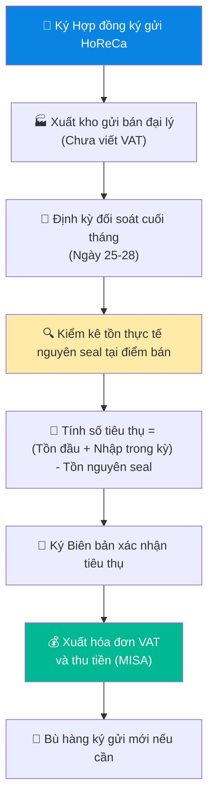

# 6.8 Quy trình Quản lý Hàng Ký gửi HoReCa

🌐 [English Version](6.8_quan_ly_hang_ky_gui_en.md)

## 1. Mục đích & Phạm vi
- **Mục đích:** Quản lý và kiểm soát chặt chẽ hàng hóa ký gửi tại các điểm bán kênh HoReCa (nhà hàng, khách sạn, bar, lounge), ngăn ngừa thất thoát hàng hóa, đảm bảo đối chiếu tiêu thụ chính xác, thu hồi công nợ và xuất hóa đơn đúng quy định của pháp luật.
- **Phạm vi áp dụng:** Bộ phận Kinh doanh (Sales Rep, Sales Director), Bộ phận Kho và Bộ phận Kế toán của Lyscellar.
- **Tần suất:** Thực hiện liên tục khi phát sinh xuất ký gửi và đối chiếu bán hàng hàng tháng.

## 2. Trách nhiệm (RACI)

| Nghiệp vụ | Responsible | Approve | Consulted | Informed |
|-----------|------------|---------|-----------|----------|
| Đề xuất hợp đồng ký gửi | Sales Rep | Sales Director | — | Kế toán |
| Phê duyệt hợp đồng ký gửi | — | BGĐ | Pháp lý | — |
| Xuất kho hàng ký gửi | Thủ kho | Quản lý Kho | — | Sales, Kế toán |
| Kiểm kê định kỳ tại điểm bán | Sales Rep | — | Thủ kho | Kế toán |
| Kiểm kê & đối soát số lượng nguyên seal | Sales Rep | — | Điểm bán | Kế toán |
| Đối soát & Xuất hóa đơn VAT | Kế toán bán hàng | — | Sales Rep | BGĐ |

## 3. Quy trình Chi tiết

### Bước 1: Thiết lập Hợp đồng Ký gửi
- **Thao tác:**
  1. Sales Rep đàm phán hợp đồng ký gửi (Consignment Agreement) sử dụng biểu mẫu quy chuẩn [Form_6.8-B_Hop_dong_Ky_gui.docx](../../../sources/Legal/Form_6.8-B_Hop_dong_Ky_gui.docx) với đối tác HoReCa:
     - Danh mục SKU được ký gửi.
     - Định mức tồn kho tối đa tại điểm bán (ví dụ: không quá 24 chai/SKU).
     - Thời hạn ký gửi (thông thường từ 3 - 6 tháng).
     - Chu kỳ đối soát tiêu thụ (hàng tháng, từ ngày 25 đến ngày 30).
     - Các **Lưu ý giao hàng (Delivery Instructions)** đặc biệt của khách hàng để làm căn cứ thực hiện khi giao nhận rượu ký gửi bổ sung.
  2. Trình BGĐ phê duyệt và ký kết hợp đồng chính thức.

### Bước 2: Xuất kho Ký gửi
- **Thao tác:**
  1. Khi điểm bán yêu cầu cấp hàng ký gửi lần đầu hoặc bù kho: Sales Rep lập **Đơn yêu cầu xuất hàng ký gửi** trên phần mềm/Excel.
  2. Kế toán kho lập **Phiếu xuất kho gửi bán đại lý / ký gửi** (mẫu quy định của Bộ Tài chính, không xuất hóa đơn VAT ở bước này).
  3. Thủ kho xuất hàng, bàn giao cho shipper vận chuyển kèm Phiếu xuất kho gửi bán đại lý.
  4. Đại diện điểm bán ký nhận biên bản giao nhận hàng hóa. Gửi trả 1 bản gốc có đóng dấu về cho Kế toán lưu trữ.

### Bước 3: Đối soát Tiêu thụ & Kiểm kê hàng tháng (Ngày 25 - 28 hàng tháng)

#### 3.1 Trách nhiệm chi tiết của các Bộ phận:

##### A. Bộ phận Kinh doanh (Sales Rep & Sales Director)
*   **Sales Rep (Nhân viên Kinh doanh trực tiếp):**
    *   **Trước kỳ kiểm kê (Trước ngày 25):**
        - Chủ động liên hệ và lên lịch hẹn kiểm kê cụ thể với đại diện từng điểm bán (Quản lý nhà hàng hoặc Trưởng quầy bar/Bartender) từ ngày 25 đến ngày 28.
        - Chuẩn bị sẵn Bảng đối chiếu số liệu (đã điền thông tin tồn đầu kỳ và lượng hàng nhập thêm trong kỳ do kế toán cung cấp) và in sẵn **Biên bản Xác nhận Tiêu thụ** (Mẫu 6.8-A).
    *   **Trong kỳ kiểm kê (Ngày 25 - 28):**
        - Có mặt trực tiếp tại điểm bán để thực hiện đồng kiểm kê số lượng nguyên seal cùng nhân sự của khách hàng.
        - Tiến hành đếm thực tế tồn kho nguyên vẹn (Stock End - chai nguyên seal) tại quầy bar, kho mát, kệ trưng bày của khách hàng. Kiểm tra tình trạng vật lý (màng co, tem rượu nhập khẩu, nhãn phụ, mức rượu hao hụt - ullage).
        - Thảo luận và ghi nhận ý kiến của điểm bán về tình hình tiêu thụ sản phẩm, chất lượng sản phẩm (nếu có chai bị lỗi cork, đục, hỏng...) hoặc đề xuất bổ sung/thu hồi SKU.
    *   **Sau kỳ kiểm kê (Trước ngày 29):**
        - Hoàn thiện chữ ký xác nhận của hai bên trên **Biên bản Xác nhận Tiêu thụ** (Mẫu 6.8-A) và gửi bản quét/ảnh chụp chất lượng cao về cho Kế toán bán hàng trên WhatsApp, đồng thời bàn giao bản gốc trước ngày 29 hàng tháng.
        - Trường hợp xảy ra chênh lệch thiếu (số chai thực tế nguyên seal tại quầy/kho ít hơn số liệu tồn đầu + nhập trong kỳ trừ đi số lượng đã chốt bán), phối hợp với khách hàng làm rõ nguyên nhân để làm căn cứ đền bù thất thoát.
*   **Sales Director (Giám đốc Kinh doanh):**
    *   **Giám sát & Đôn đốc:** Theo dõi tiến độ kiểm kê của các Sales Rep đảm bảo hoàn thành đúng thời hạn (trước ngày 28). Xử lý ngay các trường hợp Sales Rep chậm trễ hoặc gặp khó khăn khi phối hợp với khách hàng.
    *   **Xử lý Tranh chấp/Chênh lệch:** Trực tiếp tham gia đàm phán và giải quyết các khiếu nại, tranh chấp số liệu chênh lệch lớn giữa kết quả kiểm kê của Sales Rep và số liệu từ phía nhà hàng/đại lý.
    *   **Phê duyệt điều chỉnh:** Xem xét báo cáo và phê duyệt đề xuất xử lý hao hụt, mất mát hoặc hàng hỏng từ Sales Rep trước khi chuyển Kế toán bán hàng thực hiện điều chỉnh hoặc lập hóa đơn đền bù.

##### B. Bộ phận Kế toán (Kế toán bán hàng)
*   **Trước kỳ kiểm kê (Trước ngày 25):**
    - Kết xuất dữ liệu từ phần mềm kế toán MISA liên quan đến tình hình hàng ký gửi của từng khách hàng: **Số dư tồn đầu kỳ (ngày 25 tháng trước) + Số lượng xuất kho ký gửi bổ sung trong kỳ**.
    - Tổng hợp và gửi file dữ liệu đối chiếu chính xác cho từng Sales Rep trước ngày 25 để làm cơ sở đi kiểm kê thực tế.
*   **Trong kỳ kiểm kê (Ngày 25 - 28):**
    - Tiếp nhận file ảnh chụp Biên bản Xác nhận Tiêu thụ (Mẫu 6.8-A) đã ký tá đầy đủ từ Sales Rep gửi về để nhập liệu tạm thời lên hệ thống.
*   **Sau kỳ kiểm kê (Từ ngày 28 - 30):**
    - Kiểm tra tính hợp lệ của bản gốc **Biên bản Xác nhận Tiêu thụ** (Mẫu 6.8-A) do Sales Rep bàn giao (phải có đầy đủ chữ ký, con dấu của khách hàng và chữ ký Sales Rep).
    - Thực hiện đối soát chéo (reconcile) giữa số liệu trên biên bản đối soát tiêu thụ với dữ liệu MISA.
    - **Xử lý chênh lệch số liệu:**
        - Nếu số liệu khớp hoàn toàn: Thực hiện hạch toán giảm kho hàng ký gửi (TK 157) và ghi nhận doanh thu bán hàng tương ứng.
        - Nếu chênh lệch thiếu (số chai thực tế nguyên seal tại quầy/kho ít hơn sổ sách MISA sau khi trừ lượng bán): Yêu cầu Sales Rep giải trình. Tiến hành lập hóa đơn yêu cầu điểm bán đền bù đối với số lượng thất thoát theo đơn giá quy định nếu do lỗi điểm bán; hoặc khấu trừ trách nhiệm cá nhân nếu lỗi do Sales Rep.
        - Nếu chênh lệch thừa (thực tế tồn kho nhiều hơn sổ sách): Kiểm tra lại xem có đơn hàng xuất ký gửi nào trong tháng bị sót chưa nhập vào MISA hay không, tiến hành nhập bổ sung.
    - Lập và xuất hóa đơn điện tử VAT đầu ra trên phần mềm MISA đúng theo số lượng tiêu thụ thực tế đã thống nhất muộn nhất vào ngày 30 hàng tháng. Gửi hóa đơn điện tử cho khách hàng qua Email/Zalo.
    - Theo dõi, ghi nhận công nợ phải thu (AR) của từng điểm bán và đôn đốc Sales Rep thu hồi công nợ đúng kỳ hạn thanh toán (Thông thường là 05 ngày làm việc kể từ ngày xuất hóa đơn).

#### 3.2 Các bước thao tác chi tiết:
- **Thao tác:**
  1. Sales Rep đến trực tiếp điểm bán phối hợp cùng nhân viên pha chế (Bartender) hoặc Quản lý nhà hàng thực hiện kiểm kê thực tế.
  2. Hai bên tiến hành đếm và ghi nhận số lượng chai rượu còn nguyên vẹn, nguyên seal niêm phong (Tồn thực tế cuối kỳ - Stock End) tại kho mát, tủ trưng bày và khu vực quầy bar của điểm bán.
  3. Xác định số lượng tiêu thụ chốt thanh toán trong kỳ theo công thức:
     $$\text{Số tiêu thụ chốt bill} = (\text{Tồn đầu kỳ} + \text{Giao thêm trong kỳ}) - \text{Tồn thực tế nguyên seal}$$
  4. Quy trình đối soát chỉ dựa trên việc đếm số lượng chai nguyên seal thực tế và đối chiếu với sổ sách giao nhận. 

### Bước 4: Lập Biên bản Đối soát & Xuất hóa đơn VAT
- **Thao tác:**
  1. Sales Rep và Quản lý điểm bán ký **Biên bản xác nhận tiêu thụ hàng ký gửi tháng** (Mẫu 6.8-A).
  2. Biên bản gửi về cho Kế toán bán hàng trước ngày 30 hàng tháng.
  3. Kế toán bán hàng tiến hành:
     - Lập hóa đơn VAT đầu ra trên phần mềm MISA cho số lượng rượu thực tế đã tiêu thụ trong tháng.
     - Gửi hóa đơn điện tử cho khách hàng và ghi nhận doanh thu, công nợ phải thu (AR) -> [QT 8.2](../08_tai_chinh/8.2_cong_no_phai_thu.md).

### Bước 5: Thu hồi Hàng ký gửi
- **Áp dụng khi:**
  - Hợp đồng ký gửi hết hạn và không gia hạn.
  - Các SKU ký gửi tiêu thụ chậm (không phát sinh doanh số quá 60 ngày).
  - Điểm bán vi phạm điều khoản thanh toán hoặc có rủi ro nợ xấu.
- **Thao tác:**
  1. Sales Rep lập đề xuất thu hồi hàng ký gửi gửi Sales Director duyệt.
  2. Thông báo bằng văn bản gửi điểm bán trước 5 ngày làm việc.
  3. Nhân viên giao nhận / Sales Rep đến nhận lại hàng hóa nguyên vẹn.
  4. Thủ kho kiểm tra tình trạng hàng thu hồi (tem, nhãn phụ, mức rượu ullage) trước khi ký nhận nhập lại kho.
  5. Kế toán ghi giảm lượng hàng ký gửi tương ứng trên phần mềm MISA.

## 4. Sơ đồ Quy trình

## 5. Biểu mẫu
- **Biểu mẫu Hợp đồng Ký gửi:** [Form_6.8-B_Hop_dong_Ky_gui.docx](../../../sources/Legal/Form_6.8-B_Hop_dong_Ky_gui.docx) (Hợp đồng cho khách ký gửi).
- **Mẫu 6.8-A: Biên bản Xác nhận Tiêu thụ Hàng ký gửi tháng**
  - *Nội dung:* Tên khách hàng, Kỳ đối soát, Bảng đối chiếu (Mã SKU, Tên SP, Tồn đầu, Nhập trong kỳ, Tồn thực tế cuối kỳ, Lượng tiêu thụ tính toán, Chênh lệch), Chữ ký xác nhận của Sales Rep và Đại diện Khách hàng.

## 6. KPI & Kiểm soát
- **Tỷ lệ thất thoát hàng ký gửi:** `0%` (Mọi chênh lệch thiếu đều phải do điểm bán đền bù hoặc Sales Rep chịu trách nhiệm giải trình).
- **Thời gian gửi Biên bản đối soát:** Trước 12h00 ngày 29 hàng tháng.
- **Thời hạn thu hồi hàng tiêu thụ chậm:** Trong vòng 7 ngày làm việc kể từ khi có quyết định thu hồi.

## 7. Tài liệu Liên quan
- ← Liên quan: [6.3 Xử lý Đơn hàng Bán ra](6.3_xu_ly_don_hang.md) | [5.6 Xuất kho](../05_kho_van/5.6_xuat_kho.md)
- → Sau: [8.2 Quản lý Công nợ Phải thu (AR)](../08_tai_chinh/8.2_cong_no_phai_thu.md)
