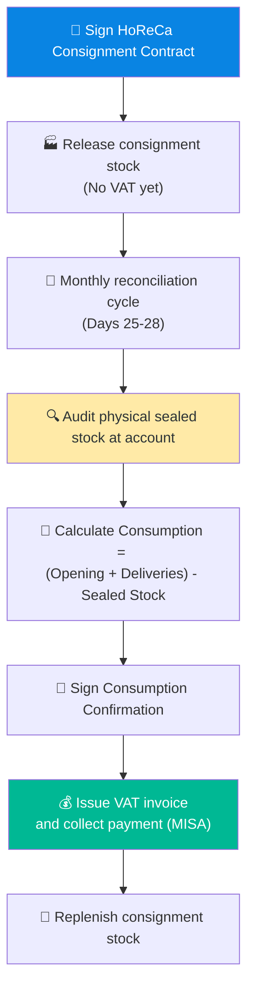

# 6.8 Consignment Stock Management Procedure for HoReCa

🌐 [Bản tiếng Việt](6.8_quan_ly_hang_ky_gui.md)

## 1. Purpose & Scope
- **Purpose:** Regulate and control consignment goods at HoReCa accounts (restaurants, hotels, bars, lounges) to prevent stock loss, verify monthly consumption, recover receivables, and issue tax invoices in compliance with tax regulations.
- **Scope of Application:** Sales Department (Sales Reps, Sales Directors), Warehouse, and Accounting departments of Lyscellar.
- **Frequency:** Continuous for each consignment release and monthly for sales reconciliation.

## 2. RACI Matrix

| Business Operation | Sales Rep | Sales Director | Warehouse Keeper | Sales Accountant | Board of Directors (BOD) |
|:---|:---:|:---:|:---:|:---:|:---:|
| **Propose consignment contract** | **R** | **A** | — | — | — |
| **Approve consignment contract** | — | — | — | **C** | **A** |
| **Release consignment stock** | — | — | **R** | **I** | — |
| **Periodic audit at account** | **R** | — | — | **C** | — |
| **Verify & Reconcile sealed stock** | **R** | — | — | **C** | — |
| **Reconciliation & VAT invoice issuance** | **C** | — | — | **R** | **I** |

## 3. Detailed Operational Steps

### Step 1: Establish Consignment Agreement
- **Execution:**
  1. Sales Rep negotiates a Consignment Agreement using the standard template [Form_6.8-B_Hop_dong_Ky_gui.docx](../../../sources/Legal/Form_6.8-B_Hop_dong_Ky_gui.docx) with the HoReCa partner, specifying:
     - Shortlisted wine SKUs for consignment.
     - Maximum stock limit at the outlet (e.g., maximum 24 bottles/SKU).
     - Consignment period (typically 3 - 6 months).
     - Monthly reconciliation cycle (between Days 25 and 30).
     - Any special **Delivery Instructions** specified by the customer for consignment releases.
  2. Submit to the BOD for final approval and official execution.

### Step 2: Consignment Goods Release
- **Execution:**
  1. When an outlet requests the initial stock or a stock replenishment, the Sales Rep drafts a **Consignment Release Request**.
  2. The Sales Accountant generates a **Consignment Stock Release Note (Phiếu xuất kho gửi bán đại lý)** (Ministry of Finance standard form; no VAT invoice is generated at this stage).
  3. The Warehouse Keeper releases the goods and hands them over to the shipper along with the release note.
  4. The outlet's authorized representative signs the delivery receipt. The signed original is returned to Accounting for records.

### Step 3: Monthly Consumption Audit & Physical Inventory (Days 25 - 28)

#### 3.1 Departmental Responsibilities:

##### A. Sales Department (Sales Rep & Sales Director)
*   **Sales Rep (Direct Sales Agent):**
    *   **Pre-audit phase (Before Day 25):**
        - Contact the account representative (Restaurant Manager or Bar Manager/Head Bartender) to schedule a physical audit between Days 25 and 28.
        - Prepare the reconciliation spreadsheet (filled with opening balances and quantities delivered during the month provided by Accounting) and print the **Monthly Consumption Reconciliation Report** (Form 6.8-A).
    *   **Audit phase (Days 25 - 28):**
        - Attend the outlet in person to perform a joint audit with the customer's staff.
        - Count physical sealed stock (Stock End - sealed bottles only) at the bar, cold storage, and displays. Inspect bottle physical conditions (shrink capsules, duty stamps, back labels, and ullage levels).
        - Log customer feedback on product sales, defects (e.g., corked or oxidized bottles), or requests to swap SKUs.
    *   **Post-audit phase (Before Day 29):**
        - Secure signatures of both parties on the **Monthly Consumption Reconciliation Report** (Form 6.8-A). Send a high-resolution scan/photo to the Sales Accountant on Zalo/WhatsApp and hand over the physical original before Day 29.
        - If a stock discrepancy arises (physical sealed bottles count is less than the calculated book inventory after sales deduction), coordinate with the client to clarify the cause for shortage compensation.
*   **Sales Director:**
    *   **Supervision:** Track audit progress for all Sales Reps to secure completion before Day 28. Address any delay or customer cooperation issues immediately.
    *   **Dispute Resolution:** Lead negotiations for major discrepancies or disputes between Sales Rep audits and customer records.
    *   **Adjustment Approvals:** Review and approve proposals to adjust stock shrinkages, losses, or damaged goods before passing them to Accounting for billing adjustments.

##### B. Accounting Department (Sales Accountant)
*   **Pre-audit phase (Before Day 25):**
    - Export data from MISA accounting software regarding customer consignment: **Opening Balance (as of Day 25 of the previous month) + Replenished Consigned Stock during the month**.
    - Distribute the data sheet to each Sales Rep before Day 25.
*   **Audit phase (Days 25 - 28):**
    - Receive and verify scans of the signed Form 6.8-A reports for temporary system entry.
*   **Post-audit phase (Days 28 - 30):**
    - Check the validity of physical **Form 6.8-A** originals returned by Sales Reps (must include customer signatures, stamps, and Sales Rep signatures).
    - Perform a double-reconciliation between reports and MISA records.
    - **Handle stock discrepancies:**
        - If data matches: Deduct consignment inventory (Account 157) and record corresponding sales revenue.
        - If stock is missing (physical sealed count is lower than book inventory): Request Sales Rep explanation. Issue a penalty invoice to the customer if customer-caused; or deduct from Sales Rep responsibility if rep-caused.
        - If stock is surplus: Recheck whether any consignment deliveries were missed in MISA and record them.
    - Generate and issue electronic VAT invoices on MISA based on the agreed consumption quantities before Day 30 of the month. Send the PDF invoice to the customer.
    - Reconcile Accounts Receivable (AR) and assist Sales Reps in collection within the credit period (typically 5 business days after invoice date).

#### 3.2 Operating Guidelines:
- **Execution:**
  1. The Sales Rep performs the physical audit alongside the customer's Bartender or Restaurant Manager.
  2. Both parties count and record the physical quantity of sealed, unopened wine bottles remaining in stock (Stock End) across storage, displays, and bars.
  3. Determine monthly sales consumption using the formula:
     $$\text{Consumption} = (\text{Opening Stock} + \text{Inbound Deliveries}) - \text{Physical Sealed Stock}$$
  4. Reconciliation is based solely on counting physical sealed inventory and matching it against delivery records. 

### Step 4: Reconcile & Issue VAT Invoice
- **Execution:**
  1. Sales Rep and outlet manager sign the **Monthly Consumption Reconciliation Report** (Form 6.8-A).
  2. Deliver the original signed copy to the Sales Accountant before Day 30.
  3. The Sales Accountant:
     - Generates the sales invoice on MISA matching the consumed quantity.
     - Sends the e-invoice to the customer and records accounts receivable (AR) $\rightarrow$ refer to [QT 8.2](../08_tai_chinh/8.2_cong_no_phai_thu.md).

### Step 5: Consignment Retrieval
- **Applies when:**
  - The Consignment Agreement expires and is not renewed.
  - Consigned SKUs are slow-moving (no sales generated for > 60 days).
  - The customer breaches payment terms or represents a bad debt risk.
- **Execution:**
  1. Sales Rep drafts a retrieval proposal for Sales Director approval.
  2. Send a 5-day written notice of retrieval to the customer.
  3. Delivery Shipper or Sales Rep retrieves the sealed stock.
  4. The Warehouse Keeper inspects bottle conditions (duty stamps, labels, ullage) before signing the return receipt.
  5. The Sales Accountant records the inventory return in MISA.

## 4. Process Flowchart

## 5. Forms & Templates
- **Consignment Agreement Template:** [Form_6.8-B_Hop_dong_Ky_gui.docx](../../../sources/Legal/Form_6.8-B_Hop_dong_Ky_gui.docx) (Contract for consignment).
- **Form 6.8-A: Monthly Consumption Reconciliation Report**
  - *Contents:* Customer details, billing cycle, reconciliation table (SKU, Wine name, Opening Balance, Inbound, Closing Stock, Calculated Consumption, Variance), signatures of both parties.

## 6. KPI & Control Metrics
- **Consignment Stock Loss Rate:** **0%** (All missing stock must be compensated by the customer or resolved by the Sales Rep).
- **Report Submission Deadline:** Before 12:00 PM on Day 29 of each month.
- **Slow-Moving Retrieval SLA:** Within **7 business days** after retrieval decision.

## 7. Related Documents & Links
- ← Related: [6.3 Order Processing](6.3_xu_ly_don_hang_en.md) | [5.6 Outbound Release](../05_kho_van/5.6_xuat_kho.md)
- → Next: [8.2 Accounts Receivable](../08_tai_chinh/8.2_cong_no_phai_thu.md)
