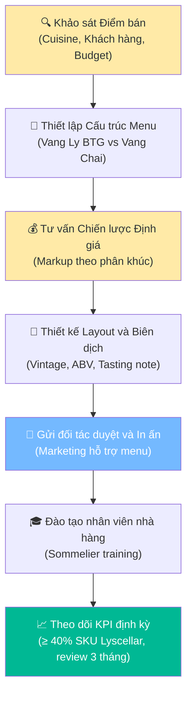

# 6.9 Quy trình Tư vấn & Thiết kế Wine List cho Điểm bán HoReCa

🌐 [English Version](6.9_tu_van_thiet_ke_wine_list_en.md)

## 1. Mục đích & Phạm vi
- **Mục đích:** Hướng dẫn nhân viên kinh doanh (Sales Rep) phương pháp phân tích, tư vấn cấu trúc danh mục và thiết kế Menu rượu vang (Wine List) tối ưu cho các nhà hàng, khách sạn, bar, lounge đối tác; giúp tăng tốc độ bán hàng, nâng cao trải nghiệm thực khách và củng cố vị thế đối tác chiến lược của Lyscellar.
- **Phạm vi:** Áp dụng cho mọi đề xuất thiết kế hoặc làm mới Wine List cho các điểm bán HoReCa trực tiếp ký hợp đồng với Lyscellar.

## 2. Trách nhiệm (RACI)

| Nghiệp vụ | Responsible | Approve | Consulted | Informed |
|-----------|------------|---------|-----------|----------|
| Khảo sát & Phân tích điểm bán | Sales Rep | — | Quản lý nhà hàng | — |
| Thiết lập danh mục đề xuất | Sales Rep | Sales Director | Sommelier/QC | Kế toán |
| Thuyết trình & Duyệt Wine List | Sales Rep | Khách hàng (HoReCa) | — | — |
| Thiết kế Layout & In ấn Menu | Marketing | — | Sales Rep | Khách hàng |

---

## 3. Sơ đồ Quy trình Tư vấn Wine List (Wine List Consultation Flow)

---

## 4. Quy trình Chi tiết

### Bước 1: Khảo sát & Phân tích Điểm bán
Trước khi đề xuất bất kỳ danh mục rượu nào, Sales Rep thực hiện khảo sát kỹ thuật số kết hợp mystery dining theo cẩm nang: [Quy trình Nghiên cứu Rượu & Menu Khách hàng](../../market_research/huong_dan_nghien_cuu_menu_khach_hang.md). Các thông tin cốt lõi cần thu thập gồm:
1.  **Phong cách ẩm thực (Cuisine):** Á, Âu, Việt Nam truyền thống, ẩm thực Fusion, hay Steakhouse... để định hướng ghép đôi món ăn phù hợp.
2.  **Hạng khách hàng & Hóa đơn trung bình (Average Spend):**
    *   *Phân khúc cao cấp (Fine dining):* Ưu tiên dòng rượu Premium/Super Premium, tập trung nhiều vang đỏ lâu năm, vang nổ Champagne.
    *   *Phân khúc trung cấp (Casual dining/Bistro):* Cân bằng giữa vang phổ thông (Entry/Mid-range) và một số chai Premium tiêu biểu.
    *   *Phân khúc Bar/Lounge:* Ưu tiên vang sủi (Prosecco), vang trắng chua thanh mát và vang đỏ trẻ dễ uống.
3.  **Tần suất cập nhật Menu:** Khách hàng muốn in Menu cố định hay thay đổi theo mùa?

### Bước 2: Thiết lập Cấu trúc Danh mục (Wine List Structure)
Một Wine List tiêu chuẩn phải được cân đối giữa hai danh mục bán hàng:

#### A. Danh mục rượu bán theo ly (Wine-by-the-Glass - BTG)
*   **Mục đích:** Kích thích khách dùng thử, quay vòng hàng tồn kho nhanh và tối ưu hóa biên lợi nhuận.
*   **Tiêu chí chọn rượu:**
    *   Hương vị dễ tiếp cận, đại chúng (crowd-pleaser).
    *   Vang trắng và sủi tăm phải giữ được ga và độ tươi mát tốt sau khi khui (hoặc dùng hệ thống bảo quản Vacu Vin/Coravin).
    *   Giá vốn (COGS) thấp để nhà hàng dễ thiết lập mức giá bán theo ly hợp lý.
*   **SKU đề xuất từ Lyscellar:**
    *   *Sparkling:* `L10009` (Sartori Prosecco Brut) hoặc `L10023` (La Jara Prosecco Millesimato Dry).
    *   *White:* `L10007` (Arco dei Giovi Pinot Grigio) hoặc `L20033` (La Petite Perriere Sauvignon Blanc).
    *   *Red:* `L10006` (Arco dei Giovi Valpolicella Superior) hoặc `L20034` (La Petite Perriere Pinot Noir).

#### B. Danh mục rượu bán theo chai (Wine-by-the-Bottle)
*   **Mục đích:** Tạo điểm nhấn thương hiệu đẳng cấp cho nhà hàng và tăng doanh thu đơn hàng lớn.
*   **Tiêu chí chọn rượu:** Đầy đủ các phân khúc từ vang sủi tăm (Prosecco, Cava), vang trắng nhạt/đậm, vang hồng (Provence), vang đỏ nhẹ/trung bình/đậm đà (Pinot Noir, Chianti Classico, Amarone, Bordeaux Blend) và vang ngọt tráng miệng.
*   **Tỷ lệ phân bổ khuyến nghị:** Vang trắng (30%) - Vang đỏ (60%) - Vang sủi tăm & Khác (10%) (Có thể điều chỉnh theo phong cách món ăn của quán).

### Bước 3: Tư vấn Chiến lược Định giá (Markup Strategy)
Sales Rep hỗ trợ nhà hàng thiết lập giá bán lẻ trên menu dựa trên giá vốn mua từ Lyscellar để đảm bảo nhà hàng có lợi nhuận tốt mà không làm giá quá đắt gây cản trở sức mua:
*   **Vang bán theo ly (BTG):** Mức định giá thông thường: **Giá bán 2 ly = Giá vốn 1 chai** mua từ Lyscellar (Bù đắp cho rủi ro rượu bị hỏng sau khi khui và đảm bảo tính cạnh tranh).
*   **Vang bán theo chai phổ thông (Entry/Mid-range):** Áp dụng hệ số Markup **×2.5 đến ×3.0** lần giá mua sỉ.
*   **Vang bán theo chai cao cấp (Premium/Super Premium):** Áp dụng hệ số Markup **×1.8 đến ×2.2** lần giá mua sỉ.

### Bước 4: Thiết kế Layout & Biên dịch nội dung Menu
*   **Thông tin bắt buộc trên Wine List:**
    1.  Tên đầy đủ của chai rượu (đúng chính tả tiếng nước ngoài).
    2.  Giống nho chính.
    3.  Vùng sản xuất & Quốc gia.
    4.  Niên vụ (Vintage) - Cực kỳ quan trọng để quản lý FEFO. Thông tin mô tả hương vị (tasting notes) luôn phải đi kèm với niên vụ cụ thể, không dùng chung chung.
    5.  Nồng độ cồn (ABV).
    6.  Mô tả ngắn gọn hương vị bằng tiếng Việt (2 dòng) để kích thích khách chọn món.
*   **Thứ tự sắp xếp:** Phân nhóm theo màu sắc (Vang nổ -> Vang trắng -> Vang hồng -> Vang đỏ -> Vang ngọt). Trong mỗi nhóm, sắp xếp từ nhẹ đến đậm đà (Light-bodied -> Full-bodied) hoặc sắp xếp theo quốc gia.

---

## 5. KPI & Đo lường
- **Tỷ lệ SKU Lyscellar trên Menu:** Đạt tối thiểu `40%` tổng số SKU rượu vang trong Wine List của điểm bán đối tác.
- **Tần suất kiểm tra Menu:** 3 tháng/lần, Sales Rep kiểm tra thực tế menu của nhà hàng để cập nhật niên vụ hoặc thay thế các SKU đã dừng nhập khẩu.

---

## 6. Tài liệu Liên quan
- ← Liên quan: [6.4 Chính sách Giá & Chiết khấu](6.4_chinh_sach_gia.md) | [6.8 Quản lý Hàng Ký gửi HoReCa](6.8_quan_ly_hang_ky_gui.md)
- 🔍 Thông tin Thị trường: [Nghiên cứu Thị trường & Đối thủ (Market Intelligence)](../../market_research/index.md) | [Cẩm nang Khảo sát Wine List Khách hàng](../../market_research/huong_dan_nghien_cuu_menu_khach_hang.md)
- ↔ Kiến thức: [Nguyên tắc ghép đôi Món ăn & Rượu](../../concepts/concept_nguyen_tac_ghep_doi_mon_an.md) | [Kịch bản Xử lý Từ chối & Đào tạo Sales](../../concepts/concept_kich_ban_sales_faq.md)
