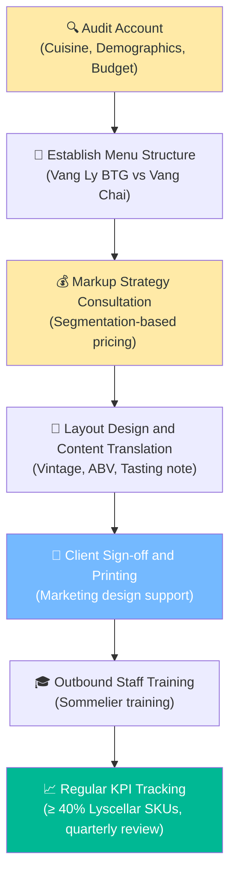

# 6.9 Wine List Consultation & Design Procedure for HoReCa

🌐 [Bản tiếng Việt](6.9_tu_van_thiet_ke_wine_list.md)

## 1. Purpose & Scope
- **Purpose:** Guide Sales Reps through auditing, consulting on menu structure, and designing optimized Wine Lists for partner restaurants, hotels, bars, and lounges. The goal is to accelerate inventory rotation, elevate diner experience, and secure Lyscellar's positioning as a strategic partner.
- **Scope of Application:** All new wine list design or redesign proposals for HoReCa accounts directly signed with Lyscellar.

---

## 2. RACI Matrix

| Step | Sales Rep | Sales Director | Sommelier / QC | Marketing | HoReCa Partner |
|:---|:---:|:---:|:---:|:---:|:---:|
| **1. Audit & Analyze Account** | **R** | — | — | — | **C** |
| **2. Draft Proposed Wine Selection** | **R** | **A** | **C** | — | — |
| **3. Presentation & Customer Sign-off** | **R** | — | — | — | **A** |
| **4. Layout Design & Printing** | **C** | — | — | **R** | **C** |

---

## 3. Wine List Consultation Flow

---

## 4. Detailed Operational Steps

### Step 1: Account Audit & Profiling
Before proposing any wine list selection, the Sales Rep must audit and collect:
1.  **Cuisine Style:** Italian, French, traditional Vietnamese, fusion, or Steakhouse... to determine food pairing opportunities.
2.  **Customer Demographics & Average Spend:**
    *   *Fine Dining:* Focus on Premium/Super Premium SKUs, aged reds, and Champagnes.
    *   *Casual Dining / Bistros:* Balance between Entry-level/Mid-range wines and selected Premium listings.
    *   *Wine Bars / Lounges:* Focus on sparkling wines (Prosecco), high-acid whites, and approachable young reds.
3.  **Menu Update Frequency:** Does the partner prefer a fixed menu or seasonal rotations?

### Step 2: Establish Menu Structure
A standard Wine List must be balanced between two main components:

#### A. Wine-by-the-Glass (BTG) Program
*   **Purpose:** Encourage customer trial, accelerate inventory turnover, and maximize gross margins.
*   **SKU Selection Criteria:**
    *   Crowd-pleaser taste profiles.
    *   Wines (especially sparkling and whites) must maintain carbonation/freshness after opening (using Vacu Vin or Coravin preservation systems).
    *   Lower COGS to allow the restaurant to set an attractive price per glass.
*   **Lyscellar Proposed SKUs:**
    *   *Sparkling:* `L10009` (Sartori Prosecco Brut) or `L10023` (La Jara Prosecco Millesimato Dry).
    *   *White:* `L10007` (Arco dei Giovi Pinot Grigio) or `L20033` (La Petite Perriere Sauvignon Blanc).
    *   *Red:* `L10006` (Arco dei Giovi Valpolicella Superior) or `L20034` (La Petite Perriere Pinot Noir).

#### B. Wine-by-the-Bottle Program
*   **Purpose:** Build the partner's brand image and drive higher average transaction values.
*   **SKU Selection Criteria:** Complete coverage of styles: sparkling (Prosecco, Cava), light/full-bodied whites, Rosé (Provence), light/medium/full-bodied reds (Pinot Noir, Chianti Classico, Amarone, Bordeaux Blend), and dessert sweet wines.
*   **Recommended Ratio:** Whites (30%) - Reds (60%) - Sparkling & Other (10%) (adjust based on cuisine).

### Step 3: Pricing Strategy Consultation (Markup Strategy)
The Sales Rep guides the partner in setting menu retail prices based on Lyscellar's wholesale pricing to secure healthy margins without pricing the wines out of the local market:
*   **Wine-by-the-Glass (BTG):** Standard rule: **Price of 2 glasses = Cost of 1 bottle** paid to Lyscellar (offsets potential wine spoilage while maintaining competitiveness).
*   **Entry-level & Mid-range Bottles:** Apply a markup multiplier of **x2.5 to x3.0** on wholesale cost.
*   **Premium & Super Premium Bottles:** Apply a markup multiplier of **x1.8 to x2.2** on wholesale cost.

### Step 4: Layout Design & Content Translation
*   **Mandatory Wine List Content:**
    1.  Full official wine name (correct spelling and fonts).
    2.  Grape variety/blend.
    3.  Appellation & Country of origin.
    4.  Vintage (essential for FEFO inventory management; tasting notes must always be paired with their specific vintage).
    5.  Alcohol by Volume (ABV).
    6.  Brief tasting notes in English/Vietnamese (2 lines) to entice guests.
*   **Sorting & Sequence:** Group by color (Sparkling $\rightarrow$ Whites $\rightarrow$ Rosé $\rightarrow$ Reds $\rightarrow$ Sweet). Within each group, list from lightest to full-bodied (Light-bodied $\rightarrow$ Full-bodied) or sort by country of origin.

---

## 5. KPI & Control Metrics
- **Lyscellar SKU Share:** Minimum **≥ 40%** of total wine SKUs listed on the partner's Wine List.
- **Menu Audit Frequency:** Every **3 months**. The Sales Rep audits the physical menu on-site to update vintages (vintages change) or replace retired SKUs.

---

## 6. Related Documents & Links
- ← Related: [6.4 Pricing Policy](6.4_chinh_sach_gia.md) | [6.8 Consignment Stock Management](6.8_quan_ly_hang_ky_gui.md)
- ↔ Knowledge: [Food & Wine Pairing Concepts](../../concepts/concept_nguyen_tac_ghep_doi_mon_an.md) | [Objection Handling & Sales Training FAQ](../../concepts/concept_kich_ban_sales_faq.md)
