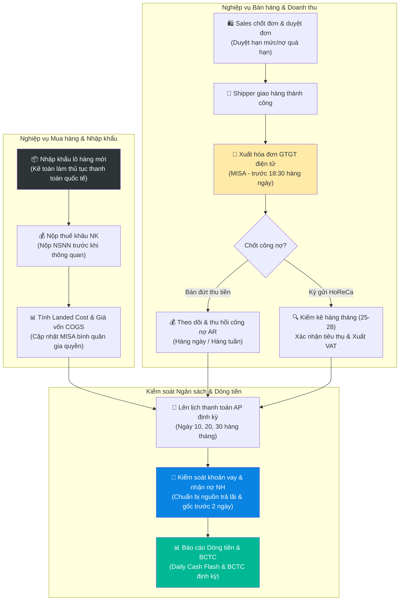
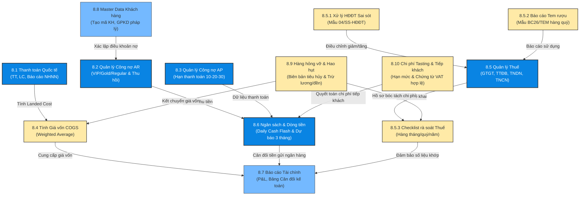

# 8.0 Tổng quan Quy trình Kế toán - Tài chính Lyscellar

Tài liệu này cung cấp tổng quan về các hoạt động nghiệp vụ Kế toán – Tài chính tại Lyscellar — từ khâu xử lý hóa đơn, quản lý công nợ, tính giá vốn, kê khai thuế nhà nước cho đến hoạt động kiểm soát dòng tiền, khoản vay ngân hàng và đối soát tồn kho. Đây là hướng dẫn quy trình tiêu chuẩn (SOP) giúp nhân sự bộ phận Kế toán vận hành chuẩn xác, tuân thủ pháp luật và kiểm soát rủi ro tài chính của doanh nghiệp.

---

## 1. Sơ đồ Dòng chảy Quy trình Tổng thể (Finance & Accounting Lifecycle)

Dưới đây là sơ đồ dòng chảy nghiệp vụ kế toán theo vòng đời hoạt động kinh doanh tại Lyscellar:

---

## 2. Kiến trúc Liên kết Hệ thống Quy trình Kế toán (Finance Processes Map)

Bộ phận Kế toán vận hành dựa trên hệ thống các quy trình chuyên biệt liên kết chặt chẽ với nhau:

---

## 3. Bảng Phân định Trách nhiệm Phối hợp (RACI Matrix)

*   **R (Responsible):** Nhân sự trực tiếp thực hiện.
*   **A (Accountable):** Nhân sự phê duyệt cuối cùng và chịu trách nhiệm cao nhất.
*   **C (Consulted):** Nhân sự được tham vấn ý kiến.
*   **I (Informed):** Nhân sự được nhận thông tin sau khi hoàn thành.

| Giai đoạn / Nghiệp vụ | Kế toán bán hàng | Kế toán thanh toán | Kế toán tổng hợp | Kế toán trưởng | Ban Giám Đốc (BGĐ) | Thủ kho | Nhân viên Sales |
| :--- | :---: | :---: | :---: | :---: | :---: | :---: | :---: |
| **1. Xác thực hồ sơ mở mã KH mới** | **R** | — | — | **C** | **A** | — | **I** |
| **2. Kiểm tra hạn mức & duyệt SO** | **R** | — | — | — | **A** (Duyệt ngoại lệ) | **I** | **I** |
| **3. Thanh toán quốc tế (lô hàng NK)** | — | **R** | — | **C** | **A** | — | — |
| **4. Tính Landed Cost & Giá vốn COGS** | — | — | **R** | **A** | — | — | — |
| **5. Xuất hóa đơn GTGT điện tử bán ra** | **R** | — | — | — | — | **I** | **I** |
| **6. Đối soát tiêu thụ hàng ký gửi** | **R** | — | — | — | **I** | — | **R** |
| **7. Quản lý chi phí tasting/tiếp khách** | **R** | **R** | — | **C** | **A** | **I** | **R** |
| **8. Quyết toán hàng hỏng vỡ, hao hụt** | — | — | **R** | **C** | **A** | **R** | **I** |
| **9. Theo dõi khế ước & trả gốc lãi vay** | — | **R** | — | **C** | **A** | — | — |
| **10. Kê khai và đóng Thuế định kỳ** | — | — | **R** | **R** | **A** | — | — |
| **11. Đối soát tồn kho hàng tháng** | — | — | **R** | **A** | — | **R** | — |
| **12. Lập BCTC quản trị & BCTC Thuế** | — | — | **R** | **R** | **A** | — | — |

---

## 4. Các Chốt chặn Kiểm soát Quan trọng (Critical Control Gates)

Kế toán và các bộ phận liên quan phải tuân thủ nghiêm ngặt 5 chốt chặn kiểm soát quan trọng sau:

> [!IMPORTANT]
> **Chốt 1: Xuất hóa đơn GTGT điện tử 100% trong ngày**
> Căn cứ vào Nghị định 123/2020/NĐ-CP, Kế toán bán hàng bắt buộc xuất Hóa đơn điện tử trên MISA trước **18:30 hàng ngày** cho toàn bộ các đơn hàng đã giao thành công và có chữ ký xác nhận của khách hàng. Nghiêm cấm xuất lùi ngày hoặc trì hoãn sang ngày hôm sau.

> [!WARNING]
> **Chốt 2: Kiểm soát nợ quá hạn và hạn mức công nợ**
> - Kế toán bán hàng chỉ duyệt đơn hàng sang trạng thái "Approved" khi KH không có nợ quá hạn quá 30 ngày và đơn hàng nằm trong hạn mức nợ được duyệt.
> - Khách hàng có nợ quá hạn trên 30 ngày sẽ bị **HỦY tư cách gia hạn công nợ** trong tối thiểu 1 tháng kể từ ngày tất toán nợ cũ.
> - Mọi trường hợp khẩn cấp vượt hạn mức bắt buộc phải có tin nhắn duyệt ngoại lệ từ BGĐ trên nhóm chat WhatsApp trước khi kế toán phê duyệt trên MISA.

> [!CAUTION]
> **Chốt 3: Quản lý ngày trả lãi & đáo hạn gốc khoản vay ngân hàng**
> Kế toán thanh toán có trách nhiệm kiểm soát số dư tài khoản thanh toán tại các ngân hàng cho vay trước ngày trả lãi định kỳ tối thiểu **2 ngày làm việc** nhằm đảm bảo đủ tiền mặt để hệ thống ngân hàng cắt nợ tự động, tuyệt đối không để phát sinh nợ quá hạn ảnh hưởng tới điểm tín dụng CIC của công ty.

> [!IMPORTANT]
> **Chốt 4: Hồ sơ thuế bắt buộc đối với hàng tiêu hủy hỏng vỡ**
> Để bóc tách chi phí hao hụt hợp lệ khi tính thuế TNDN, kế toán phải hoàn thiện đủ bộ hồ sơ gồm: Biên bản sự cố của kho, Quyết định xử lý của BGĐ, Biên bản tiêu hủy hàng hóa (Form 8.9-A) và hình ảnh/video ghi lại quá trình khui đổ rượu/đập vỡ cổ chai.

> [!IMPORTANT]
> **Chốt 5: Quy chuẩn hóa đơn dịch vụ ăn uống (Chi phí tiếp khách)**
> Kế toán chỉ duyệt chi trả tiền tiếp khách khi nhận được **Hóa đơn điện tử VAT** kèm theo **Bảng kê chi tiết món ăn (Bill thanh toán in từ máy tính nhà hàng)**. Hóa đơn chỉ ghi chung chung "Dịch vụ ăn uống" không kèm bill chi tiết món sẽ bị loại chi phí khi quyết toán thuế.

---

## 5. Danh mục Quy trình Chi tiết & Biểu mẫu liên kết nhanh

Dưới đây là các quy trình chuẩn và biểu mẫu thực hành phục vụ công tác Kế toán – Tài chính:

### 5.1 Quy trình Chi tiết (Processes)
*   [8.1 Thanh toán Quốc tế](file:///d:/Lyscellar/Wiki/wiki/processes/08_tai_chinh/8.1_thanh_toan_quoc_te.md): Quy định hồ sơ thanh toán TT trả trước, trả sau và ảnh chụp màn hình báo cáo khoản vay NHNN sau 45 ngày chưa trả.
*   [8.2 Quản lý Công nợ Phải thu (AR)](file:///d:/Lyscellar/Wiki/wiki/processes/08_tai_chinh/8.2_cong_no_phai_thu.md): Quy trình theo dõi, đôn đốc thu hồi nợ, báo cáo công nợ hàng ngày.
*   [8.3 Quản lý Công nợ Phải trả (AP)](file:///d:/Lyscellar/Wiki/wiki/processes/08_tai_chinh/8.3_cong_no_phai_tra.md): Lịch thanh toán định kỳ ngày 10 (trả lương và công nợ), ngày 20 và 30 (công nợ dịch vụ, NCC).
*   [8.4 Tính Giá vốn Hàng bán (COGS)](file:///d:/Lyscellar/Wiki/wiki/processes/08_tai_chinh/8.4_gia_von_cogs.md): Phương pháp phân bổ chi phí chung và tính giá vốn bình quân gia quyền.
*   [8.5 Quản lý Thuế](file:///d:/Lyscellar/Wiki/wiki/processes/08_tai_chinh/8.5_quan_ly_thue.md): Tổng hợp thuế suất áp dụng (lưu ý mức GTGT 8% cho rượu không cồn) và lịch kê khai thuế nhà nước.
*   [8.5.1 Quy trình Xử lý Hóa đơn Điện tử Sai sót](file:///d:/Lyscellar/Wiki/wiki/processes/08_tai_chinh/8.5.1_xu_ly_hoa_don_sai_sot.md): Các bước nộp Mẫu 04/SS-HĐĐT và lập hóa đơn điều chỉnh/thay thế trên MISA.
*   [8.5.2 Báo cáo tình hình sử dụng Tem rượu Nhập khẩu](file:///d:/Lyscellar/Wiki/wiki/processes/08_tai_chinh/8.5.2_bao_cao_tem_ruou.md): Quy chuẩn đối soát số lượng dán thực tế và nộp tờ khai BC26/TEM hàng quý.
*   [8.5.3 Checklist đối chiếu rà soát Thuế định kỳ](file:///d:/Lyscellar/Wiki/wiki/processes/08_tai_chinh/8.5.3_checklist_ra_soat_thue.md): Bảng checklist rà soát tự động & thủ công hàng tháng, hàng quý và quyết toán năm.
*   [8.6 Kiểm soát Ngân sách & Dòng tiền](file:///d:/Lyscellar/Wiki/wiki/processes/08_tai_chinh/8.6_kiem_soat_ngan_sach.md): Quy định lập Daily Cash Flash và báo cáo dự báo dòng tiền 3 tháng vào ngày 03 hàng tháng.
*   [8.7 Báo cáo Tài chính](file:///d:/Lyscellar/Wiki/wiki/processes/08_tai_chinh/8.7_bao_cao_tai_chinh.md): Lịch trình lập P&L hàng tháng (hoàn thành trước ngày 10) và bảng cân đối kế toán.
*   [8.8 Quy trình Quản lý Master Data Khách hàng](file:///d:/Lyscellar/Wiki/wiki/processes/08_tai_chinh/8.8_quan_ly_master_data_khach_hang.md): Quy tắc đặt mã khách hàng HORECA theo nhóm thương hiệu (Mã cha/con) và kiểm soát GPKD pháp lý.
*   [8.9 Xử lý Tài chính Hàng hỏng vỡ & Hao hụt](file:///d:/Lyscellar/Wiki/wiki/processes/08_tai_chinh/8.9_xu_ly_tai_chinh_hang_hong_vo.md): Quy định hạch toán các trường hợp công ty chịu chi phí, trừ lương nhân viên, bắt đền đơn vị vận chuyển hoặc nhận Credit Note từ NCC.
*   [8.10 Quản lý Chi phí Tasting & Tiếp khách](file:///d:/Lyscellar/Wiki/wiki/processes/08_tai_chinh/8.10_quan_ly_chi_phi_tasting_tiep_khach.md): Định mức tiếp khách của Sales Rep/Manager và quy trình dán nhãn phụ hàng mẫu thử "WINE SAMPLE - NOT FOR SALE".

### 5.2 Biểu mẫu Thực hành (Forms & Templates)
*   📥 [Form 3.3-A: Phiếu yêu cầu thanh toán (Excel)](file:///d:/Lyscellar/Wiki/sources/Forms/Form_3.3-A_Yeu_cau_Thanh_toan.xlsx)
*   📥 [Form 8.2-A: Bảng theo dõi công nợ phải thu (AR)](file:///d:/Lyscellar/Wiki/sources/Forms/Form_8.2-A_Cong_no_Phai_thu.xlsx)
*   📥 [Form 8.2-C: Báo cáo công nợ hàng ngày](file:///d:/Lyscellar/Wiki/sources/Forms/Form_8.2-C_Bao_cao_Cong_no_Hang_ngay.xlsx)
*   📥 [Form 8.3-A: Sổ theo dõi công nợ phải trả (AP)](file:///d:/Lyscellar/Wiki/sources/Forms/Form_8.3-A_Cong_no_Phai_tra.xlsx)
*   📥 [Form 8.4-A: Bảng tính giá vốn sản phẩm (COGS)](file:///d:/Lyscellar/Wiki/sources/Forms/Form_8.4-A_COGS.xlsx)
*   📥 [Form 8.6-A: Biểu mẫu kiểm soát ngân sách](file:///d:/Lyscellar/Wiki/sources/Forms/Form_8.6-A_Ngan_sach.xlsx)
*   📥 [Form 8.8-A: Phiếu yêu cầu tạo mã khách hàng mới](file:///d:/Lyscellar/Wiki/sources/Forms/Form_8.8-A_Yeu_cau_Tao_ma_KH.xlsx)
*   📥 [Form 8.10-A: Đề xuất xuất rượu mẫu thử (Wine Sample Request)](file:///d:/Lyscellar/Wiki/sources/Forms/Form_8.10-A_To_trinh_Wine_Tasting.xlsx)

---

## 6. Các Quy trình liên phòng ban có sự tham gia của Kế toán

Bên cạnh các nghiệp vụ chuyên biệt, bộ phận Kế toán có vai trò chốt chặn kiểm soát tài chính trong các quy trình phối hợp liên phòng ban sau:

*   **[QT 9.4: Đối soát Tài chính Sự kiện Wine Tasting & Dinner](file:///d:/Lyscellar/Wiki/wiki/processes/09_marketing/9.4_wine_tasting.md):** Kế toán đối soát lượng rượu khui thực tế tại sự kiện (phạt trừ lương Sales nếu khui thừa không lý do), đối soát hóa đơn ăn uống (bill món chi tiết từ nhà hàng), doanh thu bán vé/voucher (Luồng A) hoặc xuất hóa đơn sỉ cho đối tác (Luồng B).
*   **[QT 9.2: Quyết toán chi phí Marketing & POSM](file:///d:/Lyscellar/Wiki/wiki/processes/09_marketing/9.2_quy_trinh_duyet_ngan_sach_mkt_posm.md):** Kế toán kiểm soát hoàn tạm ứng (Mẫu BM_TA_MKT_01_02) và quyết toán chi phí marketing (Mẫu BM_TA_MKT_01_04), yêu cầu hóa đơn VAT và bảng kê chi tiết, có phê duyệt của Kế toán trưởng.
*   **[QT 12.4: Kiểm kho Showroom hàng tuần (Thứ Sáu)](file:///d:/Lyscellar/Wiki/wiki/processes/12_van_hanh/12.4_quy_trinh_tuan_showroom_kho.md):** Kế toán kho trích xuất danh sách tồn kho trên phần mềm MISA tại Kho Showroom (`KSR`), phối hợp đối chiếu thực tế với nhân viên showroom và lập biên bản xử lý chênh lệch (Form 12.4-A).
*   **[QT 10.1: Chi lương & Đóng Bảo hiểm bắt buộc](file:///d:/Lyscellar/Wiki/wiki/processes/10_nhan_su/10.1_tuyen_dung.md):** Kế toán thực hiện chi trả lương chuyển khoản cho toàn bộ CBCNV vào ngày **10 hàng tháng** và nộp tiền bảo hiểm xã hội bắt buộc vào ngày **25 hàng tháng** theo đúng quy định.
*   **[QT 3.3 & 4.5: Đặt cọc PO & Hạch toán Landed Cost](file:///d:/Lyscellar/Wiki/wiki/processes/03_mua_hang/3.3_xac_nhan_don_hang.md):** Kế toán thanh toán thực hiện chuyển tiền đặt cọc (deposit) cho nhà cung cấp ngoại dựa trên PO. Sau thông quan, kế toán rà soát bảng tính Landed Cost (do XNK gửi trong 24h) để hạch toán ghi tăng hàng hóa (TK 156) và phân bổ chi phí liên quan.

---

## 7. Hệ thống Chỉ số đánh giá Hiệu quả (KPIs Bộ phận Kế toán - Tài chính)

Hiệu quả công việc của bộ phận Kế toán - Tài chính tại Lyscellar được đo lường thông qua các chỉ số mục tiêu cốt lõi sau:

| Nghiệp vụ / Phân nhóm | Chỉ số KPI | Mục tiêu đạt được | Tần suất đo lường |
| :--- | :--- | :--- | :---: |
| **Thanh toán & Nợ phải trả (AP)** | Thanh toán đúng hạn cho nhà cung cấp/dịch vụ | **100%** | Hàng tháng |
| | Số dư nợ quá hạn với nhà cung cấp (AP overdue) | **= 0** | Hàng tuần |
| | Chênh lệch tỷ giá mua ngoại tệ thực tế vs dự toán | **≤ 3%** | Hàng quý |
| | Phí giao dịch ngân hàng trung bình mỗi lô nhập | **≤ $50** | Hàng quý |
| **Công nợ phải thu (AR)** | DSO (Số ngày phải thu bình quân) | **≤ 20 ngày** | Hàng tháng |
| | Tỷ lệ nợ quá hạn trên tổng dư nợ AR | **≤ 5%** | Hàng tháng |
| | Nợ xấu quá hạn trên 60 ngày phát sinh | **= 0** | Hàng năm |
| **Hiệu quả dòng tiền & Lợi nhuận** | Biên lợi nhuận gộp trung bình (Gross Margin) | **≥ 35%** | Hàng tháng |
| | Tỷ lệ SKU có biên lợi nhuận gộp < 25% | **≤ 10% tổng SKU** | Hàng quý |
| | Biên lợi nhuận ròng (Net Margin) | **≥ 10%** | Hàng tháng |
| | Hệ số quay vòng hàng tồn kho (Inventory Turnover) | **≥ 4.0x / năm** | Hàng quý |
| | Hệ số thanh toán hiện thời (Current Ratio) | **≥ 1.5** | Hàng quý |
| | Dòng tiền hoạt động thuần hàng tháng (Net Cash Flow)| **Dương (> 0)** | Hàng tháng |
| | Quỹ tiền mặt dự trữ khẩn cấp | **≥ 2 tháng chi phí cố định**| Hàng tháng |
| **Quản lý Thuế & Hóa đơn** | Kê khai và nộp tờ khai/tiền thuế đúng hạn | **100%** | Hàng tháng/quý |
| | Tỷ lệ hóa đơn điện tử sai sót trên tổng phát hành | **< 2%** | Hàng tháng |
| | Số tiền phạt hành chính phát sinh về thuế | **= 0** | Hàng năm |
| **SLA hỗ trợ nội bộ** | Thời gian phản hồi báo cáo/công nợ cho Sales | **≤ 4 giờ làm việc** | Hàng ngày |
| | Hạn hoàn thành Báo cáo Kết quả Kinh doanh (P&L) | **Trước ngày 10 tháng sau**| Hàng tháng |
| | Thời hạn nộp Báo cáo Tem rượu (BC26/TEM) | **Trước ngày 30 đầu quý sau**| Hàng quý |
