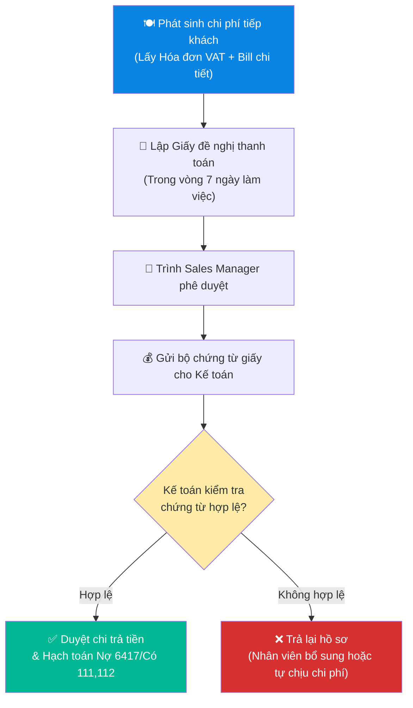

# 8.10 Quản lý Chi phí Tasting & Tiếp khách

## 1. Mục đích & Phạm vi
- **Mục đích:** Quy định rõ định mức ngân sách, thẩm quyền phê duyệt và quy trình thanh quyết toán đối với chi phí khui rượu mẫu thử (Wine Samples) và chi phí tiếp khách của bộ phận Sales/Marketing. Đảm bảo sử dụng nguồn lực tài chính hiệu quả, đúng mục tiêu thúc đẩy doanh số và tuân thủ các quy định về chứng từ khấu trừ Thuế tại Việt Nam.
- **Phạm vi:** Áp dụng cho toàn bộ nhân viên kinh doanh (Sales Rep), Trưởng phòng kinh doanh (Sales Manager), bộ phận Marketing và bộ phận Kế toán của Lyscellar.

## 2. Quản lý Rượu mẫu thử (Wine Samples / Tasting Bottles)

### 2.1 Định nghĩa & Quy tắc
- **Rượu mẫu thử:** Là rượu vang được xuất từ kho của công ty nhằm phục vụ khách hàng HORECA, Đại lý hoặc Khách hàng VIP nếm thử chất lượng trước khi ký hợp đồng hoặc quyết định đưa vào Menu rượu.
- **Quy định nhãn chai:** Chai rượu xuất làm hàng mẫu thử bắt buộc phải được dán nhãn phụ **"HÀNG MẪU THỬ - KHÔNG BÁN (WINE SAMPLE - NOT FOR SALE)"** trước khi mang ra khỏi kho để tránh nhầm lẫn hoặc trục lợi thương mại.

### 2.2 Quy trình & Thẩm quyền phê duyệt xuất mẫu thử
Để kiểm soát hiệu quả chi phí bán hàng và rủi ro trục lợi thương mại, Lyscellar áp dụng cơ chế phê duyệt tập trung đối với mọi trường hợp xuất rượu mẫu thử:
- **Thẩm quyền phê duyệt:** Mọi đề xuất xuất rượu mẫu thử (không phân biệt trị giá hay phân hạng sản phẩm) đều **bắt buộc phải được Ban Giám đốc (BGĐ) phê duyệt trực tiếp trước khi thực hiện**.
- **Quy trình thực hiện:** Sales Rep lập **Phiếu đề xuất xuất rượu thử (Wine Sample Request - Form 8.10-A)** trình BGĐ duyệt trước khi chuyển bộ phận Kho làm thủ tục xuất kho vật lý.

### 2.3 Hạch toán Kế toán MISA (Rượu thử)
Khi kho xuất rượu thử đã được phê duyệt hợp lệ, Kế toán kho hạch toán ghi nhận chi phí bán hàng:
- **Nợ TK 6418** - Chi phí bán hàng khác *(Chi tiết chi phí tiếp thị/quảng cáo)*
- **Có TK 156** - Hàng hóa *(SKU chai rượu tương ứng theo giá vốn COGS)*

## 3. Quản lý Chi phí Tiếp khách (Entertainment Expenses)

### 3.1 Định mức tiếp khách (Ăn uống, gặp gỡ đối tác)
Hạn mức chi tiêu tối đa cho mỗi cuộc tiếp khách trực tiếp (đã bao gồm VAT):
- **Nhân viên kinh doanh (Sales Rep):** Tối đa **1.000.000 VNĐ** / lần gặp đối tác.
- **Trưởng phòng kinh doanh (Sales Manager):** Tối đa **3.000.000 VNĐ** / lần gặp đối tác.
- **Ban Giám đốc (BGĐ):** Phê duyệt theo thực tế dự án đầu tư hoặc chăm sóc đối tác chiến lược lớn.
- *Lưu ý:* Mọi chi phí vượt hạn mức tiêu chuẩn phải được người quản lý trực tiếp phê duyệt bằng văn bản/tin nhắn trước khi thực hiện chi. Nếu không xin phép trước, phần chi phí vượt hạn mức sẽ do cá nhân nhân viên tự chi trả.

### 3.2 Bộ chứng từ quyết toán Thuế hợp lệ (Bắt buộc)
Để được Kế toán duyệt thanh toán và cơ quan Thuế chấp nhận chi phí hợp lý khi tính Thuế TNDN, bộ chứng từ nộp về phải đảm bảo:
1. **Hóa đơn điện tử VAT (HĐĐT):** Xuất về cho Công ty TNHH Lyscellar (Đúng Tên công ty, địa chỉ, mã số thuế). Nội dung ghi rõ: *Tiếp khách* hoặc *Chi phí dịch vụ ăn uống*.
2. **Bảng kê chi tiết món ăn (Bill thanh toán chi tiết):** File bill in từ máy tính của nhà hàng thể hiện chi tiết danh mục đồ ăn, thức uống sử dụng. *(Cơ quan thuế sẽ loại chi phí tiếp khách nếu chỉ có hóa đơn VAT chung chung mà không kèm bill chi tiết món ăn).*
3. **Giấy đề nghị thanh toán (Form 8.10-B):** Mô tả rõ lý do tiếp khách, danh sách người tham gia (Tên đối tác, chức vụ, tên đơn vị đối tác).

### 3.3 Hạch toán Kế toán MISA (Chi phí tiếp khách)
- **Nợ TK 6417** - Chi phí dịch vụ mua ngoài *(Chi tiết chi phí tiếp khách)*
- **Có TK 1111 / 1121** - Tiền mặt / Tiền gửi ngân hàng

## 4. Quy trình Phối hợp thanh quyết toán

### 4.1 Quy trình thực hiện
1. Phát sinh chi phí tiếp khách, thu thập hóa đơn VAT + Bill chi tiết món ăn.
2. Lập giấy đề nghị thanh toán (trong vòng 7 ngày làm việc).
3. Gửi bộ chứng từ giấy cho kế toán rà soát kiểm tra tính hợp lệ.
4. Kế toán duyệt chi nộp ngân sách và hạch toán trên MISA.

### 4.2 Sơ đồ quy trình thanh quyết toán chi phí

### 4.3 Ma trận phân quyền (RACI) quản lý chi phí tiếp khách
| Nhiệm vụ / Vị trí | Nhân viên Sales | Sales Manager | Kế toán thanh toán | Kế toán trưởng | Ban Giám Đốc | Thủ kho |
| :--- | :---: | :---: | :---: | :---: | :---: | :---: |
| Lập đề xuất xuất rượu mẫu thử (Form 8.10-A) | **R** | **C** | — | — | — | — |
| Phê duyệt xuất rượu mẫu thử | — | — | — | — | **A** | — |
| Dán tem "WINE SAMPLE" & xuất kho vật lý | — | — | — | — | — | **R** |
| Thu thập hóa đơn VAT & bill chi tiết tiếp khách | **R** | — | — | — | — | — |
| Kiểm tra & đối soát chứng từ tiếp khách | — | **C** | **R** | **R** | — | — |
| Phê duyệt thanh toán chi phí tiếp khách | — | — | — | — | **A** | — |

---

## 5. Chỉ số đánh giá Hiệu quả (KPIs)

| Chỉ số KPI | Mục tiêu đạt được | Tần suất đo lường |
| :--- | :--- | :---: |
| Thời hạn nộp hồ sơ quyết toán tiếp khách | **≤ 7 ngày làm việc** kể từ ngày phát sinh | Hàng tuần |
| Tỷ lệ chứng từ tiếp khách hợp lệ (có bill món) | **100%** | Hàng tháng |
| Thời gian kế toán giải quyết thanh toán | **≤ 3 ngày làm việc** kể từ khi nhận đủ hồ sơ | Hàng tuần |
| Tỷ lệ chai mẫu thử được dán nhãn "WINE SAMPLE" | **100%** trước khi xuất kho | Hàng tháng |

---

## 6. Biểu mẫu & Tài liệu Liên quan

### 6.1 Biểu mẫu
- **Form 8.10-A: Phiếu đề xuất xuất rượu thử (Wine Sample)**
  - *Nội dung:* Tên Sales đề xuất, Tên Khách hàng & kênh bán, SKU rượu yêu cầu, Số lượng chai, Lý do đề xuất (Trial/Menu listing/Event), Chữ ký phê duyệt của Sales Manager hoặc BGĐ.
- **Form 8.10-B: Giấy đề nghị thanh toán chi phí tiếp khách**
  - *Nội dung:* Tên người đề xuất, Số tiền thanh toán, Tên đối tác được tiếp, Mục đích công việc, Danh sách hóa đơn đính kèm, Ký xác nhận của Người đề xuất, Kế toán trưởng và BGĐ.

### 6.2 Tài liệu Liên quan
- ← Liên quan: [8.6 Kiểm soát Ngân sách](8.6_kiem_soat_ngan_sach.md)
- → Sau: [9.4 Tổ chức Wine Tasting Event](../09_marketing/9.4_wine_tasting.md)
