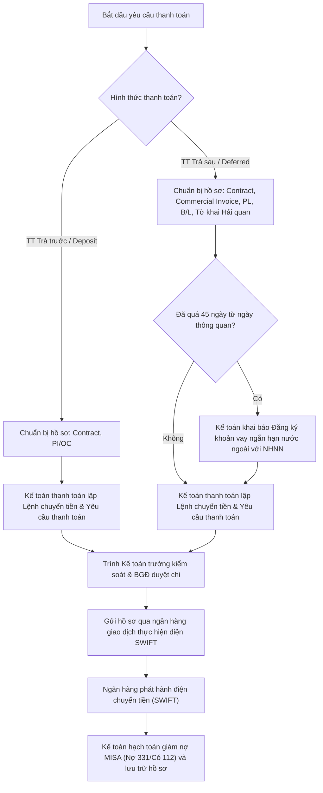

# 8.1 Thanh toán Quốc tế

## 1. Mục đích
- Quản lý thanh toán cho NCC quốc tế đúng hạn, đúng số, tối ưu tỷ giá.

## 2. Phương thức Thanh toán

| Phương thức | Mô tả | Khi nào dùng | Rủi ro |
|------------|-------|-------------|-------|
| **TT (Telegraphic Transfer)** | Chuyển khoản trực tiếp qua SWIFT | Phổ biến nhất | Trung bình |
| **LC (Letter of Credit)** | Thư tín dụng qua ngân hàng | Đơn lớn, NCC mới | Thấp nhất |
| **Open Account** | Giao hàng trước, TT sau | NCC rất tin tưởng | Cao (cho NCC) |

## 3. Hình thức và Quy trình TT (Phổ biến)

Thanh toán điện chuyển tiền bằng ngoại tệ (TT - Telegraphic Transfer) qua hệ thống ngân hàng được phân chia thành hai hình thức chính tùy theo thỏa thuận trên hợp đồng:

### 3.1 TT Trả trước (TT in Advance)
- **Mô tả**: Lyscellar thực hiện chuyển khoản thanh toán trước cho Nhà cung cấp nước ngoài (đặt cọc một phần hoặc thanh toán 100% trị giá đơn hàng) để NCC tiến hành sản xuất, đóng gói và chuẩn bị giao hàng.
- **Tài liệu cần**: Lệnh chuyển tiền + Hợp đồng ngoại thương (Sales Contract) + Proforma Invoice (PI) hoặc Xác nhận đơn hàng (Order Confirmation - OC).
- **Quy trình thực hiện**: Xem chi tiết tại [QT 3.3](../03_mua_hang/3.3_xac_nhan_don_hang.md).

### 3.2 TT Trả sau (TT Deferred)
- **Mô tả**: Lyscellar thực hiện chuyển khoản thanh toán cho Nhà cung cấp nước ngoài sau khi nhận hàng hoặc sau khi hoàn tất thủ tục thông quan tại Việt Nam (theo số ngày quy định trong Hợp đồng/Invoice).
- **Tài liệu cần**: Lệnh chuyển tiền + Hợp đồng ngoại thương (Sales Contract) + Commercial Invoice + Packing List + Bill of Lading (B/L) + Tờ khai hải quan thông quan (+ Bảng kê hóa đơn nếu có nhiều hóa đơn).
- **Quy trình thực hiện**: Xem chi tiết tại [QT 3.4](../03_mua_hang/3.4_theo_doi_tien_do.md).

### 3.3 Sơ đồ quy trình thanh toán và báo cáo NHNN

> [!IMPORTANT]
> **Yêu cầu đối với bộ thanh toán có nhiều hóa đơn:**
> Đối với các bộ hồ sơ thanh toán quốc tế đi kèm nhiều hóa đơn (invoices), bắt buộc phải có **bảng kê hóa đơn** (bản nộp cùng tờ khai thông quan) đi kèm trong bộ chứng từ nộp ngân hàng và lưu trữ hồ sơ thanh toán.

## 4. Quy trình về Bộ Chứng từ Thanh toán Quốc tế

Tùy thuộc vào hình thức thanh toán được quy định trên hợp đồng ngoại thương (TT Trả trước hay TT Trả sau), bộ phận Kế toán cần chuẩn bị và kiểm tra đầy đủ bộ chứng từ thanh toán nộp cho ngân hàng giao dịch:

### 4.1 Bộ chứng từ thanh toán TT Trả trước (TT in Advance)
Áp dụng khi chuyển tiền đặt cọc hoặc thanh toán trước cho NCC nước ngoài trước khi giao hàng. Hồ sơ nộp ngân hàng gồm:
1. **Lệnh chuyển tiền** (theo mẫu của ngân hàng giao dịch, ký đóng dấu đầy đủ).
2. **Hợp đồng ngoại thương (Sales Contract)**: Bản sao y đóng dấu treo (phải thể hiện rõ điều khoản thanh toán trả trước và thông tin tài khoản ngân hàng của người thụ hưởng).
3. **Hóa đơn tạm tính (Proforma Invoice - PI)** hoặc **Xác nhận đơn hàng (Order Confirmation - OC)** do Nhà cung cấp phát hành (bản sao y).

### 4.2 Bộ chứng từ thanh toán TT Trả sau (TT Deferred)
Áp dụng khi thanh toán phần còn lại hoặc thanh toán 100% giá trị đơn hàng sau khi hàng đã được ship hoặc sau khi thông quan. Hồ sơ nộp ngân hàng gồm:
1. **Lệnh chuyển tiền** (theo mẫu của ngân hàng).
2. **Hợp đồng ngoại thương (Sales Contract)**: Bản sao y.
3. **Hóa đơn thương mại chính thức (Commercial Invoice)**: Bản sao y.
4. **Phiếu đóng gói (Packing List)**: Bản sao y.
5. **Vận đơn đường biển (Bill of Lading - B/L)**: Bản sao y (phải khớp thông tin người gửi, người nhận, số container, số seal).
6. **Tờ khai hải quan thông quan**: Bản in từ hệ thống VNACCS (đã được thông quan/giải phóng hàng).
7. **Bảng kê hóa đơn (Invoice List)**: Bản nộp kèm tờ khai thông quan (bắt buộc khi bộ hồ sơ thanh toán có từ 2 hóa đơn trở lên).
8. **Bằng chứng đã thanh toán trả trước/đặt cọc** (điện chuyển tiền SWIFT trước đó nếu có).
9. **Ảnh chụp màn hình báo cáo đăng ký khoản vay ngắn hạn trên hệ thống Ngân hàng Nhà nước (NHNN)**: Chỉ áp dụng bắt buộc đối với các lô hàng trả sau mà sau 45 ngày kể từ ngày thông quan vẫn chưa thanh toán cho NCC (khoản nợ được coi là một khoản vay ngắn hạn nước ngoài).

### 4.3 Quy định Báo cáo Khoản vay ngắn hạn với Ngân hàng Nhà nước (NHNN)
Đối với các lô hàng nhập khẩu theo hình thức TT Trả sau:
- **Thời hạn làm báo cáo**: Kế toán chỉ thực hiện khai báo báo cáo vay trên cổng thông tin của NHNN khi:
  1. Lô hàng đã có **tờ khai hải quan thông quan**.
  2. Đã quá **45 ngày** kể từ ngày thông quan hải quan nhưng công ty chưa thanh toán tiền cho Nhà cung cấp nước ngoài.
- **Yêu cầu khi thanh toán**: Khi nộp hồ sơ thanh toán cho ngân hàng đối với các lô hàng trả chậm thuộc diện trên, Kế toán bắt buộc phải đính kèm **ảnh chụp màn hình báo cáo đăng ký khoản vay** đã khai báo thành công trên hệ thống của NHNN.

### 4.4 Quy tắc kiểm tra bộ chứng từ (Compliance & Audit)
Trước khi gửi hồ sơ cho ngân hàng, kế toán cần đối chiếu chéo các thông tin sau:
- **Tên và Địa chỉ thụ hưởng**: Phải trùng khớp 100% giữa Hợp đồng, Invoice và Lệnh chuyển tiền.
- **Thông tin tài khoản ngân hàng (SWIFT Code, IBAN, Số tài khoản)**: Phải khớp chính xác với thông tin được ghi trên Hợp đồng hoặc Invoice. Trường hợp NCC thay đổi tài khoản, phải có thông báo chính thức có chữ ký xác nhận của đại diện NCC (hoếp thông báo phụ lục hợp đồng).
- **Số tiền thanh toán**: Đúng theo tỷ lệ quy định trong hợp đồng và số tiền trên hóa đơn thương mại.
- **Mã HS & Tên hàng hóa**: Khớp đúng với tờ khai hải quan.

### 4.5 Ma trận phân quyền (RACI) nghiệp vụ thanh toán quốc tế
| Nhiệm vụ / Vị trí | Kế toán thanh toán | Kế toán trưởng | Ban Giám Đốc | Nhân viên XNK | Ngân hàng giao dịch |
| :--- | :---: | :---: | :---: | :---: | :---: |
| Lập yêu cầu & chuẩn bị hồ sơ thanh toán | **R** | — | — | **C** | — |
| Kiểm soát chéo hồ sơ thanh toán | — | **R** | — | — | — |
| Phê duyệt lệnh chuyển tiền / duyệt chi | — | — | **A** | — | — |
| Khai báo đăng ký khoản vay với NHNN | **R** | **C** | **A** | — | — |
| Thực hiện giao dịch & phát hành điện SWIFT | — | — | — | — | **R** |
| Hạch toán trên MISA & lưu trữ chứng từ | **R** | **I** | — | — | — |

## 5. Quản lý Tỷ giá

| Hành động | Khi nào |
|-----------|--------|
| Theo dõi tỷ giá EUR, USD hàng ngày | Hàng ngày |
| Mua ngoại tệ sớm nếu tỷ giá tốt | Khi cần TT trong 1-2 tuần |
| Forward contract (nếu đủ điều kiện) | Đơn hàng lớn > 50K EUR |

## 6. Biểu mẫu
- 📥 **Form 8.1-A:** Sử dụng [Form 3.3-A Yêu cầu Thanh toán](../../../sources/Forms/Form_3.3-A_Yeu_cau_Thanh_toan.xlsx)

## 7. KPI

| KPI | Mục tiêu |
|-----|---------|
| Thanh toán đúng hạn | 100% |
| Chênh lệch tỷ giá vs dự toán | ≤ 3% |
| Phí ngân hàng / lô | ≤ $50 |

## 8. Tài liệu Liên quan
- ↔ Liên quan: [3.3 Xác nhận & Deposit](../03_mua_hang/3.3_xac_nhan_don_hang.md) | [8.3 Công nợ Phải trả](8.3_cong_no_phai_tra.md)
