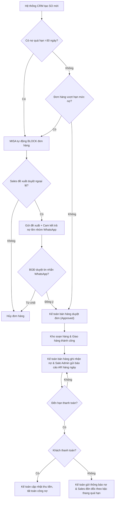

# 8.2 Quản lý Công nợ Phải thu (AR)

## 1. Mục đích
- Theo dõi tiền KH nợ, đôn đốc thu tiền đúng hạn, giảm nợ xấu.

## 2. Chính sách Công nợ
- **Trách nhiệm của Sales:** Nhân viên Sales đề xuất hạn mức công nợ phải tự chịu trách nhiệm về tính xác thực của hồ sơ đề xuất và có trách nhiệm trực tiếp trong việc đôn đốc đòi nợ, thu hồi toàn bộ công nợ quá hạn từ khách hàng đó.

| Hạng KH | Hạn CN | Hạn mức CN | Điều kiện |
|---------|--------|-----------|----------|
| 🥇 VIP | 30 ngày | 50 triệu | Mua > 6 tháng, không nợ quá hạn |
| 🥈 Gold | 15 ngày | 30 triệu | Mua > 3 tháng |
| 🥉 Regular | COD / CK trước | 0 | Mới hoặc chưa đủ uy tín |
| ⚠️ Nợ xấu | DỪNG cấp CN | 0 | Nợ quá hạn > 30 ngày |

## 3. Quy trình Quản lý

### Bước 1: Ghi nhận Công nợ (Sau mỗi đơn hàng)
1. Kế toán ghi nhận: Mã KH, Số HĐ, Ngày bán, Giá trị, Hạn thanh toán
2. Cập nhật **Sổ Công nợ** (Form 8.2-A)

### Bước 1b: Báo cáo Công nợ Hàng ngày (Sale Admin) - Sử dụng Form 8.2-C
1. Hàng ngày, Sale Admin tổng hợp số liệu công nợ phải thu phát sinh mới và nợ quá hạn từ hệ thống CRM và kế toán.
2. Cập nhật thông tin vào **Báo cáo Công nợ Hàng ngày** (Form 8.2-C).
3. Gửi báo cáo cho đội ngũ Sales và Ban Giám Đốc trước **17:30** hàng ngày qua Zalo/WhatsApp hoặc Email.

### Bước 2: Theo dõi & Đôn đốc
| Thời điểm | Hành động | Ai |
|-----------|----------|---|
| T-3 ngày trước hạn | Nhắc KH (Zalo/SMS) | Sales |
| Đúng hạn | Kiểm tra đã TT chưa? | Kế toán |
| Quá hạn 1-7 ngày | Gọi điện nhắc | Sales |
| Quá hạn 7-15 ngày | Gọi + Gửi thông báo chính thức | Sales + Kế toán |
| Quá hạn 15-30 ngày | BGĐ can thiệp, DỪNG cấp hàng | BGĐ |
| Quá hạn > 30 ngày | Gửi văn bản đòi nợ | BGĐ |

*   **Quy trình duyệt ngoại lệ giao hàng khi vượt hạn mức hoặc có nợ quá hạn:** 
    1. Nhân viên Sales lập Phiếu yêu cầu duyệt ngoại lệ, trong đó ghi rõ lý do và cam kết ngày thanh toán cụ thể từ khách hàng.
    2. Sales gửi phiếu yêu cầu này vào nhóm WhatsApp duyệt đơn của công ty.
    3. Ban Giám Đốc (BGĐ) xem xét và phê duyệt trực tiếp bằng tin nhắn trên nhóm WhatsApp.
    4. Sau khi nhận được tin nhắn phê duyệt từ BGĐ trên WhatsApp, Kế toán bán hàng tiến hành thao tác duyệt đơn hàng trên hệ thống để chuyển tiếp sang bộ phận Kho soạn hàng.

### Bước 3: Sơ đồ quy trình quản lý và thu hồi công nợ

### Bước 4: Ma trận phân quyền (RACI) quản lý công nợ AR
| Nhiệm vụ / Vị trí | Nhân viên Sales | Sale Admin | Kế toán bán hàng | Kế toán trưởng | Ban Giám Đốc |
| :--- | :---: | :---: | :---: | :---: | :---: |
| Đề xuất hạn mức công nợ khách hàng | **R** | — | **C** | **C** | **A** |
| Ghi nhận hóa đơn & nợ phải thu trên MISA | — | — | **R** | **I** | — |
| Gửi báo cáo công nợ hàng ngày trước 17:30 | — | **R** | — | **I** | **I** |
| Nhắc nợ & đôn đốc thu hồi nợ quá hạn | **R** | — | **C** | — | — |
| Phê duyệt đơn ngoại lệ (SO bị block) | **C** | — | **I** | — | **A** |
| Gửi thông báo đòi nợ chính thức (>15 ngày) | **C** | — | **R** | **R** | **A** |

### Bước 5: Đối soát Cuối tháng
1. In **Bảng tổng hợp Công nợ** — gửi Sales review
2. Đối soát: Tổng CN = Tổng bán - Tổng đã thu?
3. KH nào quá hạn? → Lập kế hoạch thu

## 4. Biểu mẫu
- 📥 **Form 8.2-A:** [So_Cong_no_Phai_thu.xlsx](../../../sources/Forms/Form_8.2-A_Cong_no_Phai_thu.xlsx)
- 📥 **Form 8.2-C:** [Bao_cao_Cong_no_Hang_ngay.xlsx](../../../sources/Forms/Form_8.2-C_Bao_cao_Cong_no_Hang_ngay.xlsx)

## 5. KPI

| KPI | Mục tiêu |
|-----|---------|
| DSO (Days Sales Outstanding) | ≤ 20 ngày |
| Tỷ lệ nợ quá hạn | ≤ 5% |
| Nợ xấu (> 60 ngày) | = 0 |

## 6. Tài liệu Liên quan
- ↔ Liên quan: [6.3 Đơn hàng](../06_ban_hang/6.3_xu_ly_don_hang.md) | [6.2 CRM](../06_ban_hang/6.2_crm.md)
