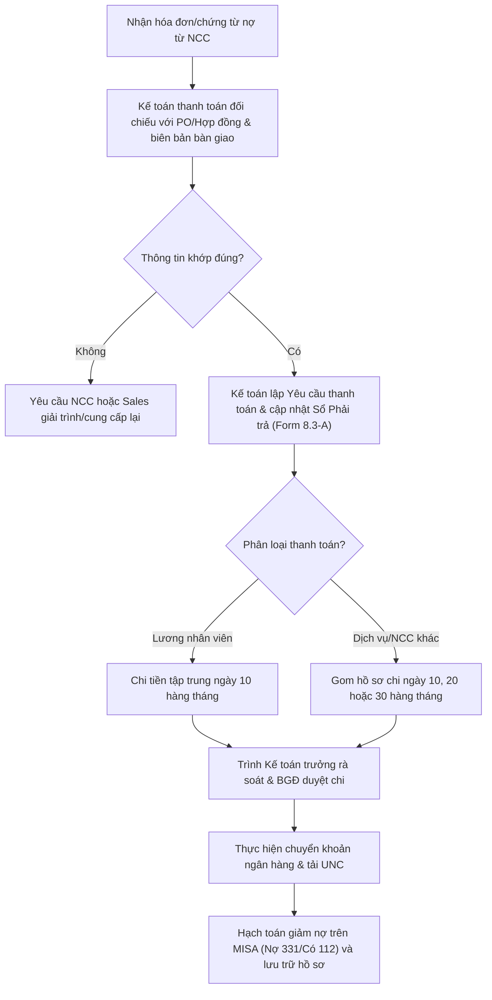

# 8.3 Quản lý Công nợ Phải trả (AP)

## 1. Mục đích
- Theo dõi tiền nợ NCC, thanh toán đúng hạn, duy trì uy tín với NCC.

## 2. Danh mục Phải trả

| Loại | Đối tượng | Hạn TT | Ghi chú |
|------|----------|--------|--------|
| NCC Quốc tế | NCC rượu | Theo HĐ (TT Trả trước/Trả sau) | Chuyển khoản QT |
| Đại lý HQ | Công ty HQ | 7-15 ngày | Chuyển khoản |
| Forwarder | Công ty vận tải | 7-30 ngày | Chuyển khoản |
| Nhà in (nhãn, catalog) | Nhà in | COD hoặc 15 ngày | CK |
| Thuế | Cơ quan thuế | Theo tờ khai | Nộp online |

## 3. Quy trình

### 3.1 Quy trình thực hiện thanh toán
1. Nhận hóa đơn/Invoice từ NCC/Nhà cung cấp dịch vụ.
2. Kiểm tra đối chiếu: Đúng PO? Đúng giá? Đã nhận hàng/dịch vụ đầy đủ?
3. Ghi nhận công nợ vào **Sổ Phải trả** (Form 8.3-A).
4. Lên lịch thanh toán định kỳ:
   - **Thanh toán lương nhân viên**: Thực hiện vào ngày **10 hàng tháng** (R) dựa trên bảng lương đã được phê duyệt.
   - **Thanh toán công nợ các bên (logistics, hải quan, nhà in, NCC dịch vụ...)**: Lập hồ sơ thanh toán định kỳ vào các ngày **10, 20, và 30 hàng tháng** (R).
5. Trình Ban Giám đốc phê duyệt hồ sơ và lịch thanh toán.
6. Thực hiện chuyển tiền thanh toán (TT) qua ngân hàng và ghi nhận trạng thái đã thanh toán.

### 3.2 Sơ đồ quy trình thanh toán AP

### 3.3 Ma trận phân quyền (RACI) quản lý công nợ AP
| Nhiệm vụ / Vị trí | Kế toán thanh toán | Kế toán trưởng | Ban Giám Đốc | Bộ phận mua hàng/XNK | Thủ kho / Showroom |
| :--- | :---: | :---: | :---: | :---: | :---: |
| Nhận chứng từ & đối chiếu kiểm soát chéo | **R** | — | — | **C** | **C** |
| Ghi nhận công nợ (AP) trên MISA | **R** | **I** | — | — | — |
| Phê duyệt lịch thanh toán (10-20-30) | — | **C** | **A** | — | — |
| Thực hiện lệnh chuyển tiền ngân hàng | **R** | — | — | — | — |
| Hạch toán chi & lưu trữ UNC | **R** | **I** | — | — | — |

## 4. Biểu mẫu
- 📥 **Form 8.3-A:** [So_Cong_no_Phai_tra.xlsx](../../../sources/Forms/Form_8.3-A_Cong_no_Phai_tra.xlsx)

## 5. KPI

| KPI | Mục tiêu |
|-----|---------|
| Thanh toán đúng hạn | 100% |
| Nợ quá hạn NCC | = 0 |

## 6. Tài liệu Liên quan
- ↔ Liên quan: [8.1 TT Quốc tế](8.1_thanh_toan_quoc_te.md) | [3.3 Xác nhận & Deposit](../03_mua_hang/3.3_xac_nhan_don_hang.md)
