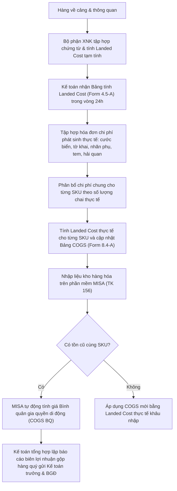

# 8.4 Tính Giá vốn Hàng bán (COGS)

## 1. Mục đích
- Tính chính xác giá vốn cho mỗi chai rượu, phục vụ định giá bán và báo cáo lợi nhuận.

## 2. Cấu trúc COGS
Xem chi tiết tại [QT 4.5 Landed Cost](../04_nhap_khau_logistics/4.5_thue_chi_phi.md)

```
COGS / chai = Landed Cost / chai
            = (Giá FOB + Cước + BH + Thuế NK + TTĐB + GTGT
               + Phí HQ + VC nội địa + Tem + Nhãn + KN) / SL chai
```

## 3. Quy trình Cập nhật COGS

### 3.1 Quy trình thực hiện
#### Bước 1: Tính COGS cho Lô mới (Sau mỗi lô nhập)
1. Thu thập tất cả chi phí thực tế cho lô hàng
2. Tính Landed Cost theo Form 4.5-A
3. Phân bổ chi phí chung (cước, HQ) theo SL chai mỗi SKU
4. Cập nhật COGS vào **Bảng COGS** (Form 8.4-A)

#### Bước 2: Tính COGS Bình quân (Weighted Average)
- Nếu cùng SKU nhập nhiều lô khác giá:
  ```
  COGS BQ = (Tồn cũ × COGS cũ + Nhập mới × COGS mới) / (Tồn cũ + Nhập mới)
  ```

#### Bước 3: Review Hàng quý
1. So sánh COGS vs Giá bán → Tính Margin thực tế
2. SKU nào margin < 25%? → Cần tăng giá hoặc giảm chi phí
3. Báo cáo BGĐ

### 3.2 Sơ đồ quy trình tính giá vốn


### 3.3 Ma trận phân quyền (RACI) tính giá vốn COGS
| Nhiệm vụ / Vị trí | Nhân viên XNK | Kế toán kho | Kế toán tổng hợp | Kế toán trưởng | Ban Giám Đốc |
| :--- | :---: | :---: | :---: | :---: | :---: |
| Lập bảng tính Landed Cost tạm tính (24h) | **R** | — | — | **I** | — |
| Thu thập hóa đơn chi phí liên quan | **C** | **R** | — | — | — |
| Phân bổ & tính Landed Cost thực tế | — | **R** | — | — | — |
| Hạch toán nhập kho trên phần mềm MISA | — | **R** | — | **I** | — |
| Lập báo cáo đối chiếu biên lợi nhuận gộp | — | — | **R** | **R** | **A** |

## 4. Biểu mẫu
- 📥 **Form 8.4-A:** [Bang_COGS.xlsx](../../../sources/Forms/Form_8.4-A_COGS.xlsx)
- 📥 Sử dụng kết hợp: [Form 4.5-A Landed Cost](../../../sources/Forms/Form_4.5-A_Landed_Cost.xlsx)

## 5. KPI

| KPI | Mục tiêu |
|-----|---------|
| Margin gộp TB | ≥ 35% |
| SKU có margin < 25% | ≤ 10% tổng SKU |
| COGS giảm YoY | ≥ 3% (nhờ FTA, tối ưu cước) |

## 6. Tài liệu Liên quan
- ← Liên quan: [4.5 Thuế & Landed Cost](../04_nhap_khau_logistics/4.5_thue_chi_phi.md)
- → Sau: [6.4 Chính sách Giá](../06_ban_hang/6.4_chinh_sach_gia.md)
