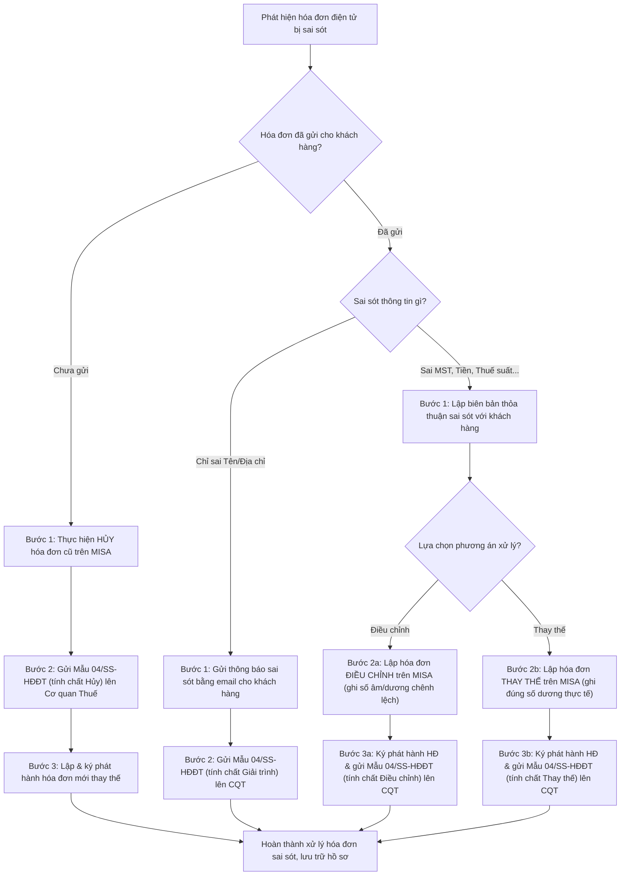

# 8.5.1 Quy trình Xử lý Hóa đơn Điện tử Sai sót

## 1. Mục đích & Phạm vi
- **Mục đích:** Hướng dẫn chi tiết các bước xử lý khi phát hiện hóa đơn điện tử (HĐĐT) đầu ra đã lập bị sai sót thông tin, đảm bảo tuân thủ Nghị định 123/2020/NĐ-CP và Thông tư 78/2021/TT-BTC, tránh bị xử phạt hành chính bởi cơ quan thuế.
- **Phạm vi áp dụng:** Bộ phận Kế toán (Kế toán bán hàng & Kế toán tổng hợp) tại Lyscellar.

## 2. Căn cứ Pháp lý
- **Nghị định số 123/2020/NĐ-CP:** Điều 19 quy định về xử lý hóa đơn điện tử đã lập có sai sót.
- **Thông tư số 78/2021/TT-BTC:** Điều 7 hướng dẫn xử lý hóa đơn điện tử, bảng tổng hợp dữ liệu hóa đơn điện tử đã gửi cơ quan thuế có sai sót.

## 3. Các trường hợp và Quy trình Xử lý Chi tiết

### Trường hợp 1: Chỉ sai tên, địa chỉ người mua (Không sai MST, Tiền, Thuế suất...)
*Áp dụng khi hóa đơn đã gửi cho khách hàng.*
1. **Bước 1 (Thông báo cho khách hàng):** Kế toán gửi thông báo bằng văn bản hoặc email cho khách hàng về việc sai sót thông tin tên, địa chỉ và không cần lập lại hóa đơn mới.
2. **Bước 2 (Gửi mẫu 04/SS-HĐĐT):** Kế toán lập Thông báo hóa đơn điện tử có sai sót theo **Mẫu số 04/SS-HĐĐT** gửi cơ quan thuế trực tiếp quản lý.
3. **Lưu ý:** Không cần lập hóa đơn điều chỉnh hoặc hóa đơn thay thế cho trường hợp này.

### Trường hợp 2: Sai Mã số thuế, Số tiền, Thuế suất, Tiền thuế hoặc Quy cách hàng hóa
*Áp dụng khi hóa đơn đã gửi cho khách hàng. Kế toán được lựa chọn 1 trong 2 phương án sau:*

#### Phương án A: Lập hóa đơn điện tử ĐIỀU CHỈNH
1. **Bước 1 (Thỏa thuận):** Kế toán và khách hàng lập biên bản thỏa thuận ghi rõ sai sót (không bắt buộc nhưng nên có để đối chiếu).
2. **Bước 2 (Lập hóa đơn điều chỉnh trên MISA):**
   - Chọn hóa đơn gốc bị sai sót, chọn chức năng **Lập hóa đơn điều chỉnh**.
   - Hóa đơn điều chỉnh phải có dòng chữ: *"Điều chỉnh cho hóa đơn Mẫu số... Ký hiệu... Số... Ngày... Tháng... Năm..."*.
   - **Cách ghi giá trị:** Nếu điều chỉnh tăng thì ghi số dương, nếu điều chỉnh giảm thì ghi số âm (bao gồm đơn giá, thành tiền, thuế suất, tiền thuế).
3. **Bước 3 (Ký số & Phát hành):** BGĐ ký số hóa đơn điều chỉnh và hệ thống gửi cho khách hàng cùng cơ quan thuế.
4. **Bước 4 (Nộp mẫu 04/SS-HĐĐT):** Lập và nộp Mẫu 04/SS-HĐĐT gửi cơ quan thuế.

#### Phương án B: Lập hóa đơn điện tử THAY THẾ
1. **Bước 1 (Thỏa thuận):** Kế toán và khách hàng lập biên bản thỏa thuận về việc thay thế hóa đơn.
2. **Bước 2 (Lập hóa đơn thay thế trên MISA):**
   - Chọn hóa đơn gốc bị sai sót, chọn chức năng **Lập hóa đơn thay thế**.
   - Hóa đơn thay thế phải có dòng chữ: *"Thay thế cho hóa đơn Mẫu số... Ký hiệu... Số... Ngày... Tháng... Năm..."*.
   - Kế toán nhập lại toàn bộ thông tin đúng của đơn hàng (giá trị dương).
3. **Bước 3 (Ký số & Phát hành):** BGĐ ký số hóa đơn thay thế và gửi cho khách hàng cùng cơ quan thuế.
4. **Bước 4 (Nộp mẫu 04/SS-HĐĐT):** Lập và nộp Mẫu 04/SS-HĐĐT gửi cơ quan thuế.

### Trường hợp 3: Hóa đơn chưa gửi cho người mua nhưng phát hiện sai sót
1. **Bước 1 (Hủy hóa đơn):** Kế toán thực hiện thao tác **Hủy hóa đơn** đã lập trên phần mềm MISA.
2. **Bước 2 (Nộp mẫu 04/SS-HĐĐT):** Lập và nộp Mẫu 04/SS-HĐĐT gửi cơ quan thuế trong ngày thực hiện hủy hóa đơn.
3. **Bước 3 (Lập hóa đơn mới):** Kế toán lập hóa đơn mới, ký số và gửi cho người mua.

### 3.4 Sơ đồ xử lý sai sót hóa đơn

### 3.5 Ma trận phân quyền (RACI) xử lý hóa đơn sai sót
| Nhiệm vụ / Vị trí | Kế toán bán hàng | Kế toán tổng hợp | Kế toán trưởng | Ban Giám Đốc | Khách hàng |
| :--- | :---: | :---: | :---: | :---: | :---: |
| Phát hiện sai sót & kiểm tra thông tin đúng | **R** | **C** | — | — | **C** |
| Ký biên bản thỏa thuận sai sót hóa đơn | **R** | — | — | **A** | **R** |
| Lập hóa đơn điều chỉnh / thay thế trên MISA | **R** | — | **I** | — | — |
| Lập và nộp Mẫu 04/SS-HĐĐT lên CQT | **R** | **R** | **C** | — | — |
| Ký số phát hành hóa đơn điều chỉnh/thay thế | — | — | — | **A** | — |
| Đối soát trạng thái phê duyệt của CQT | **R** | **I** | — | — | — |

## 4. Hướng dẫn nộp Mẫu số 04/SS-HĐĐT trên phần mềm kế toán MISA
Kế toán thực hiện gửi Mẫu 04/SS-HĐĐT theo các bước sau để tránh trễ hạn:
1. Vào phân hệ **Quản lý hóa đơn** → Chọn tab **Thông báo sai sót (04/SS-HĐĐT)**.
2. Nhấn **Thêm mới** → Chọn hóa đơn bị sai sót từ danh sách.
3. Chọn **Tính chất sai sót** tương ứng:
   - *Hủy:* Đối với trường hợp hủy hóa đơn chưa gửi người mua hoặc giải trình sai sót.
   - *Điều chỉnh:* Đối với hóa đơn điều chỉnh.
   - *Thay thế:* Đối với hóa đơn thay thế.
   - *Giải trình:* Đối với trường hợp sai tên, địa chỉ.
4. Nhập nội dung mô tả chi tiết lý do sai sót (ví dụ: *"Viết sai mã số thuế khách hàng"*, *"Áp sai thuế suất sản phẩm rượu không cồn"*).
5. Ký điện tử và gửi thông báo lên cơ quan thuế trực tiếp từ phần mềm MISA.
6. **Kiểm tra trạng thái phản hồi:** Sau 1-2 tiếng, kiểm tra xem cơ quan thuế có chấp nhận thông báo sai sót hay không (Trạng thái: *CQT đã chấp nhận*).

## 5. Lưu ý Đặc biệt đối với sản phẩm Rượu không cồn (VAT 8%)
- Đối với các sản phẩm **rượu không cồn**, nếu kế toán xuất nhầm hóa đơn ở thuế suất 10%, bắt buộc phải làm **Hóa đơn điều chỉnh/Thay thế** về thuế suất **8%** và gửi Mẫu 04/SS-HĐĐT giải trình với cơ quan thuế.
- Trường hợp ngược lại, nếu xuất rượu thông thường ở mức 8% thay vì 10%, đây là rủi ro trốn thuế/thiếu thuế lớn, phải làm hóa đơn điều chỉnh tăng thuế suất ngay khi phát hiện.

## 6. KPI & Kiểm soát
- **Thời hạn gửi Mẫu 04/SS-HĐĐT:** Phải gửi trước ngày cuối cùng của kỳ kê khai thuế GTGT phát sinh hóa đơn sai sót (hoặc gửi ngay trong ngày xử lý sai sót - khuyến nghị).
- **Tỷ lệ hóa đơn sai sót:** `< 2%` tổng lượng hóa đơn xuất trong tháng. Kế toán tổng hợp kiểm tra định kỳ vào ngày 28 hàng tháng.

---
- ← Quy trình cha: [8.5 Quản lý Thuế](8.5_quan_ly_thue.md)
- ↔ Liên quan: [8.2 Công nợ Phải thu](8.2_cong_no_phai_thu.md)
