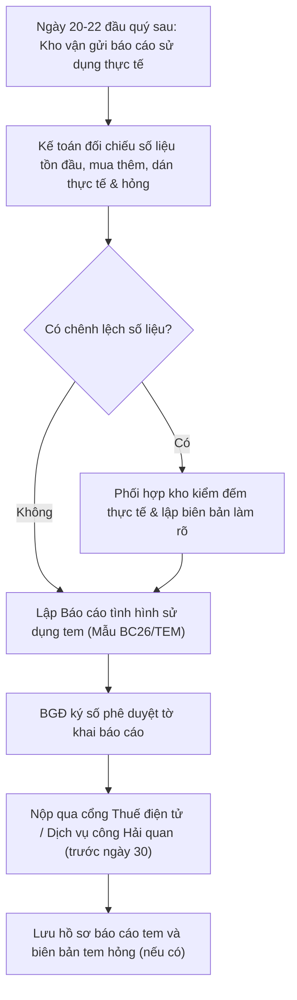

# 8.5.2 Báo cáo tình hình sử dụng Tem rượu Nhập khẩu

## 1. Mục đích & Phạm vi
- **Mục đích:** Hướng dẫn chi tiết các bước quản lý, đối chiếu và lập Báo cáo tình hình sử dụng Tem rượu Nhập khẩu định kỳ hàng quý cho cơ quan quản lý (Hải quan hoặc Thuế), đảm bảo tuân thủ nghiêm ngặt quy định pháp luật và tránh rủi ro bị phạt hành chính hoặc đình chỉ thông quan.
- **Phạm vi áp dụng:** Bộ phận Kế toán (kê khai báo cáo) và Bộ phận Kho vận (theo dõi và thực hiện dán tem thực tế).

## 2. Căn cứ Pháp lý
- **Thông tư số 23/2021/TT-BTC:** Quy định về việc in, phát hành, quản lý và sử dụng tem rượu nhập khẩu và tem thuốc lá nhập khẩu.
- **Nghị định số 105/2017/NĐ-CP:** Nghị định về kinh doanh rượu, yêu cầu rượu nhập khẩu lưu thông trên thị trường phải được dán tem đúng quy định.

## 3. Phân công Trách nhiệm

### 3.1 Phân công vai trò
| Bộ phận | Trách nhiệm cụ thể | Chứng từ / File bàn giao |
| :--- | :--- | :--- |
| **Kho vận (Warehouse)** | - Tiếp nhận tem từ kế toán, bảo quản trong kho mát. - Ghi nhận số lượng dán thực tế, dải seri dán theo từng lô. - Lập biên bản thu hồi tem hỏng, rách khâu dán tem. - Chốt tồn kho tem thực tế và bàn giao cho kế toán. | [Sổ Theo dõi Tem Rượu](../05_kho_van/5.2_dan_tem.md#L112) (Excel) Biên bản thu hồi xác tem hỏng. |
| **Kế toán (Finance)** | - Làm thủ tục mua tem tại cơ quan Thuế/Hải quan. - Theo dõi hóa đơn mua tem và thanh toán tiền mua tem. - Đối chiếu số liệu với kho vận và lập báo cáo sử dụng tem quý. - Thực hiện nộp báo cáo và lưu trữ hồ sơ thuế. | Báo cáo sử dụng tem hàng quý. Hồ sơ chứng từ mua tem. |

### 3.2 Ma trận phân quyền (RACI) quản lý tem rượu nhập khẩu
| Nhiệm vụ / Vị trí | Nhân viên Kho | Thủ kho | Kế toán kho | Kế toán tổng hợp | Kế toán trưởng | Ban Giám Đốc |
| :--- | :---: | :---: | :---: | :---: | :---: | :---: |
| Thực hiện mua tem tại CQT/Hải quan | — | — | — | **R** | **C** | **A** |
| Nhập kho, bảo quản & cấp phát tem | — | **R** | — | — | — | — |
| Thực hiện dán tem & theo dõi seri dải tem | **R** | **C** | — | — | — | — |
| Lập biên bản thu hồi xác tem hỏng | **R** | **R** | — | — | — | — |
| Chốt số tồn & đối chiếu tồn kho tem | — | **R** | **R** | **C** | — | — |
| Lập báo cáo sử dụng tem quý (BC26/TEM) | — | — | — | **R** | **C** | — |
| Ký số nộp báo cáo & tiêu hủy tem hỏng | — | — | — | — | **C** | **A** |

## 4. Quy trình Thực hiện hàng Quý

### Chi tiết các bước thực hiện:

#### Bước 1: Thu thập số liệu từ Kho vận (Ngày 20 đến 22 tháng đầu quý sau)
- Kế toán yêu cầu bộ phận Kho vận gửi file *Sổ theo dõi tem rượu nhập khẩu* và các biên bản tem hỏng phát sinh trong quý (nếu có).

#### Bước 2: Đối chiếu số liệu (Ngày 22 đến 25)
- Kế toán thực hiện công thức đối chiếu cân bằng tem:
  $$\text{Tồn cuối kỳ} = \text{Tồn đầu kỳ} + \text{Mua trong kỳ} - \text{Đã dán trong kỳ} - \text{Hỏng/Mất trong kỳ}$$
- So khớp dải số seri (từ số... đến số...) của lượng tem mua mới trong kỳ trên hóa đơn mua tem với số thực tế nhập kho.
- Kiểm tra danh sách seri tem đã dán lên các lô hàng đã thông quan và xuất kho trong quý.

#### Bước 3: Lập Báo cáo sử dụng tem (Ngày 25 đến 28)
- Kế toán lập báo cáo theo **Mẫu số BC26/TEM** (Báo cáo tình hình sử dụng tem rượu nhập khẩu) hoặc mẫu tương đương trên hệ thống kê khai thuế/hải quan.
- Các chỉ tiêu cần điền chính xác:
  1. Loại tem (Rượu nhập khẩu nồng độ ≥ 20° hoặc < 20°).
  2. Số lượng tồn đầu kỳ, số lượng mua trong kỳ (theo hóa đơn).
  3. Số lượng đã sử dụng (đã dán hoàn thành).
  4. Số lượng hỏng, mất trong kỳ (phải ghi rõ lý do).
  5. Số lượng tồn cuối kỳ (đối chiếu khớp với tồn kho thực tế của Kho vận).

#### Bước 4: Ký số và Nộp báo cáo (Trước ngày 30)
- Trình kế toán trưởng rà soát số liệu.
- Trình BGĐ ký số tờ khai báo cáo tem.
- Thực hiện nộp trực tuyến qua **Cổng thuế điện tử** (phân hệ Hóa đơn/Ấn chỉ) hoặc **Cổng thông tin Hải quan** tùy thuộc vào cơ quan cấp tem cho doanh nghiệp.

#### Bước 5: Lưu trữ hồ sơ
- In báo cáo đã nộp kèm thông báo xác nhận chấp nhận của cơ quan quản lý.
- Lưu bản cứng báo cáo cùng với hóa đơn mua tem và toàn bộ **Biên bản thu hồi xác tem hỏng** trong quý vào tủ hồ sơ kế toán thuế (lưu trữ tối thiểu 10 năm).

---

## 5. Quy định xử lý Tem hỏng, Tem rách và Tem bị mất

### 5.1 Đối với Tem hỏng, Tem rách trong quá trình dán:
1. **Thu hồi bắt buộc:** Công nhân dán tem tuyệt đối không được tự ý vứt bỏ tem hỏng, rách. Phải lột ra và dán lại xác tem hỏng lên một tờ giấy A4 trắng theo thứ tự.
2. **Lập biên bản:** Cuối mỗi lô dán tem hoặc cuối tháng, thủ kho lập *Biên bản ghi nhận tem hỏng* có chữ ký xác nhận của người trực tiếp dán tem và thủ kho.
3. **Tiêu hủy tem hỏng:** Định kỳ hàng quý hoặc hàng năm, doanh nghiệp thành lập hội đồng tiêu hủy tem hỏng và lập *Biên bản tiêu hủy tem hỏng* kèm theo bảng xác tem thu hồi để làm cơ sở giải trình khi cơ quan thuế quyết toán.

### 5.2 Đối với Tem bị mất (Do thiên tai, hỏa hoạn hoặc thất thoát):
1. **Báo cáo ngay lập tức:** Trong vòng **05 ngày làm việc** kể từ ngày phát hiện mất tem, doanh nghiệp phải lập thông báo mất tem (theo mẫu quy định) gửi cho cơ quan thuế/hải quan trực tiếp quản lý.
2. **Giải trình:** Ghi rõ số lượng mất, dải seri mất (từ số... đến số...) và nguyên nhân mất tem.
3. **Xử phạt hành chính:** Lưu ý việc làm mất tem rượu nhập khẩu sẽ bị xử phạt vi phạm hành chính về quản lý ấn chỉ thuế ở mức rất cao, đồng thời doanh nghiệp sẽ bị đưa vào danh sách kiểm tra trọng điểm về thuế.

---

## 6. KPI & Kiểm soát rủi ro
- **Hạn nộp báo cáo:** Ngày **30 của tháng đầu quý sau** (ví dụ: Q1 nộp trước 30/04, Q2 nộp trước 30/07...).
- **Chênh lệch tồn kho:** Tồn kho thực tế tại kho và tồn kho trên báo cáo thuế phải khớp nhau `100%`. Bất kỳ chênh lệch nào không giải trình được đều bị coi là vi phạm pháp luật thuế.

---
- ← Quy trình cha: [8.5 Quản lý Thuế](8.5_quan_ly_thue.md)
- ↔ Liên quan: [5.2 Dán Tem Rượu Nhập khẩu](../05_kho_van/5.2_dan_tem.md) | [7.4 Quản lý Tem & Nhãn phụ](../07_phap_ly/7.4_tem_nhan.md)
