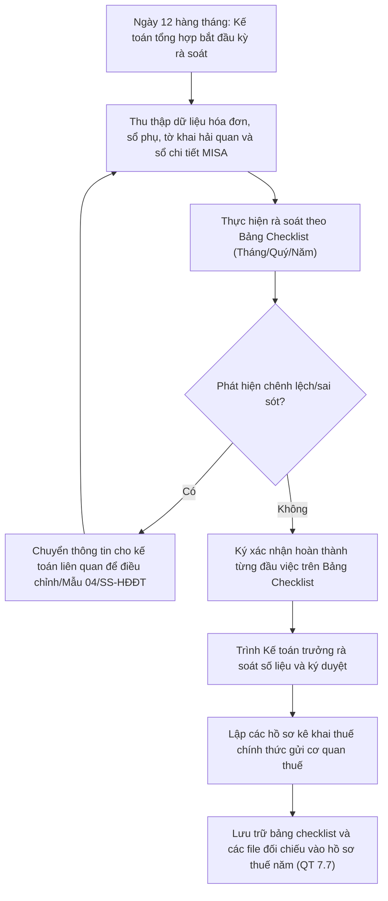

# 8.5.3 Checklist đối chiếu rà soát Thuế định kỳ

## 1. Mục đích
Nhằm kiểm soát rủi ro sai sót dữ liệu, đảm bảo số liệu kế toán và dữ liệu kê khai thuế đồng nhất `100%`, phục vụ công tác thanh tra quyết toán thuế và đạt mục tiêu KPI **"Phạt thuế = 0"**. Bảng checklist này quy định các đầu việc đối chiếu tự động và thủ công kế toán phải làm hàng tháng, hàng quý, và hàng năm.

### 1.1 Sơ đồ quy trình rà soát thuế

---

## 2. Checklist Rà soát hàng Tháng (Thực hiện từ ngày 12 đến 15 hàng tháng)

| # | Đầu việc rà soát | Công cụ / Nguồn dữ liệu | Kết quả cần đạt | Người thực hiện |
|---|------------------|-------------------------|-----------------|-----------------|
| 1 | **Đối chiếu hóa đơn bán ra (Đầu ra)** | Bảng kê hóa đơn đã phát hành trên MISA vs. Dữ liệu trên Cổng Tổng cục Thuế. | Không chênh lệch doanh thu và thuế GTGT đầu ra. Phát hiện kịp thời hóa đơn bị bỏ sót hoặc xuất trùng. | Kế toán bán hàng |
| 2 | **Đối chiếu hóa đơn mua vào (Đầu vào)** | Bảng kê hóa đơn mua vào trên MISA vs. Danh sách hóa đơn mua vào trên Cổng Tổng cục Thuế. | Đảm bảo 100% hóa đơn đầu vào hợp lệ đã được ghi nhận trên phần mềm. | Kế toán tổng hợp |
| 3 | **Tra cứu tình trạng Nhà cung cấp** | Kiểm tra trạng thái MST nhà cung cấp có hóa đơn đầu vào trong tháng trên website `tracuunnd.gdt.gov.vn`. | Phát hiện hóa đơn mua từ doanh nghiệp tạm ngưng hoạt động, bỏ trốn, giải thể để loại trừ chi phí và thuế GTGT được khấu trừ kịp thời. | Kế toán tổng hợp |
| 4 | **Tính toán & Khấu trừ thuế TTĐB** | Sổ chi tiết tài khoản 3332 (Thuế TTĐB) và chứng từ nộp thuế TTĐB khâu nhập khẩu. | Tính chính xác số thuế TTĐB đầu ra nội địa, khấu trừ số thuế TTĐB đã nộp ở khâu nhập khẩu tương ứng số lượng đã bán. Thực hiện bút toán khấu trừ trên MISA. | Kế toán tổng hợp |
| 5 | **Đối chiếu số dư Ngân hàng** | Sổ chi tiết TK 112 (Tiền gửi ngân hàng) vs. Sổ phụ ngân hàng. | Số dư tiền gửi ngân hàng trên phần mềm khớp 100% với sổ phụ đến ngày cuối tháng. | Kế toán thanh toán |

---

## 3. Checklist Rà soát hàng Quý (Thực hiện trước ngày 20 tháng đầu quý sau)

| # | Đầu việc rà soát | Công cụ / Nguồn dữ liệu | Kết quả cần đạt | Người thực hiện |
|---|------------------|-------------------------|-----------------|-----------------|
| 1 | **Đối chiếu thuế GTGT khâu Nhập khẩu** | Giấy nộp tiền vào NSNN khâu nhập khẩu vs. Sổ chi tiết TK 1331 (VAT đầu vào được khấu trừ). | Số thuế GTGT khâu nhập khẩu đã nộp thực tế khớp với số thuế ghi nhận được khấu trừ trên MISA. (Tránh khấu trừ khi chưa nộp tiền thuế GTGT nhập khẩu). | Kế toán tổng hợp |
| 2 | **Khớp doanh thu tờ khai VAT vs. P&L** | Doanh thu trên tờ khai thuế GTGT 3 tháng trong quý vs. Doanh thu trên Báo cáo Kết quả Kinh doanh (P&L) nội bộ quý. | Doanh thu khớp nhau. Nếu lệch do chênh lệch thời điểm (ghi nhận doanh thu kế toán vs. doanh thu xuất hóa đơn thuế), phải lập bảng giải trình chi tiết. | Kế toán tổng hợp |
| 3 | **Rà soát tờ khai thuế TNCN** | Bảng lương quý, danh sách CBCNV phát sinh thu nhập chịu thuế, hồ sơ giảm trừ gia cảnh. | Tính đúng số thuế TNCN phải khấu trừ của từng lao động (hợp đồng dài hạn tính theo biểu lũy tiến từng phần, thời vụ tính 10%). | Kế toán lương |
| 4 | **Đối chiếu & Báo cáo Tem rượu** | Tồn kho tem tại kho (Thủ kho) vs. Sổ mua tem tại Cục Thuế. | Đối chiếu khớp 100% lượng tem đầu kỳ, tem mua trong kỳ, tem đã dán, tem hỏng và tồn cuối kỳ. Lập và nộp Mẫu BC26/TEM đúng hạn. | Kế toán tổng hợp |
| 5 | **Kê khai thuế Nhà thầu (FCT)** | Sổ chi tiết TK 33382 (Thuế nhà thầu) và các giao dịch chuyển tiền ra nước ngoài cho Google, Facebook, hãng tàu ngoại... | Kiểm tra xem đã trích lập và nộp thay thuế nhà thầu đối với các khoản thanh toán dịch vụ quốc tế hay chưa. | Kế toán tổng hợp |

---

## 4. Checklist Quyết toán hàng Năm (Thực hiện từ ngày 01/03 đến 15/03 năm sau)

| # | Đầu việc rà soát | Công cụ / Nguồn dữ liệu | Kết quả cần đạt | Người thực hiện |
|---|------------------|-------------------------|-----------------|-----------------|
| 1 | **Khớp doanh thu năm** | Tổng doanh thu tờ khai VAT 4 quý vs. Doanh thu trên Báo cáo tài chính năm. | Số liệu trùng khớp hoàn toàn. Nếu có chênh lệch, phải có bảng đối chiếu giải trình chi tiết cho cơ quan thuế khi thanh tra. | Kế toán tổng hợp |
| 2 | **Rà soát chi phí không được trừ** | Sổ chi tiết các tài khoản chi phí (TK 642, 641, 632) và hóa đơn chứng từ đính kèm. | Xác định và bóc tách các chi phí không được trừ khi tính thuế TNDN (quá hạn mức tiếp khách, tiền phạt hành chính, chi phí tiền lương thiếu hợp đồng/bảng lương ký nhận...). Điền vào chỉ tiêu B4 trên tờ khai quyết toán thuế TNDN. | Kế toán tổng hợp |
| 3 | **Quyết toán thuế TNCN năm** | Tổng hợp thu nhập chịu thuế cả năm của toàn bộ nhân viên, giấy ủy quyền quyết toán thay. | Tính toán chính xác số thuế TNCN phải nộp thêm hoặc hoàn thuế của từng nhân viên. Xuất tờ khai quyết toán năm (Mẫu 05/QTT-TNCN). | Kế toán tổng hợp |
| 4 | **Trích lập & Hoàn nhập dự phòng** | Báo cáo tuổi nợ phải thu, biên bản đối chiếu công nợ cuối năm, biên bản kiểm kê hàng tồn kho. | Thực hiện trích lập dự phòng nợ phải thu khó đòi và dự phòng giảm giá hàng tồn kho theo đúng quy định để tối ưu hóa chi phí chịu thuế hợp lệ. | Kế toán tổng hợp |

---

## 5. Quy trình Kiểm soát và Phê duyệt

### 5.1 Các bước thực hiện
1. Kế toán tổng hợp in bảng checklist này vào cuối mỗi kỳ rà soát, thực hiện tích chọn và ký xác nhận cho từng đầu việc.
2. Trình Kế toán trưởng kiểm tra chéo dữ liệu đối chiếu và ký phê duyệt.
3. Toàn bộ bảng đối chiếu số liệu (Excel) và bảng checklist đã ký được lưu chung vào thư mục lưu trữ hồ sơ thuế định kỳ của năm tài chính để làm căn cứ giải trình số liệu sau này.

### 5.2 Ma trận phân quyền (RACI) rà soát thuế định kỳ
| Nhiệm vụ / Vị trí | Kế toán bán hàng | Kế toán thanh toán | Kế toán tổng hợp | Kế toán trưởng | Ban Giám Đốc |
| :--- | :---: | :---: | :---: | :---: | :---: |
| Đối chiếu hóa đơn bán ra (Đầu ra) vs GDT | **R** | — | **C** | **I** | — |
| Đối chiếu hóa đơn mua vào (Đầu vào) vs GDT | — | — | **R** | **I** | — |
| Đối chiếu số dư tài khoản ngân hàng vs Sổ phụ | — | **R** | **I** | — | — |
| Khấu trừ thuế TTĐB & đối chiếu thuế nhập khẩu | — | — | **R** | **C** | — |
| Phê duyệt bảng rà soát thuế & ký checklist | — | — | **C** | **R** | **A** |
| Giải trình số liệu khi thanh kiểm tra thuế | — | — | **R** | **R** | **A** |

---
- ← Quy trình cha: [8.5 Quản lý Thuế](8.5_quan_ly_thue.md)
- 📊 Tài liệu liên quan: [8.7 Báo cáo Tài chính](8.7_bao_cao_tai_chinh.md)
